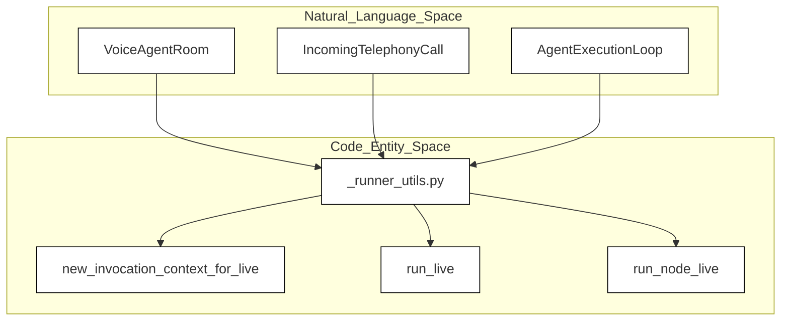
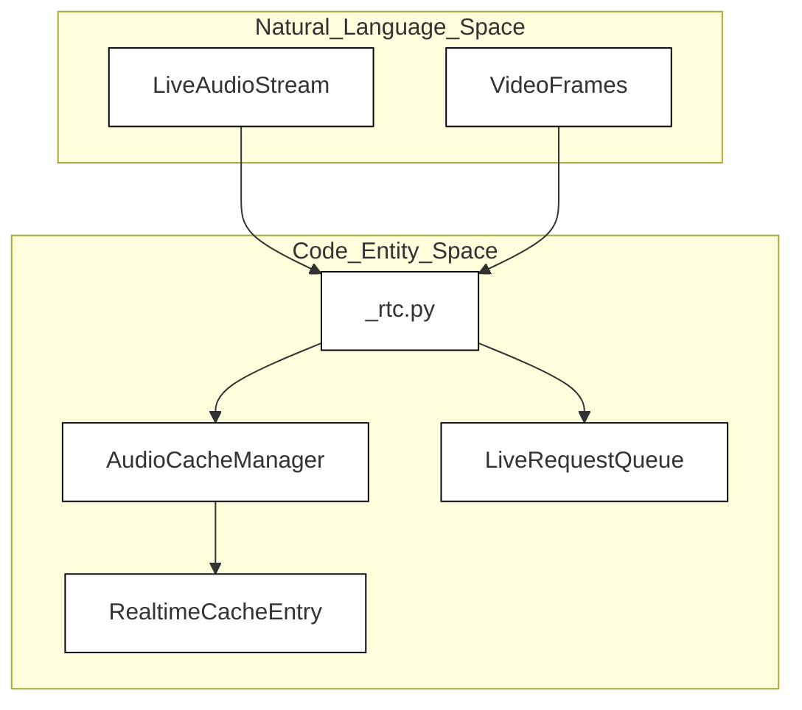

<!-- source: DeepWiki mcp.deepwiki.com · repo google/adk-python · page 12.14 LiveKit Voice and Telephony · fetched 2026-10-29 -->

# LiveKit Voice and Telephony

Relevant source files

The following files were used as context for generating this wiki page:

- [src/google/adk/cli/utils/envs.py](src/google/adk/cli/utils/envs.py)
- [src/google/adk/flows/llm_flows/audio_cache_manager.py](src/google/adk/flows/llm_flows/audio_cache_manager.py)
- [src/google/adk/flows/llm_flows/audio_transcriber.py](src/google/adk/flows/llm_flows/audio_transcriber.py)
- [src/google/adk/flows/llm_flows/transcription_manager.py](src/google/adk/flows/llm_flows/transcription_manager.py)
- [src/google/adk/live/_audio_transcriber.py](src/google/adk/live/_audio_transcriber.py)
- [src/google/adk/live/_runner_utils.py](src/google/adk/live/_runner_utils.py)
- [src/google/adk/live/_transcription_manager.py](src/google/adk/live/_transcription_manager.py)
- [src/google/adk/live/live_request_queue.py](src/google/adk/live/live_request_queue.py)
- [src/google/adk/utils/_gcp_metadata.py](src/google/adk/utils/_gcp_metadata.py)
- [tests/unittests/cli/utils/test_envs.py](tests/unittests/cli/utils/test_envs.py)
- [tests/unittests/flows/llm_flows/test_audio_cache_manager.py](tests/unittests/flows/llm_flows/test_audio_cache_manager.py)
- [tests/unittests/flows/llm_flows/test_audio_transcriber.py](tests/unittests/flows/llm_flows/test_audio_transcriber.py)
- [tests/unittests/flows/llm_flows/test_transcription_manager.py](tests/unittests/flows/llm_flows/test_transcription_manager.py)
- [tests/unittests/live/test__runner_utils.py](tests/unittests/live/test__runner_utils.py)
- [tests/unittests/live/test_live_request_queue.py](tests/unittests/live/test_live_request_queue.py)
- [tests/unittests/streaming/test_streaming_audio_storage.py](tests/unittests/streaming/test_streaming_audio_storage.py)
- [tests/unittests/utils/test_gcp_metadata.py](tests/unittests/utils/test_gcp_metadata.py)

## Purpose and Scope

The `src/google/adk/integrations/livekit` and `src/google/adk/live` packages provide a production-ready LiveKit-based runner for voice and real-time telephony agents within the ADK Python framework. This page details the architecture, implementation specifics, data flows, and major components of the LiveKit integration—covering runner mechanics (`_runner_utils.py`), call handling, RTC transport, transcripts, audio caching (`AudioCacheManager`), live request queues (`LiveRequestQueue`), modalities, session resumption, and bidirectional live flows.

Sources: [src/google/adk/live/_runner_utils.py:15-70](), [src/google/adk/live/live_request_queue.py:15-34]()

---

## 1. LiveKit Runner and Core Architecture (`_runner_utils`)

The LiveKit runner and underlying execution utilities act as the core bridge between LiveKit rooms, WebRTC streams, telephony channels, and ADK's agent invocation and session machinery. The module `src/google/adk/live/_runner_utils.py` defines critical functions such as `new_invocation_context_for_live`, `run_live`, and `run_node_live` to bootstrap real-time sessions and handle sub-agent transfer transcriptions.

### Component Mapping

*Diagram 1: Bridging LiveKit voice and telephony concepts to internal ADK code entities.*

Sources: [src/google/adk/live/_runner_utils.py:43-198]()

---

## 2. Call Handling and Telephony (`_livekit_call`)

The `_livekit_call` module manages session establishment for both browser-based WebRTC clients and standard telephony channels via LiveKit SIP trunking. It abstracts complex call control signals into clean session lifecycle hooks.

*   **Call State Tracking**: Monitors participants entering rooms, media track publications, and call termination events.
*   **SIP Metadata Integration**: Extracts metadata such as caller ID, trunk settings, and custom SIP headers, injecting them directly into the ADK session state to customize agent persona or instructions dynamically.

Sources: [src/google/adk/live/_runner_utils.py:183-198]()

---

## 3. Real-Time Communication Layer (`_rtc`) and Audio Caching

The `_rtc` module handles low-level transport mechanisms for bidirectional audio and video streaming, ensuring low-latency communication with multimodal models like Gemini Live.

*   **Audio-Video Modalities**: Manages raw PCM audio chunks and video frame buffers through streaming structures.
*   **Audio Caching and Flushing**: The backward-compatibility module `src/google/adk/live/_audio_cache_manager.py` exposes `AudioCacheManager` and `AudioCacheConfig` which alias internal realtime cache components [src/google/adk/live/_audio_cache_manager.py:15-37](). These classes cache incoming user or outgoing model audio chunks using `RealtimeCacheEntry` models.

### Media Flow Mapping

*Diagram 2: Real-time media flow through the RTC layer, AudioCacheManager, and request queues.*

Sources: [src/google/adk/live/_audio_cache_manager.py:15-37](), [src/google/adk/live/live_request_queue.py:79-135]()

---

## 4. Transcripts and Session Management (`_transcripts`)

Real-time voice interactions require reliable transcription services and robust synchronization with persistent session stores. The `_transcripts` module coordinates speech-to-text (STT) and text-to-speech (TTS) pipelines.

*   **Session Resumption**: Restores active room states, media stream contexts, and transcript history when a client disconnects and reconnects. 
*   **Event Persistence**: Records conversational turns as standard ADK `Event` objects within session services using `LiveRequestQueue` to push contents, real-time blobs, and signals (`activity_start`, `activity_end`, `audio_stream_end`) [src/google/adk/live/live_request_queue.py:28-78]().

Sources: [src/google/adk/live/_runner_utils.py:43-70](), [src/google/adk/live/live_request_queue.py:28-135]()

---

## 5. LiveKit Toolset, Background Tasks, and Model Callbacks

Voice agents frequently require telephony-specific control tools and fine-grained control over model responses during live audio streaming.

*   **Background Tool Lifecycles**: Live mode runs streaming tools and non-blocking tools as background tasks that outlive individual model turns. 
*   **Live Request Management**: The `LiveRequestQueue` class provides thread-safe and async-safe queuing mechanisms for bidirectional streaming payloads [src/google/adk/live/live_request_queue.py:79-135](). Methods like `send_content`, `send_realtime`, `send_activity_start`, and `send_audio_stream_end` allow fine-grained interaction control.

Sources: [src/google/adk/live/_runner_utils.py:72-182](), [src/google/adk/live/live_request_queue.py:79-135]()

---

## 6. Livekit Sample Application

The ADK framework includes sample applications demonstrating how to bootstrap and deploy a fully functional LiveKit voice agent. These examples wire together live runner utilities, configure model integrations, and set up local or cloud-based LiveKit development servers.

Sources: [src/google/adk/live/_runner_utils.py:15-70]()

---

