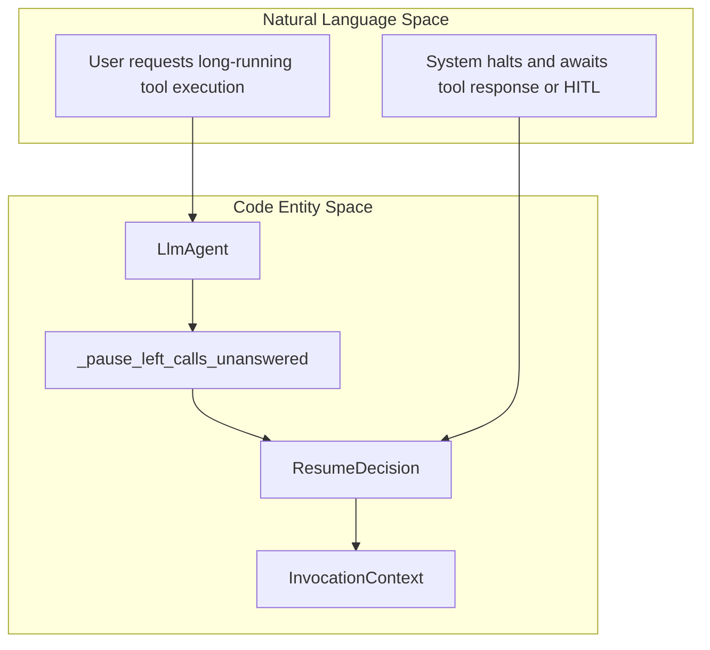
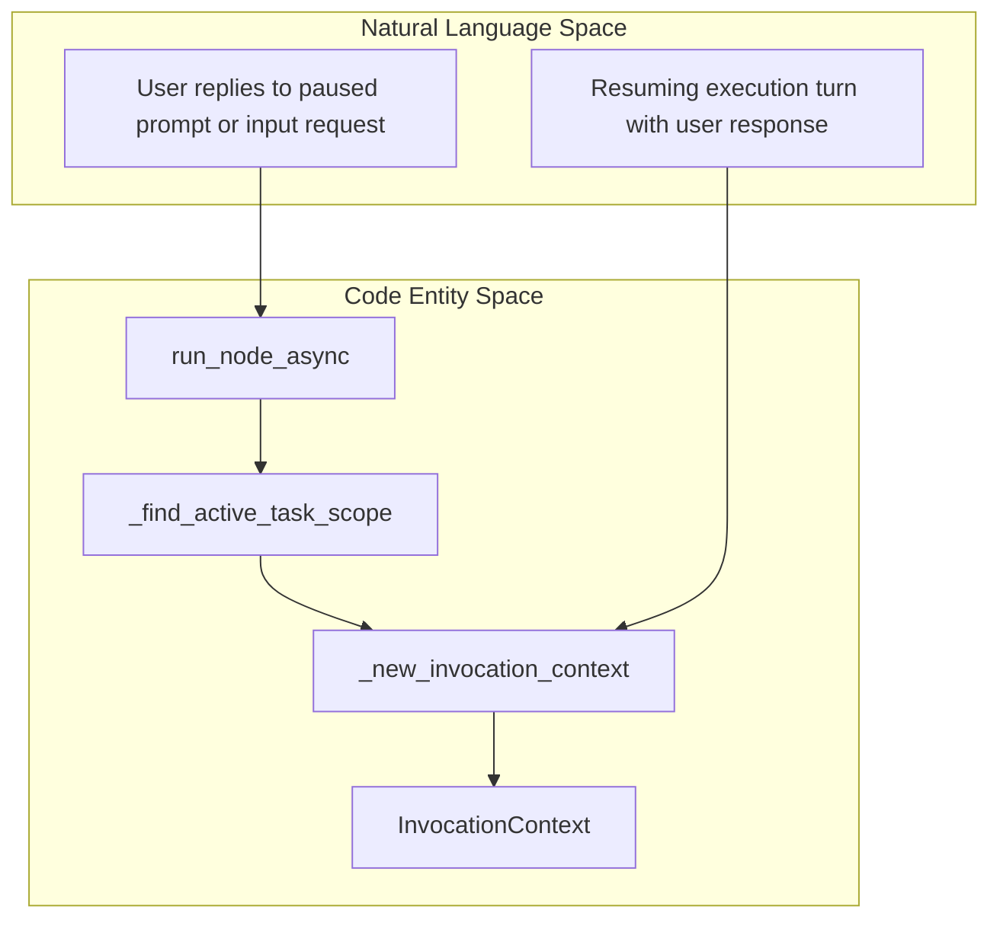
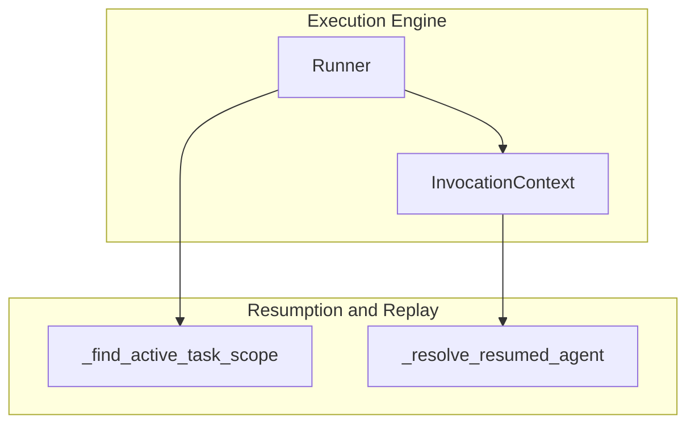

<!-- source: DeepWiki mcp.deepwiki.com · repo google/adk-python · page 12.2 Session Resumability · fetched 2026-10-29 -->

# Session Resumability

Relevant source files

The following files were used as context for generating this wiki page:

- [src/google/adk/agents/_agent_router.py](src/google/adk/agents/_agent_router.py)
- [src/google/adk/events/_abort_events.py](src/google/adk/events/_abort_events.py)
- [src/google/adk/flows/llm_flows/core/_function_call_postprocessor.py](src/google/adk/flows/llm_flows/core/_function_call_postprocessor.py)
- [src/google/adk/flows/llm_flows/core/_resume.py](src/google/adk/flows/llm_flows/core/_resume.py)
- [src/google/adk/flows/llm_flows/extensions/_agent_transfer.py](src/google/adk/flows/llm_flows/extensions/_agent_transfer.py)
- [src/google/adk/flows/llm_flows/prompt/_identity.py](src/google/adk/flows/llm_flows/prompt/_identity.py)
- [src/google/adk/flows/llm_flows/prompt/_schema.py](src/google/adk/flows/llm_flows/prompt/_schema.py)
- [src/google/adk/flows/llm_flows/tools/_batch_executor.py](src/google/adk/flows/llm_flows/tools/_batch_executor.py)
- [src/google/adk/runners.py](src/google/adk/runners.py)
- [src/google/adk/workflow/_node_runner_utils.py](src/google/adk/workflow/_node_runner_utils.py)
- [src/google/adk/workflow/utils/_transfer_utils.py](src/google/adk/workflow/utils/_transfer_utils.py)
- [tests/unittests/agents/test_agent_router.py](tests/unittests/agents/test_agent_router.py)
- [tests/unittests/agents/test_llm_agent_interruptions.py](tests/unittests/agents/test_llm_agent_interruptions.py)
- [tests/unittests/agents/test_resumable_llm_agent.py](tests/unittests/agents/test_resumable_llm_agent.py)
- [tests/unittests/events/test_abort_events.py](tests/unittests/events/test_abort_events.py)
- [tests/unittests/flows/llm_flows/core/test_function_call_postprocessor.py](tests/unittests/flows/llm_flows/core/test_function_call_postprocessor.py)
- [tests/unittests/flows/llm_flows/core/test_resume.py](tests/unittests/flows/llm_flows/core/test_resume.py)
- [tests/unittests/flows/llm_flows/prompt/test_schema.py](tests/unittests/flows/llm_flows/prompt/test_schema.py)
- [tests/unittests/flows/llm_flows/tools/test_batch_executor.py](tests/unittests/flows/llm_flows/tools/test_batch_executor.py)
- [tests/unittests/flows/llm_flows/tools/test_functions_parallel.py](tests/unittests/flows/llm_flows/tools/test_functions_parallel.py)
- [tests/unittests/flows/llm_flows/tools/test_functions_parallel_error.py](tests/unittests/flows/llm_flows/tools/test_functions_parallel_error.py)
- [tests/unittests/flows/llm_flows/tools/test_functions_simple.py](tests/unittests/flows/llm_flows/tools/test_functions_simple.py)
- [tests/unittests/runners/test_resume_invocation.py](tests/unittests/runners/test_resume_invocation.py)
- [tests/unittests/test_runners.py](tests/unittests/test_runners.py)
- [tests/unittests/workflow/test_agent_transfer.py](tests/unittests/workflow/test_agent_transfer.py)
- [tests/unittests/workflow/test_node_runner_utils.py](tests/unittests/workflow/test_node_runner_utils.py)
- [tests/unittests/workflow/test_workflow_agent_as_node.py](tests/unittests/workflow/test_workflow_agent_as_node.py)
- [tests/unittests/workflow/test_workflow_function_tool_as_node.py](tests/unittests/workflow/test_workflow_function_tool_as_node.py)
- [tests/unittests/workflow/test_workflow_live.py](tests/unittests/workflow/test_workflow_live.py)
- [tests/unittests/workflow/test_workflow_rewind.py](tests/unittests/workflow/test_workflow_rewind.py)
- [tests/unittests/workflow/test_workflow_schema.py](tests/unittests/workflow/test_workflow_schema.py)
- [tests/unittests/workflow/utils/test_transfer_utils.py](tests/unittests/workflow/utils/test_transfer_utils.py)

## Purpose and Scope

Session resumability enables agent invocations to be paused mid-execution and resumed later, supporting long-running operations, human-in-the-loop (HITL) workflows, and recovery from interruptions. This page details the pause and resume mechanisms, `invocation_id` resolution, synthetic user event injection, agent state management, and the role of the `Runner` [src/google/adk/runners.py:51-72]() and `InvocationContext` [src/google/adk/agents/invocation_context.py:127-165]() in coordinating resumable execution.

Sources: [src/google/adk/runners.py:51-72](), [src/google/adk/agents/invocation_context.py:127-165]()

---

## Core Concepts and Invocation ID Resolution

### Resumability vs. End of Invocation

ADK distinguishes between two ways an invocation stops:
- **Pausing**: The invocation temporarily suspends execution. It can be resumed by passing the same `invocation_id` to the runner. The agent execution state is preserved via session event history [src/google/adk/workflow/_node_runner_utils.py:87-113]().
- **Ending**: The invocation completes normally. Setting `end_invocation = True` on the context terminates the turn [src/google/adk/agents/invocation_context.py:127-165]().

### Invocation ID Resolution

When an agent invocation begins, the runner or `run_node_async` [src/google/adk/workflow/_node_runner_utils.py:50-63]() resolves whether it is a fresh invocation or a resumption of an existing one:
- If an `invocation_id` is omitted when a new message arrives, the system resolves it from existing session event history via `_resolve_invocation_id_from_fr` or `_find_active_task_scope` [src/google/adk/workflow/_node_runner_utils.py:87-95]().
- If a caller supplies an `invocation_id`, it is reconciled against the responses to prevent dropping tool results [src/google/adk/workflow/_node_runner_utils.py:96-106]().
- Fresh invocations generate a unique identifier using platform utilities [src/google/adk/agents/invocation_context.py:22-22]().

Sources: [src/google/adk/workflow/_node_runner_utils.py:50-113](), [src/google/adk/agents/invocation_context.py:22-22]()

---

## Pausing Execution and Long-Running Tool Calls

### Tool-Triggered Pauses and Long-Running Tools

Executions pause when an agent invokes a long-running tool or requests user interaction (such as input, credentials, or confirmation). The function-handling infrastructure identifies these actions via specialized call names or check routines like `_pause_left_calls_unanswered` [src/google/adk/flows/llm_flows/core/_resume.py:97-124](). The `ResumeAction` enum determines whether a paused flow should continue (`CONTINUE`), pause (`PAUSE`), or replay calls (`REPLAY_CALLS`) [src/google/adk/flows/llm_flows/core/_resume.py:46-60]().

Title: "NaturalLanguageSpaceToCodeEntitySpaceToolPause"

Sources: [src/google/adk/flows/llm_flows/core/_resume.py:46-124]()

---

## Resume Utilities and Synthetic User Events

### Synthetic User Events and Task Scoping

When resuming an invocation that was paused inside a delegated sub-agent or task, the system invokes `_find_active_task_scope` to inspect session history backwards [src/google/adk/runners.py:92-156](). This function locates the unclosed `isolation_scope` matching active task-mode agents or function-call delegations.

Rehydration and scanning utilities inspect event history to unwrap stored responses and validate resume inputs against expected schemas [src/google/adk/workflow/_node_runner_utils.py:78-106]().

Title: "NaturalLanguageSpaceToCodeEntitySpaceResumption"

Sources: [src/google/adk/runners.py:92-156](), [src/google/adk/workflow/_node_runner_utils.py:50-125]()

---

## Agent and Node State Management

Agents and workflow nodes serialize progress using `BaseAgentState` [src/google/adk/agents/base_agent.py:48-51]() subclasses. Upon resumption, these states are reloaded into the `InvocationContext` [src/google/adk/agents/invocation_context.py:127-165]().

| State Class / Field | Code Reference | Role in Resumability |
|---------------------|----------------|----------------------|
| `BaseAgentState` | [src/google/adk/agents/base_agent.py:48-51]() | Base model for serializable agent states. |
| `_LoopState` | [src/google/adk/workflow/_workflow.py:42-43]() | Tracks loop iteration counts across pauses. |
| `InvocationContext` | [src/google/adk/agents/invocation_context.py:127-165]() | Carries active session state and abort signals during execution. |

Sources: [src/google/adk/agents/base_agent.py:48-51](), [src/google/adk/workflow/_workflow.py:42-43](), [src/google/adk/agents/invocation_context.py:127-165]()

---

## Implementation Details

Title: "ResumabilityArchitectureMapping"

Sources: [src/google/adk/runners.py:92-156](), [src/google/adk/agents/invocation_context.py:127-165]()

---

