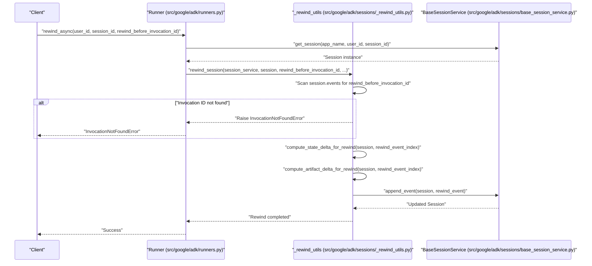
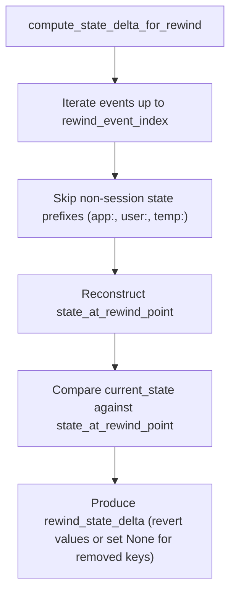
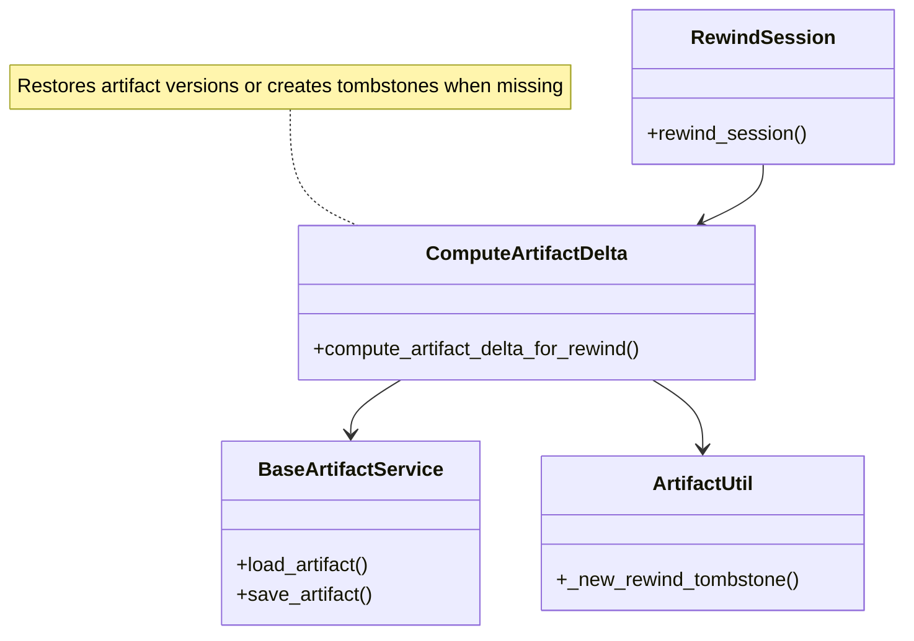

<!-- source: DeepWiki mcp.deepwiki.com · repo google/adk-python · page 12.3 Session Rewind · fetched 2026-10-29 -->

# Session Rewind

Relevant source files

The following files were used as context for generating this wiki page:

- [src/google/adk/agents/_agent_router.py](src/google/adk/agents/_agent_router.py)
- [src/google/adk/artifacts/artifact_util.py](src/google/adk/artifacts/artifact_util.py)
- [src/google/adk/artifacts/base_artifact_service.py](src/google/adk/artifacts/base_artifact_service.py)
- [src/google/adk/artifacts/file_artifact_service.py](src/google/adk/artifacts/file_artifact_service.py)
- [src/google/adk/artifacts/gcs_artifact_service.py](src/google/adk/artifacts/gcs_artifact_service.py)
- [src/google/adk/artifacts/in_memory_artifact_service.py](src/google/adk/artifacts/in_memory_artifact_service.py)
- [src/google/adk/errors/input_validation_error.py](src/google/adk/errors/input_validation_error.py)
- [src/google/adk/events/_abort_events.py](src/google/adk/events/_abort_events.py)
- [src/google/adk/runners.py](src/google/adk/runners.py)
- [src/google/adk/sessions/_rewind_utils.py](src/google/adk/sessions/_rewind_utils.py)
- [src/google/adk/tools/_forwarding_artifact_service.py](src/google/adk/tools/_forwarding_artifact_service.py)
- [src/google/adk/workflow/_node_runner_utils.py](src/google/adk/workflow/_node_runner_utils.py)
- [src/google/adk/workflow/utils/_transfer_utils.py](src/google/adk/workflow/utils/_transfer_utils.py)
- [tests/unittests/agents/test_agent_router.py](tests/unittests/agents/test_agent_router.py)
- [tests/unittests/agents/test_llm_agent_interruptions.py](tests/unittests/agents/test_llm_agent_interruptions.py)
- [tests/unittests/agents/test_resumable_llm_agent.py](tests/unittests/agents/test_resumable_llm_agent.py)
- [tests/unittests/artifacts/test_artifact_service.py](tests/unittests/artifacts/test_artifact_service.py)
- [tests/unittests/artifacts/test_artifact_util.py](tests/unittests/artifacts/test_artifact_util.py)
- [tests/unittests/events/test_abort_events.py](tests/unittests/events/test_abort_events.py)
- [tests/unittests/runners/test_runner_rewind.py](tests/unittests/runners/test_runner_rewind.py)
- [tests/unittests/sessions/test_rewind_utils.py](tests/unittests/sessions/test_rewind_utils.py)
- [tests/unittests/test_runners.py](tests/unittests/test_runners.py)
- [tests/unittests/tools/test_forwarding_artifact_service.py](tests/unittests/tools/test_forwarding_artifact_service.py)
- [tests/unittests/workflow/test_agent_transfer.py](tests/unittests/workflow/test_agent_transfer.py)
- [tests/unittests/workflow/test_node_runner_utils.py](tests/unittests/workflow/test_node_runner_utils.py)
- [tests/unittests/workflow/test_workflow_agent_as_node.py](tests/unittests/workflow/test_workflow_agent_as_node.py)
- [tests/unittests/workflow/test_workflow_function_tool_as_node.py](tests/unittests/workflow/test_workflow_function_tool_as_node.py)
- [tests/unittests/workflow/test_workflow_live.py](tests/unittests/workflow/test_workflow_live.py)
- [tests/unittests/workflow/test_workflow_rewind.py](tests/unittests/workflow/test_workflow_rewind.py)
- [tests/unittests/workflow/test_workflow_schema.py](tests/unittests/workflow/test_workflow_schema.py)
- [tests/unittests/workflow/utils/test_transfer_utils.py](tests/unittests/workflow/utils/test_transfer_utils.py)

Session Rewind is a time-travel and session-correction mechanism within the ADK Python framework that allows reverting a session to a precise historical point prior to a given invocation. This page details the rewind architecture, including `rewind_async`, `_rewind_utils`, state delta computation, and artifact version restoration.

For related session features, see [Session Resumability](12.2) and [Session Management](8.1). For event history internals, see [Session Management](8.1) and [Event System and History](8.3).

---

## Overview

Session rewind provides logical time-travel by appending a reversing event rather than mutating historical records. When a rewind is requested via `Runner.rewind_async` [src/google/adk/runners.py]() or helper utilities in `_rewind_utils.py`:
1. The session is retrieved using `BaseSessionService` [src/google/adk/sessions/base_session_service.py]().
2. The event history is scanned to locate the target invocation ID (`rewind_before_invocation_id`) [src/google/adk/sessions/_rewind_utils.py]().
3. Inverse state deltas and artifact version adjustments are computed using utility functions in `_rewind_utils.py` [src/google/adk/sessions/_rewind_utils.py]().
4. An `Event` containing `EventActions` with the computed deltas is created [src/google/adk/events/event.py]().
5. The rewind event is committed using `BaseSessionService.append_event` [src/google/adk/sessions/base_session_service.py]().

Sources: `[src/google/adk/runners.py]`, `[src/google/adk/sessions/base_session_service.py]`, `[src/google/adk/sessions/_rewind_utils.py]()`

---

## Rewind Process Flow

The following sequence diagram bridges natural language rewind operations to concrete code entities across `Runner`, `BaseSessionService`, and `_rewind_utils`.

### Session Rewind Code Execution Flow

Sources: `[src/google/adk/runners.py]`, `[src/google/adk/sessions/_rewind_utils.py]`, `[src/google/adk/sessions/base_session_service.py]()`

---

## State Delta Computation

State delta computation is handled by `compute_state_delta_for_rewind` in `src/google/adk/sessions/_rewind_utils.py`.

### State Rewind Computation Flow

### Implementation Rules
* **Prefix Filtering**: Keys starting with `app:`, `user:`, or `temp:` (`_NON_SESSION_STATE_PREFIXES`) are excluded from session-level rewind state deltas `[src/google/adk/sessions/_rewind_utils.py]()`.
* **Reversion and Removal**: Keys modified after the rewind point are restored to their previous values, while keys added after the rewind point are explicitly set to `None` in the delta dictionary to signal deletion `[src/google/adk/sessions/_rewind_utils.py]()`.

Sources: `[src/google/adk/sessions/_rewind_utils.py]()`

---

## Artifact Version Restoration

Artifact version adjustments are managed by `compute_artifact_delta_for_rewind` and associated artifact service utilities `[src/google/adk/sessions/_rewind_utils.py]()`.

### Artifact Restoration Architecture

### Restoration Logic
* **Version Inspection**: Compares current artifact version numbers against the versions present at the historical rewind point `[src/google/adk/sessions/_rewind_utils.py]()`.
* **User Artifact Exclusion**: Artifacts prefixed with `user:` are excluded from session rewind restoration `[src/google/adk/sessions/_rewind_utils.py]()`.
* **Tombstones**: If an artifact did not exist at the rewind point or its historical version cannot be loaded, a rewind tombstone is created via `artifact_util._new_rewind_tombstone()` `[src/google/adk/artifacts/artifact_util.py:140-174]()`.

Sources: `[src/google/adk/sessions/_rewind_utils.py]`, `[src/google/adk/artifacts/artifact_util.py:140-174]()`

---

## Error Handling

* **`InvocationNotFoundError`**: Raised when the specified `rewind_before_invocation_id` cannot be matched against any event within `session.events` `[src/google/adk/sessions/_rewind_utils.py]()`. It inherits from base error definitions for consistent exception handling `[src/google/adk/errors/_invocation_not_found_error.py]()`.
* **`StaleSessionError`**: Raised during concurrent session modifications or state conflicts `[src/google/adk/errors/_stale_session_error.py]()`.

Sources: `[src/google/adk/sessions/_rewind_utils.py]`, `[src/google/adk/errors/_invocation_not_found_error.py]`, `[src/google/adk/errors/_stale_session_error.py]()`

---

