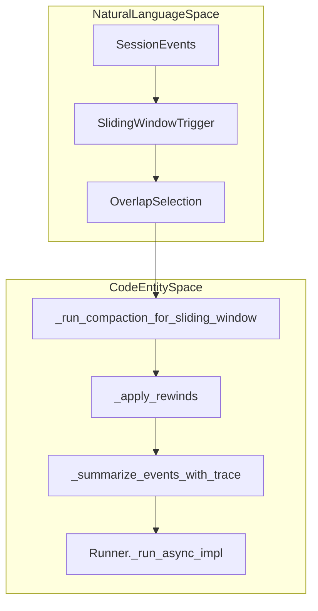
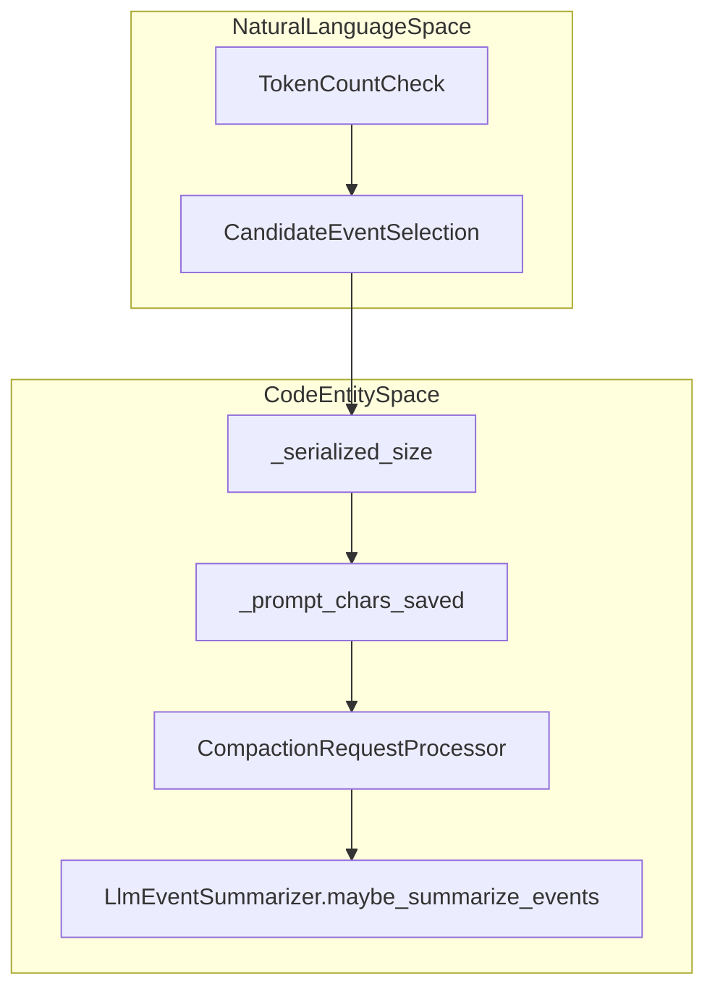
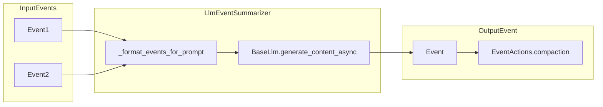
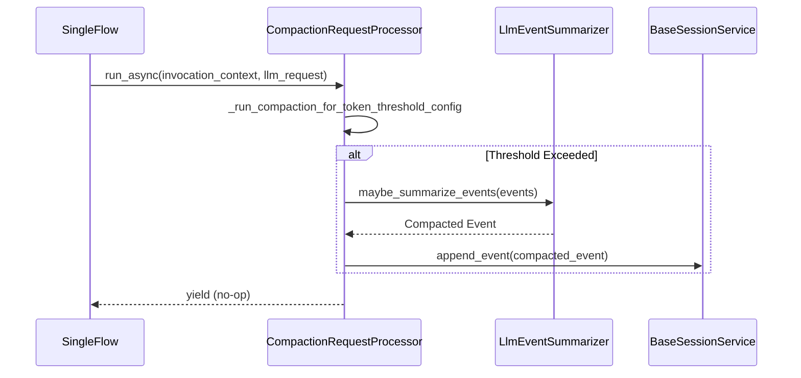

<!-- source: DeepWiki mcp.deepwiki.com · repo google/adk-python · page 12.4 Event Compaction · fetched 2026-10-29 -->

# Event Compaction

Relevant source files

The following files were used as context for generating this wiki page:

- [src/google/adk/apps/base_events_summarizer.py](src/google/adk/apps/base_events_summarizer.py)
- [src/google/adk/apps/compaction.py](src/google/adk/apps/compaction.py)
- [src/google/adk/apps/llm_event_summarizer.py](src/google/adk/apps/llm_event_summarizer.py)
- [src/google/adk/flows/llm_flows/context/_compaction.py](src/google/adk/flows/llm_flows/context/_compaction.py)
- [tests/benchmarks/benchmark_compaction.py](tests/benchmarks/benchmark_compaction.py)
- [tests/unittests/apps/test_compaction.py](tests/unittests/apps/test_compaction.py)
- [tests/unittests/apps/test_compaction_runner_e2e.py](tests/unittests/apps/test_compaction_runner_e2e.py)
- [tests/unittests/apps/test_compaction_scaling.py](tests/unittests/apps/test_compaction_scaling.py)
- [tests/unittests/apps/test_llm_event_summarizer.py](tests/unittests/apps/test_llm_event_summarizer.py)
- [tests/unittests/flows/llm_flows/context/test_compaction.py](tests/unittests/flows/llm_flows/context/test_compaction.py)
- [tests/unittests/flows/llm_flows/context/test_compaction_intervals.py](tests/unittests/flows/llm_flows/context/test_compaction_intervals.py)
- [tests/unittests/flows/llm_flows/context/test_content_compaction.py](tests/unittests/flows/llm_flows/context/test_content_compaction.py)
- [tests/unittests/flows/llm_flows/test_processor_helpers.py](tests/unittests/flows/llm_flows/test_processor_helpers.py)

Event compaction is a mechanism that manages the growing size of session event history by summarizing older events into concise summaries. This prevents the conversation context from exceeding model token limits and reduces prompt costs while maintaining semantic continuity across long sessions.

For information about the broader session management system, see [8.1 Session Management](). For details on the event system structure, see [8.3 Event System and History]().

## Overview

As conversations progress, the accumulated event history grows larger, eventually approaching or exceeding the LLM's context window. Event compaction addresses this by:

1. Monitoring session events for compaction triggers (invocation count or token threshold).
2. Selecting a range of events to summarize based on configuration.
3. Using an LLM to generate a concise summary of the selected events.
4. Appending a compacted event containing the summary and metadata.
5. Filtering compacted event ranges during content assembly for model requests.

The compaction system supports two distinct strategies: **sliding window compaction** (based on invocation count) and **token threshold compaction** (based on prompt token count). Rewound invocations are explicitly excluded from compaction, and critical context like conversation language and tool names are preserved.

Sources: [src/google/adk/apps/compaction.py:24-33](), [tests/unittests/apps/test_compaction_runner_e2e.py:165-187]()

## Configuration

Event compaction is configured via `EventsCompactionConfig`, which defines the parameters for when and how compaction should occur. The configuration is attached to an `App` instance and referenced during agent execution via the invocation context.

### EventsCompactionConfig Structure

| Field | Type | Description |
| :--- | :--- | :--- |
| `compaction_interval` | `int` | Number of new invocations required to trigger sliding-window compaction. |
| `overlap_size` | `int` | Number of invocations to overlap between successive summaries. |
| `token_threshold` | `int \| None` | Token count limit that triggers token-threshold compaction. |
| `event_retention_size` | `int \| None` | Number of recent events to keep uncompacted in token-threshold mode. |
| `summarizer` | `BaseEventsSummarizer \| None` | The component used to generate summaries. Defaults to `LlmEventSummarizer`. |

Sources: [src/google/adk/apps/compaction.py:36-39](), [src/google/adk/apps/llm_event_summarizer.py:29-46]()

### Configuration Modes

| Mode | Required Fields | Behavior |
| :--- | :--- | :--- |
| **Sliding Window** | `compaction_interval`, `overlap_size` | Compacts after every N new invocations, with overlap for context continuity. |
| **Token Threshold** | `token_threshold`, `event_retention_size` | Compacts when prompt token count exceeds threshold, keeping recent events. |

Validation logic ensures that `token_threshold` and `event_retention_size` are set together.

Sources: [src/google/adk/apps/compaction.py:24-38](), [src/google/adk/apps/llm_event_summarizer.py:29-46]()

## Compaction Strategies

### Sliding Window Compaction

Sliding window compaction triggers after a fixed number of new invocations have completed. It creates overlapping summaries to maintain continuity between compacted ranges.

Title: "Sliding Window Compaction Bridge from Natural Language to Code Entities"

Sources: [src/google/adk/apps/compaction.py:24-38](), [tests/unittests/apps/test_compaction_runner_e2e.py:165-187]()

**Algorithm:**
1. Count new invocations since the latest compaction end timestamp.
2. Filter out rewound invocations using `_apply_rewinds` to ensure summaries only cover live history [src/google/adk/apps/compaction.py:26-26]().
3. If count >= `compaction_interval`, trigger compaction.
4. Determine range: Start includes `overlap_size` previous invocations; End is the last completed invocation.
5. Summarize all events in range using `_summarize_events_with_trace` [src/google/adk/apps/compaction.py:112-167]().
6. In the `Runner` loop, the resulting event is yielded and appended to the session.

Sources: [src/google/adk/apps/compaction.py:24-38](), [tests/unittests/apps/test_compaction_runner_e2e.py:165-187]()

### Token Threshold Compaction

Token threshold compaction triggers when the estimated prompt token count exceeds a configured threshold. It preserves the most recent events while compacting older history.

Title: "Token Threshold Compaction Bridge from Natural Language to Code Entities"

Sources: [src/google/adk/apps/compaction.py:66-110](), [src/google/adk/apps/llm_event_summarizer.py:129-173](), [tests/unittests/apps/test_compaction_runner_e2e.py:88-163]()

**Algorithm:**
1. Check latest `usage_metadata.prompt_token_count` or evaluate token thresholds during the request preprocessing phase via `CompactionRequestProcessor` [src/google/adk/flows/llm_flows/context/_compaction.py:35-62]().
2. If count >= `token_threshold`, trigger compaction via `_run_compaction_for_token_threshold_config` [src/google/adk/flows/llm_flows/context/_compaction.py:50-58]().
3. Identify candidate events while ensuring a safe split to avoid orphaning tool calls. Logic ensures that if a tool call is included in a compaction, its corresponding response must also be included, or both must be excluded.
4. Generate summary using the configured `summarizer` (`LlmEventSummarizer`) and append the new `Event`.

Sources: [src/google/adk/apps/compaction.py:66-110](), [src/google/adk/apps/llm_event_summarizer.py:129-173](), [src/google/adk/flows/llm_flows/context/_compaction.py:35-62]()

## Summarization Process

### LlmEventSummarizer Implementation

`LlmEventSummarizer` uses an LLM to generate summaries from a list of events. It implements the `BaseEventsSummarizer` interface [src/google/adk/apps/base_events_summarizer.py]() (or [src/google/adk/apps/llm_event_summarizer.py:29-46]()).

Title: "Summarization Data Flow"

Sources: [src/google/adk/apps/llm_event_summarizer.py:29-173]()

**Implementation Details:**
* **Prompt Template:** Uses a default template focusing on key information, decisions, and conversation language, with critical instructions to identify the primary language and list exact tool names to maintain grounding [src/google/adk/apps/llm_event_summarizer.py:48-61]().
* **Formatting:** `_format_events_for_prompt` extracts text parts, thoughts, and tool interactions. Tool call arguments and responses are truncated to 2000 characters via `_MAX_TOOL_CONTENT_CHARS` to prevent context inflation [src/google/adk/apps/llm_event_summarizer.py:63-120]().
* **Role Enforcement:** The resulting summary content is explicitly set to `role='model'` [src/google/adk/apps/llm_event_summarizer.py:165-166]().
* **Range Metadata:** Captures `start_timestamp` and `end_timestamp` from the input event list to define the `EventCompaction` range [src/google/adk/apps/llm_event_summarizer.py:168-173]().

Sources: [src/google/adk/apps/llm_event_summarizer.py:29-173]()

## Lifecycle Integration

### CompactionRequestProcessor

The `CompactionRequestProcessor` handles token-based compaction during the LLM flow preprocessing stage [src/google/adk/flows/llm_flows/context/_compaction.py:35-62]().

Title: "Processor Flow Sequence"

Sources: [src/google/adk/flows/llm_flows/context/_compaction.py:35-62]()

In the LLM request flow, the compaction request processor is registered before the contents request processor. This ensures that the model sees the updated summary instead of the raw history that triggered the compaction [src/google/adk/flows/llm_flows/context/_compaction.py:35-62]().

Sources: [src/google/adk/flows/llm_flows/context/_compaction.py:35-62]()

## Compacted Event Structure

A compacted event is a standard `Event` containing `EventCompaction` metadata in its `actions` field [src/google/adk/apps/llm_event_summarizer.py:171-173]().

| Field | Description | Source |
| :--- | :--- | :--- |
| `start_timestamp` | Earliest timestamp of compacted range. | [src/google/adk/apps/llm_event_summarizer.py:168-172]() |
| `end_timestamp` | Latest timestamp of compacted range. | [src/google/adk/apps/llm_event_summarizer.py:169-173]() |
| `compacted_content` | The `Content` object containing the summary. | [src/google/adk/apps/llm_event_summarizer.py:170-173]() |

Sources: [src/google/adk/apps/llm_event_summarizer.py:161-173]()

## Content Assembly Integration

The content assembly logic respects compaction ranges by filtering out individual events covered by a summary via `_process_compaction_events` [src/google/adk/flows/llm_flows/context/_compaction.py:68-146]():

1. **Identification:** Identifies all events containing `EventCompaction` metadata [src/google/adk/flows/llm_flows/context/_compaction.py:92-93]().
2. **Subsumption:** Checks if a compaction range is fully contained within a later, larger compaction [src/google/adk/flows/llm_flows/context/_compaction.py:96-104]().
3. **Rewind Awareness:** Ensures that rewound content is never fed to the summarizer LLM or the agent prompt [src/google/adk/apps/compaction.py:26-26]().
4. **Filtering:** During history traversal, events with timestamps between a valid compaction's `start_timestamp` and `end_timestamp` are omitted from the LLM prompt, and the `compacted_content` is used instead [src/google/adk/flows/llm_flows/context/_compaction.py:132-141]().

Sources: [src/google/adk/flows/llm_flows/context/_compaction.py:68-146]()

---

