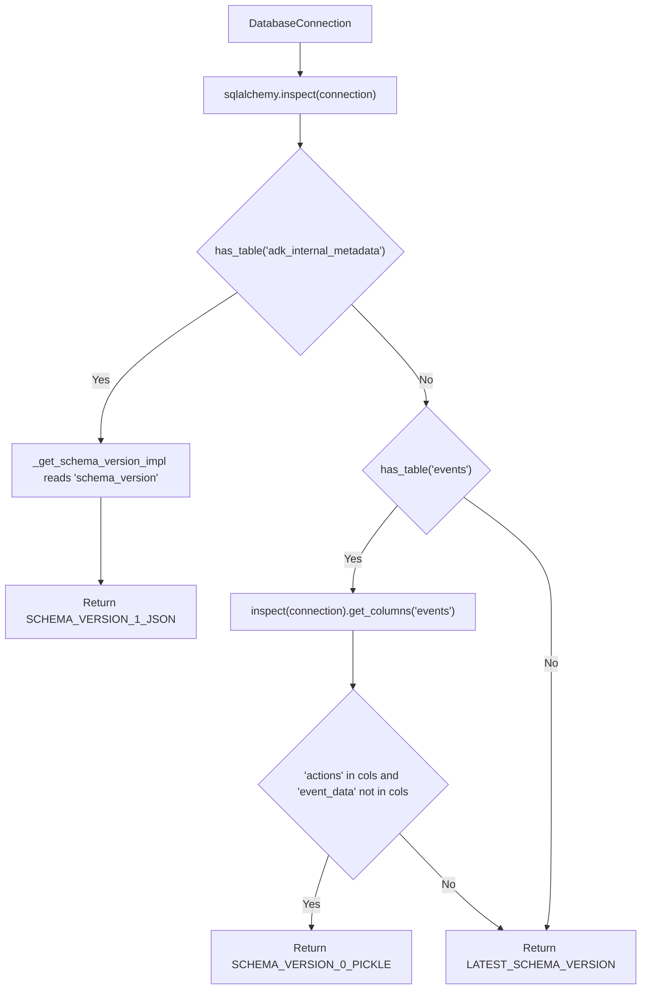
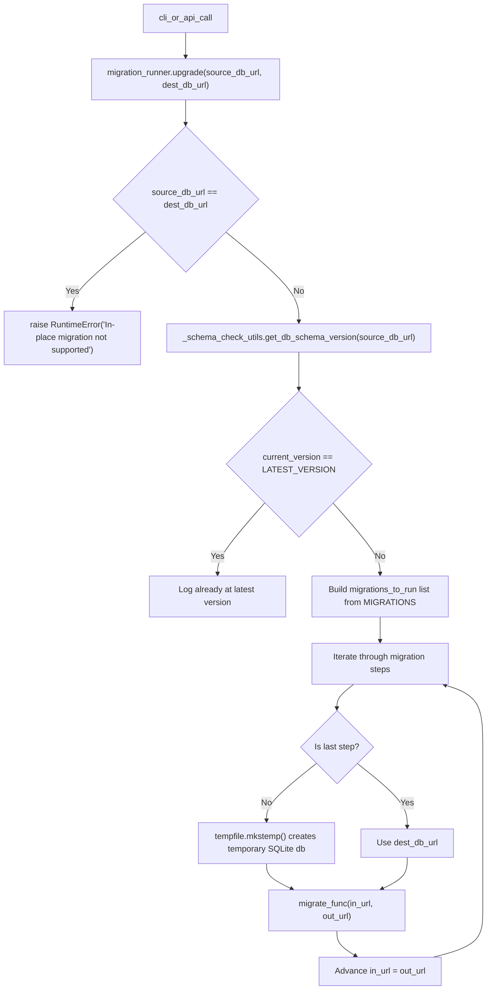
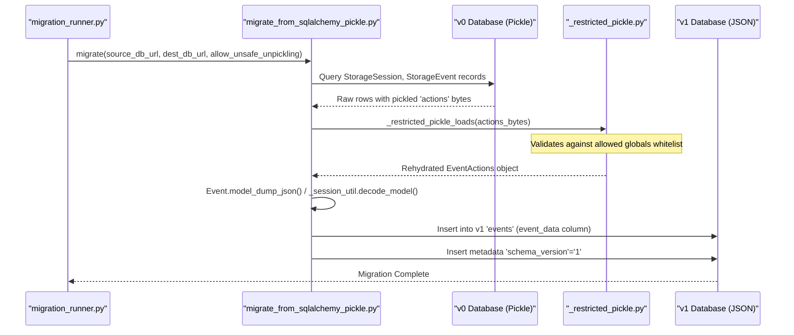

<!-- source: DeepWiki mcp.deepwiki.com · repo google/adk-python · page 12.5 Database Schema Management · fetched 2026-10-29 -->

# Database Schema Management

Relevant source files

The following files were used as context for generating this wiki page:

- [src/google/adk/sessions/_restricted_pickle.py](src/google/adk/sessions/_restricted_pickle.py)
- [src/google/adk/sessions/migration/_schema_check_utils.py](src/google/adk/sessions/migration/_schema_check_utils.py)
- [src/google/adk/sessions/migration/migrate_from_sqlalchemy_pickle.py](src/google/adk/sessions/migration/migrate_from_sqlalchemy_pickle.py)
- [src/google/adk/sessions/migration/migrate_from_sqlalchemy_sqlite.py](src/google/adk/sessions/migration/migrate_from_sqlalchemy_sqlite.py)
- [src/google/adk/sessions/migration/migration_runner.py](src/google/adk/sessions/migration/migration_runner.py)
- [src/google/adk/sessions/schemas/shared.py](src/google/adk/sessions/schemas/shared.py)
- [src/google/adk/sessions/schemas/v0.py](src/google/adk/sessions/schemas/v0.py)
- [src/google/adk/sessions/schemas/v1.py](src/google/adk/sessions/schemas/v1.py)
- [tests/unittests/sessions/migration/test_database_schema.py](tests/unittests/sessions/migration/test_database_schema.py)
- [tests/unittests/sessions/migration/test_migration.py](tests/unittests/sessions/migration/test_migration.py)
- [tests/unittests/sessions/test_dynamic_pickle_type.py](tests/unittests/sessions/test_dynamic_pickle_type.py)
- [tests/unittests/sessions/test_schemas_shared.py](tests/unittests/sessions/test_schemas_shared.py)

## Purpose and Scope

This page details the database schema management system used by `DatabaseSessionService` to persist agent sessions, state, and events across relational backends (PostgreSQL, MySQL, Spanner, and SQLite). It covers schema versioning, automated version checks via `_schema_check_utils.py`, orchestration via `migration_runner.py`, secure unpickling of legacy data through `_restricted_pickle.py`, and migration tooling from v0 (Pickle-based) formats to v1 (JSON-based) schemas.

Sources: `[src/google/adk/sessions/schemas/v0.py:14-24]`, `[src/google/adk/sessions/schemas/v1.py:15-20]`, `[src/google/adk/sessions/migration/_schema_check_utils.py:14-14]`

## Overview

The ADK persistence layer relies on SQLAlchemy to provide cross-platform relational storage. To manage database evolution safely across deployments, the codebase implements version detection, multi-step upgrades, and restricted unpickling protections.

Key subsystems include:
- **Schema Detection**: `_schema_check_utils.get_db_schema_version()` inspects metadata tables and column structures to determine whether a database is running the legacy v0 schema or the current v1 schema [src/google/adk/sessions/migration/_schema_check_utils.py:44-94]().
- **Migration Runner**: `migration_runner.upgrade()` orchestrates sequential upgrades across multiple versions, utilizing temporary SQLite staging files for multi-step migrations between external engines [src/google/adk/sessions/migration/migration_runner.py:45-145]().
- **Restricted Pickle**: `_restricted_pickle.py` provides an unpickling allowlist derived from Pydantic models (`EventActions`, `AuthConfig`) to safely load legacy serialized data without allowing arbitrary code execution [src/google/adk/sessions/_restricted_pickle.py:14-37]().

Sources: `[src/google/adk/sessions/migration/_schema_check_utils.py:44-94]`, `[src/google/adk/sessions/migration/migration_runner.py:15-43]`, `[src/google/adk/sessions/_restricted_pickle.py:14-37]`

## Schema Versions and Detection

### Version Definitions

| Version | Identifier | Description |
| :--- | :--- | :--- |
| **v0** | `"0"` | Legacy schema using SQLAlchemy `PickleType` via `DynamicPickleType` to store `EventActions` inside the `events` table `actions` column. |
| **v1** | `"1"` | Current schema using `DynamicJSON` (`event_data` column) and an `adk_internal_metadata` table for schema version tracking. |

Sources: `[src/google/adk/sessions/migration/_schema_check_utils.py:39-42]`, `[src/google/adk/sessions/schemas/v0.py:96-137]`, `[src/google/adk/sessions/schemas/v1.py:56-70]`

### Schema Version Detection Logic

The detection mechanism (`_schema_check_utils._get_schema_version_impl`) verifies the existence of the `adk_internal_metadata` table or inspects columns in the `events` table via SQLAlchemy reflection APIs.

Title: Schema Version Detection Flow

Sources: `[src/google/adk/sessions/migration/_schema_check_utils.py:45-94]`

## Migration Runner and Orchestration

The `migration_runner.upgrade()` function coordinates database upgrades [src/google/adk/sessions/migration/migration_runner.py:45-49](). In-place migrations (`source_db_url == dest_db_url`) are explicitly prohibited to prevent database corruption [src/google/adk/sessions/migration/migration_runner.py:76-80]().

Title: Migration Runner Orchestration Flow (Code Entity Space Bridge)

Sources: `[src/google/adk/sessions/migration/migration_runner.py:45-145]`, `[src/google/adk/sessions/migration/_schema_check_utils.py:168-192]`

## v0 to v1 Migration (Pickle to JSON)

Migrating from v0 to v1 requires reading relational rows containing pickled `EventActions`, deserializing them through the restricted loader, and outputting them as JSON strings into the `event_data` column [src/google/adk/sessions/migration/migrate_from_sqlalchemy_pickle.py:64-147](). The `migrate_from_sqlalchemy_pickle.py` script manages this process [src/google/adk/sessions/migration/migrate_from_sqlalchemy_pickle.py:14-14](). It provides `_restricted_pickle_loads` which defaults to restricted unpickling unless `allow_unsafe_unpickling` is explicitly enabled [src/google/adk/sessions/migration/migrate_from_sqlalchemy_pickle.py:42-48]().

Title: Pickle to JSON Migration Sequence (Code Entity Space Bridge)

Sources: `[src/google/adk/sessions/migration/migrate_from_sqlalchemy_pickle.py:42-179]`, `[src/google/adk/sessions/migration/migration_runner.py:127-135]`, `[src/google/adk/sessions/_restricted_pickle.py:166-173]`

## Restricted Unpickling and Security

Because legacy v0 payloads contain untrusted pickled bytes, `_restricted_pickle.py` defines a subclassed `pickle.Unpickler` (`_RestrictedUnpickler`) that restricts resolved globals [src/google/adk/sessions/_restricted_pickle.py:14-37](). This prevents arbitrary code execution from malicious payloads.

The allowed globals are composed of:
1. **Derived Part**: `_walk_model_tree()` inspects field annotations on root models (`EventActions` and `AuthConfig`), recursively resolving `BaseModel` and `Enum` subclasses [src/google/adk/sessions/_restricted_pickle.py:100-139]().
2. **Static Part**: `_STATIC_ALLOWED_GLOBALS` explicitly admits built-in containers (`dict`, `list`, `set`, `tuple`), stdlib types (`datetime`, `Decimal`, `UUID`, `Path`), and auth scheme models [src/google/adk/sessions/_restricted_pickle.py:53-97]().

Sources: `[src/google/adk/sessions/_restricted_pickle.py:14-173]`, `[src/google/adk/sessions/migration/migrate_from_sqlalchemy_pickle.py:42-48]`

## Table Structures and Custom SQLAlchemy Types

### v1 Storage Models

The `v1.py` schema defines the current database structure, including `StorageMetadata` for version tracking, `StorageSession` for session state, and `StorageEvent` for serialized event logs [src/google/adk/sessions/schemas/v1.py:15-203]().

| Table Name | Primary Key Columns | Data Columns |
| :--- | :--- | :--- |
| `adk_internal_metadata` | `key` | `value` |
| `sessions` | `app_name`, `user_id`, `id` | `state` (JSON), `create_time`, `update_time` |
| `events` | `id`, `app_name`, `user_id`, `session_id` | `invocation_id`, `timestamp`, `event_data` (JSON) |

Sources: `[src/google/adk/sessions/schemas/v1.py:56-203]`

### Custom SQLAlchemy Types

The `shared.py` module defines custom SQLAlchemy types for cross-dialect compatibility [src/google/adk/sessions/schemas/shared.py:1-120]().

- **`DynamicJSON`**: Maps to `JSONB` on PostgreSQL, `LONGTEXT` on MySQL, and serializes to JSON string via `Text` for SQLite and other engines [src/google/adk/sessions/schemas/shared.py:51-87]().
- **`PreciseTimestamp`**: Ensures microsecond precision for `datetime` values using `DATETIME(fsp=6)` on MySQL and `DATETIME2(precision=6)` on MSSQL [src/google/adk/sessions/schemas/shared.py:89-120]().
- **`to_sync_url`**: Normalizes async database URLs (e.g., `postgresql+asyncpg://` or `sqlite+aiosqlite://`) to synchronous equivalents for migration drivers [src/google/adk/sessions/migration/_schema_check_utils.py:103-131]().

Sources: `[src/google/adk/sessions/schemas/shared.py:51-120]`, `[src/google/adk/sessions/migration/_schema_check_utils.py:103-131]`

---

