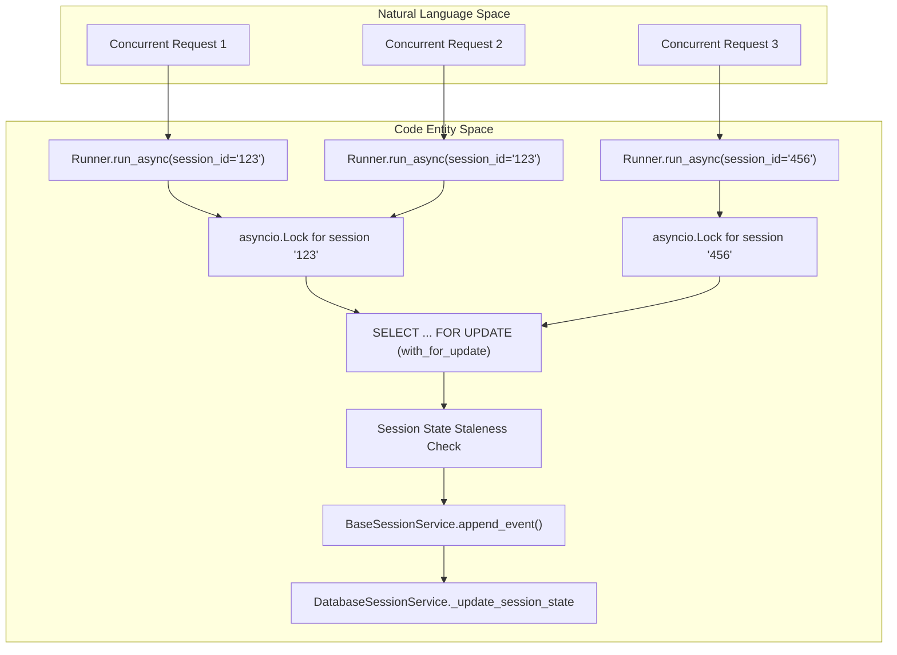
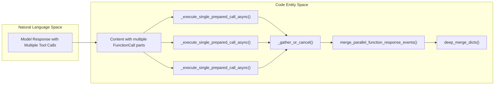
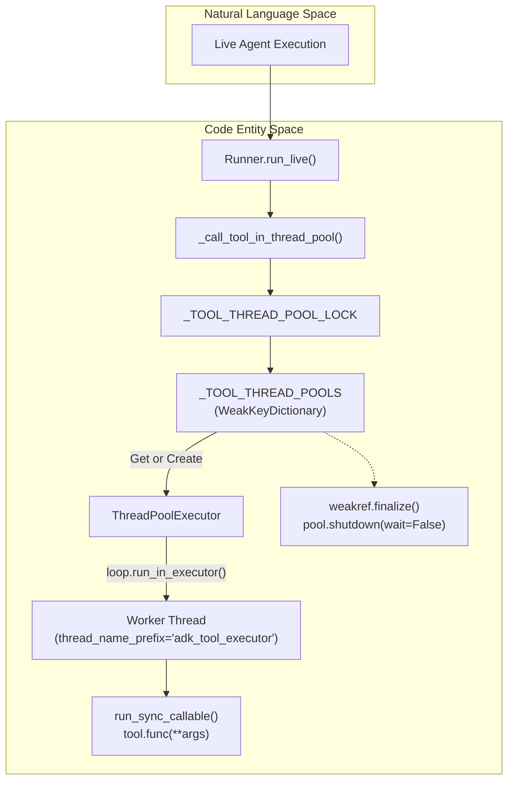
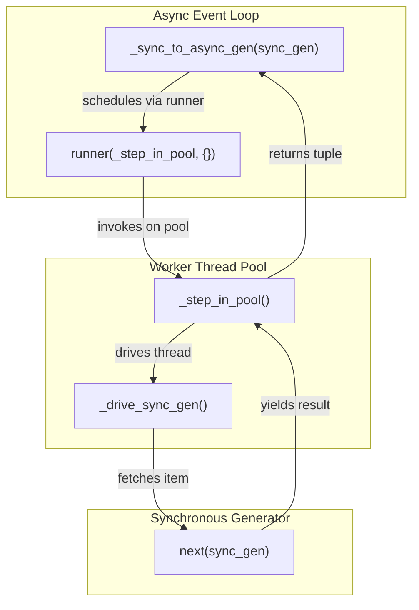

<!-- source: DeepWiki mcp.deepwiki.com · repo google/adk-python · page 12.6 Concurrency and Performance · fetched 2026-10-29 -->

# Concurrency and Performance

Relevant source files

The following files were used as context for generating this wiki page:

- [.agents/skills/adk-debug/references/failure-modes.md](.agents/skills/adk-debug/references/failure-modes.md)
- [docs/guides/plugins/reflect_retry_model_plugin/index.md](docs/guides/plugins/reflect_retry_model_plugin/index.md)
- [src/google/adk/__init__.py](src/google/adk/__init__.py)
- [src/google/adk/agents/__init__.py](src/google/adk/agents/__init__.py)
- [src/google/adk/cli/__init__.py](src/google/adk/cli/__init__.py)
- [src/google/adk/dependencies/__init__.py](src/google/adk/dependencies/__init__.py)
- [src/google/adk/dependencies/rouge_scorer.py](src/google/adk/dependencies/rouge_scorer.py)
- [src/google/adk/dependencies/vertexai.py](src/google/adk/dependencies/vertexai.py)
- [src/google/adk/flows/llm_flows/core/_function_call_postprocessor.py](src/google/adk/flows/llm_flows/core/_function_call_postprocessor.py)
- [src/google/adk/flows/llm_flows/core/_resume.py](src/google/adk/flows/llm_flows/core/_resume.py)
- [src/google/adk/flows/llm_flows/extensions/_agent_transfer.py](src/google/adk/flows/llm_flows/extensions/_agent_transfer.py)
- [src/google/adk/flows/llm_flows/prompt/_identity.py](src/google/adk/flows/llm_flows/prompt/_identity.py)
- [src/google/adk/flows/llm_flows/prompt/_schema.py](src/google/adk/flows/llm_flows/prompt/_schema.py)
- [src/google/adk/flows/llm_flows/tools/_batch_executor.py](src/google/adk/flows/llm_flows/tools/_batch_executor.py)
- [src/google/adk/flows/llm_flows/tools/_caller.py](src/google/adk/flows/llm_flows/tools/_caller.py)
- [src/google/adk/flows/llm_flows/tools/_confirmation.py](src/google/adk/flows/llm_flows/tools/_confirmation.py)
- [src/google/adk/flows/llm_flows/tools/_error_handler.py](src/google/adk/flows/llm_flows/tools/_error_handler.py)
- [src/google/adk/flows/llm_flows/tools/_thread_pool.py](src/google/adk/flows/llm_flows/tools/_thread_pool.py)
- [src/google/adk/integrations/bigquery/search_tool.py](src/google/adk/integrations/bigquery/search_tool.py)
- [src/google/adk/plugins/_reflect_retry_model_plugin.py](src/google/adk/plugins/_reflect_retry_model_plugin.py)
- [src/google/adk/plugins/_reflect_retry_utils.py](src/google/adk/plugins/_reflect_retry_utils.py)
- [src/google/adk/plugins/reflect_retry_tool_plugin.py](src/google/adk/plugins/reflect_retry_tool_plugin.py)
- [src/google/adk/utils/_lazy.py](src/google/adk/utils/_lazy.py)
- [src/google/adk/utils/_sync_runner.py](src/google/adk/utils/_sync_runner.py)
- [src/google/adk/workflow/__init__.py](src/google/adk/workflow/__init__.py)
- [tests/unittests/dependencies/test_vertexai.py](tests/unittests/dependencies/test_vertexai.py)
- [tests/unittests/flows/llm_flows/core/test_function_call_postprocessor.py](tests/unittests/flows/llm_flows/core/test_function_call_postprocessor.py)
- [tests/unittests/flows/llm_flows/core/test_resume.py](tests/unittests/flows/llm_flows/core/test_resume.py)
- [tests/unittests/flows/llm_flows/prompt/test_schema.py](tests/unittests/flows/llm_flows/prompt/test_schema.py)
- [tests/unittests/flows/llm_flows/tools/test_batch_executor.py](tests/unittests/flows/llm_flows/tools/test_batch_executor.py)
- [tests/unittests/flows/llm_flows/tools/test_caller.py](tests/unittests/flows/llm_flows/tools/test_caller.py)
- [tests/unittests/flows/llm_flows/tools/test_confirmation.py](tests/unittests/flows/llm_flows/tools/test_confirmation.py)
- [tests/unittests/flows/llm_flows/tools/test_functions_parallel.py](tests/unittests/flows/llm_flows/tools/test_functions_parallel.py)
- [tests/unittests/flows/llm_flows/tools/test_functions_parallel_error.py](tests/unittests/flows/llm_flows/tools/test_functions_parallel_error.py)
- [tests/unittests/flows/llm_flows/tools/test_functions_simple.py](tests/unittests/flows/llm_flows/tools/test_functions_simple.py)
- [tests/unittests/flows/llm_flows/tools/test_functions_thread_pool.py](tests/unittests/flows/llm_flows/tools/test_functions_thread_pool.py)
- [tests/unittests/isolated_import_utils.py](tests/unittests/isolated_import_utils.py)
- [tests/unittests/plugins/test_reflect_retry_model_plugin.py](tests/unittests/plugins/test_reflect_retry_model_plugin.py)
- [tests/unittests/plugins/test_reflect_retry_tool_plugin.py](tests/unittests/plugins/test_reflect_retry_tool_plugin.py)
- [tests/unittests/runners/__init__.py](tests/unittests/runners/__init__.py)
- [tests/unittests/runners/test_resume_invocation.py](tests/unittests/runners/test_resume_invocation.py)
- [tests/unittests/runners/test_run_tool_confirmation.py](tests/unittests/runners/test_run_tool_confirmation.py)
- [tests/unittests/test_import_loading.py](tests/unittests/test_import_loading.py)
- [tests/unittests/test_optional_dependencies.py](tests/unittests/test_optional_dependencies.py)
- [tests/unittests/test_release_dependencies.py](tests/unittests/test_release_dependencies.py)
- [tests/unittests/utils/test_lazy.py](tests/unittests/utils/test_lazy.py)
- [tests/unittests/utils/test_sync_runner.py](tests/unittests/utils/test_sync_runner.py)

## Purpose and Scope

This page documents the concurrency control mechanisms, batch execution engines, thread pooling, platform thread utilities, and performance optimizations implemented in the ADK Python framework (`google/adk`). It covers session consistency via in-process locks and row-level database locking, concurrent tool execution through the batch tool executor in `src/google/adk/flows/llm_flows/tools/_batch_executor.py` [src/google/adk/flows/llm_flows/tools/_batch_executor.py:1-184](), thread pool isolation for blocking tools in `src/google/adk/flows/llm_flows/tools/_thread_pool.py` [src/google/adk/flows/llm_flows/tools/_thread_pool.py:1-107](), synchronous-to-asynchronous generator bridging via `_sync_to_async_gen` in `src/google/adk/workflow/_function_node.py` [src/google/adk/workflow/_function_node.py:63-190](), plugin error recovery with thread-safe locking in `src/google/adk/plugins/reflect_retry_tool_plugin.py` [src/google/adk/plugins/reflect_retry_tool_plugin.py:47-130](), and deferred import strategies verified by import-loading safety checks in `tests/unittests/test_import_loading.py` [tests/unittests/test_import_loading.py:37-124](). 

For details on session management concepts and database services, see [8.1 Session Management]() and [8.6 Database Session Service](). For workflow retries and resilience, see [5.5 Retry, Timeout, and Resilience]().

Sources: `[src/google/adk/flows/llm_flows/tools/_batch_executor.py:1-184]`, `[src/google/adk/flows/llm_flows/tools/_thread_pool.py:1-174]`, `[src/google/adk/workflow/_function_node.py:63-190]`, `[src/google/adk/plugins/reflect_retry_tool_plugin.py:47-130]`, `[tests/unittests/test_import_loading.py:37-124]()`

---

## Session-Level Concurrency Control

ADK ensures session consistency when multiple concurrent requests attempt to read or modify the same session. The concurrency model operates across multiple layers: per-session in-process `asyncio.Lock` structures, database-level exclusive row locking, and transactional state validation.

### Locking Architecture

Title: "Session Concurrency Control Architecture"

Sources: `[src/google/adk/flows/llm_flows/tools/_batch_executor.py:118-142]()`

### Per-Session In-Process Locks

To prevent race conditions within a single process, session services maintain an in-process dictionary of locks keyed by session identifiers. 
- **Lock Management**: `_session_locks` maintains active locks, guarded by synchronization primitives.
- **Context Manager**: Internal lock acquisition helpers handle acquiring and releasing session-specific locks around critical transaction blocks.

Sources: `[src/google/adk/flows/llm_flows/tools/_batch_executor.py:118-142]()`

### Row-Level Database Locking

For SQL backends supporting explicit row locks (such as PostgreSQL, MySQL, and MariaDB), ADK issues `SELECT ... FOR UPDATE` via SQLAlchemy (`with_for_update`) on storage rows during read-modify-write cycles. SQLite relies on file-level locking and synchronous transaction execution.

Sources: `[src/google/adk/flows/llm_flows/tools/_batch_executor.py:118-142]()`

---

## Parallel Tool Execution and Batch Tool Executor

When an LLM returns multiple tool calls in a single response, ADK dispatches and executes them concurrently using the batch tool execution engine located in `src/google/adk/flows/llm_flows/tools/_batch_executor.py` [src/google/adk/flows/llm_flows/tools/_batch_executor.py:1-184]() and `src/google/adk/flows/llm_flows/tools/_caller.py` [src/google/adk/flows/llm_flows/tools/_caller.py:1-188]().

### Batch Tool Execution Flow

Title: "Parallel Tool Execution Flow"

Sources: `[src/google/adk/flows/llm_flows/tools/_batch_executor.py:50-116]`, `[src/google/adk/flows/llm_flows/tools/_batch_executor.py:145-167]()`

### Event Merging and State Diffs

When parallel tool executions complete, their individual response events and side effects (such as `state_delta` updates) must be merged into a single coherent event:
- `deep_merge_dicts()` recursively merges dictionaries `[src/google/adk/flows/llm_flows/tools/_batch_executor.py:52-59]()`. For list values, it concatenates lists or updates nested keys, ensuring parallel tool state updates are correctly preserved.
- `merge_parallel_function_response_events()` aggregates response parts and renders UI widgets across parallel tool outputs into a single unified `Event` `[src/google/adk/flows/llm_flows/tools/_batch_executor.py:62-117]()`.
- `_apply_latest_state_writes()` re-applies the latest values of list and dict keys written by multiple concurrent calls so that subsequent read operations reflect the most recent state `[src/google/adk/flows/llm_flows/tools/_batch_executor.py:120-144]()`.
- `_start_execute_task()` ensures that context variables (such as auth tokens or tracing spans) established during the prepare phase are correctly propagated to execution tasks via `contextvars.copy_context()` `[src/google/adk/flows/llm_flows/tools/_batch_executor.py:172-184]()`.

Additionally, plugins such as `ReflectAndRetryToolPlugin` maintain thread-safe failure counters across concurrent executions using `ScopedFailureTracker` and internal locking primitives (`self._lock`) `[src/google/adk/plugins/reflect_retry_tool_plugin.py:125-130]()`.

Sources: `[src/google/adk/flows/llm_flows/tools/_batch_executor.py:50-184]`, `[src/google/adk/plugins/reflect_retry_tool_plugin.py:125-130]()`

---

## Thread Pools for Tools and Platform Utilities

To prevent synchronous tools or blocking I/O (such as file operations or synchronous network calls) from starving the asyncio event loop, ADK manages dedicated worker thread pools implemented in `src/google/adk/flows/llm_flows/tools/_thread_pool.py` [src/google/adk/flows/llm_flows/tools/_thread_pool.py:1-107]() and provides bridging utilities in `src/google/adk/workflow/_function_node.py` [src/google/adk/workflow/_function_node.py:63-190]().

### Thread Pool Architecture

Title: "Thread Pool Isolation for Blocking Tools"

Sources: `[src/google/adk/flows/llm_flows/tools/_thread_pool.py:41-100]`, `[src/google/adk/flows/llm_flows/tools/_thread_pool.py:107]()`

### Synchronous-to-Asynchronous Generator Bridging

When executing synchronous generators inside an asynchronous workflow environment, ADK utilizes `_sync_to_async_gen` defined in `src/google/adk/workflow/_function_node.py` [src/google/adk/workflow/_function_node.py:63-190](). 

Title: "Code Entity Mapping: _sync_to_async_gen Execution Pipeline"

- **Dedicated Thread per Generator**: `_sync_to_async_gen` binds generator execution to a dedicated thread (`_drive_sync_gen`) managed by `create_thread()` [src/google/adk/workflow/_function_node.py:41](), ensuring thread-local state persists across generator yields [src/google/adk/workflow/_function_node.py:63-74]().
- **Context Preservation**: Copies active context variables using `contextvars.copy_context()` so that telemetry spans and auth context remain available throughout generator lifecycle steps [src/google/adk/workflow/_function_node.py:85-89]().

Sources: `[src/google/adk/workflow/_function_node.py:41-190]`, `[src/google/adk/flows/llm_flows/tools/_thread_pool.py:41-107]()`

---

## Deferred Imports and Startup Performance

To minimize import-time overhead and prevent circular dependency issues across complex subsystems (such as graph workflows, agent orchestrators, and toolsets), ADK relies on deferred (lazy) module imports and package accessors.

- **Lazy Accessors and Package Inits**: Top-level packages like `google.adk.agents` defer loading heavy subsystems until attributes are explicitly requested using `_lazy.accessors` [src/google/adk/agents/__init__.py:19-82]().
- **Dependency Guardrails**: Automated unit tests in `tests/unittests/test_import_loading.py` verify package import behavior and enforce that entry points (`from google.adk.agents import Agent`, `from google.adk.runners import Runner`) only load an allowlisted set of third-party packages, deferring optional heavy SDKs (such as SQLAlchemy, FastAPI, or MCP runtimes) until actual runtime usage [tests/unittests/test_import_loading.py:37-124]().

Sources: `[src/google/adk/agents/__init__.py:19-82]`, `[tests/unittests/test_import_loading.py:37-124]()`

---

