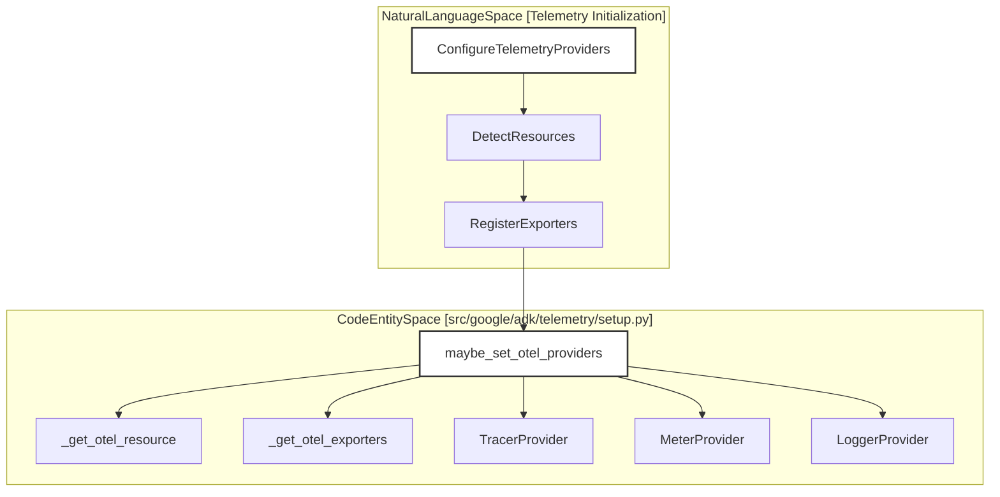
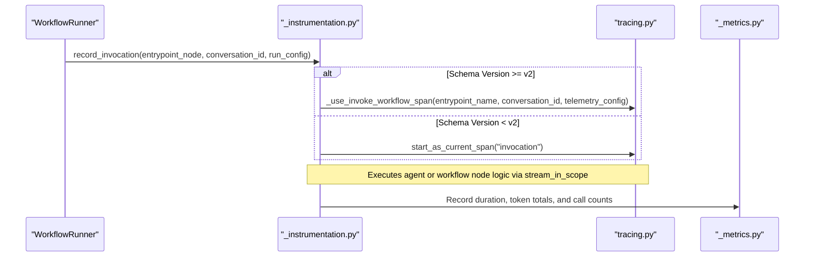
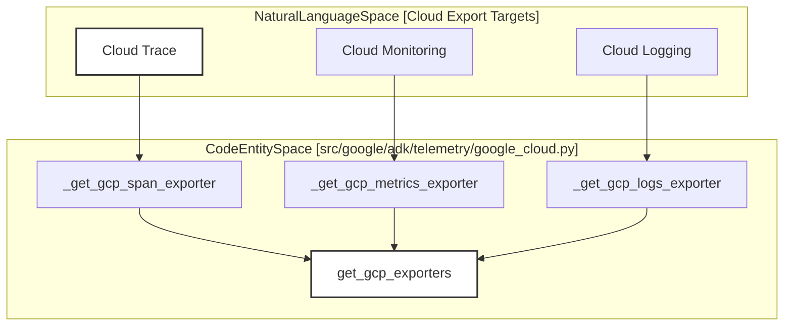

<!-- source: DeepWiki mcp.deepwiki.com · repo google/adk-python · page 12.7 Telemetry and Observability · fetched 2026-10-29 -->

# Telemetry and Observability

<details>
<summary>Relevant source files</summary>

The following files were used as context for generating this wiki page:

- [docs/guides/agents/run_config/index.md](docs/guides/agents/run_config/index.md)
- [docs/guides/telemetry/telemetry_config/index.md](docs/guides/telemetry/telemetry_config/index.md)
- [src/google/adk/flows/llm_flows/context/_fencing.py](src/google/adk/flows/llm_flows/context/_fencing.py)
- [src/google/adk/flows/llm_flows/core/_model_call.py](src/google/adk/flows/llm_flows/core/_model_call.py)
- [src/google/adk/integrations/openai/_openai_llm.py](src/google/adk/integrations/openai/_openai_llm.py)
- [src/google/adk/integrations/openai/_openai_responses_llm.py](src/google/adk/integrations/openai/_openai_responses_llm.py)
- [src/google/adk/models/interactions_utils.py](src/google/adk/models/interactions_utils.py)
- [src/google/adk/telemetry/_adk_attributes.py](src/google/adk/telemetry/_adk_attributes.py)
- [src/google/adk/telemetry/_experimental_semconv.py](src/google/adk/telemetry/_experimental_semconv.py)
- [src/google/adk/telemetry/_gcp_resource.py](src/google/adk/telemetry/_gcp_resource.py)
- [src/google/adk/telemetry/_instrumentation.py](src/google/adk/telemetry/_instrumentation.py)
- [src/google/adk/telemetry/_metrics.py](src/google/adk/telemetry/_metrics.py)
- [src/google/adk/telemetry/context.py](src/google/adk/telemetry/context.py)
- [src/google/adk/telemetry/google_cloud.py](src/google/adk/telemetry/google_cloud.py)
- [src/google/adk/telemetry/node_tracing.py](src/google/adk/telemetry/node_tracing.py)
- [src/google/adk/telemetry/setup.py](src/google/adk/telemetry/setup.py)
- [src/google/adk/telemetry/tracing.py](src/google/adk/telemetry/tracing.py)
- [tests/unittests/flows/llm_flows/core/test_model_call.py](tests/unittests/flows/llm_flows/core/test_model_call.py)
- [tests/unittests/integrations/openai/test_openai_responses_llm.py](tests/unittests/integrations/openai/test_openai_responses_llm.py)
- [tests/unittests/models/test_interactions_utils.py](tests/unittests/models/test_interactions_utils.py)
- [tests/unittests/telemetry/functional/_recording.py](tests/unittests/telemetry/functional/_recording.py)
- [tests/unittests/telemetry/functional/scenarios/conversation.py](tests/unittests/telemetry/functional/scenarios/conversation.py)
- [tests/unittests/telemetry/functional/scenarios/inference.py](tests/unittests/telemetry/functional/scenarios/inference.py)
- [tests/unittests/telemetry/functional_divergences.json](tests/unittests/telemetry/functional_divergences.json)
- [tests/unittests/telemetry/functional_goldens/agent/grounding.json](tests/unittests/telemetry/functional_goldens/agent/grounding.json)
- [tests/unittests/telemetry/functional_goldens/skill/invalid-skill-resource-schema-v1.json](tests/unittests/telemetry/functional_goldens/skill/invalid-skill-resource-schema-v1.json)
- [tests/unittests/telemetry/functional_goldens/skill/invalid-skill-resource-schema-v2.json](tests/unittests/telemetry/functional_goldens/skill/invalid-skill-resource-schema-v2.json)
- [tests/unittests/telemetry/functional_goldens/skill/invalid-skill-schema-v2.json](tests/unittests/telemetry/functional_goldens/skill/invalid-skill-schema-v2.json)
- [tests/unittests/telemetry/functional_goldens/skill/skill-resource-telemetry-schema-v1.json](tests/unittests/telemetry/functional_goldens/skill/skill-resource-telemetry-schema-v1.json)
- [tests/unittests/telemetry/functional_goldens/skill/skill-resource-telemetry-schema-v2.json](tests/unittests/telemetry/functional_goldens/skill/skill-resource-telemetry-schema-v2.json)
- [tests/unittests/telemetry/functional_goldens/skill/skill-script-telemetry-schema-v2.json](tests/unittests/telemetry/functional_goldens/skill/skill-script-telemetry-schema-v2.json)
- [tests/unittests/telemetry/functional_goldens/skill/skill-telemetry-disabled-schema-v1.json](tests/unittests/telemetry/functional_goldens/skill/skill-telemetry-disabled-schema-v1.json)
- [tests/unittests/telemetry/functional_goldens/skill/skill-telemetry-disabled-schema-v2.json](tests/unittests/telemetry/functional_goldens/skill/skill-telemetry-disabled-schema-v2.json)
- [tests/unittests/telemetry/functional_goldens/skill/skill-telemetry-schema-v1.json](tests/unittests/telemetry/functional_goldens/skill/skill-telemetry-schema-v1.json)
- [tests/unittests/telemetry/functional_goldens/skill/skill-telemetry-schema-v2.json](tests/unittests/telemetry/functional_goldens/skill/skill-telemetry-schema-v2.json)
- [tests/unittests/telemetry/functional_node_test_cases.py](tests/unittests/telemetry/functional_node_test_cases.py)
- [tests/unittests/telemetry/functional_test_cases.py](tests/unittests/telemetry/functional_test_cases.py)
- [tests/unittests/telemetry/regenerate.py](tests/unittests/telemetry/regenerate.py)
- [tests/unittests/telemetry/test_experimental_semconv.py](tests/unittests/telemetry/test_experimental_semconv.py)
- [tests/unittests/telemetry/test_functional.py](tests/unittests/telemetry/test_functional.py)
- [tests/unittests/telemetry/test_gcp_resource.py](tests/unittests/telemetry/test_gcp_resource.py)
- [tests/unittests/telemetry/test_google_cloud.py](tests/unittests/telemetry/test_google_cloud.py)
- [tests/unittests/telemetry/test_instrumentation.py](tests/unittests/telemetry/test_instrumentation.py)
- [tests/unittests/telemetry/test_metrics.py](tests/unittests/telemetry/test_metrics.py)
- [tests/unittests/telemetry/test_node_functional.py](tests/unittests/telemetry/test_node_functional.py)
- [tests/unittests/telemetry/test_semconv_conformance.py](tests/unittests/telemetry/test_semconv_conformance.py)
- [tests/unittests/telemetry/test_setup.py](tests/unittests/telemetry/test_setup.py)
- [tests/unittests/telemetry/test_spans.py](tests/unittests/telemetry/test_spans.py)
- [tests/unittests/telemetry/test_telemetry_context.py](tests/unittests/telemetry/test_telemetry_context.py)

</details>


This page covers the technical architecture of telemetry and observability in the ADK Python framework. The purpose of this module is to provide comprehensive OpenTelemetry (OTel) integration, standardized tracing and node tracing, instrumentation, metrics collection, GenAI semantic conventions, and Google Cloud exporters. ADK tracks high-level framework constructs—such as agent invocations, workflow graphs, tool executions, and token usage—while coordinating with underlying model SDKs.

---

## 1. OpenTelemetry Foundation and Setup

ADK integrates tightly with OpenTelemetry packages to manage providers, span processors, metric readers, and log record processors. The telemetry system initializes via `maybe_set_otel_providers()`, which aggregates per-telemetry-type hooks (`OTelHooks`) and configures global OpenTelemetry providers if they have not already been initialized [src/google/adk/telemetry/setup.py:45-72]().


**Figure 1: Telemetry Initialization Bridging Natural Language Configuration to Code Entities**

Sources: [src/google/adk/telemetry/setup.py:45-114]()

---

## 2. Unified Instrumentation, Tracing, and Node Tracing

ADK uses internal context managers defined in `_instrumentation.py`, `tracing.py`, and `node_tracing.py` to unify trace span lifecycles with metric recording [src/google/adk/telemetry/_instrumentation.py:1-176](), [src/google/adk/telemetry/tracing.py:1-120](), [src/google/adk/telemetry/node_tracing.py:1-100]().

### Context Managers and Safe Async Streams
Because ADK's telemetry scopes wrap async generators whose events are yielded to callers, holding an OTel attach token across yields is unsafe. Async generators resume and finalize in the context of whoever drives them. To prevent context leaks where detached scopes leave spans active [src/google/adk/telemetry/_instrumentation.py:114-135](), ADK implements `stream_in_scope()`:

```python
# Conceptual usage in _instrumentation.py
async def stream_in_scope(otel_context, agen):
    ...
```
It attaches the context inside an uninterrupted generator drive step (`_drive`), ensuring clean metrics and exception handling on `GeneratorExit` or error propagation [src/google/adk/telemetry/_instrumentation.py:150-181](). Additionally, `_recording_span()` acts as `trace.use_span` without the attach side-effect, recording escaping exceptions and setting span status safely [src/google/adk/telemetry/_instrumentation.py:86-109]().


**Figure 2: Invocation and Scoping Execution Flow**

Sources: [src/google/adk/telemetry/_instrumentation.py:64-184](), [src/google/adk/telemetry/tracing.py:1-120](), [src/google/adk/telemetry/node_tracing.py:1-100]()

---

## 3. Semantic Conventions (Stable and Experimental)

ADK implements both stable and experimental OpenTelemetry GenAI semantic conventions to ensure compatibility with modern observability backends [src/google/adk/telemetry/_experimental_semconv.py:16-82]().

### Semantic Configuration Flags and TypedDict Structures
*   `OTEL_SEMCONV_STABILITY_OPT_IN`: Controls whether experimental schema attributes and event names are emitted [src/google/adk/telemetry/_experimental_semconv.py:81-82]().
*   `ADK_CAPTURE_MESSAGE_CONTENT_IN_SPANS`: ADK-specific toggle allowing message payloads (prompts and completions) to be logged inside spans [src/google/adk/telemetry/tracing.py:105-118]().

The experimental semantic module (`_experimental_semconv.py`) defines structured TypedDict representations for parts, messages, and tool definitions—such as `InputMessage`, `OutputMessage`, `ToolCall`, and `FunctionToolDefinition`—to normalize telemetry events before export [src/google/adk/telemetry/_experimental_semconv.py:92-148]().

Sources: [src/google/adk/telemetry/_experimental_semconv.py:16-148](), [src/google/adk/telemetry/tracing.py:105-118]()

---

## 4. Metrics Collection and Token Usage

Metrics are declared and managed via `_metrics.py` using OpenTelemetry Meter APIs [src/google/adk/telemetry/_metrics.py:63-66]().

### Key Histograms and Counters
*   `gen_ai.invoke_agent.duration`: Measures agent execution latency with advisory bucket boundaries [src/google/adk/telemetry/_metrics.py:69-88]().
*   `gen_ai.invoke_workflow.duration`: Measures ADK 2.0 workflow execution duration across all nested agents [src/google/adk/telemetry/_metrics.py:89-93]().
*   `gen_ai.execute_tool.duration`: Tracks tool call execution times [src/google/adk/telemetry/_metrics.py:94-114]().
*   Token usage histograms: `adk.experimental.invoke_agent.input_tokens`, `output_tokens`, `total_tokens`, `cache_read.input_tokens`, and `reasoning.output_tokens` [src/google/adk/telemetry/_metrics.py:222-228]().

Sources: [src/google/adk/telemetry/_metrics.py:61-228]()

---

## 5. Exporters and Storage Backends

ADK provides built-in exporters for Google Cloud services, generic OTLP HTTP endpoints, and local debugging through SQLite.

### Google Cloud and Agent Engine Exporters

The `google_cloud.py` module defines `get_gcp_exporters()` to establish connectivity with Cloud Trace, Cloud Monitoring, and Cloud Logging using authorized GCP credentials [src/google/adk/telemetry/google_cloud.py:103-160](). It automatically detects Agent Engine environments and configures appropriate batch span processors and metric readers [src/google/adk/telemetry/google_cloud.py:123-157]().


**Figure 3: Export Architecture Mapping Cloud Targets to Python Exporter Functions**

### SQLite Span Exporter
For local inspection, testing, and lightweight persistence without external collectors, ADK includes span exporters which write OpenTelemetry spans directly into storage backends [src/google/adk/telemetry/google_cloud.py:103-160]().

Sources: [src/google/adk/telemetry/google_cloud.py:103-160]()

---

