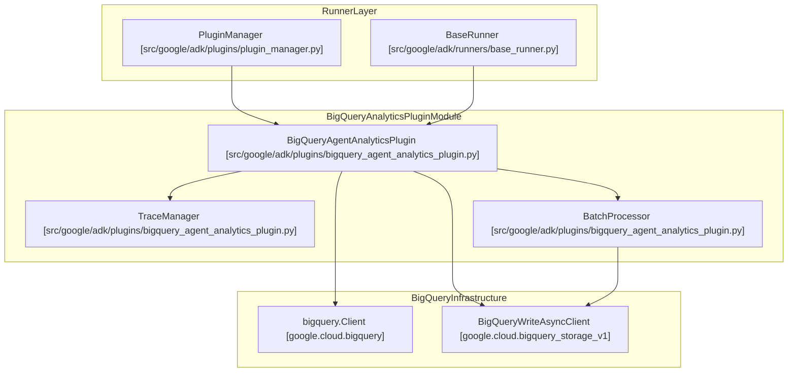
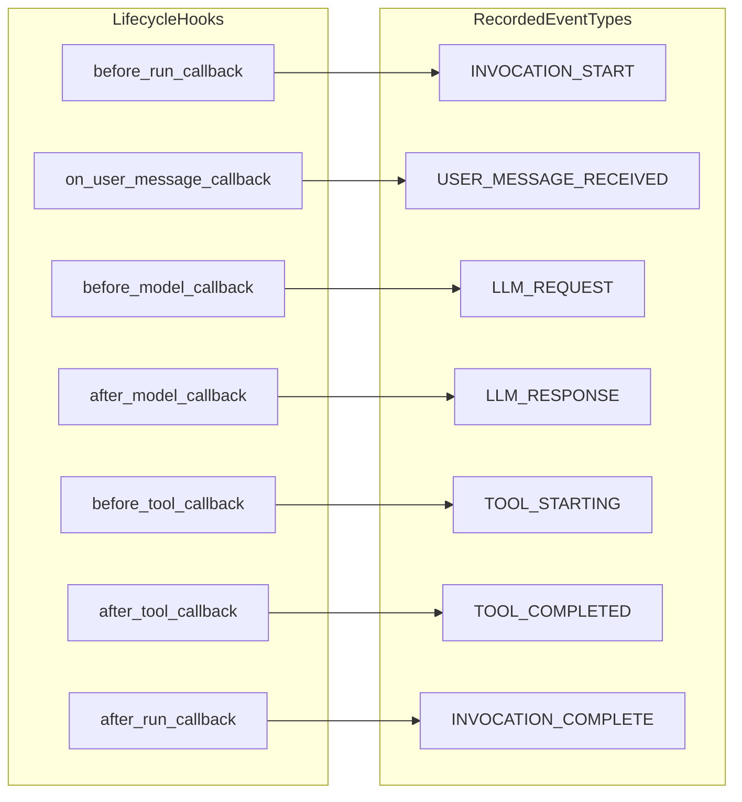

<!-- source: DeepWiki mcp.deepwiki.com · repo google/adk-python · page 12.8 BigQuery Analytics Plugin · fetched 2026-10-29 -->

# BigQuery Analytics Plugin

Relevant source files

The following files were used as context for generating this wiki page:

- [src/google/adk/plugins/__init__.py](src/google/adk/plugins/__init__.py)
- [src/google/adk/plugins/_callback_helpers.py](src/google/adk/plugins/_callback_helpers.py)
- [src/google/adk/plugins/bigquery_agent_analytics_plugin.py](src/google/adk/plugins/bigquery_agent_analytics_plugin.py)
- [src/google/adk/utils/_telemetry_context.py](src/google/adk/utils/_telemetry_context.py)
- [tests/unittests/integrations/bigquery/test_bigquery_client.py](tests/unittests/integrations/bigquery/test_bigquery_client.py)
- [tests/unittests/plugins/test_bigquery_agent_analytics_plugin.py](tests/unittests/plugins/test_bigquery_agent_analytics_plugin.py)
- [tests/unittests/utils/test_telemetry_context.py](tests/unittests/utils/test_telemetry_context.py)

The BigQuery Analytics Plugin provides comprehensive event logging, distributed tracing correlation, and analytics infrastructure for ADK agents by capturing execution telemetry and streaming it directly to Google Cloud BigQuery. This plugin implements the `BasePlugin` interface (`[src/google/adk/plugins/base_plugin.py]()`) and automatically logs user messages, LLM requests/responses, tool executions, and agent lifecycle events.

For general plugin concepts, see [Plugin System](). For OpenTelemetry integration details, see [Telemetry and Observability]().

## Overview

The `BigQueryAgentAnalyticsPlugin` (`[src/google/adk/plugins/bigquery_agent_analytics_plugin.py]()`) captures structured event data during agent execution and persists it via the BigQuery Write API using Apache Arrow serialization. Events are batched asynchronously to minimize invocation latency impact.

### Key Features

| Feature | Description |
|---------|-------------|
| **Asynchronous Batching** | Events are queued and written in high-throughput batches using `BatchProcessor` (`[src/google/adk/plugins/bigquery_agent_analytics_plugin.py]()`). |
| **Event Filtering** | Allowlists and denylists control precisely which event types are persisted. |
| **Content Truncation** | Text length limits prevent oversized rows (`max_content_length`). |
| **GCS Offloading** | Large multimodal parts (images, audio, large text) can be offloaded to Google Cloud Storage with `ObjectRef` pointers (`[src/google/adk/plugins/bigquery_agent_analytics_plugin.py]()`). |
| **Schema Evolution** | Auto-upgrade capabilities dynamically add missing columns (`_SCHEMA_VERSION = "2"`) (`[src/google/adk/plugins/bigquery_agent_analytics_plugin.py:137-146]()`). |
| **Trace Management** | Integrates with OpenTelemetry via `TraceManager` to track span hierarchies and correlation IDs (`[src/google/adk/plugins/bigquery_agent_analytics_plugin.py]()`). |
| **Token Tracking** | Captures granular thinking, tool-use, and cached token metrics from LLM responses (`[src/google/adk/plugins/bigquery_agent_analytics_plugin.py]()`). |

Sources: `[src/google/adk/plugins/bigquery_agent_analytics_plugin.py:137-146]`, `[src/google/adk/plugins/bigquery_agent_analytics_plugin.py]()`

## Plugin Architecture

The following diagram bridges natural language analytics concepts to concrete code entities inside the plugin implementation.

**Architecture Diagram: BigQuery Analytics Plugin Component Structure**

- **`BigQueryAgentAnalyticsPlugin`**: The primary plugin class implementing `BasePlugin` hooks (`[src/google/adk/plugins/bigquery_agent_analytics_plugin.py]()`).
- **`TraceManager`**: Manages span contexts using Python `contextvars` for asynchronous safety (`[src/google/adk/plugins/bigquery_agent_analytics_plugin.py]()`).
- **`BatchProcessor`**: Handles queue buffering, Arrow record batch conversion, and retry logic for the BigQuery Storage Write API (`[src/google/adk/plugins/bigquery_agent_analytics_plugin.py]()`).

Sources: `[src/google/adk/plugins/bigquery_agent_analytics_plugin.py]()`

## Event Types and Callbacks

The plugin hooks into agent invocation lifecycles to record metrics and trace events via distinct callback methods.

**Event Types and Callback Mapping**

### Event Catalog

- **`INVOCATION_START` / `INVOCATION_COMPLETE`**: Track run boundaries, total duration, and session/user identification (`[src/google/adk/plugins/bigquery_agent_analytics_plugin.py]()`).
- **`LLM_REQUEST` / `LLM_RESPONSE`**: Capture prompt configuration, model names, structured content parts, and `usage_metadata` including thinking and tool-use tokens (`[src/google/adk/plugins/bigquery_agent_analytics_plugin.py]()`).
- **`TOOL_STARTING` / `TOOL_COMPLETED` / `TOOL_ERROR`**: Monitor tool invocation metrics, arguments, and execution latency (`[src/google/adk/plugins/bigquery_agent_analytics_plugin.py]()`).

Sources: `[src/google/adk/plugins/bigquery_agent_analytics_plugin.py]()`

## Trace and Span Management

The `TraceManager` class utilizes Python `contextvars` to ensure thread- and task-safe span propagation across concurrent agent sessions (`[src/google/adk/plugins/bigquery_agent_analytics_plugin.py]()`). It bridges OpenTelemetry trace contexts (`trace_id`, `span_id`) directly into BigQuery log rows, enabling joined queries between agent analytics and APM tracing backends.

Sources: `[src/google/adk/plugins/bigquery_agent_analytics_plugin.py]()`

## Batch Processing and Write Pipeline

Events are enqueued and processed asynchronously by `BatchProcessor` (`[src/google/adk/plugins/bigquery_agent_analytics_plugin.py]()`). 

1. **Queueing**: Events are pushed immediately via `_queue.put_nowait()`.
2. **Arrow Serialization**: Batches are converted into Apache Arrow `pa.RecordBatch` structures conforming to the target schema (`[src/google/adk/plugins/bigquery_agent_analytics_plugin.py]()`).
3. **Write API Ingestion**: `BigQueryWriteAsyncClient.append_rows()` streams records into BigQuery with exponential backoff handling for transient failures (`[src/google/adk/plugins/bigquery_agent_analytics_plugin.py]()`).

Sources: `[src/google/adk/plugins/bigquery_agent_analytics_plugin.py]()`

## BigQuery Schema and Token Columns

The plugin manages table schema versioning (`_SCHEMA_VERSION = "2"`) and automatically creates analytics views that project nested JSON attributes into typed columns (`[src/google/adk/plugins/bigquery_agent_analytics_plugin.py:137-146]()`). Key projected columns include:
- `usage_metadata.thinking_token_count`
- `usage_metadata.tool_use_token_count`
- `usage_metadata.cached_content_token_count`

Sources: `[src/google/adk/plugins/bigquery_agent_analytics_plugin.py:137-146]()`

## Plugin Lifecycle and Safety

To prevent multiprocessing issues, the plugin registers with a weak reference set and implements fork hooks (`_after_fork_in_child()`) to re-initialize gRPC channels and worker queues safely after `os.fork()` (`[src/google/adk/plugins/bigquery_agent_analytics_plugin.py]()`). Furthermore, all callback methods are wrapped to ensure analytics exceptions never propagate and crash core agent execution (`[src/google/adk/plugins/bigquery_agent_analytics_plugin.py]()`).

Sources: `[src/google/adk/plugins/bigquery_agent_analytics_plugin.py]()`

---

