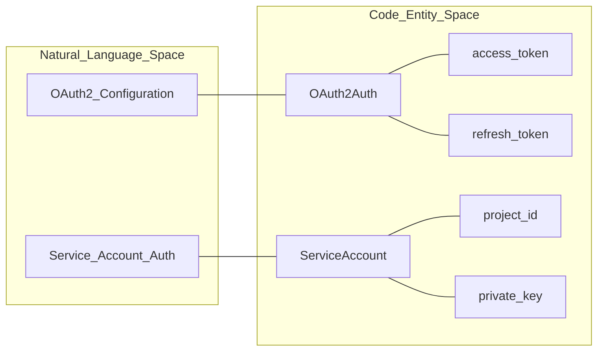
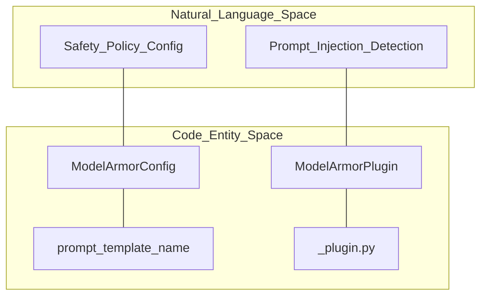

<!-- source: DeepWiki mcp.deepwiki.com · repo google/adk-python · page 12.9 Security, Guardrails and CORS · fetched 2026-10-29 -->

# Security, Guardrails and CORS

<details>
<summary>Relevant source files</summary>

The following files were used as context for generating this wiki page:

- [src/google/adk/cli/_dev_deploy.py](src/google/adk/cli/_dev_deploy.py)
- [src/google/adk/cli/adk_web_server.py](src/google/adk/cli/adk_web_server.py)
- [src/google/adk/cli/api_server.py](src/google/adk/cli/api_server.py)
- [src/google/adk/cli/cli_deploy.py](src/google/adk/cli/cli_deploy.py)
- [src/google/adk/cli/cli_tools_click.py](src/google/adk/cli/cli_tools_click.py)
- [src/google/adk/cli/dev_server.py](src/google/adk/cli/dev_server.py)
- [src/google/adk/cli/fast_api.py](src/google/adk/cli/fast_api.py)
- [src/google/adk/dependencies/_mcp.py](src/google/adk/dependencies/_mcp.py)
- [src/google/adk/plugins/auto_tracing_helpers.py](src/google/adk/plugins/auto_tracing_helpers.py)
- [src/google/adk/plugins/auto_tracing_plugin.py](src/google/adk/plugins/auto_tracing_plugin.py)
- [src/google/adk/plugins/context_filter_plugin.py](src/google/adk/plugins/context_filter_plugin.py)
- [src/google/adk/plugins/save_files_as_artifacts_plugin.py](src/google/adk/plugins/save_files_as_artifacts_plugin.py)
- [src/google/adk/tools/load_mcp_resource_tool.py](src/google/adk/tools/load_mcp_resource_tool.py)
- [src/google/adk/tools/mcp_tool/__init__.py](src/google/adk/tools/mcp_tool/__init__.py)
- [src/google/adk/tools/mcp_tool/mcp_session_manager.py](src/google/adk/tools/mcp_tool/mcp_session_manager.py)
- [src/google/adk/tools/mcp_tool/mcp_tool.py](src/google/adk/tools/mcp_tool/mcp_tool.py)
- [src/google/adk/tools/mcp_tool/mcp_toolset.py](src/google/adk/tools/mcp_tool/mcp_toolset.py)
- [src/google/adk/tools/mcp_tool/session_context.py](src/google/adk/tools/mcp_tool/session_context.py)
- [tests/unittests/cli/test_adk_web_server_run_live.py](tests/unittests/cli/test_adk_web_server_run_live.py)
- [tests/unittests/cli/test_adk_web_server_tests.py](tests/unittests/cli/test_adk_web_server_tests.py)
- [tests/unittests/cli/test_dev_deploy.py](tests/unittests/cli/test_dev_deploy.py)
- [tests/unittests/cli/test_dns_rebinding_protection.py](tests/unittests/cli/test_dns_rebinding_protection.py)
- [tests/unittests/cli/test_fast_api.py](tests/unittests/cli/test_fast_api.py)
- [tests/unittests/cli/test_local_client_check.py](tests/unittests/cli/test_local_client_check.py)
- [tests/unittests/cli/utils/test_cli_deploy.py](tests/unittests/cli/utils/test_cli_deploy.py)
- [tests/unittests/cli/utils/test_cli_deploy_ignore.py](tests/unittests/cli/utils/test_cli_deploy_ignore.py)
- [tests/unittests/cli/utils/test_cli_deploy_to_cloud_run.py](tests/unittests/cli/utils/test_cli_deploy_to_cloud_run.py)
- [tests/unittests/cli/utils/test_cli_tools_click.py](tests/unittests/cli/utils/test_cli_tools_click.py)
- [tests/unittests/plugins/test_auto_tracing_plugin.py](tests/unittests/plugins/test_auto_tracing_plugin.py)
- [tests/unittests/plugins/test_context_filtering_plugin.py](tests/unittests/plugins/test_context_filtering_plugin.py)
- [tests/unittests/plugins/test_save_files_as_artifacts.py](tests/unittests/plugins/test_save_files_as_artifacts.py)
- [tests/unittests/tools/mcp_tool/test_dependencies_mcp.py](tests/unittests/tools/mcp_tool/test_dependencies_mcp.py)
- [tests/unittests/tools/mcp_tool/test_mcp_session_manager.py](tests/unittests/tools/mcp_tool/test_mcp_session_manager.py)
- [tests/unittests/tools/mcp_tool/test_mcp_tool.py](tests/unittests/tools/mcp_tool/test_mcp_tool.py)
- [tests/unittests/tools/mcp_tool/test_mcp_toolset.py](tests/unittests/tools/mcp_tool/test_mcp_toolset.py)
- [tests/unittests/tools/mcp_tool/test_session_context.py](tests/unittests/tools/mcp_tool/test_session_context.py)

</details>


This page details the security architecture, CORS implementation, DNS-rebinding protection, credential redaction, YAML configuration module blocklists, SQL and prompt-injection safeguards, and the Model Armor guardrail plugin within the ADK Python framework (`src/google/adk/`).

## CORS and DNS-Rebinding Protection

ADK provides robust CORS support and DNS-rebinding protection for its FastAPI-based servers (`src/google/adk/cli/fast_api.py` and `src/google/adk/cli/api_server.py`). These mechanisms ensure that the API and development UI are only accessible from trusted origins and hostnames.

### Implementation and Regex Patterns

The CORS logic is primarily handled during the construction of the FastAPI application via `get_fast_api_app` [src/google/adk/cli/fast_api.py:107-134](). It utilizes `CORSMiddleware` from Starlette/FastAPI.

A unique feature of the ADK implementation is the `regex:` prefix for origins. The utility function `_parse_cors_origins` [src/google/adk/cli/api_server.py:135-161]() splits the provided `allow_origins` list into literal origins and a combined regex string.

| Feature | Description |
| :--- | :--- |
| **Literal Origins** | Standard strings like `http://localhost:3000`. |
| **Regex Patterns** | Strings starting with `regex:`. These are stripped of the prefix and joined with `|` (OR) into a single pattern [src/google/adk/cli/api_server.py:151-160](). |
| **FastAPI Integration** | Literal origins are passed to `allow_origins`, while the combined regex is passed to `allow_origin_regex` in `CORSMiddleware`. |

### DNS-Rebinding Protection

To protect against DNS-rebinding attacks, ADK includes origin validation routines [src/google/adk/cli/api_server.py:163-176]() that validate incoming request headers against the server's bound address and allowed origins.

*   **Loopback Validation**: Requests to loopback addresses (e.g., `localhost`, `127.0.0.1`, `[::1]`) are permitted if the server is bound to a loopback address.
*   **Origin Match**: If the request is not a loopback request, the `Host` and effective origin must match one of the allowed literal origins or the allowed origin regex via `_is_origin_allowed` [src/google/adk/cli/api_server.py:163-176]().

**CORS and Origin Configuration Flow**
```mermaid
graph TD
    subgraph "CLI_Space"
        [adk_api_server] -- "--allow_origins" --> B["click.option"]
    end

    subgraph "Code_Entity_Space"
        B --> C["get_fast_api_app(allow_origins=...)"]
        C -- "calls" --> D["_parse_cors_origins(allow_origins)"]
        D -- "returns_(literal_origins,_combined_regex)" --> E["CORSMiddleware"]
        C -- "registers" --> H["_OriginCheckMiddleware"]
    end

    subgraph "FastAPI_/_Starlette"
        E -- "Configures" --> F["allow_origins"]
        E -- "Configures" --> G["allow_origin_regex"]
        H -- "Validates" --> I["Request_Host_Header"]
    end
```
Sources: [src/google/adk/cli/api_server.py:135-176](), [src/google/adk/cli/fast_api.py:107-134]()

---

## Authentication Providers and Credential Management

The ADK uses a provider-based architecture for handling authentication, allowing different tools to use specialized logic for obtaining credentials.

### Credential Redaction

To prevent sensitive information (such as API keys, tokens, or private keys) from leaking into logs, traces, or agent states, ADK implements credential redaction routines [src/google/adk/auth/auth_credential.py:28-33](). When `AuthCredential` objects are serialized or printed, fields flagged as secret are automatically masked.

**Credential Entity Mapping**

Sources: [src/google/adk/auth/auth_credential.py:28-33]()

---

## YAML Configuration Security and Module Blocklists

The API server includes builder endpoints for uploading agent configurations when the development UI is enabled [src/google/adk/cli/fast_api.py:107-146](). To prevent arbitrary code execution, ADK implements layers of validation.

### Configuration Safety Measures

1.  **Local Client Enforcement**: Mutating `/dev` endpoints and Agent Builder utilities enforce `_require_local_agent_builder_client` [src/google/adk/cli/dev_server.py:128-164](), rejecting remote callers unless explicitly overridden via environment variables.
2.  **Module Blocklist**: For YAML-based agent configurations referencing Python code, ADK enforces validation rules to prevent OS-level escapes.
3.  **Path Traversal Prevention**: Upload parsing functions reject paths containing parent directory references (`..`) or absolute paths outside the designated agents directory.

Sources: [src/google/adk/cli/dev_server.py:128-164](), [src/google/adk/cli/fast_api.py:107-146]()

---

## SQL Injection and Prompt-Injection Guards

ADK tools interacting with databases (such as BigQuery, Spanner, and SQLAlchemy backends) incorporate parameterized query builders and SQL injection guards. Similarly, inputs processed by agent flows pass through sanitization pipelines to mitigate prompt-injection vulnerabilities.

*   **SQL Guards**: User-provided inputs passed to analytics plugins or database toolsets are mapped through safe parameter bindings rather than string interpolation.
*   **Prompt-Injection Guards**: Content processors intercept incoming multi-turn prompts to detect override patterns or jailbreak attempts before they reach the model execution phase.

Sources: [src/google/adk/agents/llm_agent.py]()

---

## Model Armor Guardrail Plugin

The Model Armor guardrail plugin (`src/google/adk/integrations/model_armor/`) integrates Google Cloud Model Armor capabilities into the ADK plugin pipeline to inspect prompts and model responses for safety violations, prompt injection, and data loss.

*   `ModelArmorPlugin`: Intercepts agent interactions during model stages.
*   `ModelArmorConfig` [src/google/adk/integrations/model_armor/_config.py:27-93](): Configures template IDs (`prompt_template_name`, `response_template_name`, `tool_output_template_name`), blocking behaviors (`block_on_screening_failure`), and sensitive data de-identification (`deidentify_sensitive_data`).

**Model Armor Guardrail Mapping**

Sources: [src/google/adk/integrations/model_armor/_plugin.py](), [src/google/adk/integrations/model_armor/_config.py:27-93]()

---

