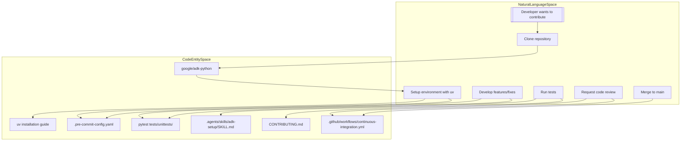
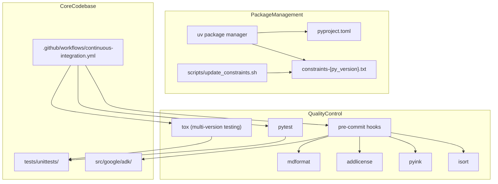

<!-- source: DeepWiki mcp.deepwiki.com · repo google/adk-python · page 13 Development and Contributing · fetched 2026-10-29 -->

# Development and Contributing

<details>
<summary>Relevant source files</summary>

The following files were used as context for generating this wiki page:

- [.agents/skills/adk-setup/SKILL.md](.agents/skills/adk-setup/SKILL.md)
- [.github/pull_request_template.md](.github/pull_request_template.md)
- [.gitignore](.gitignore)
- [AGENTS.md](AGENTS.md)
- [CONTRIBUTING.md](CONTRIBUTING.md)
- [README.md](README.md)
- [assets/adk-web-dev-ui-function-call.png](assets/adk-web-dev-ui-function-call.png)
- [assets/adk-web-dev-ui.png](assets/adk-web-dev-ui.png)
- [contributing/README.md](contributing/README.md)
- [contributing/adk_project_overview_and_architecture.md](contributing/adk_project_overview_and_architecture.md)
- [scripts/update_constraints.sh](scripts/update_constraints.sh)
- [tests/unittests/conftest.py](tests/unittests/conftest.py)
- [tox.ini](tox.ini)

</details>


This page provides an overview of how to contribute to the ADK Python repository, covering the development workflow, environment setup, code quality standards, testing practices, and release processes. It is intended for developers who want to contribute code, documentation, or other improvements to the ADK project.

For general contribution guidelines and community policies, see `CONTRIBUTING.md` [CONTRIBUTING.md:1-19](). As a parent guide, this page links out to detailed child pages covering specific domains of the development lifecycle:
- **Local Development Setup:** [Local Development Setup](#13.1) — Setting up the development environment with `uv`, virtual environments, running unit tests, and constraints update scripts.
- **Project Structure:** [Project Structure](#13.2) — Repository layout, `src/google/adk` organization, test structure, import conventions, scripts utilities, and `.agents/skills` AI skills.
- **Code Quality and CI:** [Code Quality and CI](#13.3) — Style guide, autoformat tools (`pyink`, `isort`), pre-commit hooks, compliance checks, `pytest`, and GitHub Actions workflows.
- **Release Process:** [Release Process](#13.4) — `release-please` configuration, version management, changelog curation, PyPI publishing, and web sync.
- **Contributing Guidelines:** [Contributing Guidelines](#13.5) — PR requirements, small focused changes, testing plans, issue creation, and `AGENTS.md` conventions.
- **Samples and Unit Guides:** [Samples and Unit Guides](#13.6) — Mapping the contribution sample tree, per-unit documentation, and test validation via `tests/unittests/test_samples.py`.

---

## Development Workflow Overview

The ADK development workflow follows a standard fork-and-pull-request model with automated tooling for code quality, testing, and releases. The diagram below bridges natural language development tasks to specific code entities and scripts in the repository.

### Contributor Workflow and Code Entity Mapping



Sources: [CONTRIBUTING.md:1-19](), [CONTRIBUTING.md:145-189](), [.agents/skills/adk-setup/SKILL.md:1-105]()

---

## Development Environment Architecture

The ADK development environment uses modern Python tooling for fast, reproducible builds and consistent code quality. The following diagram maps package management and quality control tools to codebase entities.

### Development Tools and Entity Mapping



Sources: [CONTRIBUTING.md:145-189](), [scripts/update_constraints.sh:1-173]()

---

## Quick Start for Contributors

### Prerequisites

| Requirement | Version | Installation Reference |
|:------------|:--------|:-----------------------|
| Python      | 3.11+   | [README.md:77](), [.agents/skills/adk-setup/SKILL.md:23-44]() |
| `uv`        | Latest  | [CONTRIBUTING.md:154-158]() |
| `git`       | Any recent | System package manager |

Sources: [README.md:77](), [CONTRIBUTING.md:145-189](), [.agents/skills/adk-setup/SKILL.md:21-44]()

### Setup Steps

```shell
# 1. Clone the repository
gh repo clone google/adk-python
cd adk-python

# 2. Create virtual environment
uv venv --python "python3.11" ".venv"

# 3. Activate the virtual environment
source .venv/bin/activate

# 4. Install all development dependencies including extras
uv sync --all-extras

# 5. Run tests to verify setup
pytest ./tests/unittests

# 6. Run pre-commit hooks manually
pre-commit run --all-files
```

Sources: [CONTRIBUTING.md:145-189](), [.agents/skills/adk-setup/SKILL.md:45-104]()

---

## Core Development Sub-Topics

### Local Development Setup
For detailed instructions on configuring your virtual environment using `uv`, handling Python version constraints, running isolated tests, and executing constraints update scripts, see [Local Development Setup](#13.1).
Sources: [CONTRIBUTING.md:145-189](), [scripts/update_constraints.sh:1-173]()

### Project Structure
For an in-depth breakdown of the repository layout, `src/google/adk/` packaging, `tests/` organization, import conventions, utility scripts under `scripts/`, and AI-assisted workflows in `.agents/skills/`, see [Project Structure](#13.2).
Sources: [CONTRIBUTING.md:1-19](), [AGENTS.md:1-28](), [contributing/README.md:10-14]()

### Code Quality and CI
For guidelines on style compliance, auto-formatting with `pyink` and `isort`, pre-commit hooks, `addlicense` header checks, `pytest` configurations, and GitHub Actions continuous integration pipelines, see [Code Quality and CI](#13.3).
Sources: [CONTRIBUTING.md:92-144]()

### Release Process
For documentation on `release-please` integration and manifests, version management, changelog curation, cherry-pick strategies, PyPI publishing workflows, and web synchronization, see [Release Process](#13.4).
Sources: [CONTRIBUTING.md:48-61]()

### Contributing Guidelines
For pull request requirements, maintaining small focused changes, writing comprehensive testing plans, creating issues, and adhering to `AGENTS.md` conventions, see [Contributing Guidelines](#13.5).
Sources: [CONTRIBUTING.md:62-144](), [AGENTS.md:1-28]()

### Samples and Unit Guides
For navigation of the contribution samples tree, the `docs/guides/` documentation set, and sample validation through `tests/unittests/test_samples.py`, see [Samples and Unit Guides](#13.6).
Sources: [README.md:19-23](), [contributing/README.md:5-9]()

---

