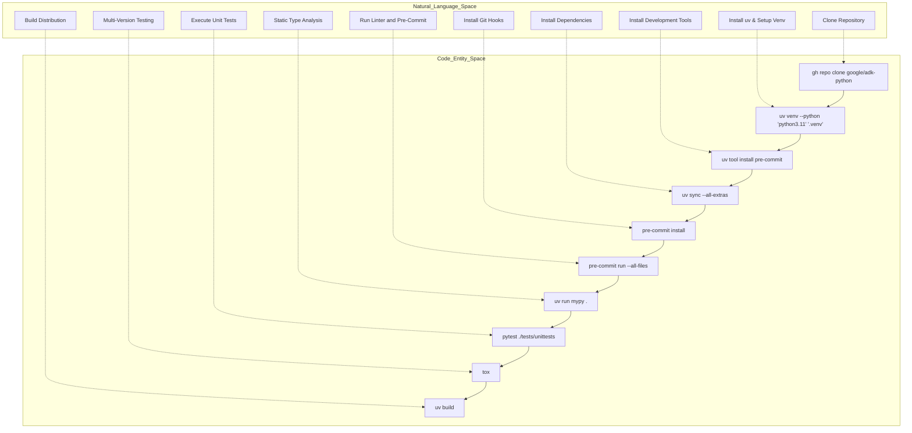
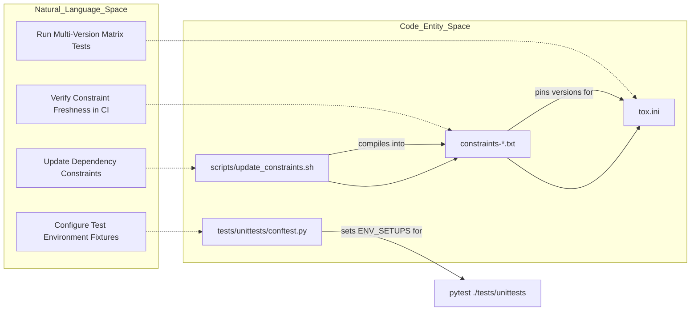

<!-- source: DeepWiki mcp.deepwiki.com · repo google/adk-python · page 13.1 Local Development Setup · fetched 2026-10-29 -->

# Local Development Setup

<details>
<summary>Relevant source files</summary>

The following files were used as context for generating this wiki page:

- [.agents/skills/adk-setup/SKILL.md](.agents/skills/adk-setup/SKILL.md)
- [.github/pull_request_template.md](.github/pull_request_template.md)
- [.gitignore](.gitignore)
- [AGENTS.md](AGENTS.md)
- [CONTRIBUTING.md](CONTRIBUTING.md)
- [README.md](README.md)
- [assets/adk-web-dev-ui-function-call.png](assets/adk-web-dev-ui-function-call.png)
- [assets/adk-web-dev-ui.png](assets/adk-web-dev-ui.png)
- [constraints-3.11.txt](constraints-3.11.txt)
- [constraints-3.12.txt](constraints-3.12.txt)
- [constraints-3.13.txt](constraints-3.13.txt)
- [constraints-3.14.txt](constraints-3.14.txt)
- [constraints-3.15.txt](constraints-3.15.txt)
- [contributing/README.md](contributing/README.md)
- [contributing/adk_project_overview_and_architecture.md](contributing/adk_project_overview_and_architecture.md)
- [pyproject.toml](pyproject.toml)
- [scripts/update_constraints.sh](scripts/update_constraints.sh)
- [src/google/adk/tools/openapi_tool/openapi_spec_parser/tool_auth_handler.py](src/google/adk/tools/openapi_tool/openapi_spec_parser/tool_auth_handler.py)
- [tests/unittests/conftest.py](tests/unittests/conftest.py)
- [tests/unittests/tools/openapi_tool/openapi_spec_parser/test_tool_auth_handler.py](tests/unittests/tools/openapi_tool/openapi_spec_parser/test_tool_auth_handler.py)
- [tox.ini](tox.ini)

</details>


## Purpose and Scope

This page details setting up the local development environment for contributing to the ADK Python repository [pyproject.toml:1-14](). It covers installing prerequisites, managing virtual environments and dependencies via `uv`, updating version constraints using the automated constraints script across Python versions `3.11` through `3.15` [pyproject.toml:15-27](), [scripts/update_constraints.sh:49](), executing unit tests with environment configurations [tests/unittests/conftest.py:32-49](), running type checks, and maintaining code compliance using pre-commit hooks and validation scripts [CONTRIBUTING.md:145-189]().

Sources: [pyproject.toml:1-27](), [scripts/update_constraints.sh:49](), [tests/unittests/conftest.py:32-49](), [CONTRIBUTING.md:145-189]()

---

## Prerequisites and Initial Setup

ADK Python relies on `uv` for high-speed package management and virtual environment orchestration [CONTRIBUTING.md:28](). Supported Python versions range from `3.11` through `3.15` [pyproject.toml:15-27]().

| Tool | Minimum / Recommended | Purpose |
|------|-----------------------|---------|
| Python | `>=3.11` [pyproject.toml:15-15]() (`3.11`–`3.15` supported) | Runtime environment |
| `uv` | Latest [CONTRIBUTING.md:154-158]() | Dependency resolution, virtual environments, and fast package installation |
| `pre-commit` | `>=4` [pyproject.toml:181-190]() | Automated code linting, formatting, and compliance enforcement |
| `tox` | `>=4` [pyproject.toml:181-190]() | Multi-version test execution with `tox-uv` |

### Repository Setup Commands

```bash
# Clone and enter directory
gh repo clone google/adk-python
cd adk-python

# Create virtual environment using Python 3.11
uv venv --python "python3.11" ".venv"
source .venv/bin/activate

# Install development tools (pre-commit, tox, tox-uv)
uv tool install pre-commit
uv tool install tox --with tox-uv

# Install all runtime and optional dependencies
uv sync --all-extras

# Install git pre-commit hooks
pre-commit install
```

Sources: [pyproject.toml:15-27](), [pyproject.toml:181-190](), [CONTRIBUTING.md:146-189]()

---

## Natural Language Space to Code Entity Space: Development Cycle

The following diagram bridges high-level development goals to their exact command-line tool invocations and codebase utilities within the ADK repository.



Sources: [CONTRIBUTING.md:146-189](), [pyproject.toml:181-190]()

---

## Dependencies and Constraints Management

ADK maintains explicit version constraints files per Python version (`constraints-3.11.txt`, `constraints-3.12.txt`, `constraints-3.13.txt`, `constraints-3.14.txt`, and `constraints-3.15.txt`) to ensure reproducible builds and prevent transitive dependency breakage [constraints-3.11.txt:1-2](), [constraints-3.15.txt:1-2]().

### Automated Constraints Updates

The repository includes `scripts/update_constraints.sh` to automate compiling dependencies using `uv pip compile` across all supported Python versions (`3.11`, `3.12`, `3.13`, `3.14`, `3.15`) [scripts/update_constraints.sh:49]().

```bash
# Update constraints files in-place
./scripts/update_constraints.sh

# Check if constraints are up to date (exits with 1 if out of date, used in CI)
./scripts/update_constraints.sh --check

# Force update constraint headers and versions
./scripts/update_constraints.sh --force
```

The script dynamically excludes `google-adk` via `--no-emit-package google-adk` to prevent self-referential pinning during dependency resolution [scripts/update_constraints.sh:87-91]().

Sources: [scripts/update_constraints.sh:1-173](), [constraints-3.11.txt:1-2](), [constraints-3.15.txt:1-2]()

---

## Natural Language Space to Code Entity Space: Constraint & CI Pipelines

The following diagram associates high-level constraint management and testing tasks with their corresponding script and configuration files in the codebase.



Sources: [scripts/update_constraints.sh:1-173](), [tests/unittests/conftest.py:32-49](), [constraints-3.11.txt:1-2]()

---

## Code Quality, Pre-Commit Hooks, and Compliance Checks

Pre-commit hooks enforce formatting, linting, and license compliance across the repository [CONTRIBUTING.md:165-189]().

### Pre-Commit Hooks and Tooling
- `ruff`: Fast Python linter and code fixer.
- `isort`: Import sorting.
- `pyink`: Formatter fork of Black.
- `addlicense`: Apache 2.0 license header enforcement (integrated with Go `addlicense` tool if installed) [CONTRIBUTING.md:170-178]().
- `codespell`: Spelling checker for code and documentation.

Sources: [CONTRIBUTING.md:165-189]()

---

## Running Unit Tests, Type Checking, and CI Validation

### Unit Tests with Pytest and Environment Fixtures

Unit tests are executed via `pytest` [CONTRIBUTING.md:97-114](). Test configuration in `tests/unittests/conftest.py` automatically injects environment variables (`GOOGLE_API_KEY`, `GOOGLE_CLOUD_PROJECT`, `ADK_ALLOW_WIP_FEATURES`) and configures safe defaults for GCP metadata mocking during test sessions [tests/unittests/conftest.py:32-138](). For Python `3.15`, a lazy imports filter is registered to handle proxy specs correctly [tests/unittests/conftest.py:23-24]().

```bash
pytest ./tests/unittests
```

### Static Type Analysis with Mypy

ADK runs strict type validation using `mypy` [CONTRIBUTING.md:180-190]():

```bash
uv run mypy .
```

### Multi-Version Testing with Tox

`tox` with `tox-uv` coordinates execution across Python matrix environments defined in the workspace [CONTRIBUTING.md:165-168]().

```bash
tox
```

Sources: [CONTRIBUTING.md:97-114](), [tests/unittests/conftest.py:1-138]()

---

## Building the Package

To build source distributions and binary wheels, use `uv build`. Artifacts are stored under `dist/` [pyproject.toml:1-5](), [.gitignore:9]().

```bash
uv build
```

Sources: [pyproject.toml:1-5](), [.gitignore:1-123]()

---

