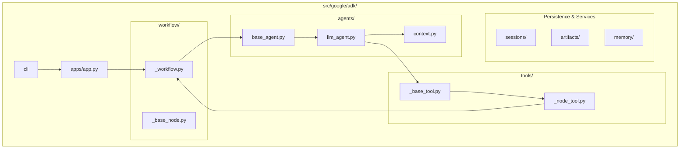
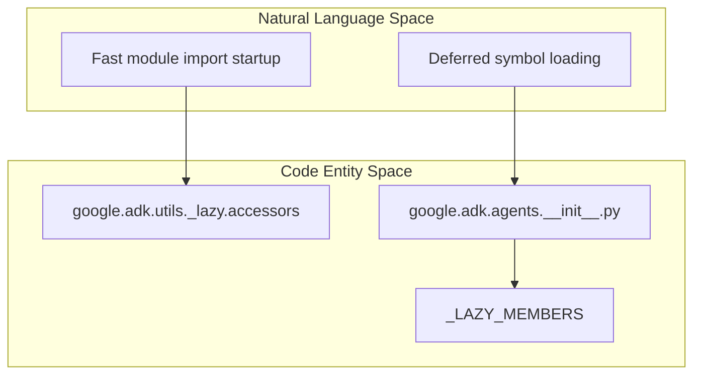
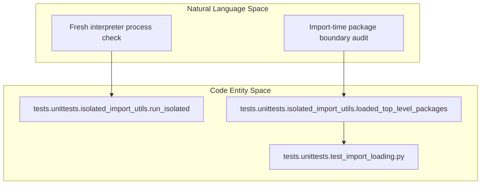

<!-- source: DeepWiki mcp.deepwiki.com · repo google/adk-python · page 13.2 Project Structure · fetched 2026-10-29 -->

# Project Structure

Relevant source files

The following files were used as context for generating this wiki page:

- [.agents/skills/adk-unit-guide/SKILL.md](.agents/skills/adk-unit-guide/SKILL.md)
- [.agents/skills/adk-unit-guide/references/guide-template.md](.agents/skills/adk-unit-guide/references/guide-template.md)
- [contributing/samples/live/streaming_tool_events/README.md](contributing/samples/live/streaming_tool_events/README.md)
- [contributing/samples/live/streaming_tool_events/__init__.py](contributing/samples/live/streaming_tool_events/__init__.py)
- [contributing/samples/live/streaming_tool_events/agent.py](contributing/samples/live/streaming_tool_events/agent.py)
- [docs/guides/a2a/agent/config/index.md](docs/guides/a2a/agent/config/index.md)
- [docs/guides/a2a/executor/a2a_agent_executor/index.md](docs/guides/a2a/executor/a2a_agent_executor/index.md)
- [docs/guides/a2a/utils/agent_card_builder/index.md](docs/guides/a2a/utils/agent_card_builder/index.md)
- [docs/guides/a2a/utils/agent_to_a2a/index.md](docs/guides/a2a/utils/agent_to_a2a/index.md)
- [docs/guides/code_executors/code_executor/index.md](docs/guides/code_executors/code_executor/index.md)
- [docs/guides/environment/base_environment/index.md](docs/guides/environment/base_environment/index.md)
- [docs/guides/errors/index.md](docs/guides/errors/index.md)
- [docs/guides/planners/planner/index.md](docs/guides/planners/planner/index.md)
- [docs/guides/skills/skill_registry/index.md](docs/guides/skills/skill_registry/index.md)
- [scripts/check_new_py_files.py](scripts/check_new_py_files.py)
- [src/google/adk/__init__.py](src/google/adk/__init__.py)
- [src/google/adk/agents/__init__.py](src/google/adk/agents/__init__.py)
- [src/google/adk/cli/__init__.py](src/google/adk/cli/__init__.py)
- [src/google/adk/dependencies/__init__.py](src/google/adk/dependencies/__init__.py)
- [src/google/adk/dependencies/rouge_scorer.py](src/google/adk/dependencies/rouge_scorer.py)
- [src/google/adk/dependencies/vertexai.py](src/google/adk/dependencies/vertexai.py)
- [src/google/adk/errors/__init__.py](src/google/adk/errors/__init__.py)
- [src/google/adk/errors/_invocation_not_found_error.py](src/google/adk/errors/_invocation_not_found_error.py)
- [src/google/adk/errors/_stale_session_error.py](src/google/adk/errors/_stale_session_error.py)
- [src/google/adk/errors/not_found_error.py](src/google/adk/errors/not_found_error.py)
- [src/google/adk/integrations/bigquery/search_tool.py](src/google/adk/integrations/bigquery/search_tool.py)
- [src/google/adk/utils/_lazy.py](src/google/adk/utils/_lazy.py)
- [src/google/adk/workflow/__init__.py](src/google/adk/workflow/__init__.py)
- [tests/unittests/dependencies/test_vertexai.py](tests/unittests/dependencies/test_vertexai.py)
- [tests/unittests/isolated_import_utils.py](tests/unittests/isolated_import_utils.py)
- [tests/unittests/scripts/test_check_new_py_files.py](tests/unittests/scripts/test_check_new_py_files.py)
- [tests/unittests/streaming/test_streaming_tool_events.py](tests/unittests/streaming/test_streaming_tool_events.py)
- [tests/unittests/test_import_loading.py](tests/unittests/test_import_loading.py)
- [tests/unittests/test_optional_dependencies.py](tests/unittests/test_optional_dependencies.py)
- [tests/unittests/test_release_dependencies.py](tests/unittests/test_release_dependencies.py)
- [tests/unittests/testing_utils.py](tests/unittests/testing_utils.py)
- [tests/unittests/utils/test_lazy.py](tests/unittests/utils/test_lazy.py)

This document describes the physical organization of the ADK codebase, including directory structure, module layout, import conventions, script utilities, and how logical components map to code locations. For local development setup, see [13.1 Local Development Setup](). For code quality standards and CI pipelines, see [13.3 Code Quality and CI]().

Sources: [.agents/skills/adk-review/SKILL.md:1-15](), [.agents/skills/adk-style/SKILL.md:1-17]()

## Repository Layout and `src/google/adk/` Organization

The repository follows a clean, modular layout separating core source code under `src/google/adk/`, comprehensive test suites under `tests/`, automation scripts under `scripts/`, and AI agent guidance under `.agents/skills/`.

| Top-Level Directory | Purpose | Key Contents |
|---------------------|---------|--------------|
| `src/google/adk/` | Main source code namespace package | Core modules (`agents/`, `workflow/`, `tools/`, `runners/`, `sessions/`, `cli/`, `apps/`) |
| `tests/` | Automated test suites | Unit tests (`tests/unittests/`), runner validations, and dependency guard tests |
| `contributing/` | Samples & documentation | Architecture guides, sample agents, and task guides |
| `docs/` | Developer documentation | Markdown guides and references |
| `scripts/` | Automation & CI utilities | Database migration helpers, compliance checks, prefix validation, and changelog management |
| `.agents/skills/` | AI agent skills | Markdown-based instructions and specifications for automated coding and review assistants |

Sources: [.agents/skills/adk-review/SKILL.md:1-15](), [.agents/skills/adk-unit-guide/SKILL.md:128-131]()

The core source organization within `src/google/adk/` isolates concerns into distinct sub-packages:
- **`agents/`**: Defines `BaseAgent`, `LlmAgent`, configuration utilities, and context management [src/google/adk/agents/__init__.py:41-80]().
- **`workflow/`**: Implements ADK 2.0 graph-based execution engines, nodes (`BaseNode`, `FunctionNode`), and schedulers.
- **`tools/`**: Contains base tool interfaces, function tools, MCP toolsets, and specialized tool integrations.
- **`runners/`**: Stateless orchestration engines executing event loops and managing invocation contexts.
- **`sessions/`**, **`artifacts/`**, **`memory/`**: Persistence and retrieval backends (InMemory, Sqlite, Database, Firestore, Redis).
- **`cli/`**: Command-line interface utilities, FastAPI production server, and development web server.
- **`apps/`**: The top-level `App` container managing plugins, event compaction, and context cache configurations.

Title: "ADK Core Module Architecture"

Sources: [src/google/adk/agents/__init__.py:41-80]()

## Import Conventions and Lazy Loading

ADK enforces strict import patterns to maintain clean module boundaries and prevent circular dependencies:

1.  **Lazy Package Initialization**: Top-level packages (`google.adk`, `google.adk.agents`, `google.adk.cli`, `google.adk.cli.utils`, `google.adk.workflow`) delegate member resolution to lazy accessor dictionaries [src/google/adk/agents/__init__.py:82](). This ensures lightweight imports do not prematurely load heavy runtime stacks such as FastAPI, SQLAlchemy, or Google GenAI.
2.  **Public API Access**: User-defined agents, extensions, and external code must use absolute imports. For source code (`src/`), relative imports are used, while tests (`tests/`) use absolute imports [.agents/skills/adk-style/references/imports.md:5-8]().
3.  **Import from Module, Not Package**: Always import directly from the module (e.g., `from ..agents.llm_agent import LlmAgent`) rather than through `__init__.py` files to avoid import cycles and eager loading [.agents/skills/adk-style/references/imports.md:9-12]().
4.  **CLI Isolation**: Core library code under `src/google/adk/` is prohibited from importing from `google.adk.cli` modules to prevent upward dependency cycles, enforced via compliance checks [.agents/skills/adk-style/references/imports.md:13-19]().
5.  **Future Annotations**: All source files must include `from __future__ import annotations` (except `__init__.py` and `version.py`) to support deferred evaluation of type hints [.agents/skills/adk-style/references/typing.md:12-15](), [.agents/skills/adk-style/references/imports.md:57-63]().
6.  **`TYPE_CHECKING` Imports**: Imports needed only for type hints should be placed within a `if TYPE_CHECKING:` block to prevent runtime imports and circular dependencies [src/google/adk/dependencies/vertexai.py:22-24](), [.agents/skills/adk-style/references/imports.md:51-63]().
7.  **Optional Dependencies**: Optional dependencies (e.g., `anthropic`, `litellm`, cloud clients) must not be imported at the module level in code paths reachable by `from google.adk.agents import Agent` or `from google.adk.runners import Runner` [tests/unittests/test_import_loading.py:52-55](), [tests/unittests/test_optional_dependencies.py:145-151]().

Sources: [src/google/adk/agents/__init__.py:41-82](), [src/google/adk/dependencies/vertexai.py:22-33](), [tests/unittests/test_import_loading.py:52-55](), [tests/unittests/test_optional_dependencies.py:145-151]()

## Automation Scripts and CI Utilities (`scripts/`)

The `scripts/` directory houses automation utilities used during development, pre-commit hooks, and CI pipelines.

### 1. Private Naming and Guide Enforcement (`check_new_py_files.py`)
ADK enforces strict conventions for newly added Python files under `src/google/adk/`:
- **Private-by-default**: Newly added files must have a `_`-prefixed basename unless explicitly exposed via subpackage `__init__.py` and `__all__` [scripts/check_new_py_files.py:19-22]().
- **Unit Guide Requirement**: Non-exempt Python files require a corresponding documentation guide under `docs/guides/` or a valid `NO_UNIT_GUIDE=<reason>` commit tag [scripts/check_new_py_files.py:23-27](), [scripts/check_new_py_files.py:106-108]().

### 2. Constraints and Dependency Management
Utilities maintain locked dependency constraints files per Python version (e.g., `constraints-3.11.txt`) and guard against unsafe checkpoint releases and unversioned optional dependency leaks [tests/unittests/test_release_dependencies.py:60-80]().

Sources: [scripts/check_new_py_files.py:16-51](), [tests/unittests/test_release_dependencies.py:60-80]()

## Test Structure (`tests/`) and Continuous Integration

The test suite is organized into subdirectories under `tests/` to target different validation layers:

| Test Subdirectory | Scope & Focus | Execution Tooling |
|-------------------|---------------|-------------------|
| `tests/unittests/` | Granular unit tests covering individual agents, workflows, tools, and CLI utilities | `pytest` |
| `tests/unittests/streaming/` | Live streaming and tool event handling validation [tests/unittests/streaming/test_streaming_tool_events.py:15-21]() | `pytest` |
| `tests/unittests/isolated_import_utils.py` | Fresh-process interpreter checks for lazy import loading and side effects [tests/unittests/isolated_import_utils.py:15-19]() | `pytest` |

Continuous Integration workflows defined in GitHub Actions execute pre-commit linters, static type checks via `mypy`, and hermetic unit test suites managed by isolated import checks and test fixtures [tests/unittests/isolated_import_utils.py:34-55]().

Sources: [tests/unittests/isolated_import_utils.py:34-55](), [tests/unittests/streaming/test_streaming_tool_events.py:15-21]()

## AI Agent Skills and Guidance (`.agents/skills/`)

The `.agents/skills/` directory contains structured markdown instructions that guide AI coding assistants in maintaining repository standards and producing developer guides [-.agents/skills/adk-unit-guide/SKILL.md:1-16]():
- **`adk-unit-guide`**: Specifies how to write granular usage documentation for code units under `docs/guides/` [-.agents/skills/adk-unit-guide/SKILL.md:18-28](), following a strict template structure [-.agents/skills/adk-unit-guide/references/guide-template.md:1-56]().
- **`adk-review`**: Provides detailed review checklists for verifying correctness, design, style, and tests.

Sources: [-.agents/skills/adk-unit-guide/SKILL.md:1-28](), [-.agents/skills/adk-unit-guide/references/guide-template.md:1-56]()

## Mapping Natural Language Space to Code Entities

### Lazy Package Loading and Accessor Resolution
This diagram connects the conceptual requirement of fast module startup times to the concrete lazy loading implementation in `google.adk.agents` and `_lazy`.

Title: "Lazy Loading Architecture Mapping"

Sources: [src/google/adk/agents/__init__.py:41-82]()

### Fresh Process Import Isolation and Guard Testing
This diagram connects the concept of import-time side-effect verification to the isolated execution utilities and test suites.

Title: "Import Isolation Testing Mapping"

Sources: [tests/unittests/isolated_import_utils.py:34-95](), [tests/unittests/test_import_loading.py:15-35]()

---

