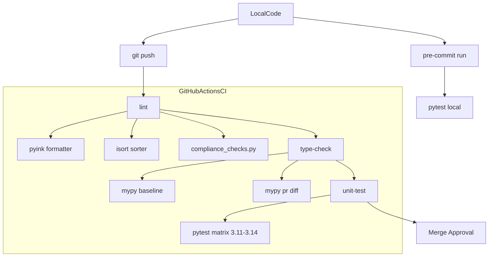

<!-- source: DeepWiki mcp.deepwiki.com · repo google/adk-python · page 13.3 Code Quality and CI · fetched 2026-10-29 -->

# Code Quality and CI

<details>
<summary>Relevant source files</summary>

The following files were used as context for generating this wiki page:

- [.agents/skills/adk-architecture/references/api-principles.md](.agents/skills/adk-architecture/references/api-principles.md)
- [.agents/skills/adk-review/SKILL.md](.agents/skills/adk-review/SKILL.md)
- [.agents/skills/adk-style/SKILL.md](.agents/skills/adk-style/SKILL.md)
- [.agents/skills/adk-style/references/async.md](.agents/skills/adk-style/references/async.md)
- [.agents/skills/adk-style/references/documentation.md](.agents/skills/adk-style/references/documentation.md)
- [.agents/skills/adk-style/references/imports.md](.agents/skills/adk-style/references/imports.md)
- [.agents/skills/adk-style/references/pydantic.md](.agents/skills/adk-style/references/pydantic.md)
- [.agents/skills/adk-style/references/testing.md](.agents/skills/adk-style/references/testing.md)
- [.agents/skills/adk-style/references/typing.md](.agents/skills/adk-style/references/typing.md)
- [.agents/skills/adk-style/references/visibility.md](.agents/skills/adk-style/references/visibility.md)
- [.agents/skills/adk-verify-snippets/SKILL.md](.agents/skills/adk-verify-snippets/SKILL.md)
- [.agents/skills/adk-verify-snippets/scripts/run.py](.agents/skills/adk-verify-snippets/scripts/run.py)
- [.agents/skills/adk-verify-snippets/scripts/verify_md.py](.agents/skills/adk-verify-snippets/scripts/verify_md.py)
- [.github/workflows/continuous-integration.yml](.github/workflows/continuous-integration.yml)
- [.pre-commit-config.yaml](.pre-commit-config.yaml)
- [contributing/samples/workflows/auth_oauth/README.md](contributing/samples/workflows/auth_oauth/README.md)
- [contributing/samples/workflows/loop_config/README.md](contributing/samples/workflows/loop_config/README.md)
- [contributing/samples/workflows/loop_config/root_agent.yaml](contributing/samples/workflows/loop_config/root_agent.yaml)
- [docs/guides/agents/config/index.md](docs/guides/agents/config/index.md)
- [docs/guides/features/feature_registry/index.md](docs/guides/features/feature_registry/index.md)
- [scripts/check_docs.py](scripts/check_docs.py)
- [scripts/check_new_py_files.sh](scripts/check_new_py_files.sh)
- [scripts/compliance_checks.py](scripts/compliance_checks.py)
- [src/google/adk/features/_feature_decorator.py](src/google/adk/features/_feature_decorator.py)
- [src/google/adk/labs/antigravity/_sub_agent_tools.py](src/google/adk/labs/antigravity/_sub_agent_tools.py)
- [src/google/adk/sessions/migration/README.md](src/google/adk/sessions/migration/README.md)
- [tests/unittests/scripts/test_check_docs.py](tests/unittests/scripts/test_check_docs.py)
- [tests/unittests/scripts/test_compliance_checks.py](tests/unittests/scripts/test_compliance_checks.py)
- [tests/unittests/test_verify_snippets.py](tests/unittests/test_verify_snippets.py)

</details>


## Purpose and Scope

This page documents the automated code quality checks, static analysis, type safety rules, and continuous integration (CI) workflows maintaining code standards in the ADK Python repository. These checks execute automatically on pull requests to enforce formatting, import organization, type safety, and architectural constraints.

Sources: [.github/workflows/continuous-integration.yml:1-45](), [.pre-commit-config.yaml:1-16]()

---

## Code Formatting and Style

ADK enforces a strict style guide to ensure codebase consistency, handled primarily via `pyink` (a Google-flavored version of Black), `isort`, and `ruff` [.pre-commit-config.yaml:28-41]().

### Code Formatting with pyink and ruff
ADK uses **pyink** for Python code formatting, extending Black with Google-specific conventions such as 2-space indentation [.pre-commit-config.yaml:38-41](). Additionally, `ruff` is configured as a pre-commit hook with automatic fixes enabled (`--spec` or `--fix`) for rules under `src/` [.pre-commit-config.yaml:28-33]().

### Import Sorting with isort
Imports are alphabetized and grouped via `isort` hooks [.pre-commit-config.yaml:34-37](). The configuration groups imports into standard library, third-party, and relative imports separated by blank lines, ensuring consistent module resolution.

### Automated Formatting and Pre-commit Hooks
Pre-commit hooks manage local and CI checks across multiple targets, including `pyproject-fmt`, `mdformat`, `codespell`, and license header verification via `addlicense` [.pre-commit-config.yaml:16-101]().

Sources: [.pre-commit-config.yaml:16-101](), [.agents/skills/adk-style/SKILL.md:1-46]()

---

## Content and Architectural Constraints

ADK enforces specific coding patterns and architectural boundaries through custom scripts and compliance checks.

### Architectural Boundaries and Compliance
- **Private-by-Default Naming:** The repository uses `scripts/check_new_py_files.sh` and its Python backend to enforce that new internal Python files follow private naming conventions prefixed with `_` under `src/google/adk/` [.pre-commit-config.yaml:52-58](), [scripts/check_new_py_files.sh:1-18]().
- **Compliance Checks:** A specialized script `scripts/compliance_checks.py` runs during pre-commit and CI to catch forbidden coding patterns [scripts/compliance_checks.py:16-19]().
- **Logger Prefixing:** `check_logger()` forbids `logging.getLogger(__name__)` without the `google_adk.` prefix [scripts/compliance_checks.py:117-120]().
- **Future Annotations:** `check_future_annotations()` enforces the presence of `from __future__ import annotations` in source modules [scripts/compliance_checks.py:123-132]().
- **CLI Import Isolation:** `check_cli_import()` restricts core library files from importing directly from the `cli/` package [scripts/compliance_checks.py:135-145]().
- **mTLS Enforcement:** Validates Google API endpoints against `_EXCLUDED_FROM_MTLS` to ensure mTLS compliance [scripts/compliance_checks.py:32-54]().
- **Feature Decorators:** Modern feature flagging uses decorators from `google.adk.features._feature_decorator.py` (`working_in_progress`, `experimental`, `stable`) backed by `FeatureName` and `_feature_registry.py` [src/google/adk/features/_feature_decorator.py:32-141](), [docs/guides/features/feature_registry/index.md:1-148]().

Sources: [scripts/compliance_checks.py:16-145](), [.pre-commit-config.yaml:52-66](), [scripts/check_new_py_files.sh:1-18](), [src/google/adk/features/_feature_decorator.py:32-141](), [docs/guides/features/feature_registry/index.md:1-148]()

---

## Static Analysis and Type Checking

The repository utilizes static analysis with `mypy` running in strict mode against `src/` [.agents/skills/adk-style/references/typing.md:21-27]().

### Mypy Baseline Comparison
The `type-check` CI job performs a dynamic comparison between the PR branch and the base target branch:
1. **Generate Baseline:** Checks out the target branch (`TARGET_BRANCH`), syncs dependencies using `uv sync`, and runs `mypy .` to generate `baseline_errors.txt` [.github/workflows/continuous-integration.yml:113-131]().
2. **Check PR Branch:** Switches back to the PR commit, re-syncs dependencies, and runs `mypy .` to output `pr_errors.txt` [.github/workflows/continuous-integration.yml:132-143]().
3. **Compare:** Uses `comm -13` to find newly introduced errors. The CI job fails if `new_errors.txt` contains any items [.github/workflows/continuous-integration.yml:145-157]().

Sources: [.github/workflows/continuous-integration.yml:81-157](), [.agents/skills/adk-style/references/typing.md:21-35]()

---

## Unit Testing

Unit tests are executed via `pytest` across a matrix of supported Python versions [.github/workflows/continuous-integration.yml:159-174]().

### CI Test Execution Matrix
- **Matrix:** Executes across Python versions `3.11`, `3.12`, `3.13`, and `3.14` [.github/workflows/continuous-integration.yml:165-167]().
- **Dependency Management:** Uses `uv` for environment setup and parallel dependency resolution [.github/workflows/continuous-integration.yml:63-67]().
- **Testing Style:** Conforms to ADK testing guidelines: test behavior rather than implementation, one behavior per test, and minimal fixtures [.agents/skills/adk-style/references/testing.md:3-125]().

Sources: [.github/workflows/continuous-integration.yml:159-174](), [.agents/skills/adk-style/references/testing.md:3-125]()

---

## GitHub Actions Workflows

Automated verification runs via GitHub Actions workflows in `.github/workflows/`:
- **Continuous Integration (`continuous-integration.yml`):** Runs pre-commit linters, matrix mypy type checking with baseline comparison, and matrix unit tests [.github/workflows/continuous-integration.yml:1-184]().
- **PR Triage and Maintenance:** Automates labeling, component assignment, and community discussion responses using repository-defined agents [.github/workflows/pr-triage.yml:15-54](), [.github/workflows/discussion_answering.yml:15-32]().

Sources: [.github/workflows/continuous-integration.yml:1-184](), [.github/workflows/pr-triage.yml:15-54](), [.github/workflows/discussion_answering.yml:15-32]()

---

## Architecture and CI Flow Diagrams

### Diagram: Quality Gate Flow

Sources: [.github/workflows/continuous-integration.yml:1-184](), [.pre-commit-config.yaml:1-75]()

### Diagram: CI Logic to Code Entity Mapping
```mermaid
classDiagram
    class "ContinuousIntegrationWorkflow" {
        +continuous-integration.yml
    }
    class "ComplianceEnforcementEngine" {
        +scripts/compliance_checks.py
        +scripts/check_new_py_files.sh
        +check_logger()
        +check_future_annotations()
        +check_cli_import()
    }
    class "StyleFormatters" {
        +pyink
        +isort
        +addlicense
    }
    class "StaticAnalysisEngine" {
        +mypy
        +uv
    }
    class "FeatureRegistrySystem" {
        +src/google/adk/features/_feature_decorator.py
        +src/google/adk/features/_feature_registry.py
        +working_in_progress()
        +experimental()
        +stable()
    }

    ContinuousIntegrationWorkflow --> ComplianceEnforcementEngine : "Runs hooks"
    ContinuousIntegrationWorkflow --> StyleFormatters : "Enforces formatting"
    ContinuousIntegrationWorkflow --> StaticAnalysisEngine : "Executes type checking"
    ComplianceEnforcementEngine --> FeatureRegistrySystem : "Validates feature annotations"
```
Sources: [.github/workflows/continuous-integration.yml:1-184](), [scripts/compliance_checks.py:1-145](), [src/google/adk/features/_feature_decorator.py:32-141]()

---

