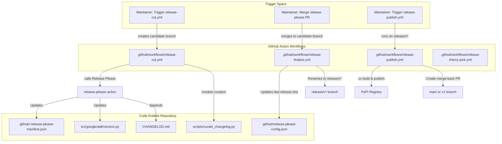
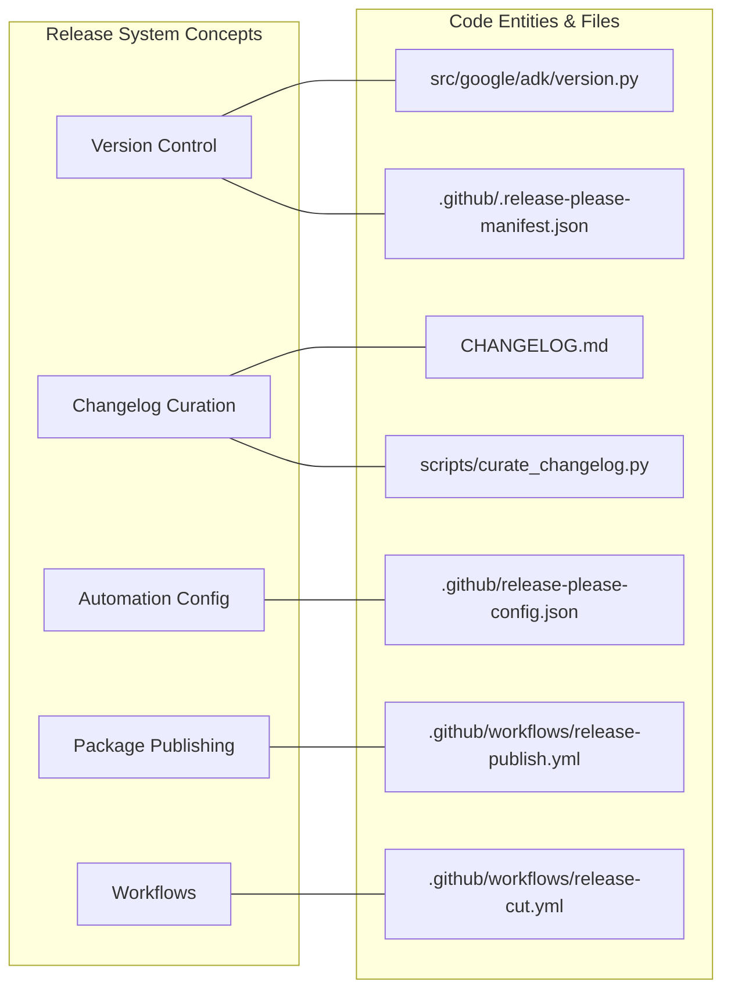

<!-- source: DeepWiki mcp.deepwiki.com · repo google/adk-python · page 13.4 Release Process · fetched 2026-10-29 -->

# Release Process

Relevant source files

The following files were used as context for generating this wiki page:

- [.github/.release-please-manifest-v1.json](.github/.release-please-manifest-v1.json)
- [.github/.release-please-manifest.json](.github/.release-please-manifest.json)
- [.github/release-please-config-v1.json](.github/release-please-config-v1.json)
- [.github/release-please-config.json](.github/release-please-config.json)
- [.github/workflows/analyze-releases-for-adk-docs-updates.yml](.github/workflows/analyze-releases-for-adk-docs-updates.yml)
- [.github/workflows/block-merge.yml](.github/workflows/block-merge.yml)
- [.github/workflows/copybara-pr-handler.yml](.github/workflows/copybara-pr-handler.yml)
- [.github/workflows/discussion_answering.yml](.github/workflows/discussion_answering.yml)
- [.github/workflows/issue-maintenance.yml](.github/workflows/issue-maintenance.yml)
- [.github/workflows/pr-triage.yml](.github/workflows/pr-triage.yml)
- [.github/workflows/release-cherry-pick.yml](.github/workflows/release-cherry-pick.yml)
- [.github/workflows/release-cut.yml](.github/workflows/release-cut.yml)
- [.github/workflows/release-finalize.yml](.github/workflows/release-finalize.yml)
- [.github/workflows/release-publish.yml](.github/workflows/release-publish.yml)
- [.github/workflows/release-update-adk-web.yaml](.github/workflows/release-update-adk-web.yaml)
- [.github/workflows/upload-adk-docs-to-vertex-ai-search.yml](.github/workflows/upload-adk-docs-to-vertex-ai-search.yml)
- [CHANGELOG.md](CHANGELOG.md)
- [contributing/samples/adk_team/adk_pr_triaging_agent/main.py](contributing/samples/adk_team/adk_pr_triaging_agent/main.py)
- [contributing/samples/adk_team/adk_pr_triaging_agent/settings.py](contributing/samples/adk_team/adk_pr_triaging_agent/settings.py)
- [scripts/curate_changelog.py](scripts/curate_changelog.py)
- [src/google/adk/cli/browser/styles-4R3GDHUZ.css](src/google/adk/cli/browser/styles-4R3GDHUZ.css)
- [src/google/adk/version.py](src/google/adk/version.py)
- [tests/unittests/test_curate_changelog.py](tests/unittests/test_curate_changelog.py)

This document describes the release process for the ADK Python package, covering version management, automated release creation via GitHub Actions, changelog curation via `scripts/curate_changelog.py`, cherry-picks, publishing to PyPI, and frontend asset synchronization. The ADK uses Google's `release-please` automation tool to handle the release workflow based on conventional commits.

---

## Version Management

The ADK version follows semantic versioning (`major.minor.patch`) and is maintained across multiple files to support both the runtime environment and automated release tooling.

### Version Storage Locations

| Location | Purpose | Format |
|----------|---------|--------|
| `src/google/adk/version.py` | Primary runtime version source | `__version__ = "2.12.0"` |
| `.github/.release-please-manifest.json` | Release-please state tracking (Main) | `{".": "2.12.0"}` |
| `.github/.release-please-manifest-v1.json` | Release-please state tracking (v1 branch) | `{".": "2.0.0-alpha.1"}` |

The version string is defined in `src/google/adk/version.py` [src/google/adk/version.py:16-16](). This file is the source of truth for the package at runtime. The manifest files synchronize these versions for the automation engine [.github/.release-please-manifest.json:1-3]() [.github/.release-please-manifest-v1.json:1-3]().

Sources: [src/google/adk/version.py:1-16](), [.github/.release-please-manifest.json:1-3](), [.github/.release-please-manifest-v1.json:1-3]()

---

## Release Automation with Release-Please

The ADK uses Google's `release-please` GitHub Action to automate the release process. This tool analyzes commit messages, determines version bumps, generates changelogs, and creates release pull requests.

### Release-Please Configuration

The configuration for the primary branch is defined in `.github/release-please-config.json` [.github/release-please-config.json:1-61](), while v1 pre-releases use `.github/release-please-config-v1.json` [not shown]().

Key configuration parameters include:
- **`release-type`**: Set to `python` to follow Python package conventions [.github/release-please-config.json:5-5]().
- **`package-name`**: Defined as `google-adk` [.github/release-please-config.json:6-6]().
- **`changelog-path`**: Points to `CHANGELOG.md` for main [.github/release-please-config.json:9-9]().
- **`changelog-sections`**: Defines how commit types map to headers, such as `feat` mapping to "Features" and `fix` mapping to "Bug Fixes" [.github/release-please-config.json:11-57]().
- **`last-release-sha`**: Tracks the commit SHA of the last successful release [.github/release-please-config.json:60-60]().

### Conventional Commits and Changelog

`release-please` relies on conventional commit messages to determine version bumps and populate `CHANGELOG.md` [CHANGELOG.md:1-3](). The following mapping is used:

| Commit Type | Changelog Section | Version Impact |
|-------------|-------------------|----------------|
| `feat` | Features | Minor bump [.github/release-please-config.json:12-13]() |
| `fix` | Bug Fixes | Patch bump [.github/release-please-config.json:16-17]() |
| `perf` | Performance Improvements | Patch bump [.github/release-please-config.json:20-21]() |
| `docs` | Documentation | Patch bump [.github/release-please-config.json:29-30]() |

The `CHANGELOG.md` provides a historical record of all changes, such as features like graceful cancellation and tool confirmation in workflows [CHANGELOG.md:7-14]().

Sources: [.github/release-please-config.json:1-61](), [CHANGELOG.md:1-15]()

---

## Changelog Curation and LLM Highlights

During a release cut, `scripts/curate_changelog.py` executes as a post-step to format, clean up, and enhance the newest release section in `CHANGELOG.md` [scripts/curate_changelog.py:15-38]().

The curation script performs three primary operations:
1. **Deterministic Cleanup**: Unescapes HTML entities (e.g., `&gt;=`), de-links accidental `@mentions` in commit subjects via `_MENTION_RE`, drops duplicate commit entries, and lowercases leading verbs for consistency (`_normalize_entry` in [scripts/curate_changelog.py:153-165]()).
2. **LLM-Backed Highlights**: Drafts an overview paragraph and concise bullet points using an LLM prompt template (`_PROMPT` in [scripts/curate_changelog.py:91-120]()) to summarize the release theme and user-facing benefits [scripts/curate_changelog.py:26-29]().
3. **Collapsible Full Changelog**: Wraps the full categorized release list under a `
` fold for readability on large releases [scripts/curate_changelog.py:30-32](), matching the structure seen in [CHANGELOG.md:16-54]().

Sources: [scripts/curate_changelog.py:15-120](), [CHANGELOG.md:16-55]()

---

## Release Workflow

The ADK follows a multi-step release strategy to support manual intervention and safe publishing.

### Step 1: Cutting the Release
A maintainer triggers a release cut via the `release-cut.yml` workflow [.github/workflows/release-cut.yml:18-43](). This creates a `release/candidate` (for main) or `release/v1-candidate` (for v1) branch [.github/workflows/release-cut.yml:55-67]().

### Step 2: Release Please PR
The `release-cut.yml` workflow runs `google-github-actions/release-please-action` which creates a Pull Request targeting the candidate branch [not shown](). This PR contains:
1. Version bump in `src/google/adk/version.py` [src/google/adk/version.py:16-16]().
2. New entries in `CHANGELOG.md` [CHANGELOG.md:3-14]().
3. **Changelog Curation**: `scripts/curate_changelog.py` [scripts/curate_changelog.py:15-38]() is invoked to curate the release notes.

### Step 3: Optional Cherry-picks
Maintainers can cherry-pick hotfixes from `main` or `v1` into the active candidate branch using the `release-cherry-pick.yml` workflow [not shown](). This workflow uses `git cherry-pick` to pull specific commits into the candidate branch.

### Step 4: Finalizing the Release
When the changelog PR is merged into the candidate branch, `release-finalize.yml` triggers [not shown](). It records the `last-release-sha` in the config file, renames the branch to `release/v{version}`, and updates the PR label.

### Step 5: Publishing to PyPI
The `release-publish.yml` workflow is manually triggered from the `release/v*` branch [.github/workflows/release-publish.yml:20-22]().
1. **PEP 440 Conversion**: For v1 pre-releases, it converts SemVer (e.g., `2.0.0-alpha.1`) to PEP 440 (e.g., `2.0.0a1`) and updates `version.py` [.github/workflows/release-publish.yml:107-133]() [.github/workflows/release-publish.yml:146-150]().
2. **Build & Publish**: Runs `uv build` and publishes using token secrets [.github/workflows/release-publish.yml:135-145]().
3. **Merge Back**: Creates a PR to sync the version bump and CHANGELOG back to the base branch (`main` or `v1`).

### Release Workflow Data Flow

Title: "Release Process Implementation Flow"

Sources: [.github/release-please-config.json:1-61](), [src/google/adk/version.py:16-16](), [.github/workflows/release-cut.yml:1-157](), [.github/workflows/release-publish.yml:1-150](), [scripts/curate_changelog.py:1-120]()

---

## Release Entity Mapping

The following diagram bridges system-level release concepts to their corresponding code entities and file locations.

Title: "Release Entity and Configuration Mapping"

Sources: [src/google/adk/version.py:16-16](), [.github/.release-please-manifest.json:1-3](), [CHANGELOG.md:1-3](), [scripts/curate_changelog.py:1-38](), [.github/release-please-config.json:1-61](), [.github/workflows/release-publish.yml:20-150](), [.github/workflows/release-cut.yml:18-43]()

---

## Frontend Assets Synchronization

The ADK Python repository includes a dedicated workflow to synchronize compiled frontend assets from the `adk-web` repository into the Python package for distribution.

The `release-update-adk-web.yaml` workflow allows maintainers to:
1. Specify a source `adk-web` repository and tag [.github/workflows/release-update-adk-web.yaml:19-27]().
2. Fetch and unzip `adk-web-browser.zip` into `src/google/adk/cli/browser` [.github/workflows/release-update-adk-web.yaml:43-72]().
3. Automatically create a Pull Request to merge these assets into the repository [.github/workflows/release-update-adk-web.yaml:83-95]().

Sources: [.github/workflows/release-update-adk-web.yaml:1-95]()

---

## Code Quality and Release Integrity

Before a release is finalized, CI workflows and scripts enforce standards to prevent regressions.

### Version Verification
The `release-publish.yml` workflow includes a validation step to ensure it is running on a correctly named release branch (`release/v*`) before proceeding with builds [.github/workflows/release-publish.yml:96-102]().

### Manifest Consistency
The release process relies on the consistency between the manifest files (e.g., `.github/.release-please-manifest.json`) and the actual codebase version. Discrepancies will block the finalization and renaming of release branches.

### Block Merge
To ensure changes land through correct internal channels, branch protection and CI checks prevent direct merging of pull requests on GitHub to protected branches.

Sources: [.github/workflows/release-publish.yml:96-102](), [src/google/adk/version.py:16-16](), [.github/.release-please-manifest.json:1-3]()

---

