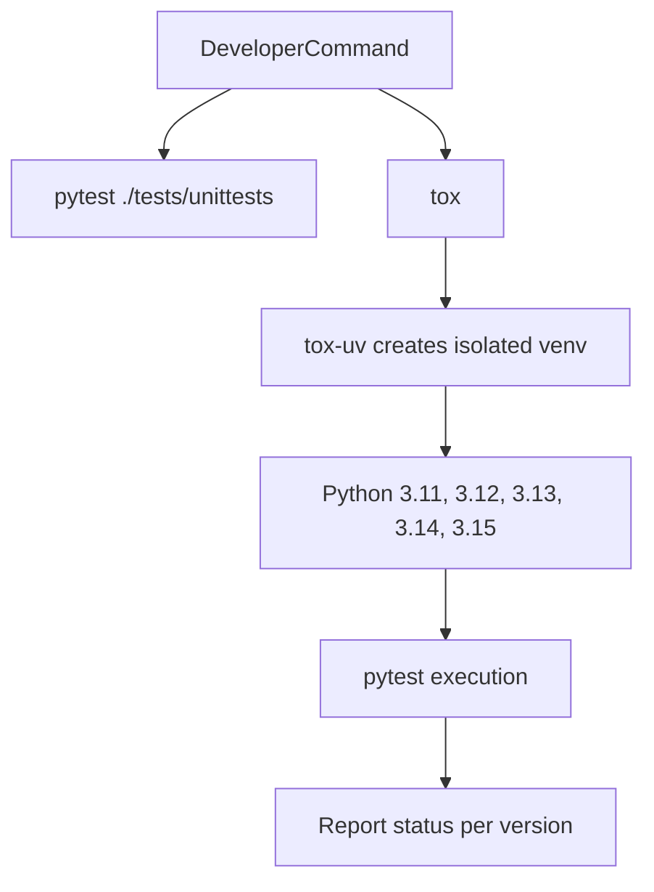
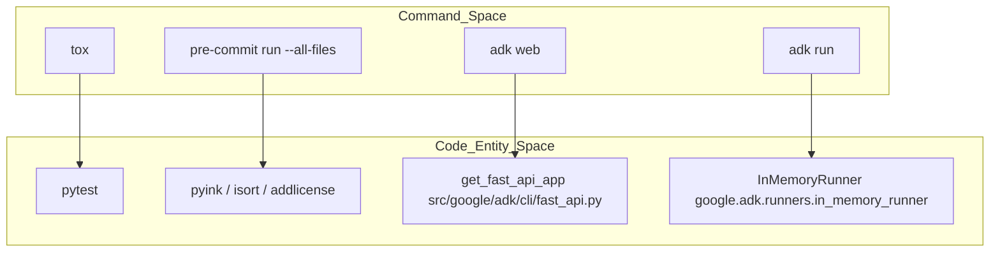
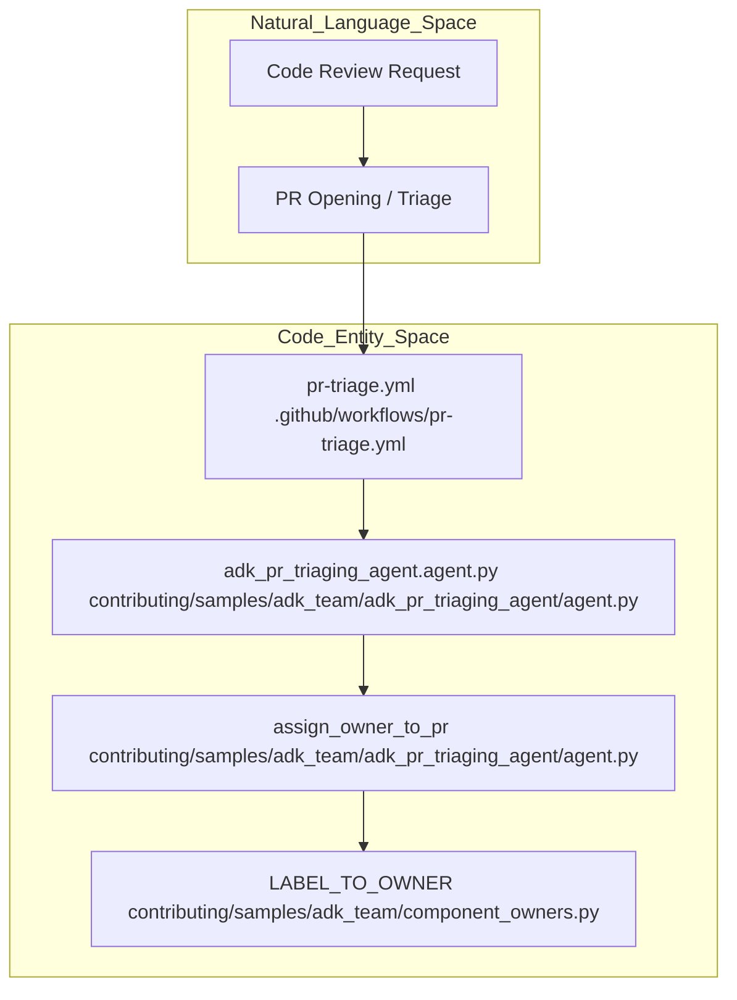

<!-- source: DeepWiki mcp.deepwiki.com · repo google/adk-python · page 13.5 Contributing Guidelines · fetched 2026-10-29 -->

# Contributing Guidelines

Relevant source files

The following files were used as context for generating this wiki page:

- [.agents/skills/adk-agent-builder/references/callbacks-and-plugins.md](.agents/skills/adk-agent-builder/references/callbacks-and-plugins.md)
- [.agents/skills/adk-agent-builder/references/getting-started.md](.agents/skills/adk-agent-builder/references/getting-started.md)
- [.agents/skills/adk-agent-builder/references/human-in-the-loop.md](.agents/skills/adk-agent-builder/references/human-in-the-loop.md)
- [.agents/skills/adk-agent-builder/references/llm-agent-nodes.md](.agents/skills/adk-agent-builder/references/llm-agent-nodes.md)
- [.agents/skills/adk-agent-builder/references/multi-agent.md](.agents/skills/adk-agent-builder/references/multi-agent.md)
- [.agents/skills/adk-agent-builder/references/task-mode.md](.agents/skills/adk-agent-builder/references/task-mode.md)
- [.agents/skills/adk-setup/SKILL.md](.agents/skills/adk-setup/SKILL.md)
- [.github/ISSUE_TEMPLATE/bug_report.md](.github/ISSUE_TEMPLATE/bug_report.md)
- [.github/ISSUE_TEMPLATE/feature_request.md](.github/ISSUE_TEMPLATE/feature_request.md)
- [.github/pull_request_template.md](.github/pull_request_template.md)
- [.gitignore](.gitignore)
- [AGENTS.md](AGENTS.md)
- [CONTRIBUTING.md](CONTRIBUTING.md)
- [LICENSE](LICENSE)
- [README.md](README.md)
- [assets/adk-web-dev-ui-function-call.png](assets/adk-web-dev-ui-function-call.png)
- [assets/adk-web-dev-ui.png](assets/adk-web-dev-ui.png)
- [contributing/README.md](contributing/README.md)
- [contributing/adk_project_overview_and_architecture.md](contributing/adk_project_overview_and_architecture.md)
- [contributing/samples/adk_team/adk_issue_monitoring_agent/PROMPT_INSTRUCTION.txt](contributing/samples/adk_team/adk_issue_monitoring_agent/PROMPT_INSTRUCTION.txt)
- [contributing/samples/adk_team/adk_issue_monitoring_agent/agent.py](contributing/samples/adk_team/adk_issue_monitoring_agent/agent.py)
- [contributing/samples/adk_team/adk_pr_triaging_agent/README.md](contributing/samples/adk_team/adk_pr_triaging_agent/README.md)
- [contributing/samples/adk_team/adk_pr_triaging_agent/agent.py](contributing/samples/adk_team/adk_pr_triaging_agent/agent.py)
- [contributing/samples/adk_team/adk_pr_triaging_agent/utils.py](contributing/samples/adk_team/adk_pr_triaging_agent/utils.py)
- [contributing/samples/adk_team/adk_stale_agent/agent.py](contributing/samples/adk_team/adk_stale_agent/agent.py)
- [contributing/samples/adk_team/component_owners.py](contributing/samples/adk_team/component_owners.py)
- [contributing/samples/context_management/memory_profiles/README.md](contributing/samples/context_management/memory_profiles/README.md)
- [contributing/samples/context_management/memory_profiles/__init__.py](contributing/samples/context_management/memory_profiles/__init__.py)
- [contributing/samples/context_management/memory_profiles/agent.py](contributing/samples/context_management/memory_profiles/agent.py)
- [docs/guides/utils/instructions_utils/index.md](docs/guides/utils/instructions_utils/index.md)
- [scripts/update_constraints.sh](scripts/update_constraints.sh)
- [src/google/adk/cli/browser/assets/audio-processor.js](src/google/adk/cli/browser/assets/audio-processor.js)
- [src/google/adk/flows/llm_flows/prompt/_instructions_utils.py](src/google/adk/flows/llm_flows/prompt/_instructions_utils.py)
- [tests/unittests/conftest.py](tests/unittests/conftest.py)
- [tests/unittests/flows/llm_flows/prompt/test_instructions_utils.py](tests/unittests/flows/llm_flows/prompt/test_instructions_utils.py)
- [tests/unittests/test_samples.py](tests/unittests/test_samples.py)
- [tox.ini](tox.ini)

This page documents the requirements and workflow for contributing code, documentation, and other changes to the ADK Python repository. It covers pull request requirements, testing standards, code quality enforcement, issue creation, `AGENTS.md` conventions, and automated triage agents.

For information about setting up your local development environment, see **13.1 Local Development Setup**. For details on code structure and organization, see **13.2 Project Structure**. For automated code quality checks, see **13.3 Code Quality and CI**.

---

## Prerequisites and Issue Selection

### Contributor License Agreement (CLA)

All contributions must be accompanied by a signed [Contributor License Agreement (CLA)](https://cla.developers.google.com/about). The CLA grants Google permission to use and redistribute your contributions as part of the project while you retain copyright. Visit [https://cla.developers.google.com/](https://cla.developers.google.com/) to view existing agreements or sign a new one.

**Sources:** [CONTRIBUTING.md:22-35]()

### Community Guidelines

This project adheres to [Google's Open Source Community Guidelines](https://opensource.google/conduct/). All interactions in issues, pull requests, and discussions must follow these standards.

**Sources:** [CONTRIBUTING.md:38-40]()

### Finding Issues to Work On

Browse issues with the following labels to find contribution opportunities:

| Label | Description | Best For |
|-------|-------------|----------|
| `good first issue` | Newcomer-friendly tasks | First-time contributors |
| `help wanted` | General contributions welcome | Community contributors |

For other issues, please ask before contributing to avoid duplication of effort.

**Sources:** [CONTRIBUTING.md:64-68]()

---

## Pull Request Requirements

### Required Elements

All pull requests must include:

1.  **Issue Association**: All PRs (other than small documentation or typo fixes) should have an associated Issue. If one doesn't exist, create one first or describe the bug/feature directly in the PR description following the structure of our issue templates [CONTRIBUTING.md:70-75]().
2.  **Small, Focused Changes**: Keep changes minimal—one concern per PR [CONTRIBUTING.md:76-76]().
3.  **Testing Plan**: Include a `testing plan` section in your PR describing how you will test. This is required for all PRs that are not small documentation or typo fixes [CONTRIBUTING.md:79-81]().
4.  **Evidence**: Provide logs or screenshots (especially for UI changes via `adk web`) after the fix is applied to help reviewers understand the fix [CONTRIBUTING.md:77-78]().

### Large or Complex Changes

For substantial features or architectural revisions:
1.  **Open an Issue First**: Outline your proposal, including design considerations and impact [CONTRIBUTING.md:83-88]().
2.  **Gather Feedback**: Discuss with maintainers and the community to ensure alignment and avoid duplicate work [CONTRIBUTING.md:89-90]().

**Sources:** [CONTRIBUTING.md:70-90](), [.github/pull_request_template.md:1-39]()

---

## Testing Requirements

To maintain code quality and prevent regressions, all code changes must include comprehensive tests and verifiable end-to-end (E2E) evidence [CONTRIBUTING.md:92-95]().

### Unit Test Requirements

-   **Coverage**: Cover new features, edge cases, error conditions, and typical use cases [CONTRIBUTING.md:104-105]().
-   **Location**: Add or update tests under `tests/unittests/`, following naming conventions like `test_<module>_<feature>.py` [CONTRIBUTING.md:106-107]().
-   **Framework**: Use `pytest`. Tests should be fast, isolated, written clearly with descriptive names, and free of external dependencies (use mocks or fixtures) [CONTRIBUTING.md:108-111](). Additionally, sample replays are validated via `tests/unittests/test_samples.py` [tests/unittests/test_samples.py:90-97]().

### Manual End-to-End (E2E) Tests

Depending on the change, provide evidence from:
-   **ADK Web**: Capture and attach screenshots from `adk web` to verify UI/UX changes or outputs [CONTRIBUTING.md:124-128]().
-   **Runner**: Provide the testing setup (agent definition and runner setup), execute the `runner` tool to reproduce workflows, and include console output highlighting relevant log sections [CONTRIBUTING.md:130-136]().

### Test Execution Flow

ADK uses `tox` with `tox-uv` to automate verification across multiple Python versions in isolated environments [CONTRIBUTING.md:160-168]().

Title: "TestExecutionWorkflow"

Sources: [CONTRIBUTING.md:92-168](), [.github/workflows/continuous-integration.yml:160-167](), [tests/unittests/test_samples.py:90-97]()

---

## Development Setup and Tooling

To contribute code, follow these steps to set up your environment using `uv`:

1.  **Clone**: `gh repo clone google/adk-python` [CONTRIBUTING.md:147-152]().
2.  **Setup Tools**: Install `pre-commit` and `tox` via `uv tool install` [.agents/skills/adk-setup/SKILL.md:65-70]().
3.  **Pre-commit**: Install git hooks with `pre-commit install` to automatically format code on commit [CONTRIBUTING.md:180-185]().
4.  **Format**: Manually run `pre-commit run --all-files` to apply `isort`, `pyink`, and `addlicense` [.agents/skills/adk-setup/SKILL.md:113-113]().

### Code Entity to Implementation Mapping

Title: "ContributionToolingMapping"

Sources: [CONTRIBUTING.md:145-188](), [.agents/skills/adk-setup/SKILL.md:1-116]()

---

## AGENTS.md Conventions and Automated Triage Agents

The repository maintains specific conventions under `AGENTS.md` and uses specialized automated agents for issue/PR management located in `contributing/samples/adk_team/`.

### AI-Assisted Review and Conventions

ADK includes structured AI coding assistant guidelines defined under `AGENTS.md` and `.agents/skills/`. The `adk-setup` skill (`.agents/skills/adk-setup/SKILL.md`) and overall architecture references assist AI tools in working correctly with the codebase [AGENTS.md:1-30]().

Title: "AIReviewAndTriageArchitecture"

The `adk_pr_triaging_agent` [contributing/samples/adk_team/adk_pr_triaging_agent/agent.py:15-305]() is an automated agent that handles pull request triaging. It can fetch PR details using `get_pull_request_details` [contributing/samples/adk_team/adk_pr_triaging_agent/agent.py:45-152]() and assign owners to PRs via `assign_owner_to_pr` [contributing/samples/adk_team/adk_pr_triaging_agent/agent.py:154-196](). This agent uses the `LABEL_TO_OWNER` mapping [contributing/samples/adk_team/component_owners.py:24-43]() to determine the appropriate owner based on the component label. The `pr-triage.yml` GitHub Actions workflow [.github/workflows/pr-triage.yml:15-81]() orchestrates the execution of this agent on `pull_request_target` events (opened, reopened, ready_for_review) or via manual `workflow_dispatch`.

Sources: [AGENTS.md:1-30](), [contributing/samples/adk_team/adk_pr_triaging_agent/agent.py:15-305](), [contributing/samples/adk_team/component_owners.py:24-43](), [.github/workflows/pr-triage.yml:15-81]()

---

