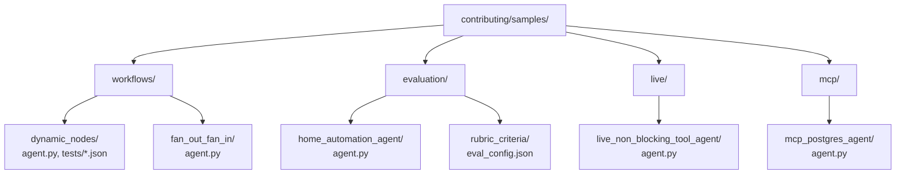
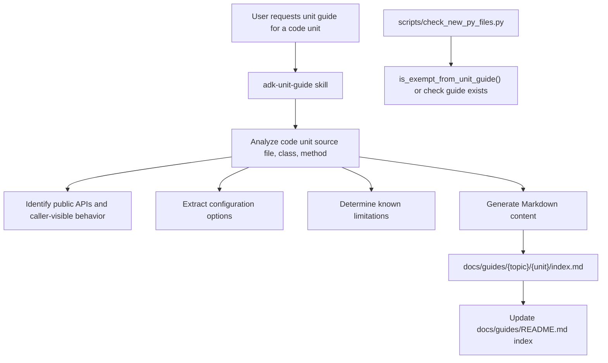
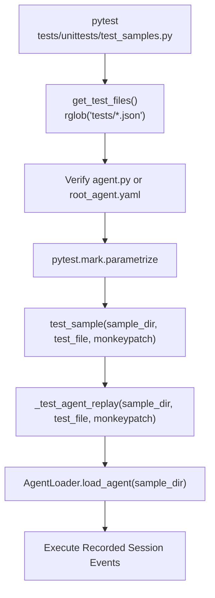

<!-- source: DeepWiki mcp.deepwiki.com · repo google/adk-python · page 13.6 Samples and Unit Guides · fetched 2026-10-29 -->

# Samples and Unit Guides

<details>
<summary>Relevant source files</summary>

The following files were used as context for generating this wiki page:

- [.agents/skills/adk-unit-guide/SKILL.md](.agents/skills/adk-unit-guide/SKILL.md)
- [.agents/skills/adk-unit-guide/references/guide-template.md](.agents/skills/adk-unit-guide/references/guide-template.md)
- [contributing/samples/adk_team/adk_issue_monitoring_agent/PROMPT_INSTRUCTION.txt](contributing/samples/adk_team/adk_issue_monitoring_agent/PROMPT_INSTRUCTION.txt)
- [contributing/samples/adk_team/adk_issue_monitoring_agent/agent.py](contributing/samples/adk_team/adk_issue_monitoring_agent/agent.py)
- [contributing/samples/adk_team/adk_pr_triaging_agent/README.md](contributing/samples/adk_team/adk_pr_triaging_agent/README.md)
- [contributing/samples/adk_team/adk_pr_triaging_agent/agent.py](contributing/samples/adk_team/adk_pr_triaging_agent/agent.py)
- [contributing/samples/adk_team/adk_pr_triaging_agent/utils.py](contributing/samples/adk_team/adk_pr_triaging_agent/utils.py)
- [contributing/samples/adk_team/adk_stale_agent/agent.py](contributing/samples/adk_team/adk_stale_agent/agent.py)
- [contributing/samples/adk_team/component_owners.py](contributing/samples/adk_team/component_owners.py)
- [contributing/samples/context_management/memory_profiles/README.md](contributing/samples/context_management/memory_profiles/README.md)
- [contributing/samples/context_management/memory_profiles/__init__.py](contributing/samples/context_management/memory_profiles/__init__.py)
- [contributing/samples/context_management/memory_profiles/agent.py](contributing/samples/context_management/memory_profiles/agent.py)
- [docs/guides/README.md](docs/guides/README.md)
- [docs/guides/a2a/agent/config/index.md](docs/guides/a2a/agent/config/index.md)
- [docs/guides/a2a/executor/a2a_agent_executor/index.md](docs/guides/a2a/executor/a2a_agent_executor/index.md)
- [docs/guides/a2a/utils/agent_card_builder/index.md](docs/guides/a2a/utils/agent_card_builder/index.md)
- [docs/guides/a2a/utils/agent_to_a2a/index.md](docs/guides/a2a/utils/agent_to_a2a/index.md)
- [docs/guides/apps/app/index.md](docs/guides/apps/app/index.md)
- [docs/guides/apps/events_compaction/index.md](docs/guides/apps/events_compaction/index.md)
- [docs/guides/apps/resumability/index.md](docs/guides/apps/resumability/index.md)
- [docs/guides/artifacts/artifact_service/index.md](docs/guides/artifacts/artifact_service/index.md)
- [docs/guides/code_executors/code_executor/index.md](docs/guides/code_executors/code_executor/index.md)
- [docs/guides/environment/base_environment/index.md](docs/guides/environment/base_environment/index.md)
- [docs/guides/errors/index.md](docs/guides/errors/index.md)
- [docs/guides/events/event/index.md](docs/guides/events/event/index.md)
- [docs/guides/events/event_actions/index.md](docs/guides/events/event_actions/index.md)
- [docs/guides/events/request_input/index.md](docs/guides/events/request_input/index.md)
- [docs/guides/planners/planner/index.md](docs/guides/planners/planner/index.md)
- [docs/guides/runners/runner/index.md](docs/guides/runners/runner/index.md)
- [docs/guides/runners/runner/live.md](docs/guides/runners/runner/live.md)
- [docs/guides/runners/runner/rewind.md](docs/guides/runners/runner/rewind.md)
- [docs/guides/skills/skill_registry/index.md](docs/guides/skills/skill_registry/index.md)
- [scripts/check_new_py_files.py](scripts/check_new_py_files.py)
- [src/google/adk/errors/__init__.py](src/google/adk/errors/__init__.py)
- [src/google/adk/errors/_invocation_not_found_error.py](src/google/adk/errors/_invocation_not_found_error.py)
- [src/google/adk/errors/_stale_session_error.py](src/google/adk/errors/_stale_session_error.py)
- [src/google/adk/errors/not_found_error.py](src/google/adk/errors/not_found_error.py)
- [tests/unittests/scripts/test_check_new_py_files.py](tests/unittests/scripts/test_check_new_py_files.py)
- [tests/unittests/test_samples.py](tests/unittests/test_samples.py)

</details>


## Purpose and Scope

This page maps the technical architecture and organization of the ADK Python sample suite located under `contributing/samples/` and the granular per-unit documentation set under `docs/guides/` [docs/guides/README.md:1-5](). It details how standalone agents and workflows are structured for validation, how developer guides are organized, and how the automated test runner in `tests/unittests/test_samples.py` verifies sample correctness using recorded session replays [tests/unittests/test_samples.py:90-96]().

Sources: [tests/unittests/test_samples.py:41-96](), [docs/guides/README.md:1-5]()

---

## 1. The Sample Tree (`contributing/samples/`)

The `contributing/samples/` directory houses a collection of minimal, single-concept samples that demonstrate specific ADK features, agent patterns, integrations, and evaluation workflows. Unlike full end-to-end applications, each sample directory is isolated and exposes a standard entry point (`root_agent` or `agent.py`).

### Sample Categories and Code Mapping

| Category | Description | Key Subdirectories / Concepts |
| :--- | :--- | :--- |
| `a2a` | Agent-to-Agent protocol communication | `remote_a2a_agent`, `a2a_executor` |
| `live` | Real-time multimodal streaming and voice | `live_non_blocking_tool_agent`, `live_tool_callbacks_agent` |
| `mcp` | Model Context Protocol integration | `mcp_postgres_agent`, `mcp_client_agent` |
| `models` | Multi-provider LLM support and failover | `litellm_with_fallback_models`, `hello_world_litellm` |
| `workflows` | ADK 2.0 graph-based and dynamic workflows | `dynamic_nodes`, `fan_out_fan_in`, `loop_config` |
| `integrations` | External services, tools, and guardrails | `jira_agent`, `slack_agent`, `gepa`, `model_armor` |
| `evaluation` | Systematic agent evaluation and scoring | `basic_criteria`, `rubric_criteria`, `llm_judge_match`, `user_simulation` |

### Architecture: Sample Tree Structure & Entities

Title: "SampleTreeStructureAndCodeEntities"

Sources: [tests/unittests/test_samples.py:37-38]()

---

## 2. Unit Developer Guides (`docs/guides/`)

The `docs/guides/` directory contains granular usage documentation for individual code units, targeting application developers who call ADK classes and APIs directly [docs/guides/README.md:1-5](). Each guide covers caller-visible behavior, minimal code snippets, configuration tables, advanced applications, and known limitations.

### Guide Organization & Structure

Guides mirror the source package layout under `docs/guides/`, using `index.md` files for each unit. They focus heavily on public APIs, avoiding internal private helpers or unexported methods.

*   **A2A**: `A2aAgentExecutor`, `A2aRemoteAgentConfig`, `AgentCardBuilder`, `to_a2a` [docs/guides/README.md:7-11]().
*   **Agents**: `BaseAgent`, `Context`, `Creating Agents with Configurations`, `InvocationContext`, `LlmAgent`, `ManagedAgent`, `RemoteA2aAgent Task Mode` [docs/guides/README.md:13-23]().
*   **Apps**: `App` [docs/guides/README.md:25]().
*   **Artifacts**: `BaseArtifactService` [docs/guides/README.md:27-28]().
*   **Auth**: `AuthConfig` and authenticated tools [docs/guides/README.md:30-31]().
*   **CLI**: `ServiceRegistry`, `get_fast_api_app` [docs/guides/README.md:33-36]().
*   **Code Executors**: `BaseCodeExecutor` [docs/guides/README.md:38-39]().
*   **Environment**: `BaseEnvironment` and `LocalEnvironment` [docs/guides/README.md:41-42]().
*   **Errors**: ADK exceptions [docs/guides/README.md:44-45]().
*   **Evaluation**: `AgentEvaluator`, `BaseEvalService` and `LocalEvalService`, `Efficiency metrics`, `EvalConfig`, `Evaluator` [docs/guides/README.md:47-52]().
*   **Events**: `Event` and `NodeInfo`, `RequestInput` [docs/guides/README.md:54-56]().
*   **Examples**: `Example` and `ExampleTool` [docs/guides/README.md:58-59]().
*   **Features**: Feature flags [docs/guides/README.md:61-62]().
*   **Flows**: Live model callbacks [docs/guides/README.md:64-65]().
*   **Integrations**: `BigQueryToolset`, `CrewaiTool`, `DaytonaEnvironment`, `E2BEnvironment`, `FirestoreSessionService`, `GCSToolset`, `LangchainTool`, `Model Armor`, `MongoDbToolset`, `RedisSessionService` [docs/guides/README.md:67-78]().

### Guide Generation Process

The `adk-unit-guide` skill is used to generate these guides, validating against conventions enforced by `scripts/check_new_py_files.py` [scripts/check_new_py_files.py:23-27]() [.agents/skills/adk-unit-guide/SKILL.md:1-15]().

Title: "UnitGuideGenerationAndValidationPipeline"

Sources: [.agents/skills/adk-unit-guide/SKILL.md:1-15](), [scripts/check_new_py_files.py:23-27](), [docs/guides/README.md:1-5]()

---

## 3. Sample Validation Infrastructure (`tests/unittests/test_samples.py`)

ADK validates code samples automatically through session replay testing implemented in `tests/unittests/test_samples.py` [tests/unittests/test_samples.py:90-96](). This test suite discovers recorded session payloads under `contributing/samples/**/tests/*.json` and replays them to ensure that sample code remains functional across updates [tests/unittests/test_samples.py:61-68]().

### Test Discovery and Execution Flow

Title: "SampleReplayTestExecutionFlow"

Sources: [tests/unittests/test_samples.py:33-96]()

### Key Functions and Fixtures

-   **`_load_samples_like_adk_run()`**: An autouse pytest fixture that disables the YAML key denylist (`config_agent_utils._ENFORCE_YAML_KEY_DENYLIST`) during test execution to permit valid configuration samples to load [tests/unittests/test_samples.py:45-58]().
-   **`get_test_files()`**: Discovers test JSON files recursively under `contributing/` and yields `pytest.param` entries containing the sample directory, test file path, and optional `xfail` markers [tests/unittests/test_samples.py:61-88]().
-   **`test_sample()`**: Executes `_test_agent_replay()` using the loaded sample directory and test payload [tests/unittests/test_samples.py:90-96]().

### Skip and XFail Load Lists

Because certain samples interact with live external services or require optional dependency packages that are not installed in standard test environments, `tests/unittests/test_samples.py` maintains explicit dictionaries for skipped and expected-failure samples [tests/unittests/test_samples.py:99-162]():

*   **`SKIP_LOAD`**: Samples that require network access, external cloud APIs, or specific optional extras (e.g., `integrations/slack_agent`, `multimodal/computer_use`, `mcp/mcp_postgres_agent`) [tests/unittests/test_samples.py:101-148]().
*   **`XFAIL_LOAD`**: Samples whose code is temporarily misaligned with the active ADK API, marked to fail until patched [tests/unittests/test_samples.py:150-162]().

### Dummy Environment Configuration

To allow offline loading and configuration validation of trusted samples, `tests/unittests/test_samples.py` injects a standardized environment dictionary (`_DUMMY_ENV`) during testing [tests/unittests/test_samples.py:164-179]():

```python
_DUMMY_ENV = {
    "ADK_ALLOW_CONFIG_STDIO_MCP_SERVERS": "1",
    "GOOGLE_API_KEY": "dummy-key",
    "GEMINI_API_KEY": "dummy-key",
    "GOOGLE_CLOUD_PROJECT": "dummy-project",
    "GOOGLE_CLOUD_LOCATION": "us-central1",
    "OPENAI_API_KEY": "dummy-key",
    "ANTHROPIC_API_KEY": "dummy-key",
}
```
Sources: [tests/unittests/test_samples.py:164-179]()

---

## Sources

*   [tests/unittests/test_samples.py:1-188]()
*   [docs/guides/README.md:1-86]()
*   [.agents/skills/adk-unit-guide/SKILL.md:1-147]()
*   [scripts/check_new_py_files.py:1-166]()
*   [tests/unittests/scripts/test_check_new_py_files.py:1-180]()

---

