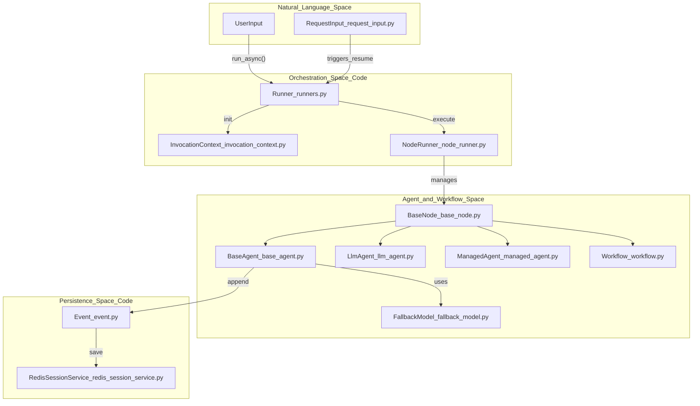
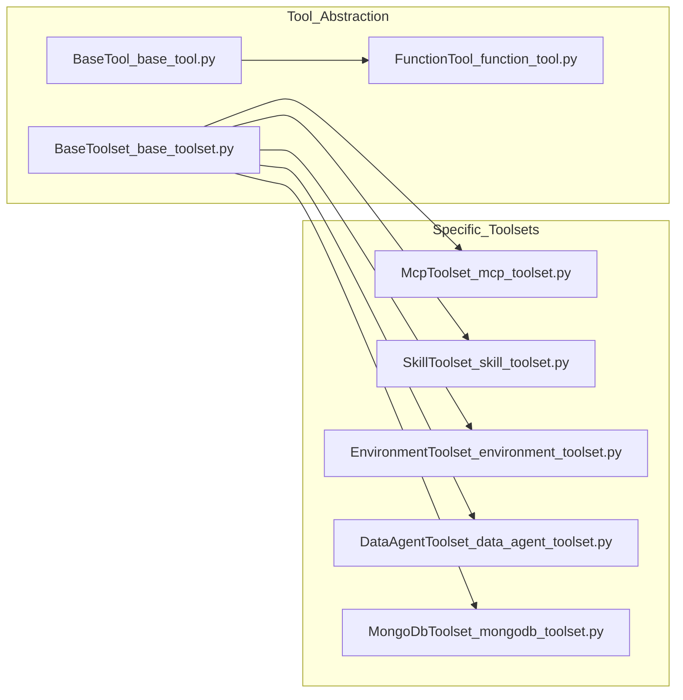

<!-- source: DeepWiki mcp.deepwiki.com · repo google/adk-python · page 14 Glossary · fetched 2026-10-29 -->

# Glossary

Relevant source files

The following files were used as context for generating this wiki page:

- [scripts/generate_agent_config_schema.py](scripts/generate_agent_config_schema.py)
- [src/google/adk/agents/_agent_router.py](src/google/adk/agents/_agent_router.py)
- [src/google/adk/agents/agent_config.py](src/google/adk/agents/agent_config.py)
- [src/google/adk/agents/base_agent.py](src/google/adk/agents/base_agent.py)
- [src/google/adk/agents/base_agent_config.py](src/google/adk/agents/base_agent_config.py)
- [src/google/adk/agents/common_configs.py](src/google/adk/agents/common_configs.py)
- [src/google/adk/agents/config_agent_utils.py](src/google/adk/agents/config_agent_utils.py)
- [src/google/adk/agents/config_schemas/AgentConfig.json](src/google/adk/agents/config_schemas/AgentConfig.json)
- [src/google/adk/agents/llm_agent.py](src/google/adk/agents/llm_agent.py)
- [src/google/adk/agents/llm_agent_config.py](src/google/adk/agents/llm_agent_config.py)
- [src/google/adk/agents/loop_agent.py](src/google/adk/agents/loop_agent.py)
- [src/google/adk/agents/loop_agent_config.py](src/google/adk/agents/loop_agent_config.py)
- [src/google/adk/agents/parallel_agent.py](src/google/adk/agents/parallel_agent.py)
- [src/google/adk/agents/parallel_agent_config.py](src/google/adk/agents/parallel_agent_config.py)
- [src/google/adk/agents/sequential_agent.py](src/google/adk/agents/sequential_agent.py)
- [src/google/adk/agents/sequential_agent_config.py](src/google/adk/agents/sequential_agent_config.py)
- [src/google/adk/dependencies/_mcp.py](src/google/adk/dependencies/_mcp.py)
- [src/google/adk/events/_abort_events.py](src/google/adk/events/_abort_events.py)
- [src/google/adk/runners.py](src/google/adk/runners.py)
- [src/google/adk/sessions/_session_util.py](src/google/adk/sessions/_session_util.py)
- [src/google/adk/sessions/base_session_service.py](src/google/adk/sessions/base_session_service.py)
- [src/google/adk/sessions/database_session_service.py](src/google/adk/sessions/database_session_service.py)
- [src/google/adk/sessions/in_memory_session_service.py](src/google/adk/sessions/in_memory_session_service.py)
- [src/google/adk/sessions/sqlite_session_service.py](src/google/adk/sessions/sqlite_session_service.py)
- [src/google/adk/sessions/vertex_ai_session_service.py](src/google/adk/sessions/vertex_ai_session_service.py)
- [src/google/adk/tools/exit_loop_tool.py](src/google/adk/tools/exit_loop_tool.py)
- [src/google/adk/tools/load_mcp_resource_tool.py](src/google/adk/tools/load_mcp_resource_tool.py)
- [src/google/adk/tools/mcp_tool/__init__.py](src/google/adk/tools/mcp_tool/__init__.py)
- [src/google/adk/tools/mcp_tool/mcp_session_manager.py](src/google/adk/tools/mcp_tool/mcp_session_manager.py)
- [src/google/adk/tools/mcp_tool/mcp_tool.py](src/google/adk/tools/mcp_tool/mcp_tool.py)
- [src/google/adk/tools/mcp_tool/mcp_toolset.py](src/google/adk/tools/mcp_tool/mcp_toolset.py)
- [src/google/adk/tools/mcp_tool/session_context.py](src/google/adk/tools/mcp_tool/session_context.py)
- [src/google/adk/utils/_schema_utils.py](src/google/adk/utils/_schema_utils.py)
- [src/google/adk/workflow/_function_node.py](src/google/adk/workflow/_function_node.py)
- [src/google/adk/workflow/_node.py](src/google/adk/workflow/_node.py)
- [src/google/adk/workflow/_node_runner_utils.py](src/google/adk/workflow/_node_runner_utils.py)
- [src/google/adk/workflow/_parallel_worker.py](src/google/adk/workflow/_parallel_worker.py)
- [src/google/adk/workflow/utils/_transfer_utils.py](src/google/adk/workflow/utils/_transfer_utils.py)
- [src/google/adk/workflow/utils/_workflow_graph_utils.py](src/google/adk/workflow/utils/_workflow_graph_utils.py)
- [tests/unittests/agents/test_agent_config.py](tests/unittests/agents/test_agent_config.py)
- [tests/unittests/agents/test_agent_router.py](tests/unittests/agents/test_agent_router.py)
- [tests/unittests/agents/test_base_agent.py](tests/unittests/agents/test_base_agent.py)
- [tests/unittests/agents/test_llm_agent_fields.py](tests/unittests/agents/test_llm_agent_fields.py)
- [tests/unittests/agents/test_llm_agent_interruptions.py](tests/unittests/agents/test_llm_agent_interruptions.py)
- [tests/unittests/agents/test_loop_agent.py](tests/unittests/agents/test_loop_agent.py)
- [tests/unittests/agents/test_parallel_agent.py](tests/unittests/agents/test_parallel_agent.py)
- [tests/unittests/agents/test_resumable_llm_agent.py](tests/unittests/agents/test_resumable_llm_agent.py)
- [tests/unittests/agents/test_sequential_agent.py](tests/unittests/agents/test_sequential_agent.py)
- [tests/unittests/events/test_abort_events.py](tests/unittests/events/test_abort_events.py)
- [tests/unittests/runners/test_pause_invocation.py](tests/unittests/runners/test_pause_invocation.py)
- [tests/unittests/sessions/test_session_service.py](tests/unittests/sessions/test_session_service.py)
- [tests/unittests/sessions/test_session_util.py](tests/unittests/sessions/test_session_util.py)
- [tests/unittests/sessions/test_v0_storage_event.py](tests/unittests/sessions/test_v0_storage_event.py)
- [tests/unittests/sessions/test_vertex_ai_session_service.py](tests/unittests/sessions/test_vertex_ai_session_service.py)
- [tests/unittests/test_runners.py](tests/unittests/test_runners.py)
- [tests/unittests/tools/mcp_tool/test_dependencies_mcp.py](tests/unittests/tools/mcp_tool/test_dependencies_mcp.py)
- [tests/unittests/tools/mcp_tool/test_mcp_session_manager.py](tests/unittests/tools/mcp_tool/test_mcp_session_manager.py)
- [tests/unittests/tools/mcp_tool/test_mcp_tool.py](tests/unittests/tools/mcp_tool/test_mcp_tool.py)
- [tests/unittests/tools/mcp_tool/test_mcp_toolset.py](tests/unittests/tools/mcp_tool/test_mcp_toolset.py)
- [tests/unittests/tools/mcp_tool/test_session_context.py](tests/unittests/tools/mcp_tool/test_session_context.py)
- [tests/unittests/utils/test_schema_utils.py](tests/unittests/utils/test_schema_utils.py)
- [tests/unittests/workflow/test_agent_transfer.py](tests/unittests/workflow/test_agent_transfer.py)
- [tests/unittests/workflow/test_function_node.py](tests/unittests/workflow/test_function_node.py)
- [tests/unittests/workflow/test_node_runner_utils.py](tests/unittests/workflow/test_node_runner_utils.py)
- [tests/unittests/workflow/test_workflow.py](tests/unittests/workflow/test_workflow.py)
- [tests/unittests/workflow/test_workflow_agent_as_node.py](tests/unittests/workflow/test_workflow_agent_as_node.py)
- [tests/unittests/workflow/test_workflow_function_tool_as_node.py](tests/unittests/workflow/test_workflow_function_tool_as_node.py)
- [tests/unittests/workflow/test_workflow_live.py](tests/unittests/workflow/test_workflow_live.py)
- [tests/unittests/workflow/test_workflow_node.py](tests/unittests/workflow/test_workflow_node.py)
- [tests/unittests/workflow/test_workflow_parallel_worker.py](tests/unittests/workflow/test_workflow_parallel_worker.py)
- [tests/unittests/workflow/test_workflow_rewind.py](tests/unittests/workflow/test_workflow_rewind.py)
- [tests/unittests/workflow/test_workflow_schema.py](tests/unittests/workflow/test_workflow_schema.py)
- [tests/unittests/workflow/utils/test_transfer_utils.py](tests/unittests/workflow/utils/test_transfer_utils.py)
- [tests/unittests/workflow/utils/test_workflow_graph_utils.py](tests/unittests/workflow/utils/test_workflow_graph_utils.py)

## Purpose and Scope
This glossary defines technical terms, domain concepts, and architectural components specific to the ADK Python codebase. It serves as a comprehensive reference for onboarding engineers to understand the mapping between conceptual jargon, architectural abstractions, and underlying code implementations across core orchestration, workflow execution, agent hierarchies, toolsets, and integration subsystems.

Sources: [src/google/adk/runners.py:163-180]()

---

## Core System Terms

### Runner
The `Runner` is the central, stateless orchestration engine of an ADK application. It manages the execution lifecycle of a root agent or workflow within a specific session, coordinating interactions between the agent, session storage, artifact services, and memory.

*   **Implementation:** Defined in `Runner` [src/google/adk/runners.py:163-180]().
*   **Key Responsibilities:**
    *   Initializing the `PluginManager` to handle hooks [src/google/adk/runners.py:188-189]().
    *   Managing `Session` lifecycle via `BaseSessionService` [src/google/adk/runners.py:190-191]().
    *   Dispatching execution to the root agent's `run_async` method [src/google/adk/runners.py:255-265]().

Sources: [src/google/adk/runners.py:163-265]()

### InvocationContext
A container object created for every unique call to `Runner.run_async`. It carries the execution state, services, and configuration needed for a single "turn" or "run" of the agent.

*   **Implementation:** Defined in `InvocationContext` [src/google/adk/agents/invocation_context.py:127-175]().
*   **Data Flow:** Passed through the agent tree and into tool execution to provide access to `agent_states`, `invocation_id`, and `services` [src/google/adk/agents/invocation_context.py:150-205]().

Sources: [src/google/adk/agents/invocation_context.py:127-205]()

### Event & EventActions
The atomic unit of history and communication in ADK (`Event`). `Event` records messages, tool calls, and responses. `EventActions` manages state modifications, routing actions, and tool invocations resulting from an event execution.

*   **Implementation:** Defined in `Event` [src/google/adk/events/event.py:20-50]() and `EventActions` [src/google/adk/events/event_actions.py:20-50]().

Sources: [src/google/adk/events/event.py:20-50](), [src/google/adk/events/event_actions.py:20-50]()

### Session & RedisSessionService
A logical grouping of events and state representing a continuous conversation between a user and an agent. `RedisSessionService` provides a high-performance Redis-backed implementation for session persistence in distributed deployments.

*   **Implementation:** Session base in `Session` [src/google/adk/sessions/session.py:20-50]() and session services in `BaseSessionService` [src/google/adk/sessions/base_session_service.py:20-50]().

Sources: [src/google/adk/sessions/session.py:20-50](), [src/google/adk/sessions/base_session_service.py:20-50]()

### FeatureRegistry
Manages experimental features, capabilities, and feature flags within the ADK runtime, controlling access to preview plugins, workflows, and toolsets.

*   **Implementation:** Defined in `FeatureRegistry` [src/google/adk/features/_feature_registry.py:20-60]().

Sources: [src/google/adk/features/_feature_registry.py:20-60]()

---

## Workflow Engine (ADK 2.0)

The Workflow Engine enables non-linear, graph-based execution of agents and functions.

### Workflow, BaseNode, FunctionNode, JoinNode, and NodeTool
*   **Workflow:** The top-level container for a graph of nodes [src/google/adk/workflow/_workflow.py:136-144]().
*   **BaseNode:** The abstract base class for all nodes [src/google/adk/workflow/_base_node.py:20-50]().
*   **FunctionNode:** Allows standard Python callables to participate in workflows [src/google/adk/workflow/_function_node.py:20-50]().
*   **JoinNode:** Synchronization point used to fan-in multiple parallel execution paths [src/google/adk/workflow/_join_node.py:20-50]().
*   **NodeTool:** Wraps a `BaseNode` or `Workflow` as an LLM-callable tool with automatic `FunctionNode` inference [src/google/adk/tools/_node_tool.py:20-50]().

Sources: [src/google/adk/workflow/_workflow.py:136-144](), [src/google/adk/workflow/_base_node.py:20-50](), [src/google/adk/workflow/_function_node.py:20-50](), [src/google/adk/workflow/_join_node.py:20-50](), [src/google/adk/tools/_node_tool.py:20-50]()

### YAML Graph Workflows
ADK 2.0 allows authoring and parsing non-linear graph workflows directly from declarative YAML configuration files using the graph parser.

*   **Implementation:** Defined in `_graph_parser.py` [src/google/adk/workflow/_graph_parser.py:20-60]().

Sources: [src/google/adk/workflow/_graph_parser.py:20-60]()

### Resilience, Retries, Replay, and Dynamic Scheduling
*   **RetryConfig:** Configuration for node-level retries with exponential backoff and jitter [src/google/adk/workflow/_retry_config.py:20-50]().
*   **ReplayManager / ReplaySequenceBarrier:** Manages replaying completed steps during session resumption or event rehydration [src/google/adk/workflow/utils/_replay_manager.py:20-50]().
*   **DynamicNodeScheduler:** Dynamically schedules and executes runtime-generated nodes [src/google/adk/workflow/_dynamic_node_scheduler.py:20-50]().

Sources: [src/google/adk/workflow/_retry_config.py:20-50](), [src/google/adk/workflow/utils/_replay_manager.py:20-50](), [src/google/adk/workflow/_dynamic_node_scheduler.py:20-50]()

---

## Agent Architecture

### BaseAgent & LlmAgent
*   **BaseAgent:** Foundation for all agent types [src/google/adk/agents/base_agent.py:134-142]().
*   **LlmAgent:** Primary agent type driven by LLM completions [src/google/adk/agents/llm_agent.py:64-70]().
*   **ManagedAgent:** Stateful agent backed by the Managed Agents / Interactions API [src/google/adk/agents/_managed_agent.py:20-50]().

Sources: [src/google/adk/agents/base_agent.py:134-142](), [src/google/adk/agents/llm_agent.py:64-70](), [src/google/adk/agents/_managed_agent.py:20-50]()

### FallbackModel
`FallbackModel` wraps a primary LLM model with an ordered list of backup models, automatically failing over when errors or empty content responses occur to ensure high agent availability.

*   **Implementation:** Defined in `FallbackModel` [src/google/adk/models/_fallback_model.py:20-50]().

Sources: [src/google/adk/models/_fallback_model.py:20-50]()

### System Flow Diagram: Execution Request to Code Entities
Title: "System Flow Diagram: Execution Request to Code Entities"

Sources: [src/google/adk/runners.py:163-180](), [src/google/adk/workflow/_node_runner.py:20-50](), [src/google/adk/models/_fallback_model.py:20-50](), [src/google/adk/agents/base_agent.py:134-142](), [src/google/adk/agents/llm_agent.py:64-70]()

---

## Tools, Integrations, and Voice

### MCP (Model Context Protocol) & SDK 2.x
*   **McpToolset:** Connects to an MCP server to retrieve and wrap tools [src/google/adk/tools/mcp_tool/mcp_toolset.py:20-60]().
*   **MCPSessionManager / SessionContext:** Manages lifecycle of MCP sessions across transports and maintains session context [src/google/adk/tools/mcp_tool/mcp_session_manager.py:20-50]().
*   **MCP SDK 2.x Compatibility:** Seamless support for MCP SDK 2.x structured models and strict validation.

Sources: [src/google/adk/tools/mcp_tool/mcp_toolset.py:20-60](), [src/google/adk/tools/mcp_tool/mcp_session_manager.py:20-50]()

### SkillToolset & Skill Registry
Discovers, views, and executes agent skill bundles, referencing frontmatter and script definitions. This release introduces advanced skill lifecycle management, allowing dynamic control over resource usage and tool persistence using ephemeral lifecycles and active skill limits.

*   **Implementation:** Defined in `SkillToolset` [src/google/adk/tools/skill_toolset.py:20-60]() and `SkillRegistry` [src/google/adk/skills/skill_registry.py:20-50]().
*   **Skill Lifecycle Management:** `SkillLifecycleMode` [src/google/adk/tools/skill_toolset.py:112-141]() and `SkillLifecycleConfig` [src/google/adk/tools/skill_toolset.py:144-169]() control how long a skill remains active. `EPHEMERAL` skills are released after one turn, `BOUNDED` skills are subject to `max_active_skills`, and `PERSISTENT` skills remain active for the session.

Sources: [src/google/adk/tools/skill_toolset.py:20-60](), [src/google/adk/skills/skill_registry.py:20-50](), [src/google/adk/tools/skill_toolset.py:112-169]()

### EnvironmentToolset, DataAgentToolset & MongoDbToolset
*   **EnvironmentToolset:** Provides execution environment capabilities (file editing, command execution) [src/google/adk/tools/environment_toolset.py:20-50]().
*   **DataAgentToolset:** Toolset specialized for database and data analysis tasks [src/google/adk/tools/data_agent_toolset.py:20-50]().
*   **MongoDbToolset:** Provides vector and hybrid search integrations over MongoDB databases [src/google/adk/tools/mongodb_toolset.py:20-50]().

Sources: [src/google/adk/tools/environment_toolset.py:20-50](), [src/google/adk/tools/data_agent_toolset.py:20-50](), [src/google/adk/tools/mongodb_toolset.py:20-50]()

### LiveKit Runner (Voice & Telephony)
`LiveKitRunner` integrates with LiveKit to power real-time native voice and telephony agents.

*   **Implementation:** Defined in `LiveKitRunner` [src/google/adk/integrations/livekit/_livekit_runner.py:20-50]().

Sources: [src/google/adk/integrations/livekit/_livekit_runner.py:20-50]()

### Tool Abstraction Flow Diagram
Title: "Tool Abstraction Flow Diagram"

Sources: [src/google/adk/tools/base_tool.py:20-50](), [src/google/adk/tools/mcp_tool/mcp_toolset.py:20-60](), [src/google/adk/tools/skill_toolset.py:20-60]()

---

## Guardrails, Plugins, and Infrastructure

### ModelArmorPlugin
Guardrail integration providing prompt injection and output security checks via Google Cloud Model Armor.

*   **Implementation:** Defined in `ModelArmorPlugin` [src/google/adk/plugins/model_armor_plugin.py:20-50]().

Sources: [src/google/adk/plugins/model_armor_plugin.py:20-50]()

### AutoTracingPlugin & Telemetry
Automatically instruments agent execution traces for OpenTelemetry and telemetry analysis.

*   **Implementation:** Defined in `AutoTracingPlugin` [src/google/adk/plugins/auto_tracing_plugin.py:20-50]().

Sources: [src/google/adk/plugins/auto_tracing_plugin.py:20-50]()

### Trigger Routes & Agent Registry
*   **trigger_routes:** Provides webhook endpoints for event-driven Pub/Sub and Eventarc triggers (`/trigger/pubsub`, `/trigger/eventarc`) [src/google/adk/triggers/trigger_routes.py:20-50]().
*   **AgentRegistry:** Manages dynamic discovery and registration of agent definitions across apps [src/google/adk/agents/agent_registry.py:20-50]().

Sources: [src/google/adk/triggers/trigger_routes.py:20-50](), [src/google/adk/agents/agent_registry.py:20-50]()

---

## Evaluation, Caching, and Configuration

### RubricBasedEvaluator & User Simulators
*   **RubricBasedEvaluator:** Evaluates agent trajectories and outputs against predefined qualitative rubrics [src/google/adk/evaluations/rubric_evaluator.py:20-50]().
*   **User Simulators:** Automated persona-driven simulators used during evaluation and testing loops to drive multi-turn conversations [src/google/adk/evaluations/user_simulator.py:20-50]().
*   **Efficiency Metrics:** New evaluation metrics for tracking duration, token consumption, and model call counts have been added to optimize agent execution costs and latency.

Sources: [src/google/adk/evaluations/rubric_evaluator.py:20-50](), [src/google/adk/evaluations/user_simulator.py:20-50]()

### ContextCacheConfig, ResumabilityConfig, & EventsCompactionConfig
*   **ContextCacheConfig:** Controls static instruction caching and cache TTL parameters for LLMs [src/google/adk/agents/context_cache_config.py:20-40]().
*   **ResumabilityConfig:** Configures session resumption behavior and invocation ID resolution [src/google/adk/apps/_configs.py:20-40]().
*   **EventsCompactionConfig:** Manages token-threshold and sliding-window event compaction to keep prompt context compact [src/google/adk/apps/_configs.py:41-60]().

Sources: [src/google/adk/agents/context_cache_config.py:20-40](), [src/google/adk/apps/_configs.py:20-60]()

---

## Domain Abbreviations and Specialized Terms

| Term | Definition | Code Pointer |
| :--- | :--- | :--- |
| **FallbackModel** | Model wrapper providing automatic failover between backup models. | [src/google/adk/models/_fallback_model.py:20-50]() |
| **LiveKitRunner** | Runner enabling real-time native voice and telephony interactions. | [src/google/adk/integrations/livekit/_livekit_runner.py:20-50]() |
| **_graph_parser** | Parser for loading ADK 2.0 graph workflows from YAML configs. | [src/google/adk/workflow/_graph_parser.py:20-60]() |
| **SkillToolset** | Toolset for discovering, inspecting, and running agent skills, now with advanced lifecycle management. | [src/google/adk/tools/skill_toolset.py:20-60]() |
| **SkillLifecycleMode** | Defines how long a skill stays active (PERSISTENT, BOUNDED, EPHEMERAL). | [src/google/adk/tools/skill_toolset.py:112-141]() |
| **SkillLifecycleConfig** | Configuration for skill lifecycle management, including `max_active_skills`. | [src/google/adk/tools/skill_toolset.py:144-169]() |
| **SkillRegistry** | Registry managing skill definitions and metadata. | [src/google/adk/skills/skill_registry.py:20-50]() |
| **RedisSessionService** | Redis-backed session persistence service. | [src/google/adk/sessions/redis_session_service.py:20-50]() |
| **MongoDbToolset** | MongoDB-backed vector and hybrid search toolset. | [src/google/adk/tools/mongodb_toolset.py:20-50]() |
| **EnvironmentToolset** | Environment manipulation and file execution toolset. | [src/google/adk/tools/environment_toolset.py:20-50]() |
| **DataAgentToolset** | Data analysis and database exploration toolset. | [src/google/adk/tools/data_agent_toolset.py:20-50]() |
| **ModelArmorPlugin** | Guardrail plugin providing security and prompt-injection checks. | [src/google/adk/plugins/model_armor_plugin.py:20-50]() |
| **FeatureRegistry** | Central registry managing experimental feature gates. | [src/google/adk/features/_feature_registry.py:20-60]() |
| **NodeTool** | Wraps a workflow node or graph as an LLM-callable tool. | [src/google/adk/tools/_node_tool.py:20-50]() |
| **McpToolset** | Connects to MCP servers for protocol-based tool execution. | [src/google/adk/tools/mcp_tool/mcp_toolset.py:20-60]() |
| **trigger_routes** | Event-driven webhook routes for Pub/Sub and Eventarc. | [src/google/adk/triggers/trigger_routes.py:20-50]() |

Sources: [src/google/adk/tools/skill_toolset.py:112-169]()