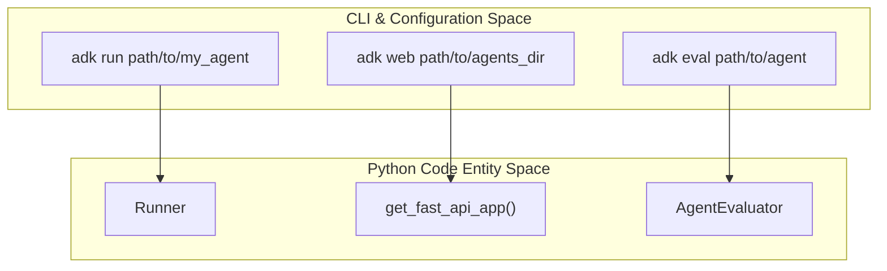
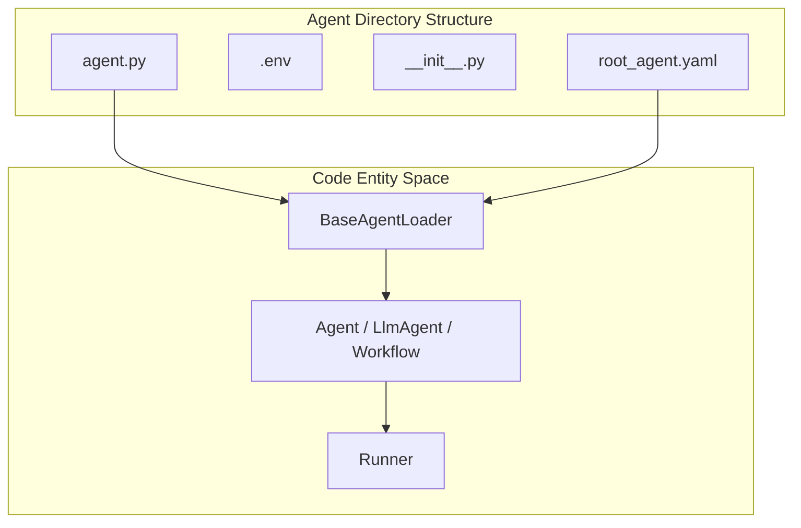

<!-- source: DeepWiki mcp.deepwiki.com · repo google/adk-python · page 2 Getting Started · fetched 2026-10-29 -->

# Getting Started

Relevant source files

The following files were used as context for generating this wiki page:

- [.agents/skills/adk-setup/SKILL.md](.agents/skills/adk-setup/SKILL.md)
- [.github/pull_request_template.md](.github/pull_request_template.md)
- [.gitignore](.gitignore)
- [AGENTS.md](AGENTS.md)
- [CONTRIBUTING.md](CONTRIBUTING.md)
- [README.md](README.md)
- [assets/adk-web-dev-ui-function-call.png](assets/adk-web-dev-ui-function-call.png)
- [assets/adk-web-dev-ui.png](assets/adk-web-dev-ui.png)
- [contributing/README.md](contributing/README.md)
- [contributing/adk_project_overview_and_architecture.md](contributing/adk_project_overview_and_architecture.md)
- [scripts/update_constraints.sh](scripts/update_constraints.sh)
- [tests/unittests/conftest.py](tests/unittests/conftest.py)
- [tox.ini](tox.ini)

This page serves as a parent overview for setting up the Agent Development Kit (ADK), installing dependencies, creating your first agent or graph workflow, and understanding core concepts. As a parent page, it provides a high-level summary and links to detailed child pages.

## Purpose and Scope

The Getting Started section guides users through the initial setup, dependency selection, agent scaffolding, and local execution of ADK applications.

For full installation instructions, optional dependency extras, and Python version constraints, see [Installation](#2.1). For a walkthrough of creating and running your first agent, see [Quick Start Guide](#2.2). For foundational definitions of Agents, Runners, Tools, Sessions, Memory, Events, and Workflows, see [Core Concepts](#2.3).

Sources: [README.md:72-89](), [.agents/skills/adk-setup/SKILL.md:23-60]()

## Installation Overview

ADK requires Python 3.11 or higher [README.md:77-77](). You can install the stable release via `pip` or use companion constraints files for precise dependency tracking [README.md:72-89](). Optional extensions and ecosystem integrations are supported via optional dependency extras [README.md:91-95]().

For detailed installation commands, python version constraints, and optional feature flags, see [Installation](#2.1).

Sources: [README.md:72-95](), [scripts/update_constraints.sh:49-50]()

## Quick Start Overview

ADK supports building agents via code (`Agent`, `LlmAgent`) or graph-based workflows (`Workflow`) using Python or YAML configurations [README.md:111-146](). You can scaffold agent directories and run them locally via interactive REPLs (`adk run`) or the development web UI (`adk web`) [README.md:148-156]().

Diagram: CLI Commands to Code Entities

Sources: [README.md:148-171](), [contributing/adk_project_overview_and_architecture.md:74-78]()

For step-by-step instructions on creating, testing, and running your first agent, see [Quick Start Guide](#2.2).

Sources: [README.md:109-172]()

## Core Concepts Overview

ADK architectures are built around a set of decoupled subsystems that handle agent identity, execution control, state persistence, and tool execution.

Diagram: Agent Structure to Code Entities

Sources: [AGENTS.md:7-15](), [contributing/adk_project_overview_and_architecture.md:32-44]()

For a comprehensive explanation of fundamental concepts including Agents, Runner, Tools, Sessions, Memory, Events, and Workflows, see [Core Concepts](#2.3).

Sources: [AGENTS.md:7-15]()

---

## Child Pages

- [Installation](#2.1) — Step-by-step instructions for package installation, optional dependency extras, and Python version constraints.
- [Quick Start Guide](#2.2) — Walkthrough of scaffolding and running agents.
- [Core Concepts](#2.3) — Fundamental overview of Agents, Runners, Tools, Sessions, Memory, Events, and Workflows.

---

