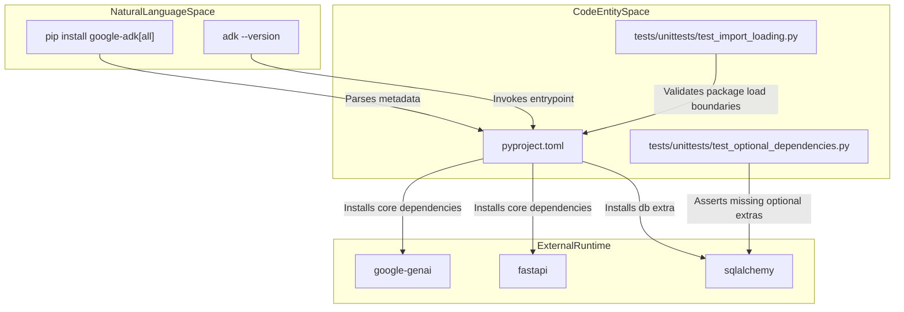
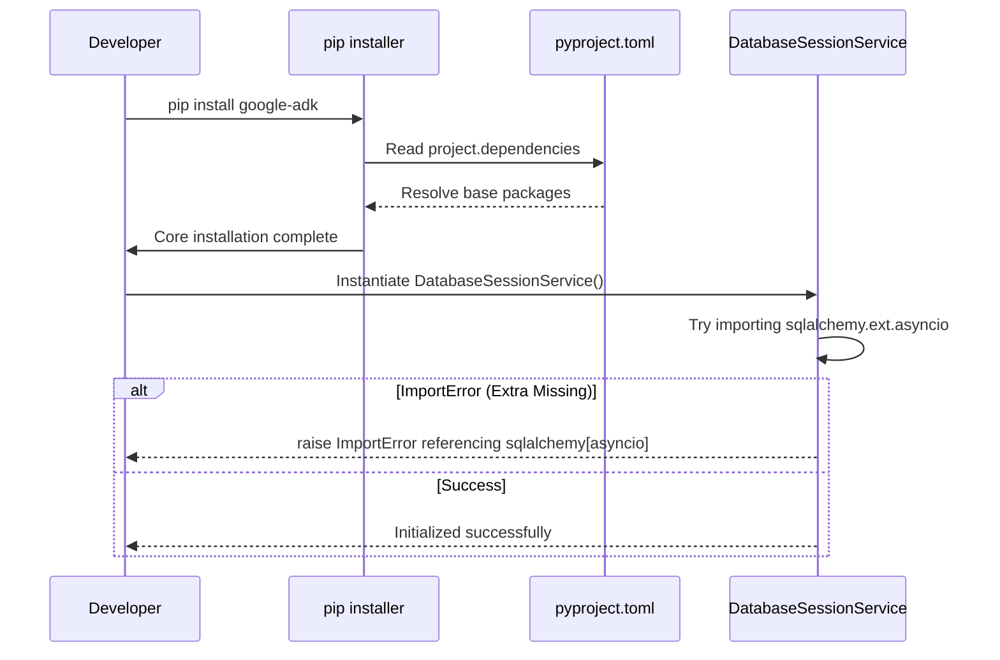

<!-- source: DeepWiki mcp.deepwiki.com · repo google/adk-python · page 2.1 Installation · fetched 2026-10-29 -->

# Installation

<details>
<summary>Relevant source files</summary>

The following files were used as context for generating this wiki page:

- [constraints-3.11.txt](constraints-3.11.txt)
- [constraints-3.12.txt](constraints-3.12.txt)
- [constraints-3.13.txt](constraints-3.13.txt)
- [constraints-3.14.txt](constraints-3.14.txt)
- [constraints-3.15.txt](constraints-3.15.txt)
- [pyproject.toml](pyproject.toml)
- [src/google/adk/__init__.py](src/google/adk/__init__.py)
- [src/google/adk/agents/__init__.py](src/google/adk/agents/__init__.py)
- [src/google/adk/cli/__init__.py](src/google/adk/cli/__init__.py)
- [src/google/adk/dependencies/__init__.py](src/google/adk/dependencies/__init__.py)
- [src/google/adk/dependencies/rouge_scorer.py](src/google/adk/dependencies/rouge_scorer.py)
- [src/google/adk/dependencies/vertexai.py](src/google/adk/dependencies/vertexai.py)
- [src/google/adk/integrations/bigquery/search_tool.py](src/google/adk/integrations/bigquery/search_tool.py)
- [src/google/adk/tools/openapi_tool/openapi_spec_parser/tool_auth_handler.py](src/google/adk/tools/openapi_tool/openapi_spec_parser/tool_auth_handler.py)
- [src/google/adk/utils/_lazy.py](src/google/adk/utils/_lazy.py)
- [src/google/adk/workflow/__init__.py](src/google/adk/workflow/__init__.py)
- [tests/unittests/dependencies/test_vertexai.py](tests/unittests/dependencies/test_vertexai.py)
- [tests/unittests/isolated_import_utils.py](tests/unittests/isolated_import_utils.py)
- [tests/unittests/test_import_loading.py](tests/unittests/test_import_loading.py)
- [tests/unittests/test_optional_dependencies.py](tests/unittests/test_optional_dependencies.py)
- [tests/unittests/test_release_dependencies.py](tests/unittests/test_release_dependencies.py)
- [tests/unittests/tools/openapi_tool/openapi_spec_parser/test_tool_auth_handler.py](tests/unittests/tools/openapi_tool/openapi_spec_parser/test_tool_auth_handler.py)
- [tests/unittests/utils/test_lazy.py](tests/unittests/utils/test_lazy.py)

</details>


## Purpose and Scope

This page details the installation process for the ADK Python package via `pip`, mandatory core dependencies, optional feature extras (such as `gcp`, `eval`, `a2a`, `livekit`, `mongodb`, `e2b`, `bigquery-analytics`), and version-specific constraints files. The ADK package (`google-adk`) serves as a code-first framework for building, orchestrating, and deploying AI agents and workflows [pyproject.toml:7-15]().

Sources:
- [pyproject.toml:7-15]()

---

## Prerequisites

### Python Version Requirements

- The ADK codebase requires **Python >= 3.11**, with active validation supporting Python 3.11, 3.12, 3.13, 3.14, and 3.15 [pyproject.toml:15-27]().
- Dependency constraint files are maintained for each minor version (`constraints-3.11.txt` through `constraints-3.15.txt`) to guarantee reproducible builds and deterministic resolution [constraints-3.11.txt:1-10](), [constraints-3.12.txt:1-10](), [constraints-3.13.txt:1-10](), [constraints-3.14.txt:1-10](), [constraints-3.15.txt:1-10]().

| Python Version | Support Status |
|----------------|----------------|
| 3.11           | Recommended / Supported |
| 3.12           | Supported      |
| 3.13           | Supported      |
| 3.14           | Supported      |
| 3.15           | Supported      |

Sources:
- [pyproject.toml:15-27]()
- [constraints-3.11.txt:1-10]()
- [constraints-3.12.txt:1-10]()
- [constraints-3.13.txt:1-10]()
- [constraints-3.14.txt:1-10]()
- [constraints-3.15.txt:1-10]()

### System and Build Requirements

- **Build Backend**: `flit_core` (>=3.8,<4) is specified as the PEP 517 build backend [pyproject.toml:1-5]().
- **Core Dependencies**: Essential libraries loaded at runtime include `fastapi`, `pydantic>=2.12,<3`, `google-genai>=2.30,<3`, `click`, `httpx`, and `opentelemetry-api` [pyproject.toml:33-58]().

Sources:
- [pyproject.toml:1-57]()

---

## Core Installation and Optional Extras

### Core Installation

To install the minimal core package without optional feature integrations:

```bash
pip install google-adk
```

This installs core requirements like Pydantic, FastAPI, and the Google GenAI SDK, while deferring heavy or specialized provider libraries [pyproject.toml:33-58](), [tests/unittests/test_release_dependencies.py:15-38]().

Sources:
- [pyproject.toml:33-58]()
- [tests/unittests/test_release_dependencies.py:15-38]()

### Optional Dependency Extras

ADK defines modular extras in `pyproject.toml` to support specific subsystems without inflating the baseline footprint. The `all` extra aggregates runtime feature requirements (excluding testing, benchmark, and docs tools) [pyproject.toml:69-155]().

| Extra Name          | Target Subsystem / Feature          | Representative Dependencies                     |
|---------------------|-----------------------------------|------------------------------------------------|
| `a2a`               | Agent-to-Agent protocol           | `a2a-sdk[http-server]>=0.3.4,<2`                |
| `agent-identity`    | GCP Agent Identity & IAM Connectors| `google-cloud-agentidentitycredentials`        |
| `antigravity`       | Google Antigravity SDK integration| `google-antigravity>=0.1.7,<0.2`                |
| `bigquery-analytics`| BigQuery Agent Analytics Plugin   | `google-cloud-bigquery`, `pyarrow>=14`          |
| `daytona`           | Daytona remote sandbox            | `daytona>=0.191`                               |
| `db`                | Relational Database session stores| `sqlalchemy>=2,<3`, `sqlalchemy-spanner`       |
| `e2b`               | E2B remote sandbox environment    | `e2b>=2,<3`                                    |
| `eval`              | Evaluation framework & judges     | `gepa>=0.1`, `pandas`, `rouge-score`, `jinja2`  |
| `livekit`           | LiveKit voice & telephony runner  | `livekit>=1,<2`, `livekit-api`                 |
| `mongodb`           | MongoDB integration               | `pymongo>=4.9,<5`                               |
| `all`               | Complete runtime feature set      | Union of all runtime extras [pyproject.toml:69-155]() |

Example installing multiple optional extras:

```bash
pip install "google-adk[agent-identity,eval,livekit,db,mongodb]"
```

Sources:
- [pyproject.toml:59-155]()
- [tests/unittests/test_release_dependencies.py:150-174]()

### Constraints Files per Python Version

To ensure version locking in production environments or CI pipelines, pre-compiled constraint files are provided for each Python release [constraints-3.11.txt:1-10](), [constraints-3.12.txt:1-10](), [constraints-3.13.txt:1-10](), [constraints-3.14.txt:1-10](), [constraints-3.15.txt:1-10]().

```bash
pip install google-adk[all] -c constraints-3.11.txt
```

Sources:
- [constraints-3.11.txt:1-10]()
- [constraints-3.12.txt:1-10]()
- [constraints-3.13.txt:1-10]()
- [constraints-3.14.txt:1-10]()
- [constraints-3.15.txt:1-10]()

---

## Lazy Loading and Import Architecture

ADK utilizes deferred package importing and lazy member loading via `__getattr__` and accessor modules (such as `google.adk.utils._lazy`) to minimize start-up latency and prevent mandatory third-party imports when specific integrations are uninstalled [tests/unittests/test_import_loading.py:37-48](), [tests/unittests/test_optional_dependencies.py:15-30](). Optional dependencies are verified dynamically via helper utilities when instantiated [tests/unittests/test_optional_dependencies.py:107-152]().

Sources:
- [tests/unittests/test_import_loading.py:37-48]()
- [tests/unittests/test_optional_dependencies.py:15-152]()

---

## Installation Architecture and Data Flow

### Diagram: Natural Language Space to Code Entity Map for Installation



Sources:
- [pyproject.toml:7-58]()
- [tests/unittests/test_import_loading.py:37-48]()
- [tests/unittests/test_optional_dependencies.py:133-152]()

### Diagram: Dependency Resolution and Optional Loading Sequence



Sources:
- [pyproject.toml:33-58]()
- [tests/unittests/test_optional_dependencies.py:133-174]()

---

## Verification of Installation

1. **Verify CLI Installation**:
   ```bash
   adk --version
   ```
   This confirms the command-line interface entrypoint is correctly registered [tests/unittests/test_import_loading.py:181-191]().

2. **Configure Provider Credentials**:
   - For Google GenAI / Gemini models:
     ```bash
     export GOOGLE_API_KEY="your_api_key"
     ```
   - For GCP integrations:
     ```bash
     gcloud auth application-default login
     ```

Sources:
- [tests/unittests/test_import_loading.py:181-191]()

---

## Troubleshooting

| Symptom | Root Cause | Resolution |
|---|---|---|
| `ImportError` or missing driver when initializing database session service | Optional feature dependency not installed via extras | Install the required extra, e.g., `pip install "google-adk[db]"` [tests/unittests/test_optional_dependencies.py:133-174]() |
| `adk: command not found` | Virtual environment not active or binary path missing | Activate your venv or ensure bin path is in `$PATH` |
| KeyError or unpickling error on startup | Incompatible checkpoint or third-party dependency version | Enforce matching versions using `constraints-<version>.txt` [constraints-3.11.txt:1-10]() |

Sources:
- [tests/unittests/test_optional_dependencies.py:133-174]()
- [constraints-3.11.txt:1-10]()

---

## Next Steps

1. Proceed to the [Quick Start Guide (2.2)] for building your first agent using `adk create` and `adk run`.
2. Review [Core Concepts (2.3)] to understand Agents, Runners, and Sessions.

---

