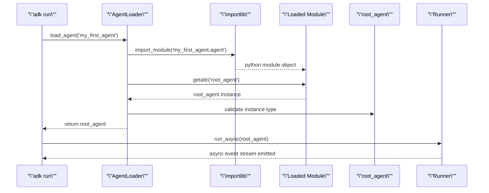

<!-- source: DeepWiki mcp.deepwiki.com · repo google/adk-python · page 2.2 Quick Start Guide · fetched 2026-10-29 -->

# Quick Start Guide

<details>
<summary>Relevant source files</summary>

The following files were used as context for generating this wiki page:

- [src/google/adk/cli/_telemetry/_constants.py](src/google/adk/cli/_telemetry/_constants.py)
- [src/google/adk/cli/_telemetry/_metrics_collector.py](src/google/adk/cli/_telemetry/_metrics_collector.py)
- [src/google/adk/cli/_telemetry/_metrics_reporter.py](src/google/adk/cli/_telemetry/_metrics_reporter.py)
- [src/google/adk/cli/cli.py](src/google/adk/cli/cli.py)
- [src/google/adk/cli/cli_create.py](src/google/adk/cli/cli_create.py)
- [src/google/adk/cli/service_registry.py](src/google/adk/cli/service_registry.py)
- [src/google/adk/cli/utils/_onboarding.py](src/google/adk/cli/utils/_onboarding.py)
- [src/google/adk/cli/utils/dot_adk_folder.py](src/google/adk/cli/utils/dot_adk_folder.py)
- [src/google/adk/cli/utils/gcp_utils.py](src/google/adk/cli/utils/gcp_utils.py)
- [src/google/adk/cli/utils/local_storage.py](src/google/adk/cli/utils/local_storage.py)
- [src/google/adk/cli/utils/service_factory.py](src/google/adk/cli/utils/service_factory.py)
- [tests/unittests/cli/_telemetry/test_metrics_collector.py](tests/unittests/cli/_telemetry/test_metrics_collector.py)
- [tests/unittests/cli/_telemetry/test_metrics_reporter.py](tests/unittests/cli/_telemetry/test_metrics_reporter.py)
- [tests/unittests/cli/conformance/test_generate_markdown_utils.py](tests/unittests/cli/conformance/test_generate_markdown_utils.py)
- [tests/unittests/cli/test_cli_utf8_encoding.py](tests/unittests/cli/test_cli_utf8_encoding.py)
- [tests/unittests/cli/test_service_registry.py](tests/unittests/cli/test_service_registry.py)
- [tests/unittests/cli/utils/test_cli.py](tests/unittests/cli/utils/test_cli.py)
- [tests/unittests/cli/utils/test_cli_create.py](tests/unittests/cli/utils/test_cli_create.py)
- [tests/unittests/cli/utils/test_dot_adk_folder.py](tests/unittests/cli/utils/test_dot_adk_folder.py)
- [tests/unittests/cli/utils/test_gcp_utils.py](tests/unittests/cli/utils/test_gcp_utils.py)
- [tests/unittests/cli/utils/test_local_storage.py](tests/unittests/cli/utils/test_local_storage.py)
- [tests/unittests/cli/utils/test_service_factory.py](tests/unittests/cli/utils/test_service_factory.py)
- [tests/unittests/streaming/test_multi_agent_streaming.py](tests/unittests/streaming/test_multi_agent_streaming.py)

</details>


**Purpose and Scope**: This guide walks you through creating and running your first ADK (Agent Development Kit) agent using the command-line interface (`adk create` and `adk run`). You will learn the basic workflow for agent development, from project creation to interactive testing and understanding the internal loading and execution mechanisms. For installation instructions, see [Installation](2.1). For deeper conceptual understanding, see [Core Concepts](2.3).

Sources: 
[src/google/adk/cli/cli_create.py:1-219](), [src/google/adk/cli/cli.py:1-187]()

---

## Creating Your First Agent

The `adk create` CLI command scaffolds a new agent project with a pre-configured template. This functionality is implemented in the module `cli_create.py`, where the main entrypoint function is `run_cmd()` which handles validation, user prompts, and file generation [src/google/adk/cli/cli_create.py:203-219]().

Run this simple command to create an agent folder:

```bash
adk create my_first_agent
```

### Detailed Workflow of `adk create`

When you execute this command, the flow is:

1. **Agent Name Validation**  
   The agent name is validated with `validate_app_name()` from `apps.app` to ensure it conforms to rules for Python package names and ADK agent identifiers [src/google/adk/cli/cli_create.py:22-22]().

2. **Model Selection Prompt**  
   The CLI prompts you to select an LLM model for the root agent, with default options like `"gemini-3.5-flash"` and `"gemini-3.8-flash"`. You may also specify another model by choosing the "Other" option [src/google/adk/cli/cli_create.py:168-185]().

3. **Agent Type Selection Prompt**  
   Choose between:
   - YAML config-based agent (experimental, specified in `root_agent.yaml`), or
   - Code-based agent (standard Python code with `agent.py`).
   
   This choice affects the generated files and the agent loading approach [src/google/adk/cli/cli_create.py:187-201]().

4. **User Onboarding for Credentials**  
   Interactive helpers gather needed credentials such as Google API keys or Vertex AI project and region identifiers. These values populate the `.env` file for runtime environment configuration [src/google/adk/cli/cli_create.py:131-144]().

5. **File Generation**  
   - Creates an agent folder matching the agent name.
   - Generates a `.env` file containing backend API key or project credentials and mode flags.
   - Ensures `.gitignore` contains entries to exclude `.env` and `.adk/` folders to protect secrets and runtime files.
   - Writes either:
     - A code-based implementation (`agent.py` and `__init__.py`) defining a root `Agent` object, or
     - A YAML config-based structure (`root_agent.yaml`) conforming to the `AgentConfig` schema [src/google/adk/cli/cli_create.py:114-166]().

### Generated Directory Structure Example for Code Mode

```plaintext
my_first_agent/
├── __init__.py      # Marks Python package, imports `agent.py`
├── agent.py         # Defines `root_agent` instance as LlmAgent-based Agent
├── .env             # Environment variables holding secrets/config
└── .gitignore       # Ignores `.env` and `.adk/` from version control
```

### Generated Directory Structure Example for YAML Config Mode

```plaintext
my_first_agent/
├── __init__.py      # Empty file marking Python package (no imports)
├── root_agent.yaml  # YAML configuration for the agent model and instruction
├── .env             # Environment variables for secrets/config
└── .gitignore       # Ignores `.env` and local storage from VCS
```

### Difference Between Code and Config Agents

| Type           | Files                    | Description                                   |
|----------------|--------------------------|-----------------------------------------------|
| Code           | `agent.py`, `__init__.py` | Defines root agent instance by Python code using `Agent` (`LlmAgent` subclass) |
| YAML Config    | `root_agent.yaml`        | Declares agent setup in YAML syntax using `AgentConfig` schema |

Sources:  
[src/google/adk/cli/cli_create.py:25-46](), [src/google/adk/cli/cli_create.py:114-166](), [src/google/adk/cli/cli_create.py:168-201](), [src/google/adk/cli/cli_create.py:203-219]()

---

## Understanding the Generated Agent

The generated `agent.py` (code mode) contains a root `Agent` instance which is an `LlmAgent` configured with properties such as the model to use, name, description, and agent instructions [src/google/adk/cli/cli_create.py:29-38]().

### Agent Properties Explained

- **`name`**: String identifier for this agent instance [src/google/adk/cli/cli_create.py:34-34]().
- **`model`**: LLM model string name used to drive generation (e.g., `"gemini-3.5-flash"`) [src/google/adk/cli/cli_create.py:33-33]().
- **`description`**: Optional textual description of agent purpose [src/google/adk/cli/cli_create.py:35-35]().
- **`instruction`**: System prompt or instruction to guide the agent's behavior [src/google/adk/cli/cli_create.py:36-36]().

These parameters feed into the `LlmAgent` constructor, which uses them to configure prompt templates, model setup, and tool integration at runtime.

### `.env` Environment File

This file stores critical credentials and configuration such as:

- `GOOGLE_API_KEY`: API key for Google AI services when using non-enterprise mode [src/google/adk/cli/cli_create.py:137-138]().
- `GOOGLE_CLOUD_PROJECT` and `GOOGLE_CLOUD_LOCATION`: For Vertex AI enterprise backend [src/google/adk/cli/cli_create.py:139-142]().
- `GOOGLE_GENAI_USE_ENTERPRISE`: Flag set to `"1"` for enterprise/Vertex AI mode or `"0"` otherwise [src/google/adk/cli/cli_create.py:133-136]().

It is essential for runtime authentication to cloud AI services.

### `.gitignore` Management

`adk create` ensures `.env` and `.adk/` are gitignored to prevent secrets and local runtime data from being checked into version control. It appends entries if necessary without duplications and respects existing content [src/google/adk/cli/cli_create.py:85-112]().

Sources:  
[src/google/adk/cli/cli_create.py:29-38](), [src/google/adk/cli/cli_create.py:85-112](), [src/google/adk/cli/cli_create.py:131-144]()

---

## CLI Workflow Diagram: From Command to Agent Execution

Title: CLI Workflow Mapping

```mermaid
graph TB
    subgraph NaturalLanguageSpace
        CreateCmd["\"adk create my_agent\""]
        RunCmd["\"adk run my_agent\""]
        DeployCmd["\"adk deploy cloud_run my_agent\""]
    end

    subgraph CodeEntitySpace
        CLI_Create["\"cli_create.run_cmd()\""]
        CLI_Run["\"cli.cli_run()\""]
        Runner["\"Runner\""]
        AgentLoader["\"AgentLoader\""]
        AgentModule["\"my_agent.agent\""]
        RootAgent["\"root_agent\""]
    end

    CreateCmd --> CLI_Create
    RunCmd --> CLI_Run
    DeployCmd --> CLI_Run
    
    CLI_Run --> AgentLoader
    AgentLoader --> AgentModule
    AgentModule --> RootAgent
    CLI_Run --> Runner

    style CLI_Create stroke-dasharray: 5 5
    style CLI_Run stroke-dasharray: 5 5
```

- `adk create` invokes `cli_create.run_cmd()` to scaffold project files [src/google/adk/cli/cli_create.py:203-219]().
- `adk run` calls `cli.cli_run()`, which uses `AgentLoader` to dynamically import the agent Python module to get `root_agent` [src/google/adk/cli/cli.py:52-52]().
- The `Runner` executes the root agent by orchestrating the runtime lifecycle and generating output events [src/google/adk/cli/cli.py:43-43]().

Sources:  
[src/google/adk/cli/cli_create.py:203-219](), [src/google/adk/cli/cli.py:52-52](), [src/google/adk/cli/cli.py:43-43]()

---

## Running Your Agent

### Interactive CLI Mode

Run the agent interactively from the terminal:

```bash
adk run my_first_agent
```

This performs the following:

1. Dynamically import the agent Python module (or YAML config).
2. Locate the exported symbol `root_agent` and verify it is an instance of `BaseAgent` [src/google/adk/cli/cli.py:32-32]().
3. Wrap it inside an `App` if not already one, for runtime orchestration context [src/google/adk/cli/cli.py:65-70]().
4. Instantiate a `Runner` and execute the root agent asynchronously [src/google/adk/cli/cli.py:83-89]().

The `Runner` yields an asynchronous event stream, which the CLI listens to and outputs the agent's assistant responses in real time [src/google/adk/cli/cli.py:100-109]().

### Running from Input Files

Alternatively, use `run_input_file()` to run queries from a JSON file holding serialized session state and list of user queries [src/google/adk/cli/cli.py:72-81](). This function:

- Loads the input queries and state [src/google/adk/cli/cli.py:90-92]().
- Creates a fresh session with initial state [src/google/adk/cli/cli.py:94-96]().
- Executes queries sequentially printing assistant responses [src/google/adk/cli/cli.py:97-109]().

### Human-in-the-Loop (HITL) Support

The CLI supports human-in-the-loop function calls that require interactive confirmation or additional inputs asynchronously. It detects pending function calls in agent events and prompts the user accordingly [src/google/adk/cli/cli.py:116-136]().

Sources:  
[src/google/adk/cli/cli.py:32-32](), [src/google/adk/cli/cli.py:65-109](), [src/google/adk/cli/cli.py:116-136]()

---

## CLI Agent Loading Sequence Diagram

Title: CLI Agent Loading Sequence



- The agent folder is loaded as a Python module dynamically via `AgentLoader`.
- The `root_agent` symbol is extracted, which must be an agent instance.
- The `Runner` orchestrates agent execution and event generation printed by CLI [src/google/adk/cli/cli.py:83-109]().

Sources:  
[src/google/adk/cli/cli.py:52-52](), [src/google/adk/cli/cli.py:83-109]()

---

## Canonical Project Structure and File Roles

| Filename          | Role                                                    | Notes                              |
|-------------------|---------------------------------------------------------|-----------------------------------|
| `agent.py`        | Root agent source code file (code mode only)           | Defines `root_agent` LlmAgent instance |
| `__init__.py`     | Python package marker                                   | Usually imports `agent.py`         |
| `.env`            | Environment variables (credentials and config)         | Holds secrets like API keys        |
| `.gitignore`      | VCS ignore file for secrets and runtime data            | Includes `.env` and `.adk/`        |
| `root_agent.yaml` | YAML agent configuration (config mode only)            | Must conform to `AgentConfig.json` |

### File Generation Logic Recap

- `.env` files store Google API keys, project IDs, and mode flags [src/google/adk/cli/cli_create.py:131-143]().
- `.gitignore` prevents committing sensitive and runtime files accidentally [src/google/adk/cli/cli_create.py:85-112]().
- `agent.py` and `__init__.py` set up the root agent code [src/google/adk/cli/cli_create.py:25-38]().
- Alternatively, `root_agent.yaml` defines the declarative configuration [src/google/adk/cli/cli_create.py:40-46]().

Sources:  
[src/google/adk/cli/cli_create.py:25-166]()

---

## Service Configuration for Local Persistence

When running locally, `adk run` automatically configures backend services for session and artifact persistence using service factories:

- **Session Service**:  
  By default, a per-agent SQLite database is created inside `.adk/session.db` using `PerAgentDatabaseSessionService`, providing isolated persistent state per agent folder [src/google/adk/cli/utils/local_storage.py:134-169]().

- **Artifact Service**:  
  Uses a file artifact service stored under `.adk/artifacts/` within the agent project by default (`PerAgentFileArtifactService`) [src/google/adk/cli/utils/local_storage.py:101-132]().

- **Configuration Behavior**:  
  - Users may override default persistence backends by specifying URI options for session or artifact services [src/google/adk/cli/utils/service_factory.py:197-204]().
  - Environment variables control fallback or forcing of local storage, e.g., `ADK_DISABLE_LOCAL_STORAGE`, `ADK_FORCE_LOCAL_STORAGE` [src/google/adk/cli/utils/service_factory.py:36-42]().
  - In cloud environments (Cloud Run, Kubernetes), in-memory ephemeral services are preferred by default [src/google/adk/cli/utils/service_factory.py:138-143]().

This ensures convenient development with durable local persistence by default, while allowing configurable backends for production deployments.

Sources:  
[src/google/adk/cli/utils/service_factory.py:36-204](), [src/google/adk/cli/utils/local_storage.py:101-169]()

---

## Summary

This Quick Start Guide covered:

- Creating an agent project with `adk create` (code or config mode) [src/google/adk/cli/cli_create.py:187-201]().
- Understanding generated files and their roles [src/google/adk/cli/cli_create.py:114-166]().
- Internal CLI workflow for loading and running the agent [src/google/adk/cli/cli.py:52-109]().
- Executing the agent interactively or from input files [src/google/adk/cli/cli.py:72-109]().
- Configuration of local backend services for sessions and artifacts [src/google/adk/cli/utils/service_factory.py:179-204]().

Sources:  
[src/google/adk/cli/cli_create.py:114-201](), [src/google/adk/cli/cli.py:52-109](), [src/google/adk/cli/utils/service_factory.py:179-204]()

---

