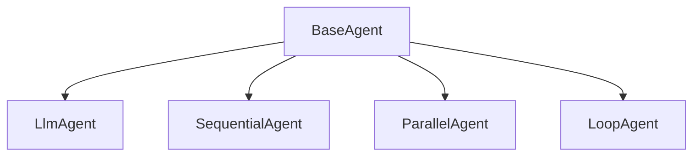
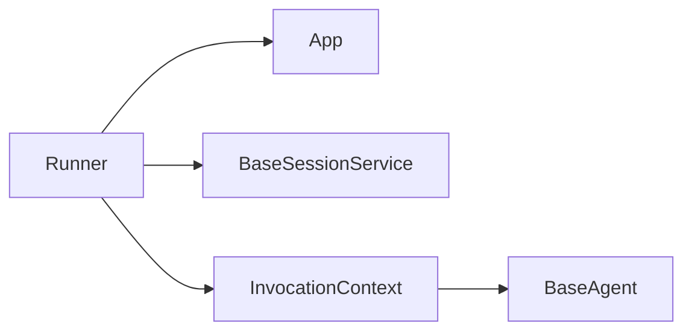
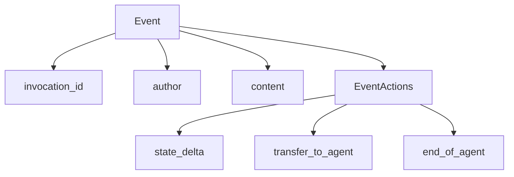
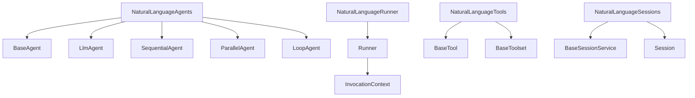
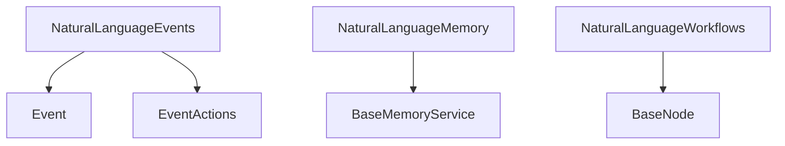
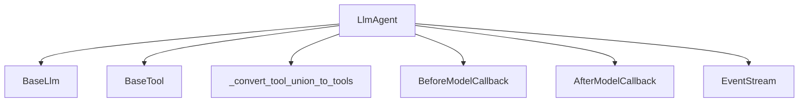

<!-- source: DeepWiki mcp.deepwiki.com · repo google/adk-python · page 2.3 Core Concepts · fetched 2026-10-29 -->

# Core Concepts

Relevant source files

The following files were used as context for generating this wiki page:

- [docs/guides/README.md](docs/guides/README.md)
- [docs/guides/apps/app/index.md](docs/guides/apps/app/index.md)
- [docs/guides/apps/events_compaction/index.md](docs/guides/apps/events_compaction/index.md)
- [docs/guides/apps/resumability/index.md](docs/guides/apps/resumability/index.md)
- [docs/guides/artifacts/artifact_service/index.md](docs/guides/artifacts/artifact_service/index.md)
- [docs/guides/events/event/index.md](docs/guides/events/event/index.md)
- [docs/guides/events/event_actions/index.md](docs/guides/events/event_actions/index.md)
- [docs/guides/events/request_input/index.md](docs/guides/events/request_input/index.md)
- [docs/guides/runners/runner/index.md](docs/guides/runners/runner/index.md)
- [docs/guides/runners/runner/live.md](docs/guides/runners/runner/live.md)
- [docs/guides/runners/runner/rewind.md](docs/guides/runners/runner/rewind.md)
- [scripts/generate_agent_config_schema.py](scripts/generate_agent_config_schema.py)
- [src/google/adk/agents/_agent_router.py](src/google/adk/agents/_agent_router.py)
- [src/google/adk/agents/agent_config.py](src/google/adk/agents/agent_config.py)
- [src/google/adk/agents/base_agent.py](src/google/adk/agents/base_agent.py)
- [src/google/adk/agents/base_agent_config.py](src/google/adk/agents/base_agent_config.py)
- [src/google/adk/agents/common_configs.py](src/google/adk/agents/common_configs.py)
- [src/google/adk/agents/config_agent_utils.py](src/google/adk/agents/config_agent_utils.py)
- [src/google/adk/agents/config_schemas/AgentConfig.json](src/google/adk/agents/config_schemas/AgentConfig.json)
- [src/google/adk/agents/llm_agent.py](src/google/adk/agents/llm_agent.py)
- [src/google/adk/agents/llm_agent_config.py](src/google/adk/agents/llm_agent_config.py)
- [src/google/adk/agents/loop_agent.py](src/google/adk/agents/loop_agent.py)
- [src/google/adk/agents/loop_agent_config.py](src/google/adk/agents/loop_agent_config.py)
- [src/google/adk/agents/parallel_agent.py](src/google/adk/agents/parallel_agent.py)
- [src/google/adk/agents/parallel_agent_config.py](src/google/adk/agents/parallel_agent_config.py)
- [src/google/adk/agents/sequential_agent.py](src/google/adk/agents/sequential_agent.py)
- [src/google/adk/agents/sequential_agent_config.py](src/google/adk/agents/sequential_agent_config.py)
- [src/google/adk/events/_abort_events.py](src/google/adk/events/_abort_events.py)
- [src/google/adk/runners.py](src/google/adk/runners.py)
- [src/google/adk/tools/exit_loop_tool.py](src/google/adk/tools/exit_loop_tool.py)
- [src/google/adk/workflow/_node_runner_utils.py](src/google/adk/workflow/_node_runner_utils.py)
- [src/google/adk/workflow/utils/_transfer_utils.py](src/google/adk/workflow/utils/_transfer_utils.py)
- [tests/unittests/agents/test_agent_config.py](tests/unittests/agents/test_agent_config.py)
- [tests/unittests/agents/test_agent_router.py](tests/unittests/agents/test_agent_router.py)
- [tests/unittests/agents/test_base_agent.py](tests/unittests/agents/test_base_agent.py)
- [tests/unittests/agents/test_llm_agent_fields.py](tests/unittests/agents/test_llm_agent_fields.py)
- [tests/unittests/agents/test_llm_agent_interruptions.py](tests/unittests/agents/test_llm_agent_interruptions.py)
- [tests/unittests/agents/test_loop_agent.py](tests/unittests/agents/test_loop_agent.py)
- [tests/unittests/agents/test_parallel_agent.py](tests/unittests/agents/test_parallel_agent.py)
- [tests/unittests/agents/test_resumable_llm_agent.py](tests/unittests/agents/test_resumable_llm_agent.py)
- [tests/unittests/agents/test_sequential_agent.py](tests/unittests/agents/test_sequential_agent.py)
- [tests/unittests/events/test_abort_events.py](tests/unittests/events/test_abort_events.py)
- [tests/unittests/runners/test_pause_invocation.py](tests/unittests/runners/test_pause_invocation.py)
- [tests/unittests/test_runners.py](tests/unittests/test_runners.py)
- [tests/unittests/workflow/test_agent_transfer.py](tests/unittests/workflow/test_agent_transfer.py)
- [tests/unittests/workflow/test_node_runner_utils.py](tests/unittests/workflow/test_node_runner_utils.py)
- [tests/unittests/workflow/test_workflow_agent_as_node.py](tests/unittests/workflow/test_workflow_agent_as_node.py)
- [tests/unittests/workflow/test_workflow_function_tool_as_node.py](tests/unittests/workflow/test_workflow_function_tool_as_node.py)
- [tests/unittests/workflow/test_workflow_live.py](tests/unittests/workflow/test_workflow_live.py)
- [tests/unittests/workflow/test_workflow_rewind.py](tests/unittests/workflow/test_workflow_rewind.py)
- [tests/unittests/workflow/test_workflow_schema.py](tests/unittests/workflow/test_workflow_schema.py)
- [tests/unittests/workflow/utils/test_transfer_utils.py](tests/unittests/workflow/utils/test_transfer_utils.py)

This page explains the fundamental concepts and abstractions forming the foundation of the Agent Development Kit (ADK). Mastery of these concepts is essential for building, orchestrating, and deploying AI agents using the ADK Python framework.

ADK’s architecture centers around these primary concepts:
- **Agents**: Autonomous computational units that process input and produce output.
- **Runner**: The stateless orchestration engine managing agent execution.
- **Tools**: Extensible functionalities callable by agents to interact with external systems.
- **Sessions**: Persistent conversational state management.
- **Memory**: Long-term semantic storage used across sessions.
- **Events**: Units representing messages, actions, and system state changes.
- **Workflows**: Graph-based orchestration of agents and nodes enabling complex execution.

Sources: [src/google/adk/agents/base_agent.py:131-137](), [src/google/adk/runners.py:61-63](), [src/google/adk/agents/invocation_context.py:127-134]()

---

## Agents

Agents are self-contained entities that perform reasoning or actions in response to input. They are at the heart of ADK's agentic automation. Every agent is a subclass of the abstract `BaseAgent` class [src/google/adk/agents/base_agent.py:131-137]() and also a `BaseNode` in the workflow engine [src/google/adk/agents/base_agent.py:52-52]().

### Agent Types and Hierarchy

ADK provides specialized agent types supporting different orchestration and execution patterns:

Title: "Agent Inheritance Hierarchy"

Sources: [src/google/adk/agents/base_agent.py:131-137](), [src/google/adk/agents/llm_agent.py:65-65](), [src/google/adk/agents/sequential_agent.py:93-94](), [src/google/adk/agents/parallel_agent.py:176-177]()

- **`BaseAgent`**: Abstract common base with methods `_run_async_impl()` and `_run_live_impl()` that subclasses override [src/google/adk/agents/base_agent.py:131-137]().
- **`LlmAgent`**: Uses LLM models to process instructions and optionally calls tools [src/google/adk/agents/llm_agent.py:65-65]().
- **`SequentialAgent`**, **`ParallelAgent`**, **`LoopAgent`**: Orchestrators running multiple sub-agents in different patterns [src/google/adk/agents/sequential_agent.py:93-94](), [src/google/adk/agents/parallel_agent.py:176-177](). These are deprecated in favor of ADK 2.0 Workflows but remain supported.

### Agent Composition and Naming

Agents form a hierarchical tree with parent/child relationships defined through the `sub_agents` attribute [src/google/adk/agents/base_agent.py:184-186](). Each agent must have a unique Python identifier-compatible `name` within its tree and **cannot be named `"user"`** (reserved for end users) [src/google/adk/agents/base_agent.py:162-164](). 

Agents have a `description` that LLMs use to help decide when to delegate control [src/google/adk/agents/base_agent.py:166-171](). The `parent_agent` attribute is set automatically when agents are added as sub_agents [src/google/adk/agents/base_agent.py:173-183]().

### Callbacks on Agents

Agents support lifecycle callbacks:

| Callback Name | Description | Behavior |
|---|---|---|
| `before_agent_callback` | Invoked before the agent runs; can bypass agent execution by returning content | Accepts a single or list of callbacks. When a callback returns content, agent run is skipped and content is returned early [src/google/adk/agents/base_agent.py:187-204]() |
| `after_agent_callback` | Invoked after the agent run completes; can append extra content to the response | When a callback returns content, it is appended as an additional response event [src/google/adk/agents/base_agent.py:205-207]() |

Callbacks can be synchronous or asynchronous, and are executed sequentially until a truthy result is returned [src/google/adk/agents/base_agent.py:48-50]().

Sources: [src/google/adk/agents/base_agent.py:131-210]()

---

## Runner

The `Runner` is ADK’s stateless orchestration engine coordinating agent runs, managing sessions, and controlling event flows. It constructs an `InvocationContext` for each invocation that encapsulates state, session information, and services [src/google/adk/agents/invocation_context.py:127-134]().

### Runner Architecture

Title: "Runner and Invocation Flow"

Sources: [src/google/adk/runners.py:61-63](), [src/google/adk/agents/invocation_context.py:127-134]()

- The `Runner` uses provided services (`BaseSessionService`, `BaseArtifactService`, `BaseMemoryService`) and `PluginManager` to manage execution lifecycles [src/google/adk/runners.py:59-63]().
- It calls the `agent.run_async(context)` method to drive agent computation.
- Supports multiple run modes: text-based (`run_async`), live audio/video streaming (`run_live`), and rewind/restore (`rewind_async`).

### Key Runner Methods

| Method | Description | Location |
|---|---|---|
| `run_async()` | Executes an agent run textually, yielding events asynchronously | [src/google/adk/runners.py:51-53]() |
| `run_live()` | Supports real-time live streaming input/output interactions | [src/google/adk/runners.py:51-53]() |
| `rewind_async()` | Rolls back to a previous event in session history | [src/google/adk/runners.py:51-53]() |

Sources: [src/google/adk/runners.py:51-73]()

---

## Sessions

A **session** represents a persistent conversation or interaction context identified by `app_name`, `user_id`, and a unique `session id` [src/google/adk/sessions/session.py:1-1]().

### State Scoping and Hierarchy

Agent and application state is tracked hierarchically using prefixes:

| Prefix | Scope | Persistence | Use Case |
|---|---|---|---|
| `app:` | All users in app | Persistent | Global app-level config |
| `user:`| All user sessions | Persistent | User preferences or settings |
| (none) | One session only | Persistent | Current conversation context |
| `temp:`| Current invocation | Not persisted | Temporary, ephemeral data |

State deltas are applied as changes in `Event.actions.state_delta` allowing precise incremental updates without rewriting whole state [src/google/adk/events/event_actions.py:1-1]().

Sources: [src/google/adk/events/event_actions.py:1-1]()

---

## Events

An **event** is the fundamental record of communication and actions within the system. This includes user messages, agent responses, function call invocations, and system state changes.

### Event Model

The core event class is `Event`, which includes fields to track authorship, invocation context, actions, output, and node metadata [src/google/adk/events/event.py:1-1]().

Title: "Event Structure"

Sources: [src/google/adk/events/event.py:1-1](), [src/google/adk/events/event_actions.py:1-1]()

- `invocation_id` groups events for a single invocation transaction [src/google/adk/events/event.py:1-1]().
- `author` identifies who emitted the event (`user` or an agent name) [src/google/adk/events/event.py:1-1]().
- `actions` include flags and state delta updates [src/google/adk/events/event.py:1-1]().

---

## Tools

**Tools** are the interfaces through which agents interact with external systems or execute custom logic. They can be Python callables, objects implementing the `BaseTool` interface, or full toolsets deriving from `BaseToolset` [src/google/adk/agents/llm_agent.py:153-153]().

### Tool Types in LlmAgent

`LlmAgent` accepts tools as a union of these forms:
- Simple callables (e.g., Python functions)
- Instances of `BaseTool`
- Toolsets (collections of tools) via `BaseToolset`
- Node wrappers (`NodeTool`) wrapping workflow nodes or subgraphs [src/google/adk/agents/llm_agent.py:156-166]()

### Workflow Nodes as Tools via NodeTool

Workflows and graph nodes can be wrapped as callable tools using the `NodeTool` wrapper. This allows an LlmAgent to invoke a workflow node as if it were a simple tool, integrating complex graph logic under the tool call framework [src/google/adk/agents/llm_agent.py:156-166]().

Sources: [src/google/adk/agents/llm_agent.py:151-166]()

---

## Invocation Context and Context Object

Upon agent execution, an `InvocationContext` instance is created by the `Runner` which provides the execution environment and access to session state, services, plugins, and run configuration [src/google/adk/agents/invocation_context.py:127-134]().

Additionally, ADK provides a higher-level `Context` object encapsulating session state, local event actions, state deltas, workflow node path, run id, and scheduler references [src/google/adk/agents/base_agent.py:55-55]().

Sources: [src/google/adk/agents/invocation_context.py:127-134](), [src/google/adk/agents/base_agent.py:55-55]()

---

## Workflows

The ADK 2.0 workflow engine manages non-linear, conditional, and cyclical orchestration via a directed graph of nodes. Agents themselves are nodes, allowing complex subgraphs of agent calls, tools, and processing logic.

### Workflow Integration with Agents

Workflows are defined as subclasses of `BaseNode` with edges specifying routing and branching logic [src/google/adk/workflow/_base_node.py:72-72]().

Agents like `LlmAgent` or `NodeTool` can be embedded as nodes within workflows for hierarchical execution. The workflow scheduler manages node triggering, retries, and resumption [src/google/adk/agents/base_agent.py:131-137]().

Sources: [src/google/adk/agents/base_agent.py:131-137](), [src/google/adk/workflow/_base_node.py:72-72]()

---

# Summary Diagram: From Natural Language to Code Entities

Title: "Natural Language to Code Entities Mapping (Part 1)"

Sources: [src/google/adk/agents/base_agent.py:131-137](), [src/google/adk/runners.py:51-73](), [src/google/adk/agents/llm_agent.py:65-65](), [src/google/adk/sessions/session.py:1-1]()

Title: "Natural Language to Code Entities Mapping (Part 2)"

Sources: [src/google/adk/events/event.py:1-1](), [src/google/adk/events/event_actions.py:1-1](), [src/google/adk/runners.py:59-63](), [src/google/adk/workflow/_base_node.py:72-72]()

---

# Summary Diagram: LlmAgent Internal Flow and Tool Integration

Title: "LlmAgent Execution and Tool Flow"

Sources: [src/google/adk/agents/llm_agent.py:65-176]()

- `LlmAgent` instantiates or receives an LLM model (`BaseLlm` subclass) [src/google/adk/agents/llm_agent.py:65-65]().
- Tools can be provided as Python functions, `BaseTool`, or toolsets; internally unified as a list of `BaseTool` instances by `_convert_tool_union_to_tools()` [src/google/adk/agents/llm_agent.py:171-176]().
- Before/after model and tool callbacks allow custom logic injection [src/google/adk/agents/llm_agent.py:93-141]().

---

# Detailed Conceptual Summary

| Concept | Implementation | Key Methods/Attributes | Notes |
|---|---|---|---|
| **Agents** | `BaseAgent` and subclasses | `run_async()`, `_run_async_impl()`, `sub_agents`, `name`, `description`, callbacks | Agents are hierarchical nodes; deprecated agents replaced by workflows [src/google/adk/agents/base_agent.py:131-210]() |
| **Runner** | `Runner` | `run_async()`, `run_live()`, `rewind_async()` | Stateless executor coordinating sessions, agents, plugins, and events [src/google/adk/runners.py:51-73]() |
| **Tools** | `BaseTool`, `BaseToolset` and `NodeTool` | Tool callables or objects; tools exposed to LLM | Tools wrap external capabilities; Nodes can be tools [src/google/adk/agents/llm_agent.py:151-166]() |
| **Sessions** | `BaseSessionService` implementations; `Session` | Hierarchical state (`app:`, `user:`, etc.), event history | Persistent conversation state with state deltas stored via events [src/google/adk/sessions/session.py:1-1]() |
| **Memory** | `BaseMemoryService` | Semantic storage accessible across sessions | For enhanced context, episodic memory, retrievers [src/google/adk/runners.py:59-63]() |
| **Events** | `Event` | `id`, `invocation_id`, `author`, `actions`, `node_info` | Data flow unit representing content, actions, state changes [src/google/adk/events/event.py:1-1]() |
| **Workflows** | `BaseNode`, `Graph` | Graph-based execution of nodes and agents | Supports recursive, dynamic, and conditional orchestration [src/google/adk/workflow/_base_node.py:72-72]() |

Sources: [src/google/adk/agents/base_agent.py:131-210](), [src/google/adk/runners.py:51-73](), [src/google/adk/agents/llm_agent.py:151-166](), [src/google/adk/sessions/session.py:1-1](), [src/google/adk/events/event.py:1-1]()

---

