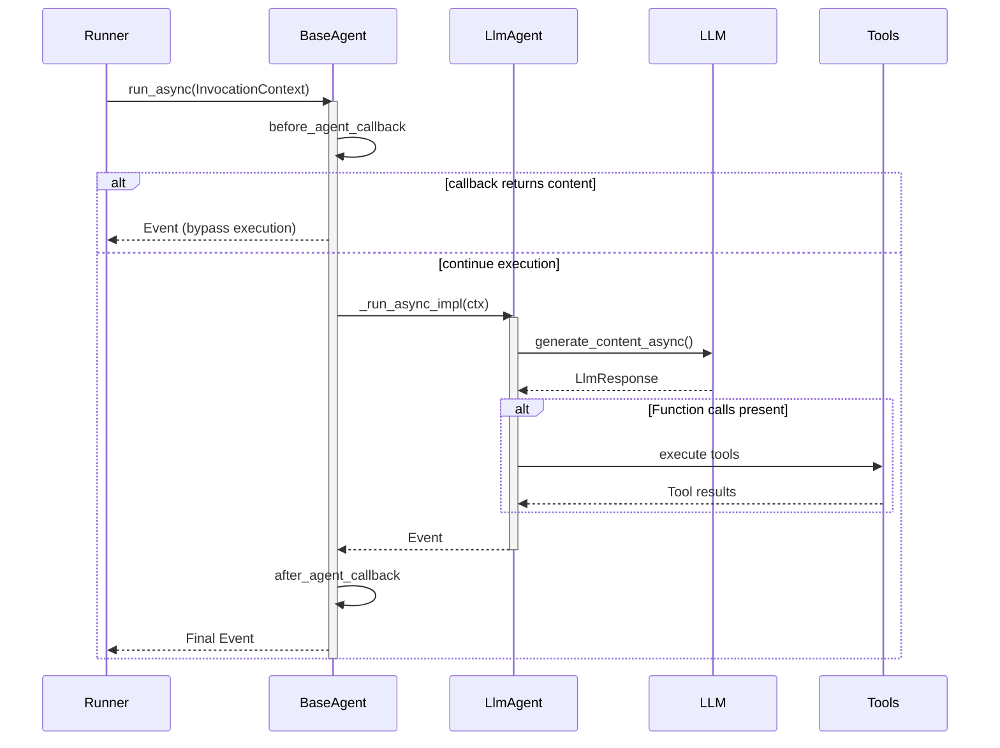

<!-- source: DeepWiki mcp.deepwiki.com · repo google/adk-python · page 3 Agent System · fetched 2026-10-29 -->

# Agent System

<details>
<summary>Relevant source files</summary>

The following files were used as context for generating this wiki page:

- [scripts/generate_agent_config_schema.py](scripts/generate_agent_config_schema.py)
- [src/google/adk/agents/agent_config.py](src/google/adk/agents/agent_config.py)
- [src/google/adk/agents/base_agent.py](src/google/adk/agents/base_agent.py)
- [src/google/adk/agents/base_agent_config.py](src/google/adk/agents/base_agent_config.py)
- [src/google/adk/agents/common_configs.py](src/google/adk/agents/common_configs.py)
- [src/google/adk/agents/config_agent_utils.py](src/google/adk/agents/config_agent_utils.py)
- [src/google/adk/agents/config_schemas/AgentConfig.json](src/google/adk/agents/config_schemas/AgentConfig.json)
- [src/google/adk/agents/llm_agent.py](src/google/adk/agents/llm_agent.py)
- [src/google/adk/agents/llm_agent_config.py](src/google/adk/agents/llm_agent_config.py)
- [src/google/adk/agents/loop_agent.py](src/google/adk/agents/loop_agent.py)
- [src/google/adk/agents/loop_agent_config.py](src/google/adk/agents/loop_agent_config.py)
- [src/google/adk/agents/parallel_agent.py](src/google/adk/agents/parallel_agent.py)
- [src/google/adk/agents/parallel_agent_config.py](src/google/adk/agents/parallel_agent_config.py)
- [src/google/adk/agents/sequential_agent.py](src/google/adk/agents/sequential_agent.py)
- [src/google/adk/agents/sequential_agent_config.py](src/google/adk/agents/sequential_agent_config.py)
- [src/google/adk/tools/exit_loop_tool.py](src/google/adk/tools/exit_loop_tool.py)
- [tests/unittests/agents/test_agent_config.py](tests/unittests/agents/test_agent_config.py)
- [tests/unittests/agents/test_base_agent.py](tests/unittests/agents/test_base_agent.py)
- [tests/unittests/agents/test_llm_agent_fields.py](tests/unittests/agents/test_llm_agent_fields.py)
- [tests/unittests/agents/test_loop_agent.py](tests/unittests/agents/test_loop_agent.py)
- [tests/unittests/agents/test_parallel_agent.py](tests/unittests/agents/test_parallel_agent.py)
- [tests/unittests/agents/test_sequential_agent.py](tests/unittests/agents/test_sequential_agent.py)
- [tests/unittests/runners/test_pause_invocation.py](tests/unittests/runners/test_pause_invocation.py)

</details>


## Purpose and Scope

The Agent System forms the core framework for developing and orchestrating AI agents within the ADK Python codebase. It provides a structured yet extensible hierarchy of agent classes that can be configured, composed, and executed to process complex user interactions and workflows.

This page delivers a high-level overview of the agent architecture, including key agent types, configuration approaches, execution lifecycle, multi-agent orchestration patterns, callback infrastructure, and agent state management. It acts as a navigational hub linking to detailed child pages for each topic.

For full implementation specifics, visit the child pages:
- [Agent Types and Hierarchy](#3.1) — Document BaseAgent, LlmAgent, LoopAgent, SequentialAgent, ParallelAgent, LangGraphAgent, ManagedAgent.
- [LlmAgent Configuration](#3.2) — Configuring LlmAgent: model, instruction, tools, generate_content_config, output_schema, mode, transfer flags.
- [Agent Configuration Files](#3.3) — Defining agents in YAML, AgentConfig discriminator, CodeConfig, module blocklist security, loading graph workflows from YAML.
- [Agent Execution Lifecycle](#3.4) — run_async, _run_async_impl, before/after callbacks, state management during execution.
- [Multi-Agent Orchestration](#3.5) — Sub-agents, agent transfer, agent routing, task-mode delegation, legacy Sequential/Parallel/Loop patterns.
- [Callbacks and Hooks](#3.6) — before/after agent, model and tool callbacks, error callbacks, callback pipeline utilities, plugin equivalents.
- [Instructions and Prompts](#3.7) — instruction, static_instruction, global_instruction, InstructionProvider, McpInstructionProvider, state injection.
- [Agent State and Context](#3.8) — Agent state management, resumable invocations, agent_states, ReadonlyContext/CallbackContext/ToolContext.

Sources: [src/google/adk/agents/base_agent.py:131-186]()

---

## Agent Class Hierarchy

At the foundation, all agents inherit from `BaseAgent`, itself a subclass of the workflow `BaseNode`. This layer provides essential properties such as the agent’s `name`, `description`, and management of `sub_agents` [src/google/adk/agents/base_agent.py:131-186](). It also defines key callbacks and the abstract asynchronous `_run_async_impl` method for executing agent logic.

Specialized agent types extend this base to support different interaction styles and orchestration strategies:
- `LlmAgent` connects to language models, encapsulating model invocation, instructions, and toolsets [src/google/adk/agents/llm_agent.py:1-67]().
- `SequentialAgent`, `ParallelAgent`, `LoopAgent` provide orchestration shells to run sub-agents in sequence, in parallel, or loops, respectively [src/google/adk/agents/sequential_agent.py:93-100](), [src/google/adk/agents/parallel_agent.py:176-177](), [src/google/adk/agents/loop_agent.py:63-72](). These are deprecated in favor of the Workflow engine.

### Natural Language Space to Code Entity Space: Agent Hierarchy
Title: "Agent Class Hierarchy and Code Mapping"
```mermaid
graph TB
    BaseNode[""BaseNode<br/>(workflow/_base_node.py)""]
    BaseAgent[""BaseAgent<br/>(agents/base_agent.py)""]
    LlmAgent[""LlmAgent<br/>(agents/llm_agent.py)""]
    SequentialAgent[""SequentialAgent<br/>(agents/sequential_agent.py)""]
    ParallelAgent[""ParallelAgent<br/>(agents/parallel_agent.py)""]
    LoopAgent[""LoopAgent<br/>(agents/loop_agent.py)""]
    
    BaseNode --> BaseAgent
    BaseAgent --> LlmAgent
    BaseAgent --> SequentialAgent
    BaseAgent --> ParallelAgent
    BaseAgent --> LoopAgent
    
    BaseAgent -.->|"name: str<br/>description: str<br/>sub_agents: list[BaseAgent]"| BaseAgentFields[""Core Fields""]
    BaseAgent -.->|"_run_async_impl()<br/>before_agent_callback<br/>after_agent_callback"| BaseAgentMethods[""Core Methods""]
```

**Agent Types Summary**

| Agent Type       | Class          | Purpose                                  | Key Configuration                                                        |
|------------------|----------------|------------------------------------------|-------------------------------------------------------------------------|
| Base Agent       | `BaseAgent`    | Abstract foundation for all agents       | `name`, `description`, `sub_agents`, callbacks                          |
| LLM Agent        | `LlmAgent`     | Interfaces with language models          | `model`, `instruction`, `tools`, `output_schema`                        |
| Sequential Agent | `SequentialAgent` | Runs sub-agents one by one (Deprecated) | `sub_agents` defines execution order                                    |
| Parallel Agent   | `ParallelAgent` | Runs sub-agents in parallel (Deprecated) | `sub_agents`, isolated async branches                                   |
| Loop Agent       | `LoopAgent`    | Loops sub-agents until exit condition (Deprecated) | `max_iterations`, escalation handling                                   |

For details, see [Agent Types and Hierarchy](#3.1).
Sources: [src/google/adk/agents/base_agent.py:131-207](), [src/google/adk/agents/sequential_agent.py:93-100](), [src/google/adk/agents/parallel_agent.py:176-177](), [src/google/adk/agents/loop_agent.py:63-72]()

---

## Agent Creation and Configuration

Agents can be instantiated programmatically or loaded declaratively from YAML configuration files. The `AgentConfig` class serves as a discriminator, allowing the framework to identify and load the correct agent type from a YAML definition. For example, an `LlmAgent` configuration is handled by `LlmAgentConfig` [src/google/adk/agents/llm_agent_config.py:37-55]().

The `config_agent_utils.py` module provides core logic for resolving agent classes and dependencies, enforcing security policies such as module blocklists via `CodeConfig` during configuration loading [src/google/adk/agents/config_agent_utils.py:197-213]().

### Natural Language Space to Code Entity Space: YAML Configuration Loading
Title: "YAML Configuration Loading Pipeline"
```mermaid
graph LR
    AgentConfigSchema[""AgentConfig JSON Schema<br/>(agents/config_schemas/AgentConfig.json)""]
    AgentConfigClass[""AgentConfig Model<br/>(agents/agent_config.py)""]
    ConfigUtils[""config_agent_utils.py<br/>(agents/config_agent_utils.py)""]
    
    AgentConfigSchema --> AgentConfigClass
    AgentConfigClass --> ConfigUtils
    
    ConfigUtils -->|"_resolve_tools()"| Tools[""BaseTool / BaseToolset<br/>(tools/base_tool.py)""]
    ConfigUtils -->|"_resolve_agent_class()"| AgentClasses[""Agent Classes""]
    
    ConfigUtils -.->|"from_config()"| LlmAgent[""LlmAgent instance""]
```

For details, see [Agent Configuration Files](#3.3) and [LlmAgent Configuration](#3.2).
Sources: [src/google/adk/agents/config_agent_utils.py:197-213](), [src/google/adk/agents/llm_agent_config.py:37-75]()

---

## Agent Execution Model

Agent instances implement asynchronous methods `run_async()` and optionally `_run_live_impl()` for streaming scenarios. These methods coordinate the agent's lifecycle within an `InvocationContext`, which tracks session state, event branches, plugins, and resumability flags [src/google/adk/agents/base_agent.py:131-207]() [tests/unittests/agents/test_base_agent.py:132-155]().

The typical execution flow for an `LlmAgent` involves applying before-agent callbacks, invoking the LLM flow, handling function/tool calls, emitting events, and running after-agent callbacks [src/google/adk/agents/llm_agent.py:1-67]().

### Agent Execution Flow Sequence
Title: "Agent Asynchronous Execution Sequence"


For a detailed explanation of lifecycle callbacks and state handling, consult [Agent Execution Lifecycle](#3.4).
Sources: [src/google/adk/agents/base_agent.py:131-207](), [tests/unittests/agents/test_base_agent.py:132-155]()

---

## Multi-Agent Composition and Orchestration

The framework supports hierarchical composition by allowing agents to contain sub-agents (`sub_agents`). This enables complex interaction patterns and task delegation [src/google/adk/agents/base_agent.py:184-186]().

Legacy orchestration agent types govern sub-agent coordination:
- `SequentialAgent`: Runs each sub-agent in series [src/google/adk/agents/sequential_agent.py:109-148]().
- `ParallelAgent`: Runs sub-agents concurrently on isolated branches [src/google/adk/agents/parallel_agent.py:92-151]().
- `LoopAgent`: Runs sub-agents in repeated loops until an exit condition or maximum iterations [src/google/adk/agents/loop_agent.py:89-144]().

These orchestrators maintain internal state via `BaseAgentState` to support resumable runs [src/google/adk/agents/base_agent.py:82-88](). These agent types are deprecated in favor of the ADK 2.0 Workflow engine.

For details, see [Multi-Agent Orchestration](#3.5).
Sources: [src/google/adk/agents/base_agent.py:82-186](), [src/google/adk/agents/sequential_agent.py:109-148](), [src/google/adk/agents/parallel_agent.py:92-151](), [src/google/adk/agents/loop_agent.py:89-144]()

---

## Callback System

The Agent System provides rich extensibility through callbacks at different lifecycle points:
- **Before Agent Callback (`before_agent_callback`):** Invoked before the agent’s main execution [src/google/adk/agents/base_agent.py:187-204]().
- **After Agent Callback (`after_agent_callback`):** Invoked after the agent completes [src/google/adk/agents/base_agent.py:205-210]().
- **Model Callbacks (`before_model_callback`, `after_model_callback`, `on_model_error_callback`):** Specific to `LlmAgent` [src/google/adk/agents/llm_agent.py:93-122]().
- **Tool Callbacks (`before_tool_callback`, `after_tool_callback`, `on_tool_error_callback`):** Hooks around tool execution [src/google/adk/agents/llm_agent.py:123-151]().

For details, see [Callbacks and Hooks](#3.6).
Sources: [src/google/adk/agents/base_agent.py:187-210](), [src/google/adk/agents/llm_agent.py:93-151]()

---

## Instructions and Prompts

Agents relying on language models utilize instructions to guide model behavior:
- **Static Instructions (`static_instruction`):** Sent verbatim at system message position, enabling context caching [src/google/adk/agents/llm_agent_config.py:97-106]().
- **Dynamic Instructions (`instruction`):** Constructed at runtime with placeholder support via `InstructionProvider` [src/google/adk/agents/llm_agent_config.py:88-96]().

For details, see [Instructions and Prompts](#3.7).
Sources: [src/google/adk/agents/llm_agent_config.py:88-106]()

---

## Agent State and Context Management

To support resumable executions, multi-agent workflows, and session histories, agents maintain internal state modeled by subclasses of `BaseAgentState` [src/google/adk/agents/base_agent.py:82-88](). This state is tracked within `InvocationContext`, while `ReadonlyContext` and `CallbackContext` offer restricted views for specific operations [src/google/adk/agents/base_agent.py:68-70]().

For details, see [Agent State and Context](#3.8).
Sources: [src/google/adk/agents/base_agent.py:68-88]()

---

