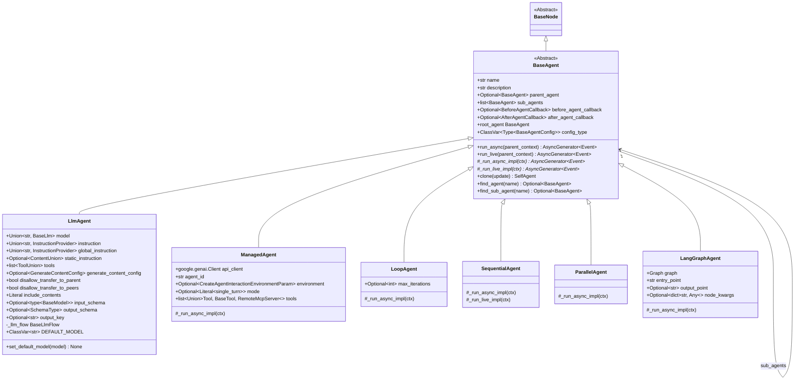
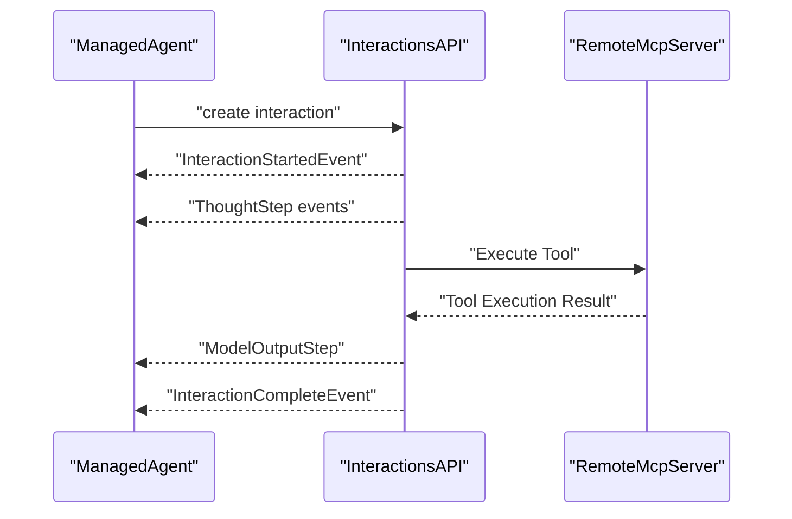
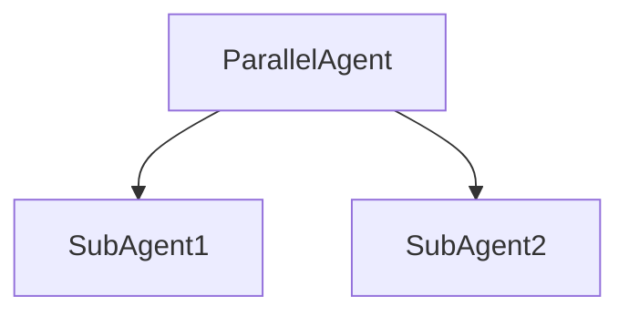

<!-- source: DeepWiki mcp.deepwiki.com · repo google/adk-python · page 3.1 Agent Types and Hierarchy · fetched 2026-10-29 -->

# Agent Types and Hierarchy

Relevant source files

The following files were used as context for generating this wiki page:

- [contributing/samples/managed_agent/basic/README.md](contributing/samples/managed_agent/basic/README.md)
- [contributing/samples/managed_agent/basic/__init__.py](contributing/samples/managed_agent/basic/__init__.py)
- [contributing/samples/managed_agent/basic/agent.py](contributing/samples/managed_agent/basic/agent.py)
- [contributing/samples/managed_agent/code_execution/README.md](contributing/samples/managed_agent/code_execution/README.md)
- [contributing/samples/managed_agent/code_execution/__init__.py](contributing/samples/managed_agent/code_execution/__init__.py)
- [contributing/samples/managed_agent/code_execution/agent.py](contributing/samples/managed_agent/code_execution/agent.py)
- [scripts/generate_agent_config_schema.py](scripts/generate_agent_config_schema.py)
- [src/google/adk/agents/_managed_agent.py](src/google/adk/agents/_managed_agent.py)
- [src/google/adk/agents/active_streaming_tool.py](src/google/adk/agents/active_streaming_tool.py)
- [src/google/adk/agents/agent_config.py](src/google/adk/agents/agent_config.py)
- [src/google/adk/agents/base_agent.py](src/google/adk/agents/base_agent.py)
- [src/google/adk/agents/base_agent_config.py](src/google/adk/agents/base_agent_config.py)
- [src/google/adk/agents/common_configs.py](src/google/adk/agents/common_configs.py)
- [src/google/adk/agents/config_agent_utils.py](src/google/adk/agents/config_agent_utils.py)
- [src/google/adk/agents/config_schemas/AgentConfig.json](src/google/adk/agents/config_schemas/AgentConfig.json)
- [src/google/adk/agents/langgraph_agent.py](src/google/adk/agents/langgraph_agent.py)
- [src/google/adk/agents/llm_agent.py](src/google/adk/agents/llm_agent.py)
- [src/google/adk/agents/llm_agent_config.py](src/google/adk/agents/llm_agent_config.py)
- [src/google/adk/agents/loop_agent.py](src/google/adk/agents/loop_agent.py)
- [src/google/adk/agents/loop_agent_config.py](src/google/adk/agents/loop_agent_config.py)
- [src/google/adk/agents/parallel_agent.py](src/google/adk/agents/parallel_agent.py)
- [src/google/adk/agents/parallel_agent_config.py](src/google/adk/agents/parallel_agent_config.py)
- [src/google/adk/agents/sequential_agent.py](src/google/adk/agents/sequential_agent.py)
- [src/google/adk/agents/sequential_agent_config.py](src/google/adk/agents/sequential_agent_config.py)
- [src/google/adk/agents/transcription_entry.py](src/google/adk/agents/transcription_entry.py)
- [src/google/adk/live/_active_streaming_tool.py](src/google/adk/live/_active_streaming_tool.py)
- [src/google/adk/live/_transcription_entry.py](src/google/adk/live/_transcription_entry.py)
- [src/google/adk/tools/exit_loop_tool.py](src/google/adk/tools/exit_loop_tool.py)
- [tests/integration/test_managed_agent.py](tests/integration/test_managed_agent.py)
- [tests/unittests/agents/test_agent_config.py](tests/unittests/agents/test_agent_config.py)
- [tests/unittests/agents/test_base_agent.py](tests/unittests/agents/test_base_agent.py)
- [tests/unittests/agents/test_langgraph_agent.py](tests/unittests/agents/test_langgraph_agent.py)
- [tests/unittests/agents/test_llm_agent_fields.py](tests/unittests/agents/test_llm_agent_fields.py)
- [tests/unittests/agents/test_loop_agent.py](tests/unittests/agents/test_loop_agent.py)
- [tests/unittests/agents/test_managed_agent.py](tests/unittests/agents/test_managed_agent.py)
- [tests/unittests/agents/test_parallel_agent.py](tests/unittests/agents/test_parallel_agent.py)
- [tests/unittests/agents/test_sequential_agent.py](tests/unittests/agents/test_sequential_agent.py)
- [tests/unittests/flows/llm_flows/test_tool_telemetry.py](tests/unittests/flows/llm_flows/test_tool_telemetry.py)
- [tests/unittests/live/test_active_streaming_tool.py](tests/unittests/live/test_active_streaming_tool.py)
- [tests/unittests/live/test_audio_transcriber.py](tests/unittests/live/test_audio_transcriber.py)
- [tests/unittests/live/test_transcription_entry.py](tests/unittests/live/test_transcription_entry.py)
- [tests/unittests/runners/test_pause_invocation.py](tests/unittests/runners/test_pause_invocation.py)

## Purpose and Scope

This document describes the agent type system in the ADK Python repository (`https://github.com/google/adk-python`). It covers the key agent classes, their relationship in the class hierarchy, and their distinctive behaviors. This page serves as a technical reference for how agents are implemented, their data flow, and how they compose complex agent behaviors.

The types documented include `BaseAgent`, `LlmAgent`, `LoopAgent`, `SequentialAgent`, `ParallelAgent` (deprecated in favor of `Workflow`), `LangGraphAgent`, and `ManagedAgent`. Their relationships and main usage patterns are detailed.

For specifics on agent configurations, lifecycle, orchestration strategies, and execution details, refer to the linked child pages.

Sources:
[src/google/adk/agents/base_agent.py:134-210]()
[src/google/adk/agents/llm_agent.py:64-90]()

---

## Agent Class Hierarchy

All agents extend `BaseAgent` which itself extends `BaseNode` from the workflow subsystem, providing a unified interface.

This hierarchy exemplifies the architectural layering where `BaseAgent` establishes the core interface, `LlmAgent` handles LLM-powered execution with tool support, `ManagedAgent` integrates with the external Managed Agents API, legacy orchestrators (`LoopAgent`, `SequentialAgent`, `ParallelAgent`) provide specific execution loops, and `LangGraphAgent` integrates graph-based workflows.

Sources:
[src/google/adk/agents/base_agent.py:134-188]()
[src/google/adk/agents/loop_agent.py:66-89]()
[src/google/adk/agents/sequential_agent.py:96-105]()
[src/google/adk/agents/parallel_agent.py:172-176]()

---

## BaseAgent - The Abstract Base

`BaseAgent` is the foundational abstract class from which all agents derive, extending `BaseNode` from the workflow engine.

### Implementation Highlights

- **Core Attributes**:
  - `name`: Unique Python identifier for the agent [src/google/adk/agents/base_agent.py:162-167]().
  - `description`: Short description about the agent's capability [src/google/adk/agents/base_agent.py:169-174]().
  - `parent_agent` and `sub_agents`: Implement hierarchical agent composition [src/google/adk/agents/base_agent.py:176-188]().
- **Callbacks**:
  - `before_agent_callback` and `after_agent_callback` insert pre/post logic around agent execution [src/google/adk/agents/base_agent.py:190-209](). Both support sync and async functions with early return signaling.
- **Execution Lifecycle**:
  - Defines abstract methods `_run_async_impl(ctx)` and `_run_live_impl(ctx)` implemented by subclasses.
  - Public methods `run_async()` and `run_live()` wrap the implementation with callback invocation and telemetry.
- **Agent State Management**:
  - Supports resumption and persistence using `_load_agent_state()` and `_create_agent_state_event()`.

### Agent Validation

`BaseAgent` validates agent names:
- Must be a valid Python identifier.
- Cannot be `"user"` (reserved for user inputs) [tests/unittests/agents/test_base_agent.py:180-184]().

Sources:
[src/google/adk/agents/base_agent.py:134-210]()
[tests/unittests/agents/test_base_agent.py:175-189]()

---

## LlmAgent - LLM-Based Agent

`LlmAgent` is the primary agent type for handling LLM interactions, integrating model configurations, instruction templates, and toolsets.

### Model Handling

- The `model` attribute accepts a string model name or a `BaseLlm` instance.
- Class methods allow configuring global defaults for all `LlmAgent` instances.

### Instruction Fields

- `instruction`: Dynamic instruction prompt (string or async callable).
- `static_instruction`: Optional static content sent as prefix for context caching.
- `global_instruction`: Injected into all LLM calls as global behavior guidance.

### LLM Flow Management

`LlmAgent` uses an internal flow (`_llm_flow`) to manage conversation turns:
- Defaults to `AutoFlow` for multi-turn conversations with transfer support.
- Switches to `SingleFlow` when no transfer and no sub-agents are present.

### Tool Integration

`tools` accepts Python callables, `BaseTool`, or `BaseToolset` instances [src/google/adk/agents/llm_agent.py:152]().

Sources:
[src/google/adk/agents/llm_agent.py:64-90]()
[tests/unittests/agents/test_llm_agent_fields.py:71-151]()

---

## ManagedAgent - Managed Agents API Integration

`ManagedAgent` integrates with Google's Managed Agents API (Interactions API) for server-driven AI agents.

### Key Features

- Connects via `google.genai.Client` to stream interactions.
- Maintains stateful dialogue across calls without resending full history.
- Supports server-side tools (ADK built-in tools and remote MCP servers).
- Supports a `single_turn` mode for inline execution within a parent `LlmAgent`.

### Data Flow Diagram

Sources:
[src/google/adk/agents/_managed_agent.py]()

---

## LoopAgent - Iterative Agent Loop (Deprecated)

`LoopAgent` executes sub-agents repeatedly in a loop until conditions are met.

**Deprecated**: Replaced by `Workflow` [src/google/adk/agents/loop_agent.py:62-65]().

### Execution Behavior

- Runs sub-agents sequentially [src/google/adk/agents/loop_agent.py:107-108]().
- Enforces `max_iterations` to prevent infinite loops [src/google/adk/agents/loop_agent.py:84-89]().
- Exits early if any sub-agent escalates [src/google/adk/agents/loop_agent.py:125-126]().
- Tracks state via `LoopAgentState` [src/google/adk/agents/loop_agent.py:52-60]().

Sources:
[src/google/adk/agents/loop_agent.py:51-173]()

---

## SequentialAgent - Ordered Sub-Agent Execution (Deprecated)

`SequentialAgent` runs sub-agents strictly in sequence.

**Deprecated**: Replaced by `Workflow` [src/google/adk/agents/sequential_agent.py:91-95]().

### Execution Details

- Tracks active sub-agent position using `SequentialAgentState` [src/google/adk/agents/sequential_agent.py:84-88]().
- Supports resumability across invocations [src/google/adk/agents/sequential_agent.py:124-125]().
- Implements live mode with an injected `task_completed()` tool [src/google/adk/agents/sequential_agent.py:197-200]().

Sources:
[src/google/adk/agents/sequential_agent.py:83-200]()

---

## ParallelAgent - Concurrent Agent Execution (Deprecated)

`ParallelAgent` runs sub-agents concurrently across isolated execution branches.

**Deprecated**: Replaced by `Workflow`.

### Key Implementation Details

- **Branch Isolation**: Each sub-agent runs on a suffixed branch `{parent_agent}.{sub_agent}` [src/google/adk/agents/parallel_agent.py:54-65]().
- **Event Merging**: Uses `asyncio.TaskGroup` on Python 3.11+ [src/google/adk/agents/parallel_agent.py:93-166]() or manual task cancellation for Python 3.10 and below [src/google/adk/agents/parallel_agent.py:169-170]().
- **Early Exit**: Handles sub-agent escalations to cancel remaining tasks [src/google/adk/agents/parallel_agent.py:68-82]().

### Branching Diagram

Sources:
[src/google/adk/agents/parallel_agent.py:50-170]()

---

## LangGraphAgent - LangGraph Integration

`LangGraphAgent` wraps compiled LangGraph workflows to run as executable ADK agents inside agent trees.

Sources:
[src/google/adk/agents/langgraph_agent.py]()

---

## Agent Configuration and Loading

Agent configuration and YAML loading relies on Pydantic models with discriminator support.

### Discriminator Pattern

- The `agent_class` field in agent config YAML determines the concrete agent class [tests/unittests/agents/test_agent_config.py:60-175]().
- Sub-agent references use `AgentRefConfig` to link external YAML configurations or code references [src/google/adk/agents/common_configs.py]().

Sources:
[src/google/adk/agents/config_agent_utils.py:18-48]()
[src/google/adk/agents/agent_config.py]()
[tests/unittests/agents/test_agent_config.py:60-175]()

---

## Summary Diagram Bridging Natural Language and Code

This diagram maps natural language agent concepts directly to their underlying Python implementation files and classes.

```mermaid
flowchart TD
    NL_Base["BaseAgent Concept"] --> Code_Base["BaseAgent\nsrc/google/adk/agents/base_agent.py"]
    NL_Llm["LlmAgent Concept"] --> Code_Llm["LlmAgent\nsrc/google/adk/agents/llm_agent.py"]
    NL_Managed["ManagedAgent Concept"] --> Code_Managed["ManagedAgent\nsrc/google/adk/agents/_managed_agent.py"]
    NL_Parallel["ParallelAgent Concept"] --> Code_Parallel["ParallelAgent\nsrc/google/adk/agents/parallel_agent.py"]
    NL_Sequential["SequentialAgent Concept"] --> Code_Sequential["SequentialAgent\nsrc/google/adk/agents/sequential_agent.py"]
    NL_Loop["LoopAgent Concept"] --> Code_Loop["LoopAgent\nsrc/google/adk/agents/loop_agent.py"]
    NL_LangGraph["LangGraphAgent Concept"] --> Code_LangGraph["LangGraphAgent\nsrc/google/adk/agents/langgraph_agent.py"]
```

Sources:
[src/google/adk/agents/base_agent.py:134-140]()
[src/google/adk/agents/llm_agent.py:64-70]()
[src/google/adk/agents/parallel_agent.py:172-176]()
[src/google/adk/agents/sequential_agent.py:96-102]()
[src/google/adk/agents/loop_agent.py:66-72]()

---

## References

- `BaseAgent` class: [src/google/adk/agents/base_agent.py:134-210]()
- `LlmAgent` class: [src/google/adk/agents/llm_agent.py:64-90]()
- `ManagedAgent` class: [src/google/adk/agents/_managed_agent.py]()
- `LoopAgent`: [src/google/adk/agents/loop_agent.py:51-173]()
- `SequentialAgent`: [src/google/adk/agents/sequential_agent.py:83-200]()
- `ParallelAgent`: [src/google/adk/agents/parallel_agent.py:50-170]()
- `LangGraphAgent`: [src/google/adk/agents/langgraph_agent.py]()

---

