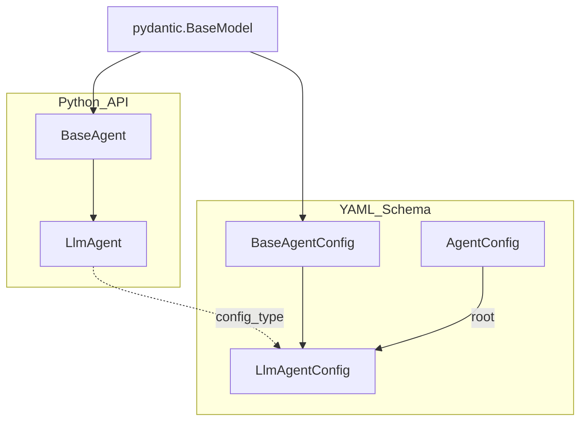
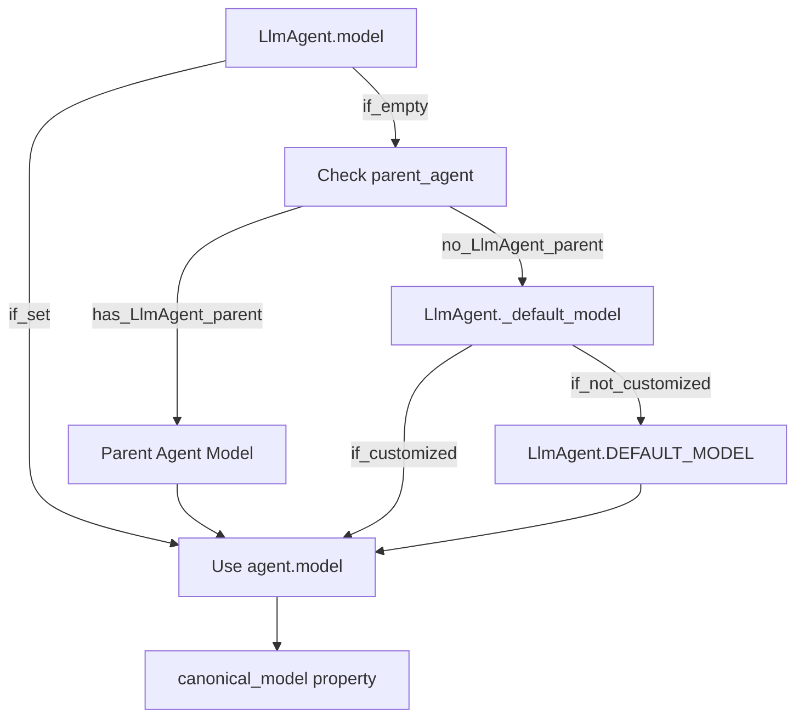
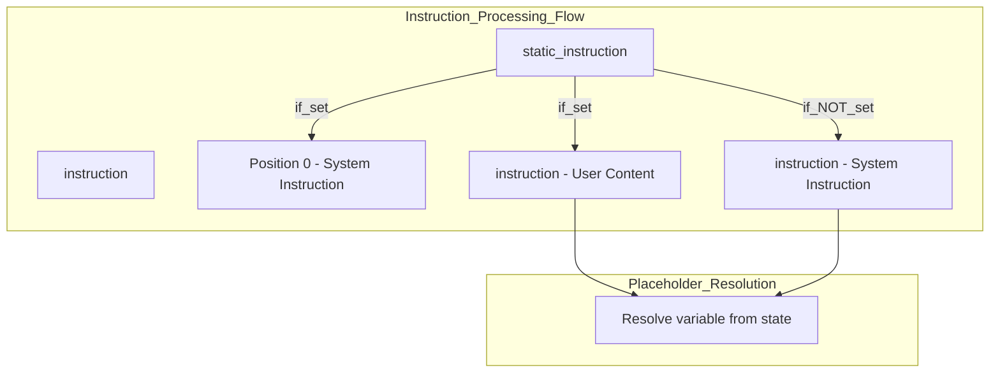
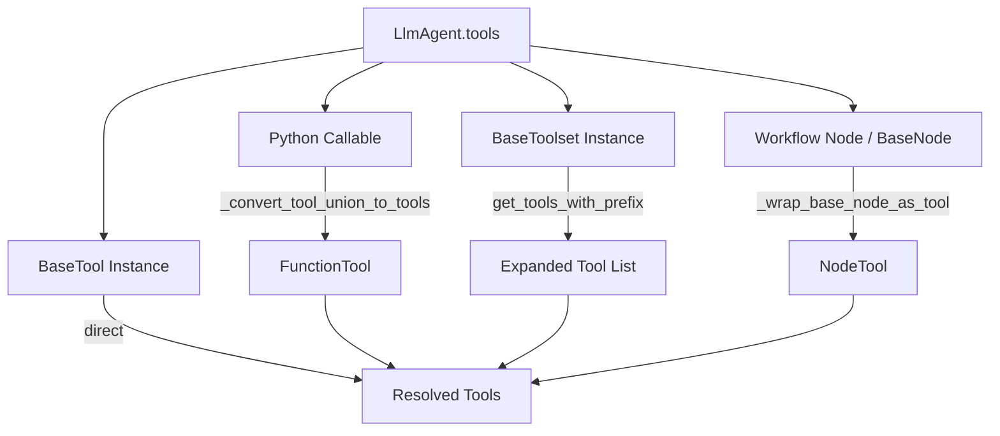
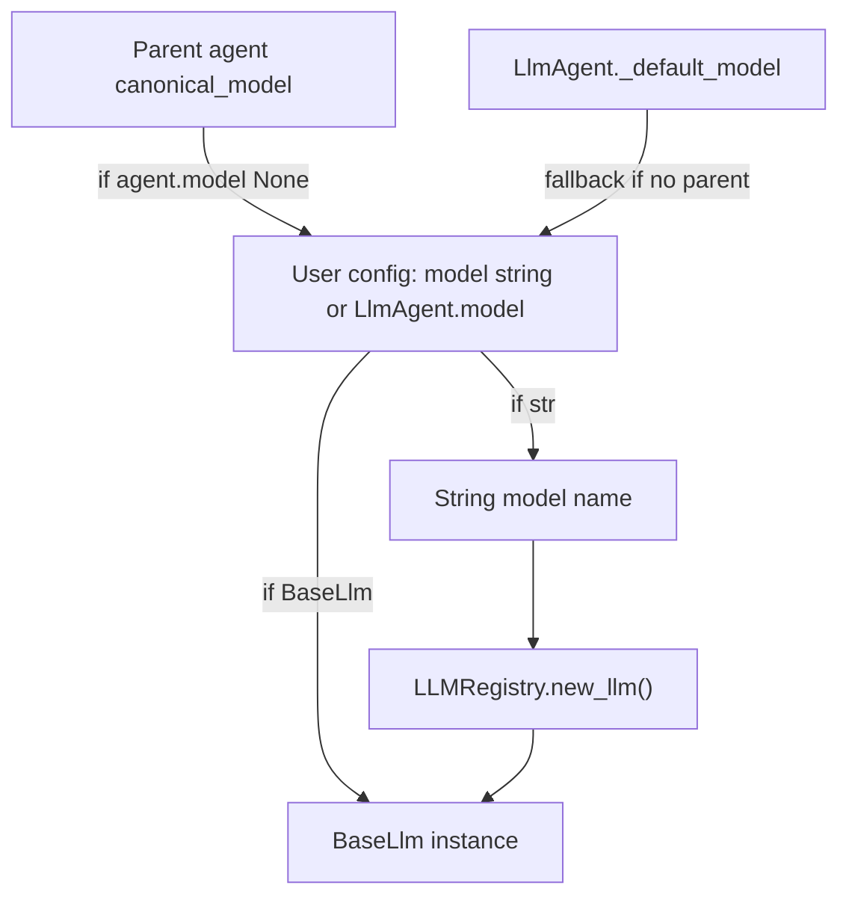
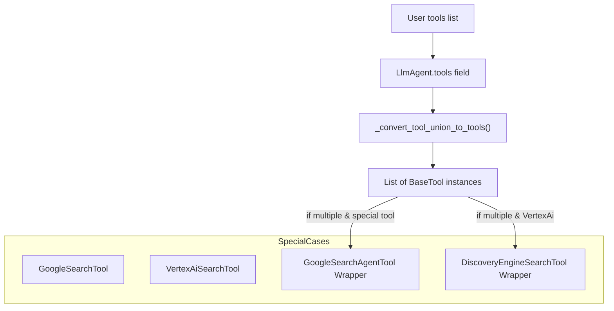

<!-- source: DeepWiki mcp.deepwiki.com · repo google/adk-python · page 3.2 LlmAgent Configuration · fetched 2026-10-29 -->

# LlmAgent Configuration

Relevant source files

The following files were used as context for generating this wiki page:

- [scripts/generate_agent_config_schema.py](scripts/generate_agent_config_schema.py)
- [src/google/adk/agents/agent_config.py](src/google/adk/agents/agent_config.py)
- [src/google/adk/agents/base_agent.py](src/google/adk/agents/base_agent.py)
- [src/google/adk/agents/base_agent_config.py](src/google/adk/agents/base_agent_config.py)
- [src/google/adk/agents/common_configs.py](src/google/adk/agents/common_configs.py)
- [src/google/adk/agents/config_agent_utils.py](src/google/adk/agents/config_agent_utils.py)
- [src/google/adk/agents/config_schemas/AgentConfig.json](src/google/adk/agents/config_schemas/AgentConfig.json)
- [src/google/adk/agents/llm_agent.py](src/google/adk/agents/llm_agent.py)
- [src/google/adk/agents/llm_agent_config.py](src/google/adk/agents/llm_agent_config.py)
- [src/google/adk/agents/loop_agent.py](src/google/adk/agents/loop_agent.py)
- [src/google/adk/agents/loop_agent_config.py](src/google/adk/agents/loop_agent_config.py)
- [src/google/adk/agents/parallel_agent.py](src/google/adk/agents/parallel_agent.py)
- [src/google/adk/agents/parallel_agent_config.py](src/google/adk/agents/parallel_agent_config.py)
- [src/google/adk/agents/sequential_agent.py](src/google/adk/agents/sequential_agent.py)
- [src/google/adk/agents/sequential_agent_config.py](src/google/adk/agents/sequential_agent_config.py)
- [src/google/adk/tools/exit_loop_tool.py](src/google/adk/tools/exit_loop_tool.py)
- [tests/unittests/agents/test_agent_config.py](tests/unittests/agents/test_agent_config.py)
- [tests/unittests/agents/test_base_agent.py](tests/unittests/agents/test_base_agent.py)
- [tests/unittests/agents/test_llm_agent_fields.py](tests/unittests/agents/test_llm_agent_fields.py)
- [tests/unittests/agents/test_loop_agent.py](tests/unittests/agents/test_loop_agent.py)
- [tests/unittests/agents/test_parallel_agent.py](tests/unittests/agents/test_parallel_agent.py)
- [tests/unittests/agents/test_sequential_agent.py](tests/unittests/agents/test_sequential_agent.py)
- [tests/unittests/runners/test_pause_invocation.py](tests/unittests/runners/test_pause_invocation.py)

## Purpose and Scope

This page provides a comprehensive technical guide on configuring `LlmAgent`, the primary agent type in ADK Python designed for building AI agents powered by large language models `[src/google/adk/agents/llm_agent.py:111-112]()`. It covers detailed aspects of setting the LLM model, instructions, integrated tools, content generation parameters, structured output schema, operational modes, and agent transfer flags.

The documentation includes explanations of how these configurations are implemented, how they interoperate during the agent runtime, and key functions/classes involved in managing this configuration. Mermaid diagrams illustrate both the architecture of configuration resolution and how natural language constructs map onto code entities.

Sources: `[src/google/adk/agents/llm_agent.py:111-112]()`, `[src/google/adk/agents/base_agent.py:110-117]()`

---

## Configuration Architecture

The `LlmAgent` inherits from `BaseAgent` and uses `LlmAgentConfig` for its configuration schema `[src/google/adk/agents/llm_agent.py:65-85]()`. Configuration can be specified in Python using Pydantic models or loaded from YAML files that validate against the `AgentConfig` discriminator pattern and dynamically resolve to `LlmAgentConfig` when applicable `[src/google/adk/agents/agent_config.py:27-29]()`.

Sources: `[src/google/adk/agents/llm_agent.py:65-85]()`, `[src/google/adk/agents/base_agent.py:110-117]()`, `[src/google/adk/agents/agent_config.py:27-29]()`

---

## Model Configuration

The `model` configuration is foundational. It determines the LLM backend the agent will leverage for its natural language generation tasks `[src/google/adk/agents/llm_agent_config.py:56-66]()`.

### Model Resolution

`LlmAgent` uses a cascading resolution approach for its `canonical_model` property, resolving a concrete `BaseLlm` instance according to the following order:

- If `model` is directly set on the agent, use it `[tests/unittests/agents/test_llm_agent_fields.py:83-86]()`.
- Else, inherit `model` from the parent agent if available `[tests/unittests/agents/test_llm_agent_fields.py:152-158]()`.
- Otherwise, use the agent's class-level default model or fall back to system defaults `[tests/unittests/agents/test_llm_agent_fields.py:63-80]()`.

The `model` field accepts string model names or concrete instances of `BaseLlm` `[tests/unittests/agents/test_llm_agent_fields.py:83-150]()`. Additionally, `model_code` in the YAML config can specify code construction references such as instantiating `LiteLlm` `[src/google/adk/agents/llm_agent_config.py:68-75]()`.

Sources: `[src/google/adk/agents/llm_agent_config.py:56-75]()`, `[tests/unittests/agents/test_llm_agent_fields.py:63-158]()`

---

## Instruction Configuration

Instructions supply the textual or programmatic guidance provided to the LLM during generation `[src/google/adk/agents/llm_agent_config.py:88-107]()`. `LlmAgent` supports both static and dynamic instructions.

### Instruction Resolution Flow

- `static_instruction` (optional) is inserted first as a system-level instruction with **no placeholder resolution** `[src/google/adk/agents/llm_agent_config.py:97-107]()`. This ensures consistent static context useful for caching.
- If `static_instruction` is set, `instruction` is treated as user content and comes **after** static instruction, with full placeholder/state resolution `[src/google/adk/agents/llm_agent_config.py:88-107]()`.
- Without `static_instruction`, `instruction` is treated as a system instruction with placeholder resolution `[src/google/adk/agents/llm_agent_config.py:88-107]()`.

### Dynamic State Injection in Instructions

Instructions can embed state variables using `{variable_name}` placeholders, automatically resolved at runtime from the agent's context state `[src/google/adk/agents/llm_agent.py:61-68]()`.

- Supports nested state references and scope prefixes (`app:`, `user:`, `temp:`) `[src/google/adk/agents/base_agent.py:110-150]()`.
- Artifacts can be referenced and loaded dynamically from the artifact service `[src/google/adk/agents/llm_agent.py:61-68]()`.

Sources: `[src/google/adk/agents/llm_agent.py:61-68]()`, `[src/google/adk/agents/llm_agent_config.py:88-107]()`, `[src/google/adk/agents/base_agent.py:110-150]()`

---

## Tools Configuration

`LlmAgent` integrates tools that extend its capabilities for external functionalities like search, API calls, or custom operations `[src/google/adk/agents/llm_agent.py:151-166]()`.

### Tools Field and Resolution

The `tools` configuration accepts a heterogeneous list of `ToolUnion` types: Python callables, `BaseTool` instances, `BaseToolset` instances, or `BaseNode` instances `[src/google/adk/agents/llm_agent.py:151-166]()`.

Sources: `[src/google/adk/agents/llm_agent.py:151-193]()`, `[src/google/adk/tools/function_tool.py:1-20]()`

---

## Output Schema and Session State Persistence

The `LlmAgent` supports structured output and input validation through configuration fields such as `input_schema`, `output_schema`, and `output_key` `[src/google/adk/agents/llm_agent_config.py:118-128]()`. These fields govern serialization into session states and interaction type constraints.

- `input_schema`: An optional `CodeConfig` that defines the expected input schema for the agent `[src/google/adk/agents/llm_agent_config.py:118-120]()`.
- `output_schema`: An optional `CodeConfig` that defines the expected output schema for the agent. This is crucial for structured output generation `[src/google/adk/agents/llm_agent_config.py:122-124]()`.
- `output_key`: An optional string that specifies a key to extract a specific part of the output if the LLM generates a complex response `[src/google/adk/agents/llm_agent_config.py:126-128]()`.

These schema configurations are typically provided as `CodeConfig` objects in YAML, allowing dynamic loading of Pydantic models or other schema definitions from Python code `[src/google/adk/agents/llm_agent_config.py:118-128]()`.

Sources: `[src/google/adk/agents/llm_agent_config.py:118-128]()`, `[src/google/adk/agents/common_configs.py:1-30]()`

---

## GenerateContentConfig and Callbacks

`LlmAgent` supports rich callback hooks for customizing the LLM interaction lifecycle, including `before_model_callback`, `after_model_callback`, `on_model_error_callback`, `before_tool_callback`, `after_tool_callback`, and `on_tool_error_callback` `[src/google/adk/agents/llm_agent.py:91-149]()`.

### Callbacks

Callbacks provide interception points for custom logic during the agent's execution. They can be synchronous or asynchronous and can modify the request or response, or handle errors `[src/google/adk/agents/llm_agent.py:91-149]()`.

- `before_model_callback`: Executed before the LLM call `[src/google/adk/agents/llm_agent.py:91-99]()`.
- `after_model_callback`: Executed after the LLM call `[src/google/adk/agents/llm_agent.py:101-109]()`.
- `on_model_error_callback`: Executed if an error occurs during the LLM call `[src/google/adk/agents/llm_agent.py:111-119]()`.
- `before_tool_callback`: Executed before a tool is invoked `[src/google/adk/agents/llm_agent.py:121-129]()`.
- `after_tool_callback`: Executed after a tool is invoked `[src/google/adk/agents/llm_agent.py:131-139]()`.
- `on_tool_error_callback`: Executed if an error occurs during tool invocation `[src/google/adk/agents/llm_agent.py:141-149]()`.

Sources: `[src/google/adk/agents/llm_agent.py:91-149]()`, `[src/google/adk/agents/llm_agent_config.py:191-213]()`

---

## Mode and Transfer Flags

`LlmAgent` supports flags to control agent transfer behavior `[src/google/adk/agents/llm_agent_config.py:109-116]()`.

### Transfer Flags

These flags control whether the `LlmAgent` can transfer control to its parent or peer agents `[src/google/adk/agents/llm_agent_config.py:109-116]()`.

- `disallow_transfer_to_parent`: A boolean flag that, when set to `True`, prevents the agent from transferring control back to its parent agent `[src/google/adk/agents/llm_agent_config.py:109-112]()`.
- `disallow_transfer_to_peers`: A boolean flag that, when set to `True`, prevents the agent from transferring control to its sibling agents `[src/google/adk/agents/llm_agent_config.py:114-116]()`.

Sources: `[src/google/adk/agents/llm_agent_config.py:109-116]()`

---

## Bridging Natural Language to Code Entities

### 1. Model Configuration Mapping

Sources: `[src/google/adk/agents/llm_agent.py:45-48]()`, `[src/google/adk/models/registry.py:1-30]()`, `[tests/unittests/agents/test_llm_agent_fields.py:63-80]()`

### 2. Tools Configuration Mapping

Sources: `[src/google/adk/agents/llm_agent.py:169-193]()`, `[src/google/adk/tools/base_tool.py:1-40]()`

---

