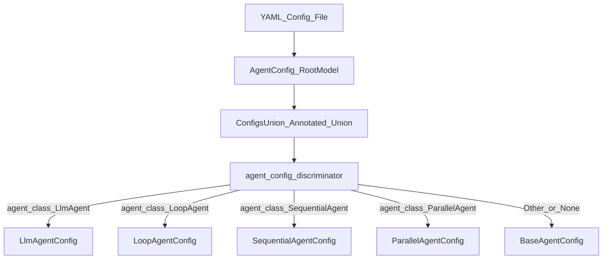
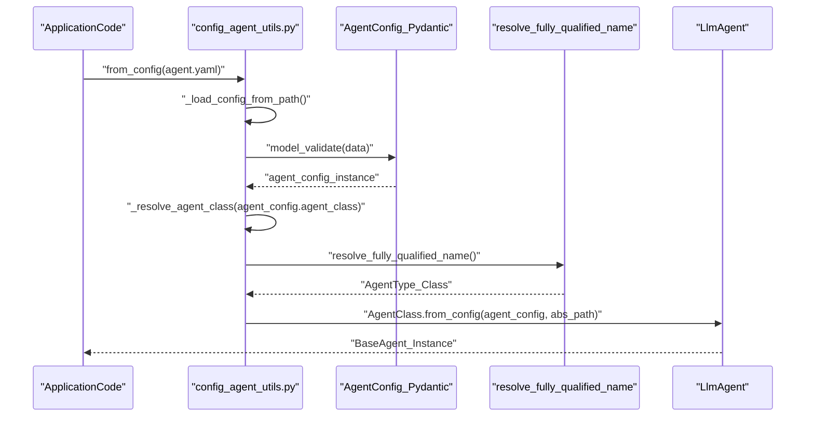
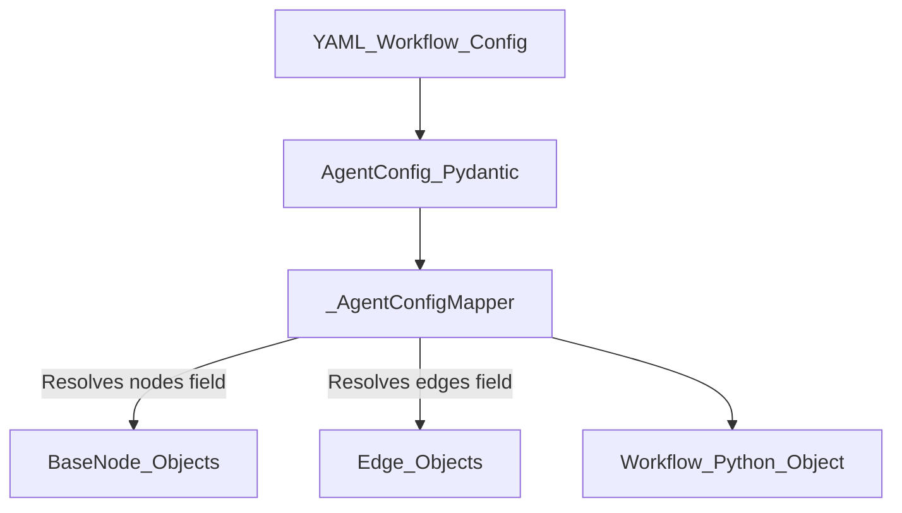
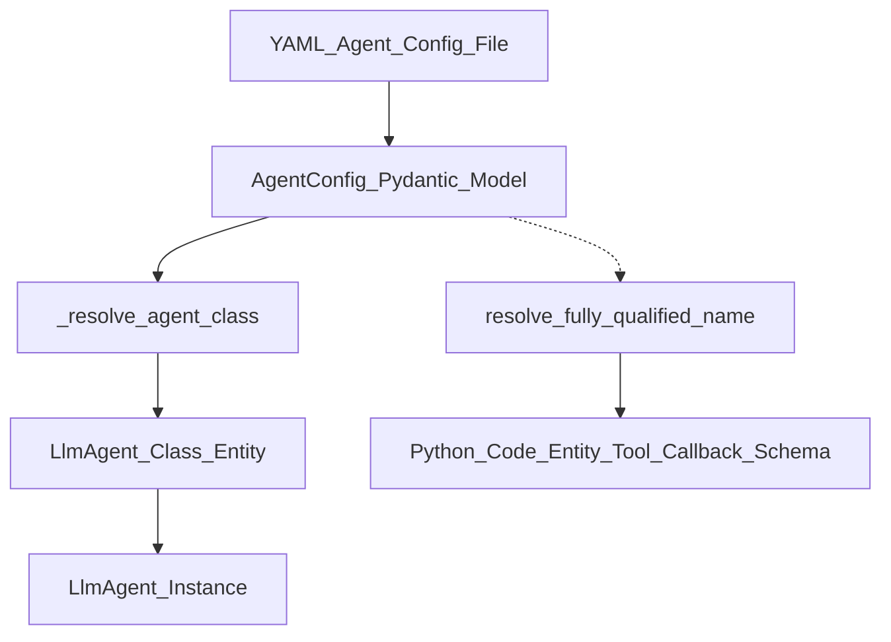

<!-- source: DeepWiki mcp.deepwiki.com · repo google/adk-python · page 3.3 Agent Configuration Files · fetched 2026-10-29 -->

# Agent Configuration Files

Relevant source files

The following files were used as context for generating this wiki page:

- [.agents/skills/adk-agent-builder/references/routing-and-conditions.md](.agents/skills/adk-agent-builder/references/routing-and-conditions.md)
- [docs/guides/labs/classifiers/classifier_node/index.md](docs/guides/labs/classifiers/classifier_node/index.md)
- [scripts/generate_agent_config_schema.py](scripts/generate_agent_config_schema.py)
- [src/google/adk/agents/agent_config.py](src/google/adk/agents/agent_config.py)
- [src/google/adk/agents/base_agent.py](src/google/adk/agents/base_agent.py)
- [src/google/adk/agents/base_agent_config.py](src/google/adk/agents/base_agent_config.py)
- [src/google/adk/agents/common_configs.py](src/google/adk/agents/common_configs.py)
- [src/google/adk/agents/config_agent_utils.py](src/google/adk/agents/config_agent_utils.py)
- [src/google/adk/agents/config_schemas/AgentConfig.json](src/google/adk/agents/config_schemas/AgentConfig.json)
- [src/google/adk/agents/llm_agent.py](src/google/adk/agents/llm_agent.py)
- [src/google/adk/agents/llm_agent_config.py](src/google/adk/agents/llm_agent_config.py)
- [src/google/adk/agents/loop_agent.py](src/google/adk/agents/loop_agent.py)
- [src/google/adk/agents/loop_agent_config.py](src/google/adk/agents/loop_agent_config.py)
- [src/google/adk/agents/parallel_agent.py](src/google/adk/agents/parallel_agent.py)
- [src/google/adk/agents/parallel_agent_config.py](src/google/adk/agents/parallel_agent_config.py)
- [src/google/adk/agents/sequential_agent.py](src/google/adk/agents/sequential_agent.py)
- [src/google/adk/agents/sequential_agent_config.py](src/google/adk/agents/sequential_agent_config.py)
- [src/google/adk/cli/conformance/__init__.py](src/google/adk/cli/conformance/__init__.py)
- [src/google/adk/cli/conformance/adk_web_server_client.py](src/google/adk/cli/conformance/adk_web_server_client.py)
- [src/google/adk/labs/classifiers/__init__.py](src/google/adk/labs/classifiers/__init__.py)
- [src/google/adk/labs/classifiers/_classifier_node.py](src/google/adk/labs/classifiers/_classifier_node.py)
- [src/google/adk/labs/classifiers/_llm_classifier.py](src/google/adk/labs/classifiers/_llm_classifier.py)
- [src/google/adk/tools/exit_loop_tool.py](src/google/adk/tools/exit_loop_tool.py)
- [src/google/adk/utils/yaml_utils.py](src/google/adk/utils/yaml_utils.py)
- [src/google/adk/workflow/_graph.py](src/google/adk/workflow/_graph.py)
- [src/google/adk/workflow/utils/_graph_parser.py](src/google/adk/workflow/utils/_graph_parser.py)
- [src/google/adk/workflow/utils/_graph_validation.py](src/google/adk/workflow/utils/_graph_validation.py)
- [tests/unittests/agents/test_agent_config.py](tests/unittests/agents/test_agent_config.py)
- [tests/unittests/agents/test_base_agent.py](tests/unittests/agents/test_base_agent.py)
- [tests/unittests/agents/test_llm_agent_fields.py](tests/unittests/agents/test_llm_agent_fields.py)
- [tests/unittests/agents/test_loop_agent.py](tests/unittests/agents/test_loop_agent.py)
- [tests/unittests/agents/test_parallel_agent.py](tests/unittests/agents/test_parallel_agent.py)
- [tests/unittests/agents/test_sequential_agent.py](tests/unittests/agents/test_sequential_agent.py)
- [tests/unittests/cli/conformance/__init__.py](tests/unittests/cli/conformance/__init__.py)
- [tests/unittests/cli/conformance/test_adk_web_server_client.py](tests/unittests/cli/conformance/test_adk_web_server_client.py)
- [tests/unittests/labs/classifiers/test_classifier_node.py](tests/unittests/labs/classifiers/test_classifier_node.py)
- [tests/unittests/labs/classifiers/test_llm_classifier.py](tests/unittests/labs/classifiers/test_llm_classifier.py)
- [tests/unittests/runners/test_pause_invocation.py](tests/unittests/runners/test_pause_invocation.py)
- [tests/unittests/utils/test_yaml_utils.py](tests/unittests/utils/test_yaml_utils.py)
- [tests/unittests/workflow/test_graph.py](tests/unittests/workflow/test_graph.py)
- [tests/unittests/workflow/utils/test_graph_parser.py](tests/unittests/workflow/utils/test_graph_parser.py)
- [tests/unittests/workflow/utils/test_graph_validation.py](tests/unittests/workflow/utils/test_graph_validation.py)

This page documents the YAML-based agent configuration system in ADK, which enables declarative agent definition as an alternative to programmatic Python code. Configuration files provide a structured way to define agents, their properties, tools, callbacks, sub-agent relationships, and graph workflows using YAML syntax.

For information about agent runtime configuration and generation settings, see [LlmAgent Configuration](#3.2). For guidance on agent types and their behavior, see [Agent Types and Hierarchy](#3.1).

**Note**: This is an experimental feature marked with `FeatureName.AGENT_CONFIG`.

Sources: [src/google/adk/agents/config_agent_utils.py:36-38](), [src/google/adk/agents/base_agent_config.py:28-42](), [src/google/adk/agents/llm_agent_config.py:32-46]()

---

## Configuration Schema Overview

The agent configuration system employs a **discriminated union** pattern to support loading various agent types from YAML. The root model `AgentConfig` dynamically resolves to one of several agent-specific config subclasses based on the `agent_class` field. This design facilitates type-safe and extensible configuration validation while supporting multiple agent classes under a unified interface.

### Core Configuration Classes

| Configuration Class | Purpose | Corresponding Agent Type |
|:--------------------|:---------------------------------------------|:---------------------------------|
| `BaseAgentConfig` | Base configuration containing common fields | Generic/custom agents |
| `LlmAgentConfig` | Configuration with LLM model, tools, etc. | `LlmAgent` |
| `LoopAgentConfig` | Configuration for looping agents | `LoopAgent` (deprecated) |
| `SequentialAgentConfig` | Configuration for sequential execution | `SequentialAgent` (deprecated) |
| `ParallelAgentConfig` | Parallel execution configuration | `ParallelAgent` (deprecated) |
| `AgentRefConfig` | Reference to other agents (as config or code)| Used in `sub_agents` |
| `CodeConfig` | Reference to Python code entities | Tools, callbacks, schemas |

This setup allows a YAML file to define an entire agent hierarchy by nesting `AgentRefConfig`s, which either point to YAML config paths or Python code references.

### Agent Configuration Discriminator Pattern

The `agent_class` field controls the discriminator among agent config subclasses. If unspecified, it defaults to `LlmAgentConfig` for backward compatibility.

Title: "Agent Config Discriminator Architecture"

Sources: [src/google/adk/agents/config_agent_utils.py:51-66](), [src/google/adk/agents/llm_agent_config.py:37-75]()

---

## Loading Agents from Configuration

The main function to load agents from YAML config files is `from_config(path)` [src/google/adk/agents/config_agent_utils.py:1011-1012](). This call chain involves:

1. Loading and parsing YAML.
2. Validating the data against the root `AgentConfig` Pydantic model.
3. Resolving the concrete Python agent type from the `agent_class` string.
4. Instantiating the corresponding agent class via `from_config()` constructor methods.

### Agent Instantiation Sequence (Natural Language Space to Code Entity Space)

This diagram maps Natural Language YAML config elements to concrete Python code entities during instantiation:

Title: "Agent Instantiation Sequence Flow"

### Key Functions Explained

- **`_resolve_agent_class(agent_class: str) -> Type[BaseAgent]`** [src/google/adk/agents/config_agent_utils.py:229-250]()
  Resolves a string of the form `"LlmAgent"` or fully qualified `"google.adk.agents.LlmAgent"` to the corresponding Python class. Defaults module to `google.adk.agents` if no dot present.

- **`resolve_fully_qualified_name(name: str) -> Any`** [src/google/adk/agents/config_agent_utils.py:251-290]()
  Dynamically imports a module and retrieves the named Python object. Enforces a module blocklist for security.

- **`resolve_agent_reference(ref_config: AgentRefConfig, ...) -> BaseAgent`** [src/google/adk/agents/config_agent_utils.py:291-340]()
  Resolves a nested agent reference either from a YAML `config_path` or from a Python-coded agent using `code`.

Sources: [src/google/adk/agents/config_agent_utils.py:229-340]()

---

## Security and Safety Measures

Loading agents from YAML allows declarative configuration but introduces possible security risks from arbitrary code execution or path traversal. The ADK enforces several safeguards:

### Module Blocklist

To prevent dangerous code execution via `CodeConfig` references, the system blocks imports of sensitive modules such as:

- OS and execution modules: `os`, `posix`, `nt`, `subprocess`, `sys`, `shutil`, `signal`, `multiprocessing`, `threading`.
- Dynamic code execution: `builtins`, `importlib`, `code`, `compileall`, `runpy`, `ctypes`.
- Networking and sockets: `socket`, `_socket`, `http`, `urllib`, `ftplib`, `smtplib`, `asyncio`, `xmlrpc`.
- Filesystem and persistence: `tempfile`, `pathlib`, `shelve`, `pickle`, `marshal`.
- Interactive and side-effect modules: `webbrowser`, `antigravity`, `pty`, `pdb`.

Attempting to resolve symbols from these modules raises `ValueError` [src/google/adk/agents/config_agent_utils.py:251-290]().

### Path Traversal Prevention

When resolving relative `config_path`s for sub-agents or tools, the loader calculates an absolute path relative to the referencing YAML file location, ensures the resulting path is within a valid directory subtree, and rejects paths attempting to use `../` or absolute outside path traversal [src/google/adk/agents/config_agent_utils.py:1011-1012]().

Sources: [src/google/adk/agents/config_agent_utils.py:251-290]()

---

## Common Configuration Fields and Reference Types

All agent configs support a shared set of base properties defined in `BaseAgentConfig` [src/google/adk/agents/base_agent_config.py:42-83]().

### BaseAgentConfig Fields

| Field | Type | Description |
|:------|:-----|:------------|
| `agent_class` | `str` | Agent type name discriminator (e.g., "LlmAgent"). Defaults to "LlmAgent" if omitted. |
| `name` | `str` | Unique agent name, must be Python identifier and not `"user"`. |
| `description` | `str` | Short description of agent capabilities, used for model delegation prompting. |
| `sub_agents` | `List[AgentRefConfig]` | List of child agents for hierarchical orchestration. |

### CodeConfig & AgentRefConfig

- **`CodeConfig`**: Used to reference a Python object such as a tool, a Pydantic schema model, or a callback function/method by its fully qualified name [src/google/adk/agents/common_configs.py:25-50]().
- **`AgentRefConfig`**: Used primarily in `sub_agents` lists, pointing either to another YAML config file (`config_path`) or referring directly to a Python-coded agent instance (`code`) [src/google/adk/agents/common_configs.py:51-107]().

Sources: [src/google/adk/agents/base_agent_config.py:42-83](), [src/google/adk/agents/common_configs.py:25-107]()

---

## LlmAgent Configuration

The primary config type is `LlmAgentConfig`, which defines an LLM-driven agent [src/google/adk/agents/llm_agent_config.py:37-218]().

- **Model Selection**: Mutually exclusive `model` string name or `model_code` pointing to a configured `BaseLlm` instance [src/google/adk/agents/llm_agent_config.py:56-86]().
- **Instruction Handling**: `instruction` (dynamic) and `static_instruction` (cached base prompt content) [src/google/adk/agents/llm_agent_config.py:88-107]().
- **Tools and Callbacks**: Tools configured via lists of `ToolConfig` objects, and callbacks referenced via lists of `CodeConfig`s [src/google/adk/agents/llm_agent_config.py:134-218]().

Sources: [src/google/adk/agents/llm_agent_config.py:37-218]()

---

## Loading ADK 2.0 Workflow Graphs from YAML

ADK 2.0 introduces a graph-based workflow engine for non-linear agent orchestration. The agent config system supports loading these graph workflows authored directly in YAML, parsing nodes and edges into workflow graph execution objects.

The `_AgentConfigMapper` class is responsible for dynamically mapping YAML data to Agent and Workflow class fields [src/google/adk/agents/config_agent_utils.py:198-212](). It handles the resolution of various types, including tools, sub-agents, and workflow-specific elements like edges. The `_AgentConfigMapper` also caches resolved nodes to maintain object identity for shared sub-graphs and `START` nodes [src/google/adk/agents/config_agent_utils.py:198-212]().

The `_AgentConfigMapper`'s `map` method is the entry point for converting a Pydantic config model into a Python object [src/google/adk/agents/config_agent_utils.py:950-1010](). For workflow graphs, it specifically handles `nodes` and `edges` fields, converting them into `BaseNode` and `Edge` objects respectively.

Title: "Workflow YAML Parsing Architecture"

Sources: [src/google/adk/agents/config_agent_utils.py:198-212](), [src/google/adk/agents/config_agent_utils.py:950-1010]()

---

## Summary Diagram: From Natural Language Configuration to Code Entity Space

Title: "Natural Language Space to Code Entity Space Mapping"

- `AgentConfig` acts as the core schema object bridging the YAML DSL to runtime code entities [src/google/adk/agents/agent_config.py:27-33]().
- `CodeConfig` references inside `AgentConfig` map directly to specific Python functions, classes, and modules [src/google/adk/agents/common_configs.py:25-50]().

Sources: [src/google/adk/agents/config_agent_utils.py:15-213](), [src/google/adk/agents/common_configs.py:25-50]()

---

## Deprecation Notice

Several agent config classes (`SequentialAgentConfig`, `ParallelAgentConfig`, `LoopAgentConfig`) and the legacy YAML agent loading mechanism are marked as **deprecated** in favor of `Workflow` graph YAMLs.

Sources: [src/google/adk/agents/base_agent.py:108-147](), [src/google/adk/agents/sequential_agent.py:89-100](), [src/google/adk/agents/loop_agent.py:62-66]()

---

