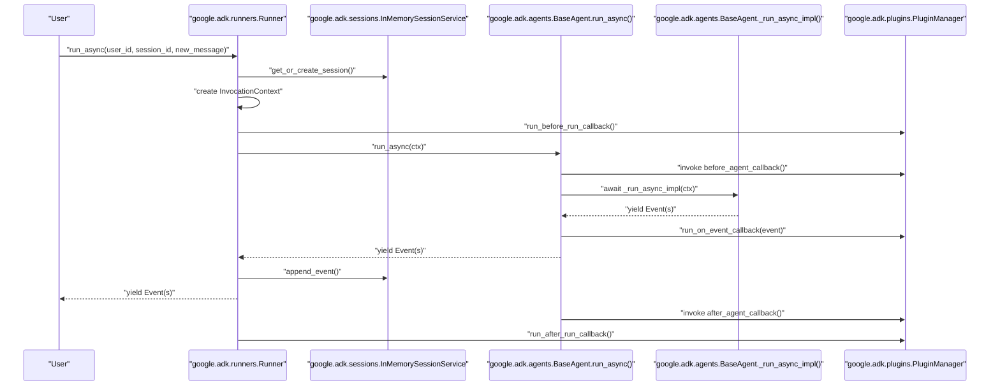
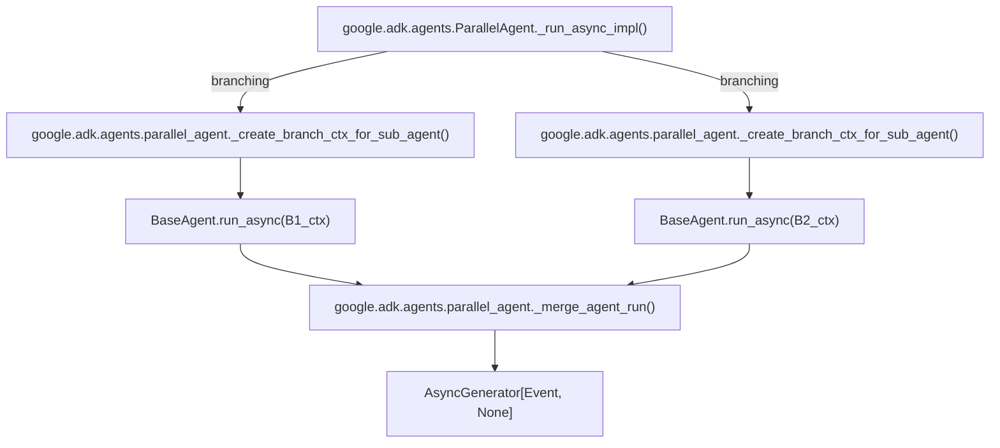

<!-- source: DeepWiki mcp.deepwiki.com · repo google/adk-python · page 3.4 Agent Execution Lifecycle · fetched 2026-10-29 -->

# Agent Execution Lifecycle

Relevant source files

The following files were used as context for generating this wiki page:

- [scripts/generate_agent_config_schema.py](scripts/generate_agent_config_schema.py)
- [src/google/adk/agents/_agent_router.py](src/google/adk/agents/_agent_router.py)
- [src/google/adk/agents/agent_config.py](src/google/adk/agents/agent_config.py)
- [src/google/adk/agents/base_agent.py](src/google/adk/agents/base_agent.py)
- [src/google/adk/agents/base_agent_config.py](src/google/adk/agents/base_agent_config.py)
- [src/google/adk/agents/common_configs.py](src/google/adk/agents/common_configs.py)
- [src/google/adk/agents/config_agent_utils.py](src/google/adk/agents/config_agent_utils.py)
- [src/google/adk/agents/config_schemas/AgentConfig.json](src/google/adk/agents/config_schemas/AgentConfig.json)
- [src/google/adk/agents/llm_agent.py](src/google/adk/agents/llm_agent.py)
- [src/google/adk/agents/llm_agent_config.py](src/google/adk/agents/llm_agent_config.py)
- [src/google/adk/agents/loop_agent.py](src/google/adk/agents/loop_agent.py)
- [src/google/adk/agents/loop_agent_config.py](src/google/adk/agents/loop_agent_config.py)
- [src/google/adk/agents/parallel_agent.py](src/google/adk/agents/parallel_agent.py)
- [src/google/adk/agents/parallel_agent_config.py](src/google/adk/agents/parallel_agent_config.py)
- [src/google/adk/agents/sequential_agent.py](src/google/adk/agents/sequential_agent.py)
- [src/google/adk/agents/sequential_agent_config.py](src/google/adk/agents/sequential_agent_config.py)
- [src/google/adk/events/_abort_events.py](src/google/adk/events/_abort_events.py)
- [src/google/adk/runners.py](src/google/adk/runners.py)
- [src/google/adk/tools/exit_loop_tool.py](src/google/adk/tools/exit_loop_tool.py)
- [src/google/adk/workflow/_node_runner_utils.py](src/google/adk/workflow/_node_runner_utils.py)
- [src/google/adk/workflow/utils/_transfer_utils.py](src/google/adk/workflow/utils/_transfer_utils.py)
- [tests/unittests/agents/test_agent_config.py](tests/unittests/agents/test_agent_config.py)
- [tests/unittests/agents/test_agent_router.py](tests/unittests/agents/test_agent_router.py)
- [tests/unittests/agents/test_base_agent.py](tests/unittests/agents/test_base_agent.py)
- [tests/unittests/agents/test_llm_agent_fields.py](tests/unittests/agents/test_llm_agent_fields.py)
- [tests/unittests/agents/test_llm_agent_interruptions.py](tests/unittests/agents/test_llm_agent_interruptions.py)
- [tests/unittests/agents/test_loop_agent.py](tests/unittests/agents/test_loop_agent.py)
- [tests/unittests/agents/test_parallel_agent.py](tests/unittests/agents/test_parallel_agent.py)
- [tests/unittests/agents/test_resumable_llm_agent.py](tests/unittests/agents/test_resumable_llm_agent.py)
- [tests/unittests/agents/test_sequential_agent.py](tests/unittests/agents/test_sequential_agent.py)
- [tests/unittests/events/test_abort_events.py](tests/unittests/events/test_abort_events.py)
- [tests/unittests/runners/test_pause_invocation.py](tests/unittests/runners/test_pause_invocation.py)
- [tests/unittests/test_runners.py](tests/unittests/test_runners.py)
- [tests/unittests/workflow/test_agent_transfer.py](tests/unittests/workflow/test_agent_transfer.py)
- [tests/unittests/workflow/test_node_runner_utils.py](tests/unittests/workflow/test_node_runner_utils.py)
- [tests/unittests/workflow/test_workflow_agent_as_node.py](tests/unittests/workflow/test_workflow_agent_as_node.py)
- [tests/unittests/workflow/test_workflow_function_tool_as_node.py](tests/unittests/workflow/test_workflow_function_tool_as_node.py)
- [tests/unittests/workflow/test_workflow_live.py](tests/unittests/workflow/test_workflow_live.py)
- [tests/unittests/workflow/test_workflow_rewind.py](tests/unittests/workflow/test_workflow_rewind.py)
- [tests/unittests/workflow/test_workflow_schema.py](tests/unittests/workflow/test_workflow_schema.py)
- [tests/unittests/workflow/utils/test_transfer_utils.py](tests/unittests/workflow/utils/test_transfer_utils.py)

## Purpose and Scope

This page details the execution lifecycle of agents within the Agent Development Kit (ADK) Python framework. It focuses on how agents are invoked asynchronously via `run_async()` in `src/google/adk/runners.py` and `src/google/adk/agents/base_agent.py`, the inner implementation `_run_async_impl()`, callback invocation (`before_agent_callback`, `after_agent_callback`), and state management during execution via `InvocationContext`.

For additional context, see related pages on agent types [3.1 Agent Types and Hierarchy](), invocation context [4.2 Invocation Context](), and runner orchestration [4.1 Runner]().

Sources: [src/google/adk/runners.py:1-186](), [src/google/adk/agents/base_agent.py:1-210]()

---

## Execution Flow Overview

Invocation is coordinated by the `Runner` engine (`src/google/adk/runners.py`), which instantiates an `InvocationContext` and invokes `run_async()` on the root `BaseAgent` (`src/google/adk/agents/base_agent.py`). Each agent inherits from `BaseAgent`, using a `@final` wrapper around `run_async()` to enforce telemetry, callbacks, and resumable state handling before delegating core logic to `_run_async_impl()`.

### Interaction Sequence from User to Core Agent Logic

Sources: [src/google/adk/runners.py:1-186](), [src/google/adk/agents/base_agent.py:1-210](), [src/google/adk/agents/invocation_context.py:1-100]()

---

## The Agent Execution Wrapper (`run_async` and `_run_async_impl`)

### `BaseAgent.run_async`

The `run_async` method in `BaseAgent` (`src/google/adk/agents/base_agent.py`) is marked `@final` to enforce consistent execution semantics across all agent types (`LlmAgent`, `SequentialAgent`, `LoopAgent`, `ParallelAgent`, and graph-based `Workflow` nodes). Its lifecycle responsibilities include:

1. **Telemetry Instrumentation:** Attaches tracing contexts (`record_agent_invocation`) to capture execution duration and span attributes.
2. **Before-Agent Callbacks:** Evaluates `before_agent_callback` hooks. If any callback returns a truthy `types.Content` object, execution of `_run_async_impl` is bypassed and the content is returned immediately as an event.
3. **Core Execution:** Awaits the generator `_run_async_impl(ctx)`, intercepting each yielded `Event` to process on-event plugins and callbacks.
4. **After-Agent Callbacks:** Evaluates `after_agent_callback` hooks upon completion of core execution, optionally appending extra response events.
5. **Resumability Tracking:** If `ctx.is_resumable` is active, appends an agent state marker indicating completion (`end_of_agent=True`).

### `_run_async_impl` Subclass Implementations

Subclasses implement private asynchronous generators for specific execution models:
- **`LlmAgent`** (`src/google/adk/agents/llm_agent.py`): Manages multi-turn LLM generation loops, request preprocessing, model calls, and tool execution.
- **`SequentialAgent`** (`src/google/adk/agents/sequential_agent.py:109-147`): Iterates sequentially over `sub_agents`, supporting index persistence via `SequentialAgentState`.
- **`LoopAgent`** (`src/google/adk/agents/loop_agent.py:89-144`): Repeats sub-agent execution until iteration limits or exit signals occur.
- **`ParallelAgent`** (`src/google/adk/agents/parallel_agent.py:92-166`): Runs sub-agents concurrently across isolated branch contexts using `asyncio.TaskGroup`.

Sources: [src/google/adk/agents/base_agent.py:1-210](), [src/google/adk/agents/sequential_agent.py:109-147](), [src/google/adk/agents/parallel_agent.py:92-166]()

---

## Callbacks in the Execution Lifecycle

The agent execution lifecycle provides hook points for intercepting and modifying behavior at both the agent level and component level.

### Agent-Level Callbacks

- **`before_agent_callback`**: Defined in `BaseAgent` (`src/google/adk/agents/base_agent.py`). Accepts `CallbackContext` and can short-circuit execution by returning a `types.Content`.
- **`after_agent_callback`**: Defined in `BaseAgent` (`src/google/adk/agents/base_agent.py`). Accepts `CallbackContext` and can append supplementary response content.

### Model and Tool Callbacks (`LlmAgent`)

`LlmAgent` supports fine-grained hooks during execution:

| Callback Type | Target Stage | Signature | Purpose |
|:--------------|:-------------|:----------|:--------|
| `BeforeModelCallback` | Before `BaseLlm.generate_content_async` | `(CallbackContext, LlmRequest) -> Optional[LlmResponse]` | Inspect or modify request parameters or mock responses. |
| `AfterModelCallback` | After LLM response received | `(CallbackContext, LlmResponse) -> Optional[LlmResponse]` | Post-process LLM outputs or inject content. |
| `BeforeToolCallback` | Before tool execution | `(BaseTool, dict, ToolContext) -> Optional[dict]` | Validate/modify tool arguments or skip invocation. |
| `AfterToolCallback` | After tool returns result | `(BaseTool, dict, ToolContext, dict) -> Optional[dict]` | Transform tool execution results. |

Sources: [src/google/adk/agents/base_agent.py:1-210](), [src/google/adk/agents/llm_agent.py:92-149]()

---

## State Management During Execution

ADK supports resumable invocations via `InvocationContext` (`src/google/adk/agents/invocation_context.py`), preserving state across interruptions.

### Agent State Classes

- **`BaseAgentState`** (`src/google/adk/agents/base_agent.py:82-88`): Pydantic base model for agent-specific state with `extra='forbid'`.
- **`SequentialAgentState`** (`src/google/adk/agents/sequential_agent.py:81-86`): Tracks `current_sub_agent` index for resumption.
- **`LoopAgentState`** (`src/google/adk/agents/loop_agent.py:49-57`): Tracks iteration count and active sub-agent state.

### State Operations

- **Loading State:** `_load_agent_state(ctx, state_type)` retrieves persisted Pydantic state models from `ctx.agent_states` using the agent's `name`.
- **Saving State:** `ctx.set_agent_state(self.name, state=...)` updates the state dictionary in the session/context.

Sources: [src/google/adk/agents/base_agent.py:82-210](), [src/google/adk/agents/sequential_agent.py:81-86](), [src/google/adk/agents/loop_agent.py:49-57]()

---

## State Persistence and Branching in Parallel Execution

When executing parallel branches via `ParallelAgent` (`src/google/adk/agents/parallel_agent.py`), each sub-agent runs within an isolated branch context generated by `_create_branch_ctx_for_sub_agent` (`src/google/adk/agents/parallel_agent.py:54-65`).

### Parallel Branching and Event Merging

Sources: [src/google/adk/agents/parallel_agent.py:54-166](), [src/google/adk/agents/base_agent.py:1-210]()

---

## Summary

The agent execution lifecycle in ADK Python provides:
- Enforced lifecycle semantics through `@final` wrappers in `BaseAgent.run_async()`.
- Flexible interception via before/after agent callbacks and LLM/tool callbacks.
- Resumable session state management through `InvocationContext` and Pydantic state schemas.
- Concurrent sub-agent execution with branch isolation and event stream merging in `ParallelAgent`.

Sources: [src/google/adk/agents/base_agent.py:1-210](), [src/google/adk/agents/parallel_agent.py:54-166](), [src/google/adk/runners.py:1-186]()

---

