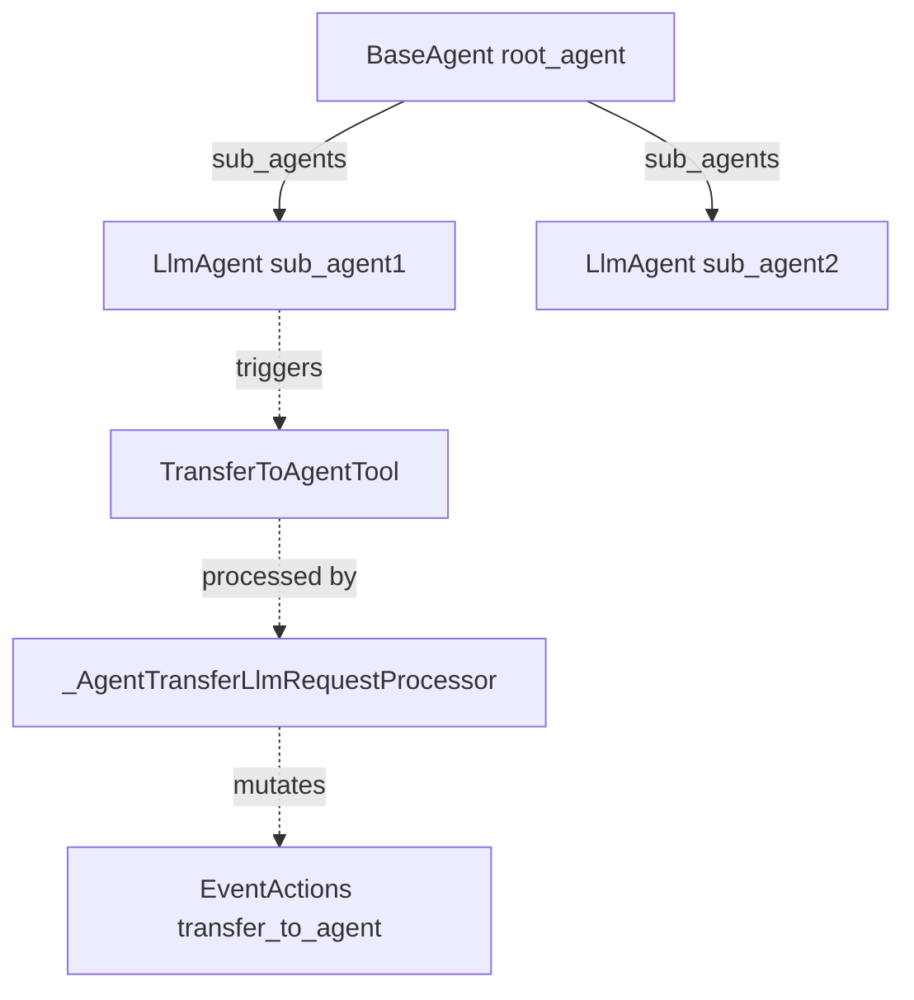
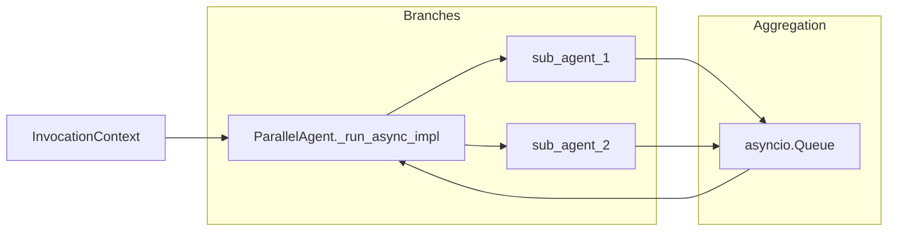
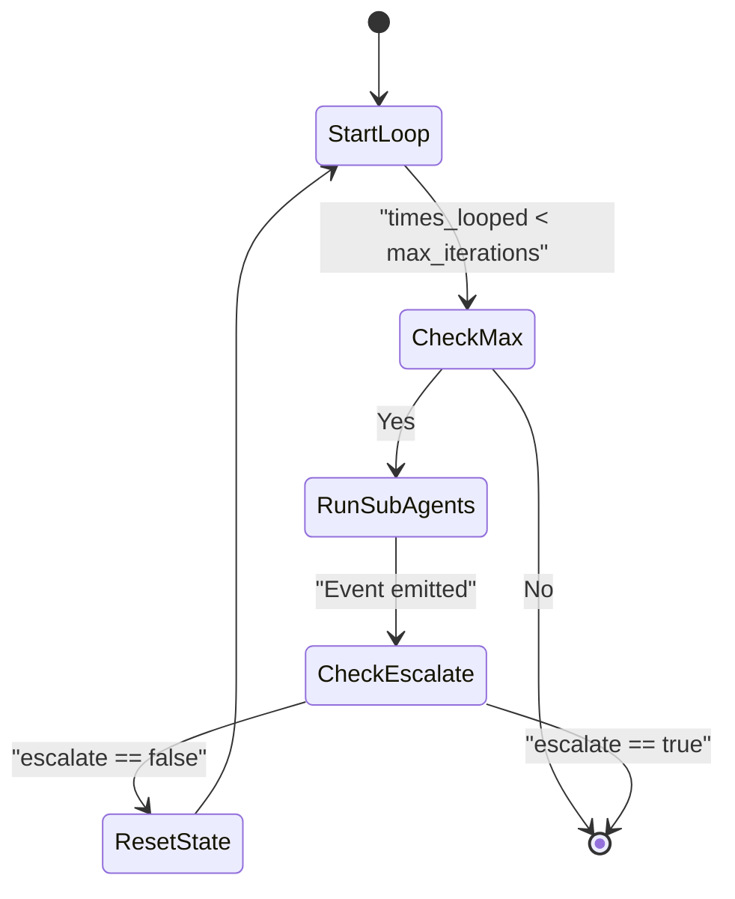

<!-- source: DeepWiki mcp.deepwiki.com · repo google/adk-python · page 3.5 Multi-Agent Orchestration · fetched 2026-10-29 -->

# Multi-Agent Orchestration

<details>
<summary>Relevant source files</summary>

The following files were used as context for generating this wiki page:

- [contributing/samples/a2a/a2a_human_in_loop/README.md](contributing/samples/a2a/a2a_human_in_loop/README.md)
- [src/google/adk/agents/_agent_router.py](src/google/adk/agents/_agent_router.py)
- [src/google/adk/code_executors/__init__.py](src/google/adk/code_executors/__init__.py)
- [src/google/adk/code_executors/agent_engine_sandbox_code_executor.py](src/google/adk/code_executors/agent_engine_sandbox_code_executor.py)
- [src/google/adk/code_executors/code_execution_utils.py](src/google/adk/code_executors/code_execution_utils.py)
- [src/google/adk/events/_abort_events.py](src/google/adk/events/_abort_events.py)
- [src/google/adk/events/event_actions.py](src/google/adk/events/event_actions.py)
- [src/google/adk/events/ui_widget.py](src/google/adk/events/ui_widget.py)
- [src/google/adk/flows/llm_flows/_code_execution.py](src/google/adk/flows/llm_flows/_code_execution.py)
- [src/google/adk/flows/llm_flows/_nl_planning.py](src/google/adk/flows/llm_flows/_nl_planning.py)
- [src/google/adk/flows/llm_flows/agent_transfer.py](src/google/adk/flows/llm_flows/agent_transfer.py)
- [src/google/adk/flows/llm_flows/auto_flow.py](src/google/adk/flows/llm_flows/auto_flow.py)
- [src/google/adk/flows/llm_flows/extensions/__init__.py](src/google/adk/flows/llm_flows/extensions/__init__.py)
- [src/google/adk/flows/llm_flows/instructions.py](src/google/adk/flows/llm_flows/instructions.py)
- [src/google/adk/memory/vertex_ai_memory_bank_service.py](src/google/adk/memory/vertex_ai_memory_bank_service.py)
- [src/google/adk/runners.py](src/google/adk/runners.py)
- [src/google/adk/tools/transfer_to_agent_tool.py](src/google/adk/tools/transfer_to_agent_tool.py)
- [src/google/adk/workflow/_node_runner_utils.py](src/google/adk/workflow/_node_runner_utils.py)
- [src/google/adk/workflow/utils/_transfer_utils.py](src/google/adk/workflow/utils/_transfer_utils.py)
- [tests/unittests/agents/test_agent_router.py](tests/unittests/agents/test_agent_router.py)
- [tests/unittests/agents/test_llm_agent_interruptions.py](tests/unittests/agents/test_llm_agent_interruptions.py)
- [tests/unittests/agents/test_resumable_llm_agent.py](tests/unittests/agents/test_resumable_llm_agent.py)
- [tests/unittests/code_executors/test_agent_engine_sandbox_code_executor.py](tests/unittests/code_executors/test_agent_engine_sandbox_code_executor.py)
- [tests/unittests/code_executors/test_code_execution_utils.py](tests/unittests/code_executors/test_code_execution_utils.py)
- [tests/unittests/events/test_abort_events.py](tests/unittests/events/test_abort_events.py)
- [tests/unittests/events/test_event_actions.py](tests/unittests/events/test_event_actions.py)
- [tests/unittests/memory/test_vertex_ai_memory_bank_service.py](tests/unittests/memory/test_vertex_ai_memory_bank_service.py)
- [tests/unittests/test_runners.py](tests/unittests/test_runners.py)
- [tests/unittests/tools/test_transfer_to_agent_tool.py](tests/unittests/tools/test_transfer_to_agent_tool.py)
- [tests/unittests/workflow/test_agent_transfer.py](tests/unittests/workflow/test_agent_transfer.py)
- [tests/unittests/workflow/test_node_runner_utils.py](tests/unittests/workflow/test_node_runner_utils.py)
- [tests/unittests/workflow/test_workflow_agent_as_node.py](tests/unittests/workflow/test_workflow_agent_as_node.py)
- [tests/unittests/workflow/test_workflow_function_tool_as_node.py](tests/unittests/workflow/test_workflow_function_tool_as_node.py)
- [tests/unittests/workflow/test_workflow_live.py](tests/unittests/workflow/test_workflow_live.py)
- [tests/unittests/workflow/test_workflow_rewind.py](tests/unittests/workflow/test_workflow_rewind.py)
- [tests/unittests/workflow/test_workflow_schema.py](tests/unittests/workflow/test_workflow_schema.py)
- [tests/unittests/workflow/utils/test_transfer_utils.py](tests/unittests/workflow/utils/test_transfer_utils.py)

</details>


## Purpose and Scope

This page details the ADK Python framework's capabilities for orchestrating multi-agent systems. It covers parent-child agent hierarchical delegation, agent transfers, dynamic routing via `_AgentTransferLlmRequestProcessor` [src/google/adk/flows/llm_flows/agent_transfer.py:15-20](), task-mode task delegation via `AgentTool` [src/google/adk/tools/agent_tool.py](), active task scoping via `_find_active_task_scope` [src/google/adk/runners.py:92-127](), and legacy orchestration patterns (`SequentialAgent`, `ParallelAgent`, `LoopAgent`) defined in `src/google/adk/agents/base_agent.py`.

Sources: `src/google/adk/flows/llm_flows/agent_transfer.py:15-20`, `src/google/adk/tools/agent_tool.py`, `src/google/adk/runners.py:92-127`, `src/google/adk/agents/base_agent.py`

---

## Agent Composition and Transfer

### Parent-Child Agent Tree

Agents are organized in a parent-child tree structure where parent agents hold references to sub-agents via the `sub_agents` list attribute [src/google/adk/agents/base_agent.py](). Each `BaseAgent` instance maintains a reference to its parent via `parent_agent` [src/google/adk/agents/base_agent.py](). Unique identifier rules enforce distinct, valid Python identifiers for all agent names within the hierarchy.

Sources: `src/google/adk/agents/base_agent.py`

### Agent Transfer and Routing

Agent transfer allows an agent to hand off execution control to another agent (e.g., specialized sub-agents or parent/peers) during a turn [src/google/adk/flows/llm_flows/agent_transfer.py:15-20](). 

- **Transfer Requests**: Initiated by setting `transfer_to_agent` and `transfer_reason` fields in `EventActions` [src/google/adk/events/event_actions.py:122-126]().
- **TransferToAgentTool**: Programmatically driven via tool call declarations where valid agent names are restricted by enum constraints [src/google/adk/tools/transfer_to_agent_tool.py]() to prevent hallucination.
- **Router Integration**: `_AgentTransferLlmRequestProcessor` (re-exported via `src/google/adk/flows/llm_flows/agent_transfer.py` [src/google/adk/flows/llm_flows/agent_transfer.py:15-20]()) coordinates routing instruction additions and injects transfer tools into runtime LLM requests.

Title: Agent Tree and Transfer Code Entity Mapping (Natural Language to Code Entity Space)

Sources: `src/google/adk/agents/base_agent.py`, `src/google/adk/tools/transfer_to_agent_tool.py`, `src/google/adk/flows/llm_flows/agent_transfer.py:15-20`, `src/google/adk/events/event_actions.py:122-126`

---

## Task-Mode Delegation

Task-mode delegation allows an agent to invoke sub-agents or workers with explicit task parameters and isolated scopes.

- **Task-Mode Setup**: Agents operating with specific modes leverage task delegation where input and output structures are explicitly typed [src/google/adk/utils/_agent_mode.py]().
- **AgentTool**: Wraps an agent as a tool [src/google/adk/tools/agent_tool.py](), converting input schemas into tool parameter declarations and mapping execution results back into the parent's conversation thread through `_find_active_task_scope` [src/google/adk/runners.py:92-127]().

Title: Task Delegation Code Entity Sequence (Natural Language to Code Entity Space)
```mermaid
sequenceDiagram
  participant Parent as "LlmAgent parent"
  participant Tool as "AgentTool"
  participant Runner as "Runner.run_async"
  participant Target as "BaseAgent sub_agent"

  Parent->>Tool: "execute(tool_context, **kwargs)"
  Tool->>Runner: "runner.run_async()"
  Runner->>Target: "_run_async_impl()"
  Target-->>Runner: "yield Event"
  Runner-->>Tool: "aggregated events/results"
  Tool-->>Parent: "FunctionResponse"

  click Parent href "src/google/adk/agents/llm_agent.py()" "See LlmAgent"
  click Tool href "src/google/adk/tools/agent_tool.py()" "See AgentTool"
  click Runner href "src/google/adk/runners.py()" "See Runner"
  click Target href "src/google/adk/agents/base_agent.py()" "See BaseAgent"
```
Sources: `src/google/adk/runners.py:92-127`, `src/google/adk/tools/agent_tool.py`, `src/google/adk/agents/base_agent.py`

---

## Legacy Orchestration Patterns

ADK supports legacy control flow agents for sequential, parallel, and looped execution patterns defined on `BaseAgent` sub-classes [src/google/adk/agents/base_agent.py]().

### SequentialAgent

Executes sub-agents one after another in order of appearance in the `sub_agents` collection [src/google/adk/agents/base_agent.py]().

Title: SequentialAgent Execution Flow
```mermaid
sequenceDiagram
  participant RunnerCtx as "InvocationContext"
  participant SeqAgent as "SequentialAgent"
  participant Sub1 as "sub_agents[0]"
  participant Sub2 as "sub_agents[1]"

  RunnerCtx->>SeqAgent: "run_async(ctx)"
  SeqAgent->>SeqAgent: "Read state current_sub_agent"
  SeqAgent->>Sub1: "run_async(ctx)"
  Sub1-->>SeqAgent: "yield events"
  SeqAgent->>SeqAgent: "Advance state"
  SeqAgent->>Sub2: "run_async(ctx)"
  Sub2-->>SeqAgent: "yield events"
  SeqAgent->>SeqAgent: "Mark end_of_agent = True"
  SeqAgent-->>RunnerCtx: "completion"

  click RunnerCtx href "src/google/adk/agents/invocation_context.py()" "See InvocationContext"
  click SeqAgent href "src/google/adk/agents/base_agent.py()" "See SequentialAgent implementation"
```
Sources: `src/google/adk/agents/base_agent.py`

### ParallelAgent

Executes all sub-agents concurrently across isolated branch paths using Python's `asyncio.TaskGroup` [src/google/adk/agents/base_agent.py]().

Title: ParallelAgent Concurrency Flow

Sources: `src/google/adk/agents/base_agent.py`

### LoopAgent

Executes sub-agents iteratively in a cycle until a maximum iteration limit is reached or an `escalate` action is returned by a sub-agent event [src/google/adk/agents/base_agent.py]().

Title: LoopAgent State Transition

Sources: `src/google/adk/agents/base_agent.py`

---

## Agent Routing Engine

The internal `_agent_router` module provides dynamic routing primitives to locate and validate target execution branches [src/google/adk/agents/_agent_router.py:15-16]().

- `find_agent_to_run`: Searches the agent tree based on active transfer rules and conversation history to select the appropriate sub-agent [src/google/adk/agents/_agent_router.py:147-190]().
- `is_transferable_across_agent_tree`: Validates whether an agent can transfer up to its parent hierarchy [src/google/adk/agents/_agent_router.py:111-131]().

Sources: `src/google/adk/agents/_agent_router.py:15-16`, `src/google/adk/agents/_agent_router.py:111-190`

---

## Summary of Key Classes and Functions

| Class / Function | Role & Implementation Purpose | Source Code Reference |
| :--- | :--- | :--- |
| `AgentTool` | Wraps an agent as an executable tool for parent LLMs, mapping inputs/outputs. | [src/google/adk/tools/agent_tool.py]() |
| `TransferToAgentTool` | Specialized tool restricting agent transfer targets via enum schemas. | [src/google/adk/tools/transfer_to_agent_tool.py]() |
| `_AgentTransferLlmRequestProcessor` | Injects transfer instructions and tool declarations into outgoing LLM requests. | [src/google/adk/flows/llm_flows/agent_transfer.py:15-20]() |
| `find_agent_to_run` | Selects the active agent to run based on session history and transfer state. | [src/google/adk/agents/_agent_router.py:147-190]() |
| `_find_active_task_scope` | Resolves active paused task agents from session event history. | [src/google/adk/runners.py:92-127]() |

Sources: `src/google/adk/tools/agent_tool.py`, `src/google/adk/tools/transfer_to_agent_tool.py`, `src/google/adk/flows/llm_flows/agent_transfer.py:15-20`, `src/google/adk/agents/_agent_router.py:147-190`, `src/google/adk/runners.py:92-127`

---

