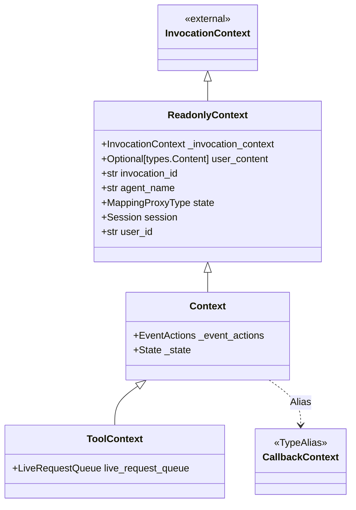

<!-- source: DeepWiki mcp.deepwiki.com · repo google/adk-python · page 3.6 Callbacks and Hooks · fetched 2026-10-29 -->

# Callbacks and Hooks

<details>
<summary>Relevant source files</summary>

The following files were used as context for generating this wiki page:

- [docs/guides/agents/invocation_context/index.md](docs/guides/agents/invocation_context/index.md)
- [src/google/adk/agents/callback_context.py](src/google/adk/agents/callback_context.py)
- [src/google/adk/flows/llm_flows/functions.py](src/google/adk/flows/llm_flows/functions.py)
- [src/google/adk/live/_active_background_tool.py](src/google/adk/live/_active_background_tool.py)
- [src/google/adk/tools/tool_context.py](src/google/adk/tools/tool_context.py)
- [src/google/adk/utils/_callback_pipeline.py](src/google/adk/utils/_callback_pipeline.py)
- [tests/unittests/agents/test_callback_context.py](tests/unittests/agents/test_callback_context.py)
- [tests/unittests/flows/llm_flows/test_async_tool_callbacks.py](tests/unittests/flows/llm_flows/test_async_tool_callbacks.py)
- [tests/unittests/flows/llm_flows/test_live_tool_callbacks.py](tests/unittests/flows/llm_flows/test_live_tool_callbacks.py)
- [tests/unittests/flows/llm_flows/test_model_callbacks.py](tests/unittests/flows/llm_flows/test_model_callbacks.py)
- [tests/unittests/flows/llm_flows/test_tool_callbacks.py](tests/unittests/flows/llm_flows/test_tool_callbacks.py)
- [tests/unittests/live/test_active_background_tool.py](tests/unittests/live/test_active_background_tool.py)
- [tests/unittests/utils/test_callback_pipeline.py](tests/unittests/utils/test_callback_pipeline.py)

</details>


## Purpose and Scope

This page documents the callback and hook system in the ADK Python repository (`https://github.com/google/adk-python`). The scope covers agent lifecycle callbacks, model interaction hooks, tool execution intercepts, error callbacks, callback pipeline execution utilities, and their equivalents in the global plugin system.

Sources: [src/google/adk/agents/base_agent.py:149-176](), [src/google/adk/plugins/base_plugin.py:41-193]()

---

## Overview

ADK provides three levels of callback hooks:

1. **Model Callbacks**: Intercept LLM requests and responses (before, after, and on error) [src/google/adk/agents/llm_agent.py:73-101]().
2. **Tool Callbacks**: Intercept tool executions (before, after, and on error) [src/google/adk/agents/llm_agent.py:103-131]().
3. **Agent Callbacks**: Intercept agent lifecycle events (`before_agent_callback`, `after_agent_callback`) [src/google/adk/agents/base_agent.py:149-176]().

Callbacks can inspect/modify requests, transform responses, handle errors with fallbacks, or implement cross-cutting concerns. If a callback returns a non-`None` value, it short-circuits the default execution flow.

Sources: [src/google/adk/agents/base_agent.py:149-176](), [src/google/adk/agents/llm_agent.py:73-131]()

---

## Callback Architecture

The diagram below illustrates how callbacks are integrated into the execution flow within the ADK `Runner` and `BaseAgent`.

### Agent Execution Flow and Hooks

```mermaid
graph TB
    subgraph "RunnerExecution"
        AgentStart["BaseAgent.run_async"]
        BeforeAgent["before_agent_callback"]
        
        subgraph "AgentInternalImplementation"
            ModelRequest["LlmRequest Construction"]
            BeforeModel["before_model_callback"]
            LLMCall["BaseLlm.generate_content_async"]
            AfterModel["after_model_callback"]
            OnModelError["on_model_error_callback"]
            
            ToolRequest["Tool Call Detection"]
            BeforeTool["before_tool_callback"]
            ToolExec["Tool Execution"]
            AfterTool["after_tool_callback"]
            OnToolError["on_tool_error_callback"]
        end
        
        AfterAgent["after_agent_callback"]
        AgentEnd["Agent End"]
    end
    
    AgentStart --> BeforeAgent
    BeforeAgent -->|"None"| ModelRequest
    BeforeAgent -->|"types.Content"| AgentEnd
    
    ModelRequest --> BeforeModel
    BeforeModel -->|"None"| LLMCall
    BeforeModel -->|"LlmResponse"| ToolRequest
    
    LLMCall -->|"Success"| AfterModel
    LLMCall -->|"Error"| OnModelError
    
    AfterModel --> ToolRequest
    OnModelError --> ToolRequest
    
    ToolRequest --> BeforeTool
    BeforeTool -->|"None"| ToolExec
    BeforeTool -->|"dict"| AfterTool
    
    ToolExec -->|"Success"| AfterTool
    ToolExec -->|"Error"| OnToolError
    
    AfterTool --> AfterAgent
    OnToolError --> AfterAgent
    AfterAgent --> AgentEnd
```



Sources: [src/google/adk/agents/base_agent.py:149-176](), [src/google/adk/agents/llm_agent.py:198-215]()

---

## Model Callbacks

Model callbacks intercept interactions with the LLM provider. They receive a `CallbackContext` encapsulating invocation state and agent session data [src/google/adk/agents/llm_agent.py:73-101]().

### Callback Types and Signatures

| Callback Type | Trigger | Parameters | Return Type | Effect if Non-None |
|---|---|---|---|---|
| `before_model_callback` | Before LLM call | `CallbackContext`, `LlmRequest` | `Optional[LlmResponse]` | Skip LLM call, use returned response |
| `after_model_callback` | After LLM call | `CallbackContext`, `LlmResponse` | `Optional[LlmResponse]` | Replace actual response |
| `on_model_error_callback` | On LLM error | `CallbackContext`, `LlmRequest`, `Exception` | `Optional[LlmResponse]` | Suppress error, use returned response |

Sources: [src/google/adk/agents/llm_agent.py:73-101](), [tests/unittests/flows/llm_flows/test_model_callbacks.py]()

---

## Tool Callbacks

Tool callbacks intercept tool execution, receiving a `ToolContext` and operating on argument dictionaries and tool responses [src/google/adk/agents/llm_agent.py:103-131]().

### Callback Types and Signatures

| Callback Type | Trigger | Parameters | Return Type | Effect if Non-None |
|---|---|---|---|---|
| `before_tool_callback` | Before tool exec | `BaseTool`, `dict[str, Any]`, `ToolContext` | `Optional[dict[str, Any]]` | Skip tool execution; use returned dict |
| `after_tool_callback` | After tool exec | `BaseTool`, `dict[str, Any]`, `ToolContext`, `dict[str, Any]` | `Optional[dict[str, Any]]` | Replace actual tool response |
| `on_tool_error_callback` | On tool error | `BaseTool`, `dict[str, Any]`, `ToolContext`, `Exception` | `Optional[dict[str, Any]]` | Suppress error; use returned dict |

Sources: [src/google/adk/agents/llm_agent.py:103-131](), [tests/unittests/flows/llm_flows/test_tool_callbacks.py]()

---

## Agent Callbacks

Agent callbacks trigger before and after top-level agent invocations [src/google/adk/agents/base_agent.py:149-176]().

### Callback Types and Effects

| Hook | Trigger | Context | Effect if Return Value is Non-None |
|---|---|---|---|
| `before_agent_callback` | Before agent logic | `CallbackContext` | Returning `types.Content` short-circuits agent processing |
| `after_agent_callback` | After agent logic | `CallbackContext` | Returning `types.Content` appends content to history |

Sources: [src/google/adk/agents/base_agent.py:149-176]()

---

## Plugin Error Callbacks

Specialized error callbacks notify plugins when exceptions occur during execution [src/google/adk/plugins/base_plugin.py:41-90]():

| Hook | Trigger | Parameters |
|---|---|---|
| `on_agent_error_callback` | Agent execution failure | `InvocationContext`, `Exception` |
| `on_run_error_callback` | Runner execution failure | `InvocationContext`, `Exception` |

Sources: [src/google/adk/plugins/base_plugin.py:41-90]()

---

## Callback Pipeline Utilities

ADK includes helper utilities in `src/google/adk/utils/_callback_pipeline.py` to normalize and chain callbacks. Key functions include:
- `_normalize_callbacks()`: Normalizes callbacks into lists [src/google/adk/utils/_callback_pipeline.py:105-114]().
- `_run_callbacks()`: Sequentially executes callbacks with stop conditions like `_stop_on_non_none` [src/google/adk/utils/_callback_pipeline.py:81-103]().

Sources: [src/google/adk/utils/_callback_pipeline.py:1-123](), [tests/unittests/utils/test_callback_pipeline.py]()

---

## Context Objects

### Context Class Hierarchy



Sources: [src/google/adk/agents/readonly_context.py:31-81](), [src/google/adk/agents/callback_context.py:21-22]()

---

## Plugin System Integration

Plugins provide global cross-cutting behaviors managed by `PluginManager` [src/google/adk/plugins/plugin_manager.py:60-199](). They execute before agent callbacks and support early exit short-circuiting.

Sources: [src/google/adk/plugins/plugin_manager.py:60-199](), [src/google/adk/plugins/base_plugin.py:41-193]()

---

## Example Plugin: LoggingPlugin

`LoggingPlugin` demonstrates intercepting user messages, agent runs, events, LLM requests/responses, and errors [src/google/adk/plugins/logging_plugin.py:20-187]().

Sources: [src/google/adk/plugins/logging_plugin.py:20-187]()

---

## Configuration via YAML

Callbacks can be configured declaratively using fully qualified Python identifiers [src/google/adk/agents/config_agent_utils.py:143-224]().

Sources: [src/google/adk/agents/config_agent_utils.py:143-224](), [src/google/adk/agents/llm_agent_config.py:187-210]()

---

# Natural Language to Code Entity Mapping

### Diagram 1: Callback Domain Concepts to ADK Code Entities

```mermaid
graph LR
    NLModel[""NaturalLanguageModelCallbacks""]
    NLTool[""NaturalLanguageToolCallbacks""]
    NLAgent[""NaturalLanguageAgentCallbacks""]
    NLPluginErrors[""NaturalLanguagePluginErrorCallbacks""]

    CodeModel[""CodeEntities: LlmAgent.before_model_callback(), after_model_callback(), on_model_error_callback()""]
    CodeTool[""CodeEntities: LlmAgent.before_tool_callback(), after_tool_callback(), on_tool_error_callback()""]
    CodeAgent[""CodeEntities: BaseAgent.before_agent_callback(), after_agent_callback()""]
    CodePlugins[""CodeEntities: BasePlugin.on_agent_error_callback(), on_run_error_callback()""]

    NLModel --> CodeModel
    NLTool --> CodeTool
    NLAgent --> CodeAgent
    NLPluginErrors --> CodePlugins
```

Sources: [src/google/adk/agents/base_agent.py:149-176](), [src/google/adk/agents/llm_agent.py:73-131](), [src/google/adk/plugins/base_plugin.py:41-90]()

---

### Diagram 2: Callback Pipeline and Execution Mapping

```mermaid
graph TD
    NLRunner[""NaturalLanguageRunnerPipeline""]
    NLUtils[""NaturalLanguagePipelineUtilities""]

    CodeRunner[""CodeEntities: Runner.run_async(), _run_async_impl()""]
    CodeUtils[""CodeEntities: _run_callbacks(), _normalize_callbacks(), _invoke_callback()""]

    NLRunner --> CodeRunner
    NLUtils --> CodeUtils
```

Sources: [src/google/adk/utils/_callback_pipeline.py:51-114](), [src/google/adk/runners/runner.py:1-100]()

---

# References

- `src/google/adk/agents/base_agent.py:149-176`  
- `src/google/adk/agents/llm_agent.py:73-131`  
- `src/google/adk/agents/readonly_context.py:31-81`  
- `src/google/adk/agents/callback_context.py:21-23`  
- `src/google/adk/plugins/base_plugin.py:41-193`  
- `src/google/adk/plugins/plugin_manager.py:60-199`  
- `src/google/adk/plugins/logging_plugin.py:20-187`  
- `src/google/adk/agents/config_agent_utils.py:143-224`  
- `src/google/adk/agents/llm_agent_config.py:187-210`  
- `src/google/adk/utils/_callback_pipeline.py:1-124`  
- `tests/unittests/flows/llm_flows/test_tool_callbacks.py`  
- `tests/unittests/flows/llm_flows/test_async_tool_callbacks.py`  
- `tests/unittests/flows/llm_flows/test_live_tool_callbacks.py`

---

