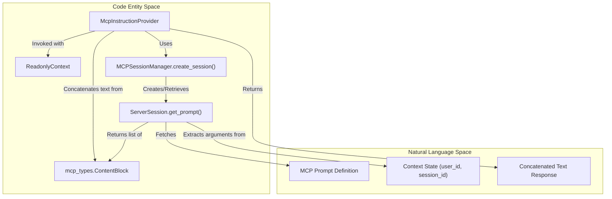
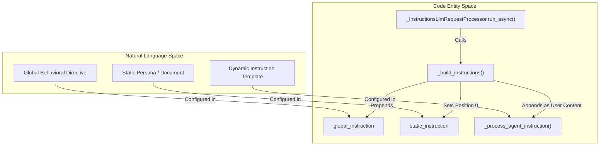

<!-- source: DeepWiki mcp.deepwiki.com · repo google/adk-python · page 3.7 Instructions and Prompts · fetched 2026-10-29 -->

# Instructions and Prompts

<details>
<summary>Relevant source files</summary>

The following files were used as context for generating this wiki page:

- [.agents/skills/adk-agent-builder/references/callbacks-and-plugins.md](.agents/skills/adk-agent-builder/references/callbacks-and-plugins.md)
- [.agents/skills/adk-agent-builder/references/getting-started.md](.agents/skills/adk-agent-builder/references/getting-started.md)
- [.agents/skills/adk-agent-builder/references/human-in-the-loop.md](.agents/skills/adk-agent-builder/references/human-in-the-loop.md)
- [.agents/skills/adk-agent-builder/references/llm-agent-nodes.md](.agents/skills/adk-agent-builder/references/llm-agent-nodes.md)
- [.agents/skills/adk-agent-builder/references/multi-agent.md](.agents/skills/adk-agent-builder/references/multi-agent.md)
- [.agents/skills/adk-agent-builder/references/task-mode.md](.agents/skills/adk-agent-builder/references/task-mode.md)
- [.agents/skills/adk-sample-creator/SKILL.md](.agents/skills/adk-sample-creator/SKILL.md)
- [.github/ISSUE_TEMPLATE/bug_report.md](.github/ISSUE_TEMPLATE/bug_report.md)
- [.github/ISSUE_TEMPLATE/feature_request.md](.github/ISSUE_TEMPLATE/feature_request.md)
- [LICENSE](LICENSE)
- [contributing/samples/multi_agent/single_turn_sub_agent/README.md](contributing/samples/multi_agent/single_turn_sub_agent/README.md)
- [contributing/samples/multi_agent/task_sub_agent/README.md](contributing/samples/multi_agent/task_sub_agent/README.md)
- [docs/guides/agents/llm_agent/single_turn.md](docs/guides/agents/llm_agent/single_turn.md)
- [docs/guides/utils/instructions_utils/index.md](docs/guides/utils/instructions_utils/index.md)
- [docs/guides/workflow/join_node/index.md](docs/guides/workflow/join_node/index.md)
- [docs/guides/workflow/parallel_worker/index.md](docs/guides/workflow/parallel_worker/index.md)
- [src/google/adk/agents/readonly_context.py](src/google/adk/agents/readonly_context.py)
- [src/google/adk/cli/browser/assets/audio-processor.js](src/google/adk/cli/browser/assets/audio-processor.js)
- [src/google/adk/cli/plugins/replay_plugin.py](src/google/adk/cli/plugins/replay_plugin.py)
- [src/google/adk/flows/llm_flows/prompt/_instructions_utils.py](src/google/adk/flows/llm_flows/prompt/_instructions_utils.py)
- [src/google/adk/plugins/base_plugin.py](src/google/adk/plugins/base_plugin.py)
- [src/google/adk/plugins/debug_logging_plugin.py](src/google/adk/plugins/debug_logging_plugin.py)
- [src/google/adk/plugins/global_instruction_plugin.py](src/google/adk/plugins/global_instruction_plugin.py)
- [src/google/adk/plugins/logging_plugin.py](src/google/adk/plugins/logging_plugin.py)
- [src/google/adk/plugins/plugin_manager.py](src/google/adk/plugins/plugin_manager.py)
- [src/google/adk/utils/__init__.py](src/google/adk/utils/__init__.py)
- [src/google/adk/utils/instructions_utils.py](src/google/adk/utils/instructions_utils.py)
- [src/google/adk/workflow/_join_node.py](src/google/adk/workflow/_join_node.py)
- [tests/unittests/agents/test_readonly_context.py](tests/unittests/agents/test_readonly_context.py)
- [tests/unittests/flows/llm_flows/prompt/test_instructions_utils.py](tests/unittests/flows/llm_flows/prompt/test_instructions_utils.py)
- [tests/unittests/plugins/test_base_plugin.py](tests/unittests/plugins/test_base_plugin.py)
- [tests/unittests/plugins/test_debug_logging_plugin.py](tests/unittests/plugins/test_debug_logging_plugin.py)
- [tests/unittests/plugins/test_global_instruction_plugin.py](tests/unittests/plugins/test_global_instruction_plugin.py)
- [tests/unittests/plugins/test_logging_plugin.py](tests/unittests/plugins/test_logging_plugin.py)
- [tests/unittests/plugins/test_notification_error_callbacks.py](tests/unittests/plugins/test_notification_error_callbacks.py)
- [tests/unittests/plugins/test_plugin_manager.py](tests/unittests/plugins/test_plugin_manager.py)
- [tests/unittests/workflow/test_join_node.py](tests/unittests/workflow/test_join_node.py)

</details>


This page documents the instruction and prompt system in ADK, which controls how agents receive their behavioral directives and how those directives are formatted for LLM requests. This includes dynamic instructions with state injection, static instructions for context caching, `InstructionProvider` callables, `McpInstructionProvider` integration, and nested state injection in templates.

For information about configuring `LlmAgent` fields in general, see [Agent System/LlmAgent Configuration](). For details on the execution lifecycle, see [Agent System/Agent Execution Lifecycle]().

---

## Overview

The ADK instruction system provides three primary mechanisms for defining agent behavior:

| Field | Type | Purpose | State Injection | Positioning |
|:---|:---|:---|:---|:---|
| `instruction` | `str \| InstructionProvider` | Dynamic behavioral directives | Yes (for strings) | System instruction or user content |
| `static_instruction` | `types.ContentUnion` | Static content for caching | No | System instruction (position 0) |
| `global_instruction` | `str \| InstructionProvider` | Tree-wide directives (deprecated) | Yes (for strings) | System instruction (prepended) |

Instructions are processed by the LLM flow engine during request construction and can include placeholders for session state variables, dynamic content generation via callables, and rich media content for multimodal interactions.

Sources: [src/google/adk/utils/instructions_utils.py:1-35](), [src/google/adk/flows/llm_flows/prompt/_instructions_utils.py:1-202]()

---

## Instruction Fields

### Field Definitions

The `LlmAgent` class utilizes instruction-related fields defined in its configuration:

- **`instruction`**: The primary behavioral directive for the agent. Can be a string with `{placeholder}` variables or a callable `InstructionProvider` that generates instructions dynamically. When `static_instruction` is not set, this goes to the LLM's system instruction. When `static_instruction` is set, this becomes user content after the static portion.
  [src/google/adk/flows/llm_flows/prompt/_instructions_utils.py:1-202]()

- **`static_instruction`**: Literal content sent without processing, primarily for context caching optimization. Supports `types.ContentUnion` including strings, `types.Content`, `types.Part`, `PIL.Image.Image`, and lists. Always placed at position 0 in system instructions.
  [src/google/adk/flows/llm_flows/prompt/_instructions_utils.py:1-202]()

- **`global_instruction`**: Deprecated field for instructions that apply to all agents in the agent tree. Only the root agent's `global_instruction` takes effect (superseded by plugins like `GlobalInstructionPlugin`).
  [src/google/adk/flows/llm_flows/prompt/_instructions_utils.py:1-202]()

Sources: [src/google/adk/flows/llm_flows/prompt/_instructions_utils.py:1-202]()

### InstructionProvider Pattern

The `InstructionProvider` is a type alias defined in `_instructions_utils.py` representing a callable that takes a `ReadonlyContext` and returns a string or an awaitable string:

```python
InstructionProvider: TypeAlias = Callable[
    [ReadonlyContext], Union[str, Awaitable[str]]
]
```

Sources: [src/google/adk/utils/instructions_utils.py:1-35](), [src/google/adk/flows/llm_flows/prompt/_instructions_utils.py:39-43]()

---

## Dynamic Instructions and State Injection

### String Instructions with State Injection

String instructions can contain placeholders using brace syntax `{variable_name}`. These placeholders are resolved at runtime via `inject_session_state()` in `src/google/adk/flows/llm_flows/prompt/_instructions_utils.py` [src/google/adk/flows/llm_flows/prompt/_instructions_utils.py:57-120]().

Supported state namespaces and retrieval patterns:
- **Unprefixed**: Session-scoped state (e.g., `{customerId}`) [src/google/adk/flows/llm_flows/prompt/_instructions_utils.py:182-186]()
- **Prefixed**: `app:`, `user:`, `temp:` for application, user, or temporary invocation states respectively.
- **Artifacts**: `{artifact.filename}` populates using artifact content loaded asynchronously via `InvocationContext.artifact_service` [src/google/adk/flows/llm_flows/prompt/_instructions_utils.py:157-178]().

Optional placeholders can use a trailing `?` suffix to prevent errors if missing; these are replaced with empty strings [src/google/adk/flows/llm_flows/prompt/_instructions_utils.py:153-156]().

### Jinja2 Templating Support

In addition to the default regex-based engine (`_render_with_regex`), `inject_session_state()` supports Jinja2-based rendering when `use_jinja2=True` is specified. Session state variables are available directly by name, and artifacts can be loaded via the async `artifact(filename)` helper [src/google/adk/flows/llm_flows/prompt/_instructions_utils.py:88-92]().

Sources: [src/google/adk/utils/instructions_utils.py:1-35](), [src/google/adk/flows/llm_flows/prompt/_instructions_utils.py:57-120]()

---

## McpInstructionProvider

The `McpInstructionProvider` class subclasses `InstructionProvider` to fetch agent prompts dynamically from a Model Context Protocol (MCP) server using `MCPSessionManager`.

Title: McpInstructionProvider Data Flow


When invoked with a `ReadonlyContext`, it creates an MCP session, inspects the prompt definition arguments against `context.state`, retrieves the prompt, and concatenates text message blocks to form the instruction string.

Sources: [src/google/adk/utils/instructions_utils.py:1-35](), [src/google/adk/flows/llm_flows/prompt/_instructions_utils.py:1-202]()

---

## Static Instructions and Context Caching

Static instructions (`static_instruction`) are sent without state injection or modification, primarily to optimize context caching for large system personas or documents [src/google/adk/flows/llm_flows/prompt/_instructions_utils.py:128-132]().

Title: Instruction Processing and Positioning Architecture


When a `static_instruction` is present alongside a dynamic `instruction`, the dynamic instruction is prefixed and wrapped via `_label_dynamic_instruction()` and appended as a `user` role content item to avoid mutating the byte-stable static prefix [src/google/adk/flows/llm_flows/prompt/_instructions_utils.py:1-202]().

Sources: [src/google/adk/utils/instructions_utils.py:1-35](), [src/google/adk/flows/llm_flows/prompt/_instructions_utils.py:1-202]()

---

## Instruction Processing Flow

Instruction processing is orchestrated by `_InstructionsLlmRequestProcessor` in `src/google/adk/flows/llm_flows/prompt/_instructions_utils.py`, which implements the `BaseLlmRequestProcessor` interface [src/google/adk/flows/llm_flows/prompt/_instructions_utils.py:1-202]().

Summary of step execution in `_build_instructions()`:
1. Prepends deprecated `global_instruction` from the root agent if present [src/google/adk/flows/llm_flows/prompt/_instructions_utils.py:1-202]().
2. Appends `static_instruction` to system instructions using transformer utilities [src/google/adk/flows/llm_flows/prompt/_instructions_utils.py:1-202]().
3. Processes dynamic `instruction` via `_process_agent_instruction()` with state injection unless `bypass_state_injection` is set [src/google/adk/flows/llm_flows/prompt/_instructions_utils.py:1-202]().

Sources: [src/google/adk/utils/instructions_utils.py:1-35](), [src/google/adk/flows/llm_flows/prompt/_instructions_utils.py:1-202]()

---

