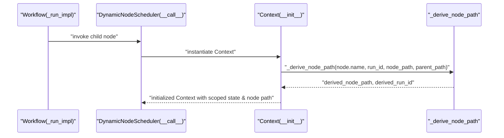
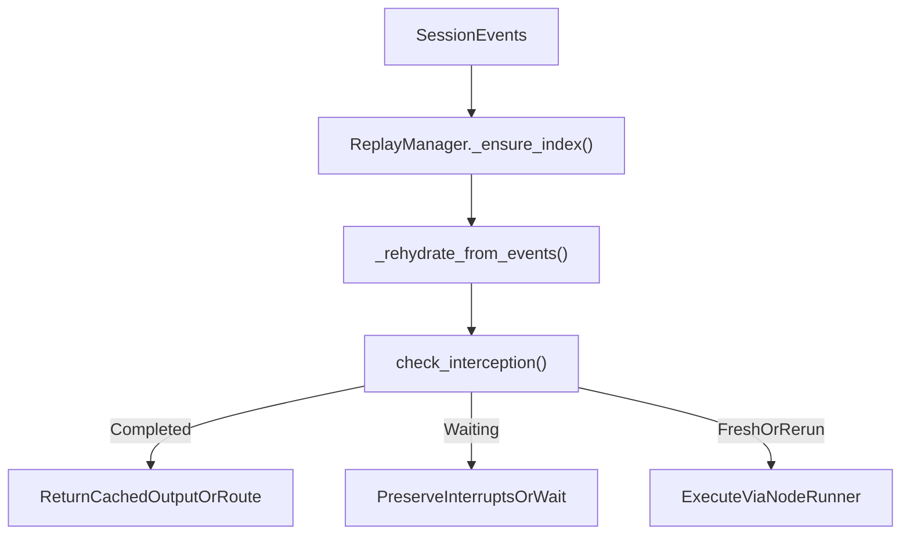
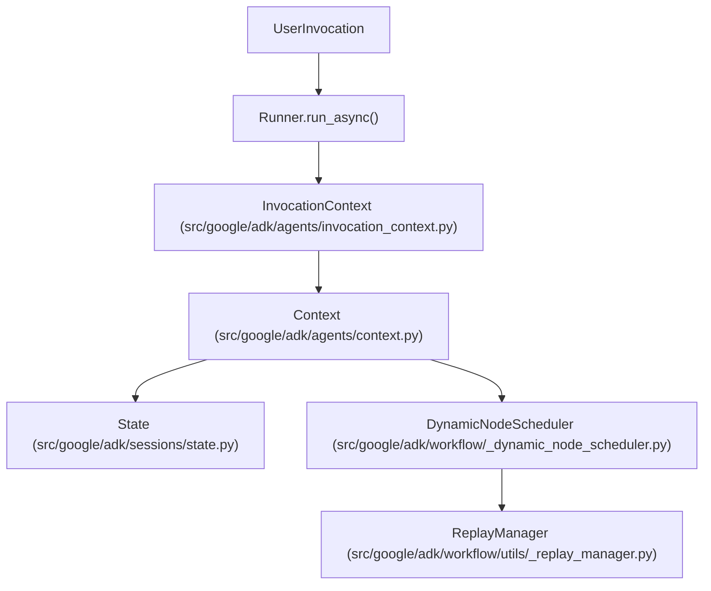

<!-- source: DeepWiki mcp.deepwiki.com · repo google/adk-python · page 3.8 Agent State and Context · fetched 2026-10-29 -->

# Agent State and Context

<details>
<summary>Relevant source files</summary>

The following files were used as context for generating this wiki page:

- [contributing/samples/tools/function_tools/README.md](contributing/samples/tools/function_tools/README.md)
- [contributing/samples/tools/function_tools/agent.py](contributing/samples/tools/function_tools/agent.py)
- [docs/guides/agents/llm_agent/index.md](docs/guides/agents/llm_agent/index.md)
- [docs/guides/tools/function_tool/index.md](docs/guides/tools/function_tool/index.md)
- [docs/guides/tools/node_tool/index.md](docs/guides/tools/node_tool/index.md)
- [src/google/adk/agents/callback_context.py](src/google/adk/agents/callback_context.py)
- [src/google/adk/agents/context.py](src/google/adk/agents/context.py)
- [src/google/adk/agents/invocation_context.py](src/google/adk/agents/invocation_context.py)
- [src/google/adk/events/_branch_path.py](src/google/adk/events/_branch_path.py)
- [src/google/adk/events/_node_path_builder.py](src/google/adk/events/_node_path_builder.py)
- [src/google/adk/flows/llm_flows/context/_contents.py](src/google/adk/flows/llm_flows/context/_contents.py)
- [src/google/adk/tools/_node_tool.py](src/google/adk/tools/_node_tool.py)
- [src/google/adk/tools/tool_context.py](src/google/adk/tools/tool_context.py)
- [src/google/adk/utils/agent_info.py](src/google/adk/utils/agent_info.py)
- [src/google/adk/workflow/_llm_agent_wrapper.py](src/google/adk/workflow/_llm_agent_wrapper.py)
- [tests/unittests/_invariants.py](tests/unittests/_invariants.py)
- [tests/unittests/agents/test_callback_context.py](tests/unittests/agents/test_callback_context.py)
- [tests/unittests/agents/test_context.py](tests/unittests/agents/test_context.py)
- [tests/unittests/agents/test_invocation_context.py](tests/unittests/agents/test_invocation_context.py)
- [tests/unittests/events/test_branch_path.py](tests/unittests/events/test_branch_path.py)
- [tests/unittests/events/test_node_path_builder.py](tests/unittests/events/test_node_path_builder.py)
- [tests/unittests/flows/llm_flows/context/test_contents.py](tests/unittests/flows/llm_flows/context/test_contents.py)
- [tests/unittests/flows/llm_flows/context/test_contents_branch.py](tests/unittests/flows/llm_flows/context/test_contents_branch.py)
- [tests/unittests/flows/llm_flows/test_context_shims.py](tests/unittests/flows/llm_flows/test_context_shims.py)
- [tests/unittests/runners/test_runner_node.py](tests/unittests/runners/test_runner_node.py)
- [tests/unittests/test_invariants.py](tests/unittests/test_invariants.py)
- [tests/unittests/utils/test_agent_info.py](tests/unittests/utils/test_agent_info.py)
- [tests/unittests/workflow/test_dynamic_node_executor.py](tests/unittests/workflow/test_dynamic_node_executor.py)
- [tests/unittests/workflow/test_llm_agent_as_node.py](tests/unittests/workflow/test_llm_agent_as_node.py)
- [tests/unittests/workflow/test_node_tool.py](tests/unittests/workflow/test_node_tool.py)
- [tests/unittests/workflow/test_task_api_e2e.py](tests/unittests/workflow/test_task_api_e2e.py)
- [tests/unittests/workflow/test_workflow_llm_agent_interruptions.py](tests/unittests/workflow/test_workflow_llm_agent_interruptions.py)
- [tests/unittests/workflow/testing_utils.py](tests/unittests/workflow/testing_utils.py)

</details>


This page details how agents access and modify state during execution, how the `InvocationContext` object carries execution metadata throughout the agent lifecycle, and how resumable invocations are managed using `agent_states`, `DynamicNodeScheduler`, and context hierarchy classes (`ReadonlyContext`, `Context`, `CallbackContext`, `ToolContext`).

---

## Overview of State and Context

The Agent Development Kit (ADK) manages state and context using three foundational mechanisms:
- **Session State**: A key-value dictionary stored in `Session` representing persistent state accessible to agents and tools, supporting scoped prefixes (`app:`, `user:`, `temp:`) [src/google/adk/sessions/state.py:72-150]().
- **Agent State & Resumability**: Agent-specific state tracking designed to support resumability for orchestrators and workflow nodes via `DynamicNodeState`, `_LoopState`, and `DynamicNodeScheduler` [src/google/adk/workflow/_workflow.py:69-127](), [src/google/adk/workflow/_dynamic_node_scheduler.py:60-130]().
- **InvocationContext**: The central context object flowing through every agent invocation, encapsulating session metadata, active agents, state tracking, and platform services [src/google/adk/agents/context.py:114-160](), [src/google/adk/agents/invocation_context.py:127-179]().

Sources: [src/google/adk/sessions/state.py:72-150](), [src/google/adk/workflow/_workflow.py:69-127](), [src/google/adk/workflow/_dynamic_node_scheduler.py:60-130](), [src/google/adk/agents/context.py:114-160](), [src/google/adk/agents/invocation_context.py:127-179]()

---

## InvocationContext and Context Hierarchy

The execution architecture relies on a hierarchy of context classes wrapping the underlying invocation and session data.

| Class | Purpose | Code Location |
| :--- | :--- | :--- |
| `ReadonlyContext` | Read-only view of invocation data for safe inspection | [src/google/adk/agents/readonly_context.py:1-40]() |
| `Context` | Core mutable context within an agent or node run, including `State` and `EventActions` | [src/google/adk/agents/context.py:114-160]() |
| `CallbackContext` | Alias/subclass used during lifecycle hooks and callbacks (maps to `Context`) | [src/google/adk/agents/callback_context.py:15-22]() |
| `ToolContext` | Context provided to tool functions for invocation and storage access | [src/google/adk/tools/tool_context.py:1-30]() |

```mermaid
classDiagram
    class "ReadonlyContext" {
        +"types.Content" user_content
        +str invocation_id
        +str agent_name
        +"MappingProxyType" state
        +"Session" session
        +str user_id
    }

    class "Context" {
        +"State" _state
        +"EventActions" _event_actions
        +str node_path
        +str run_id
        +Any output
        +run_node()
        +request_confirmation()
        +abort()
    }

    class "CallbackContext" {
    }

    class "ToolContext" {
        +"ToolConfirmation" tool_confirmation
        +request_confirmation()
    }

    "ReadonlyContext" <|-- "Context" : "inherits"
    "Context" <|-- "CallbackContext" : "alias"
    "Context" <|-- "ToolContext" : "inherits_or_wraps"
```
Sources: [src/google/adk/agents/readonly_context.py:1-40](), [src/google/adk/agents/context.py:114-196](), [src/google/adk/agents/callback_context.py:15-22](), [src/google/adk/tools/tool_context.py:1-30]()

---

## Session State Scopes and Accessors

Session state is scoped into distinct namespaces via key prefixes managed by the `State` class (`src/google/adk/sessions/state.py`) [src/google/adk/sessions/state.py:72-150]():

| Prefix | Scope | Persistence | Description |
| :--- | :--- | :--- | :--- |
| `app:` | Application | Cross-user / cross-session | Shared application-wide state |
| `user:` | User | Cross-session per user | User-specific state across conversations |
| *(none)* | Session | Single session | Conversation-specific persistent state |
| `temp:` | Temporary | Single invocation | Transient state cleared at the end of the current execution turn |

Mutations to `Context.state` undergo schema validation when a Pydantic `state_schema` is defined on the node [src/google/adk/sessions/state.py:39-70]():

```python
# Accessing and mutating state within a tool or agent
def sample_tool(ctx: ToolContext):
    user_pref = ctx.state.get("user:preference")
    ctx.state["last_active"] = timestamp
    ctx.state["temp:transient_flag"] = True
```
Sources: [src/google/adk/sessions/state.py:39-150]()

---

## Agent State Tracking and Resumability

For multi-turn operations and complex graph workflows, the execution engine tracks node states and dynamic runs via `DynamicNodeState` and `_LoopState` [src/google/adk/workflow/_workflow.py:69-127](), [src/google/adk/workflow/_dynamic_node_scheduler.py:60-130]().

- **`DynamicNodeState`**: Manages active dynamic node runs (`runs`), execution run counters (`run_counters`), and accumulated unresolved `interrupt_ids` [src/google/adk/workflow/_dynamic_node_scheduler.py:84-130]().
- **`_LoopState`**: Extends `DynamicNodeState` with static graph node statuses (`nodes`), recovered executions from event scans (`recovered_executions`), and sequence barriers for deterministic replay [src/google/adk/workflow/_workflow.py:69-127]().

```mermaid
classDiagram
    class "DynamicNodeState" {
        +dict runs
        +dict run_counters
        +set interrupt_ids
        +"ReplayManager" replay_manager
    }

    class "_LoopState" {
        +dict nodes
        +dict recovered_executions
        +bool error_shut_down
        +dict node_outputs
    }

    "DynamicNodeState" <|-- "_LoopState" : "extends"
```
Sources: [src/google/adk/workflow/_workflow.py:69-127](), [src/google/adk/workflow/_dynamic_node_scheduler.py:60-130]()

---

## Context Propagation and Node Pathing

In workflow executions, nested nodes and sub-agents rely on node path derivation to maintain correct event scoping and state isolation [src/google/adk/agents/context.py:55-111]().

- `_derive_node_path` constructs unique hierarchical paths (e.g., `parent_node@1/child_node@2`) using parent contexts and node identifiers [src/google/adk/agents/context.py:64-111]().
- `Context` initializes its internal `_node_path`, `_run_id`, and scoped `State` view based on these derived hierarchies [src/google/adk/agents/context.py:160-184]().


Sources: [src/google/adk/agents/context.py:55-111](), [src/google/adk/agents/context.py:160-184]()

---

## Workflow Replay and Interception

When resuming an interrupted session or rewinding execution, `ReplayManager` and `check_interception` inspect prior session events to fast-forward completed nodes without re-running them [src/google/adk/workflow/utils/_replay_manager.py:45-100](), [src/google/adk/workflow/utils/_replay_interceptor.py:57-174]().

- **`ReplayManager`**: Indexes session events by parent and transitive ancestor paths, maintaining sequence barriers for deterministic replay [src/google/adk/workflow/utils/_replay_manager.py:45-100]().
- **`check_interception`**: Evaluates whether a node should execute natively, fast-forward from cached outputs, or remain waiting on unresolved interrupts [src/google/adk/workflow/utils/_replay_interceptor.py:57-174]().


Sources: [src/google/adk/workflow/utils/_replay_manager.py:45-100](), [src/google/adk/workflow/utils/_replay_interceptor.py:57-174]()

---

# Natural Language to Code Entity Mapping

### State Management and Context Architecture


Sources: [src/google/adk/agents/invocation_context.py:1-50](), [src/google/adk/agents/context.py:114-160](), [src/google/adk/sessions/state.py:72-110](), [src/google/adk/workflow/_dynamic_node_scheduler.py:132-152](), [src/google/adk/workflow/utils/_replay_manager.py:45-60]()

### Context and State Entity Hierarchy

```mermaid
classDiagram
    class "InvocationContext" {
        +str invocation_id
        +"Session" session
        +dict agent_states
    }

    class "Context" {
        +"State" _state
        +"EventActions" _event_actions
        +str node_path
    }

    class "ReadonlyContext" {
        +"State" state
    }

    class "ToolContext" {
    }

    class "CallbackContext" {
    }

    "ReadonlyContext" <|-- "Context" : "inherits"
    "Context" <|-- "ToolContext" : "inherits"
    "Context" <|-- "CallbackContext" : "alias"
    "InvocationContext" -- "ReadonlyContext" : "wraps"
```
Sources: [src/google/adk/agents/context.py:26-114](), [src/google/adk/agents/callback_context.py:15-22](), [src/google/adk/tools/tool_context.py:1-30](), [src/google/adk/agents/invocation_context.py:127-179]()

---

