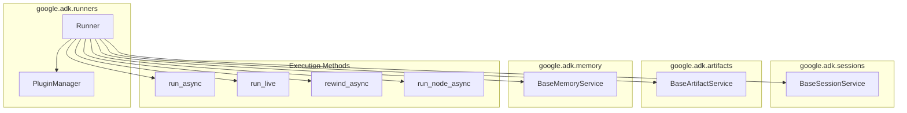
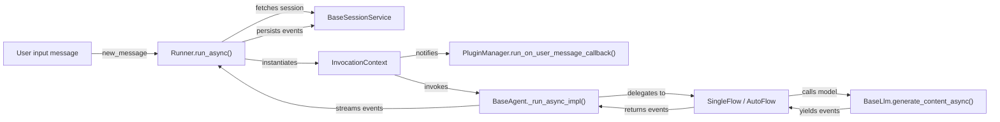

<!-- source: DeepWiki mcp.deepwiki.com · repo google/adk-python · page 4 Execution and Orchestration · fetched 2026-10-29 -->

# Execution and Orchestration

Relevant source files

The following files were used as context for generating this wiki page:

- [src/google/adk/agents/_agent_router.py](src/google/adk/agents/_agent_router.py)
- [src/google/adk/events/_abort_events.py](src/google/adk/events/_abort_events.py)
- [src/google/adk/runners.py](src/google/adk/runners.py)
- [src/google/adk/workflow/_node_runner_utils.py](src/google/adk/workflow/_node_runner_utils.py)
- [src/google/adk/workflow/utils/_transfer_utils.py](src/google/adk/workflow/utils/_transfer_utils.py)
- [tests/unittests/agents/test_agent_router.py](tests/unittests/agents/test_agent_router.py)
- [tests/unittests/agents/test_llm_agent_interruptions.py](tests/unittests/agents/test_llm_agent_interruptions.py)
- [tests/unittests/agents/test_resumable_llm_agent.py](tests/unittests/agents/test_resumable_llm_agent.py)
- [tests/unittests/events/test_abort_events.py](tests/unittests/events/test_abort_events.py)
- [tests/unittests/test_runners.py](tests/unittests/test_runners.py)
- [tests/unittests/workflow/test_agent_transfer.py](tests/unittests/workflow/test_agent_transfer.py)
- [tests/unittests/workflow/test_node_runner_utils.py](tests/unittests/workflow/test_node_runner_utils.py)
- [tests/unittests/workflow/test_workflow_agent_as_node.py](tests/unittests/workflow/test_workflow_agent_as_node.py)
- [tests/unittests/workflow/test_workflow_function_tool_as_node.py](tests/unittests/workflow/test_workflow_function_tool_as_node.py)
- [tests/unittests/workflow/test_workflow_live.py](tests/unittests/workflow/test_workflow_live.py)
- [tests/unittests/workflow/test_workflow_rewind.py](tests/unittests/workflow/test_workflow_rewind.py)
- [tests/unittests/workflow/test_workflow_schema.py](tests/unittests/workflow/test_workflow_schema.py)
- [tests/unittests/workflow/utils/test_transfer_utils.py](tests/unittests/workflow/utils/test_transfer_utils.py)

This page provides a high-level overview of the ADK core execution engine and orchestration subsystems, covering how agent invocations are orchestrated, events are generated and streamed, and how the system coordinates between agents, models, tools, and persistence services. The `Runner` class serves as the central orchestrator managing the complete lifecycle of agent execution.

**Scope**: This is a parent page. For detailed technical information, refer to the child pages:
- [Runner](#4.1)
- [Invocation Context](#4.2)
- [Plugin System](#4.3)
- [LLM Flow Orchestration](#4.4)
- [App Configuration](#4.5)

---

## 4.1 Runner

The `Runner` class (`[src/google/adk/runners.py:179-230]()`) acts as the stateless orchestration engine responsible for driving agent executions within sessions. It coordinates session retrieval, invocation context creation, plugin lifecycle hooks, and event streaming. The runner supports standard asynchronous runs via `run_async()` (`[src/google/adk/runners.py:451-525]()`), real-time bidirectional streaming via `run_live()` (`[src/google/adk/runners.py:924-950]()`), and historical session restoration via `rewind_async()`. It can also execute standalone `BaseNode` instances from the workflow engine via `run_node_async` (`[src/google/adk/workflow/_node_runner_utils.py:51-64]()`).

For comprehensive details on session management, node execution, and runner methods, see [Runner](#4.1).

**Runner System Architecture**

Sources: [src/google/adk/runners.py:179-230](), [src/google/adk/runners.py:451-525](), [src/google/adk/runners.py:924-950](), [src/google/adk/workflow/_node_runner_utils.py:51-64]()

---

## 4.2 Invocation Context

The `InvocationContext` (`[src/google/adk/agents/invocation_context.py:127-180]()`) encapsulates the data and state for a single agent invocation. It holds references to active services (`session_service`, `artifact_service`, `memory_service`, `credential_service`), run configuration (`RunConfig`), agent states, active tools, and branch/event routing rules. It manages LLM call limit enforcement and cross-thread abort signaling via `_AbortState` (`[src/google/adk/agents/invocation_context.py:97-126]()`). The context is created by the `Runner` via `_new_invocation_context` (`[src/google/adk/runners.py:113-118]()`).

For details on context structures, service bindings, and branch routing, see [Invocation Context](#4.2).

Sources: [src/google/adk/agents/invocation_context.py:97-180](), [src/google/adk/runners.py:113-118]()

---

## 4.3 Plugin System

The ADK plugin architecture provides extension points around agent execution through the `BasePlugin` interface (`[src/google/adk/plugins/base_plugin.py]()`) and `PluginManager` (`[src/google/adk/plugins/plugin_manager.py]()`). Plugins intercept user messages via `on_user_message_callback` (`[tests/unittests/test_runners.py:183-190]()`), observe or mutate generated events via `on_event_callback` (`[tests/unittests/test_runners.py:191-199]()`), handle run errors via `on_run_error_callback`, and perform setup or teardown tasks via `before_run_callback` and `after_run_callback`. Built-in plugins include analytics collectors, context filters, multimodal tool result handlers, retry logic, tracing, and guardrails like the Model Armor plugin. The callback pipeline utility helps manage the execution of multiple callbacks (`[src/google/adk/utils/_callback_pipeline.py]()`).

For complete documentation on plugin callbacks and built-in plugins, see [Plugin System](#4.3).

Sources: [src/google/adk/runners.py:487-540](), [src/google/adk/plugins/plugin_manager.py:1-50](), [tests/unittests/test_runners.py:171-199](), [src/google/adk/utils/_callback_pipeline.py:1-100]()

---

## 4.4 LLM Flow Orchestration

Model interaction logic is organized through the `BaseLlmFlow` hierarchy (`[src/google/adk/flows/llm_flows/base_llm_flow.py]()`). Implementations such as `SingleFlow` and `AutoFlow` manage the request-response lifecycle, chaining pre-processors and post-processors for instructions, authentication, compaction, and tool execution. They handle parallel function calls, batch tool execution, and streaming aggregations. Tool callbacks like `before_tool_callback` and `after_tool_callback` can intercept and modify tool execution. Similarly, model callbacks allow interception of LLM requests and responses. The function call postprocessor handles executing function calls and emitting related events.

For details on request processors, flow loops, and batch tool execution, see [LLM Flow Orchestration](#4.4).

**Flow Processing Pipeline**

```mermaid
graph LR
    subgraph "Request Processing"
        Basic["basic.request_processor"]
        Auth["auth_preprocessor"]
        Instr["instructions.request_processor"]
        Compaction["compaction.request_processor"]
        Contents["contents.request_processor"]
    end
    
    subgraph "Model Call"
        BeforeModelCb["before_model_callback"]
        Model["BaseLlm.generate_content_async"]
        AfterModelCb["after_model_callback"]
        OnModelErrorCb["on_model_error_callback"]
    end
    
    subgraph "Tool Execution"
        BeforeToolCb["before_tool_callback"]
        ToolCall["handle_function_calls_async"]
        AfterToolCb["after_tool_callback"]
        OnToolErrorCb["on_tool_error_callback"]
    end

    subgraph "Response Processing"
        NLPlan["_nl_planning.response_processor"]
        CodeExec["_code_execution.response_processor"]
        FunctionCallPostprocessor["postprocess_handle_function_calls_async"]
    end
    
    Basic --> Auth --> Instr --> Compaction --> Contents
    Contents --> BeforeModelCb
    BeforeModelCb --> Model
    Model --> AfterModelCb
    AfterModelCb --> OnModelErrorCb
    OnModelErrorCb --> ToolCall
    ToolCall --> BeforeToolCb
    BeforeToolCb --> ToolCall
    ToolCall --> AfterToolCb
    AfterToolCb --> OnToolErrorCb
    OnToolErrorCb --> NLPlan --> CodeExec --> FunctionCallPostprocessor
```

Sources: [src/google/adk/flows/llm_flows/base_llm_flow.py]()

---

## 4.5 App Configuration

The `App` class (`[src/google/adk/apps/app.py:85-100]()`) serves as the top-level container binding the root agent, plugins, context cache configuration (`ContextCacheConfig`), resumability settings (`ResumabilityConfig`), and event compaction policies (`EventsCompactionConfig`). It standardizes service initialization and runner creation across applications. The `Runner` is initialized with an `App` instance or its components (`[src/google/adk/runners.py:179-230]()`).

For configuration schemas, sliding window compaction, and service factory registries, see [App Configuration](#4.5).

Sources: [src/google/adk/runners.py:179-230](), [src/google/adk/apps/app.py:85-100]()

---

## Big Picture: Natural Language to Code Entity Space

The following diagram maps high-level user interactions and agent execution steps directly to their underlying code entities and methods within the execution framework.

**From User Request to Runner and LLM Flow Execution**

Sources: [src/google/adk/runners.py](), [src/google/adk/agents/invocation_context.py](), [src/google/adk/plugins/plugin_manager.py](), [src/google/adk/flows/llm_flows/base_llm_flow.py]()

---

## Child Pages

For detailed documentation on individual components of execution and orchestration, please refer to the following child pages:

- [Runner](#4.1) — Runner as stateless orchestration engine, `run_async`, `run_live`, `rewind_async`, session management, and node execution.
- [Invocation Context](#4.2) — Structure and services of `InvocationContext`, including run config, agent state tracking, tools, and routing.
- [Plugin System](#4.3) — `BasePlugin` interface, plugin callback methods, `PluginManager` orchestration, and built-in plugins like analytics, context filters, retry, and guardrails.
- [LLM Flow Orchestration](#4.4) — Details on `BaseLlmFlow` implementations, request/response processors, tool call handling, and batch processing.
- [App Configuration](#4.5) — Overview of the `App` class configuration, plugin loading, context cache, resumability, event compaction, and service factories.

Sources: [src/google/adk/runners.py:1-230](), [src/google/adk/agents/invocation_context.py:20-80](), [src/google/adk/plugins/plugin_manager.py:10-50]()

---

