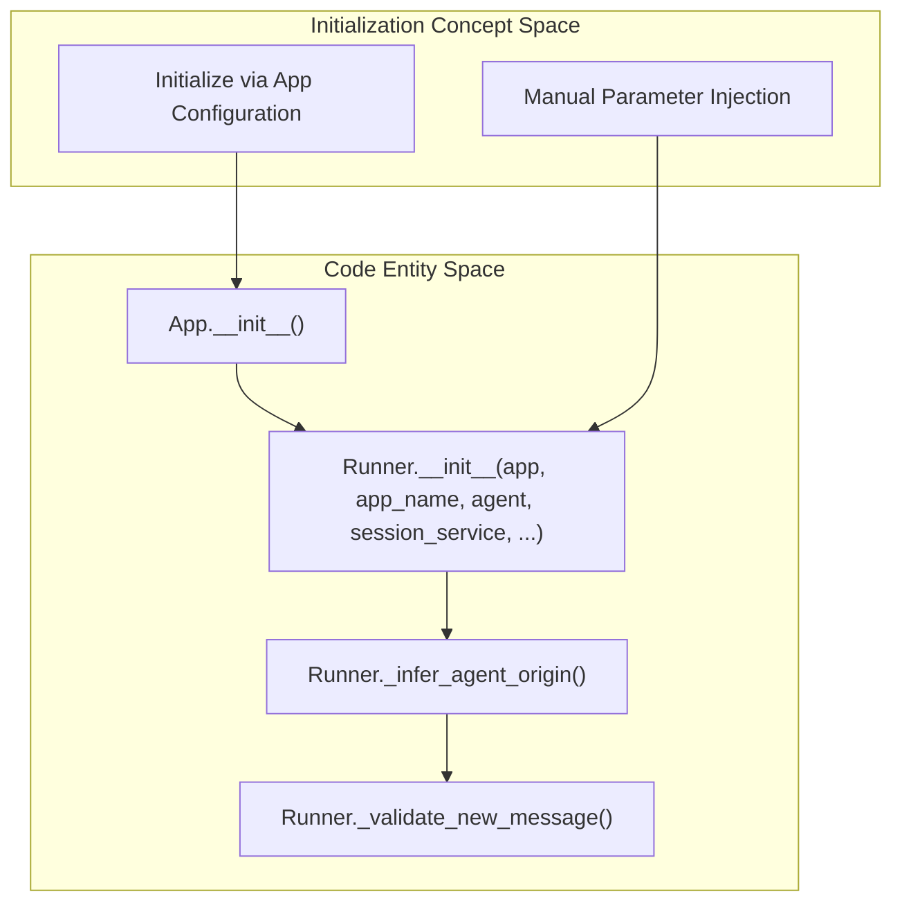
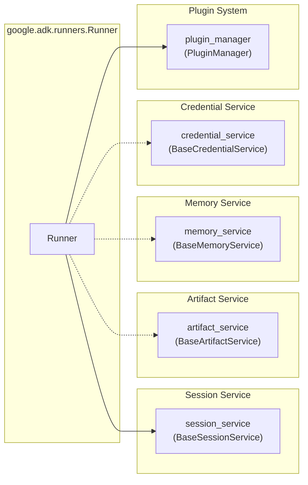
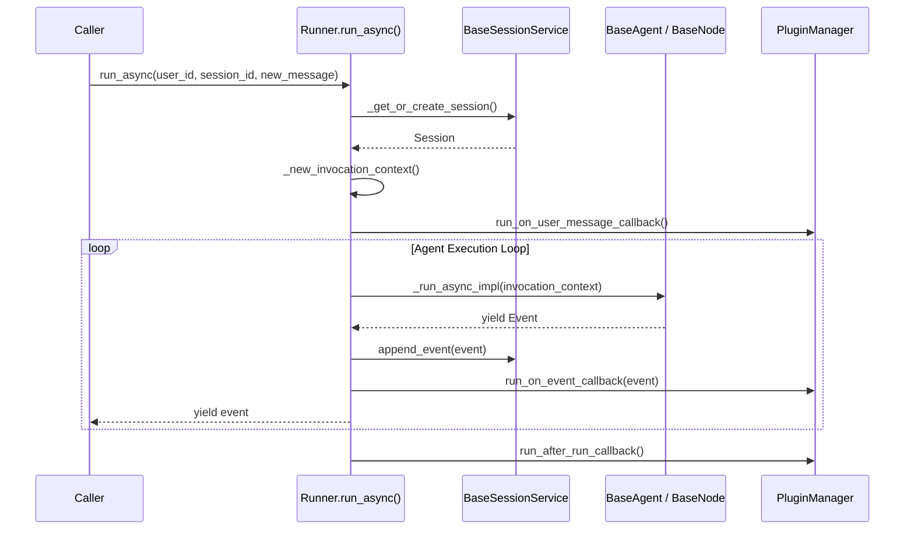
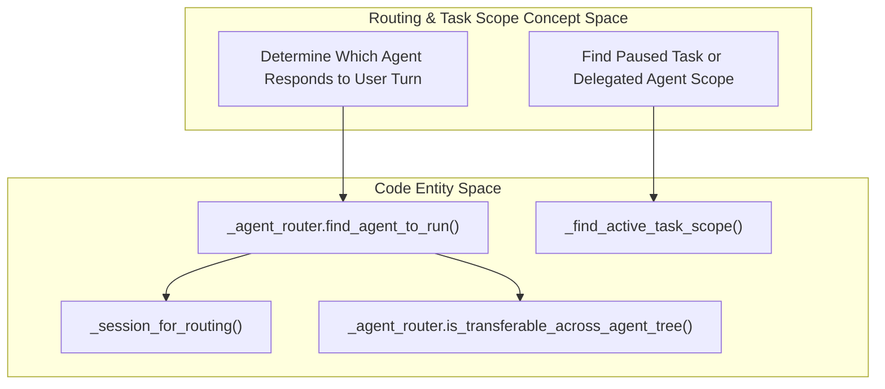

<!-- source: DeepWiki mcp.deepwiki.com · repo google/adk-python · page 4.1 Runner · fetched 2026-10-29 -->

# Runner

Relevant source files

The following files were used as context for generating this wiki page:

- [src/google/adk/agents/_agent_router.py](src/google/adk/agents/_agent_router.py)
- [src/google/adk/cli/utils/envs.py](src/google/adk/cli/utils/envs.py)
- [src/google/adk/events/_abort_events.py](src/google/adk/events/_abort_events.py)
- [src/google/adk/live/_runner_utils.py](src/google/adk/live/_runner_utils.py)
- [src/google/adk/live/live_request_queue.py](src/google/adk/live/live_request_queue.py)
- [src/google/adk/runners.py](src/google/adk/runners.py)
- [src/google/adk/utils/_gcp_metadata.py](src/google/adk/utils/_gcp_metadata.py)
- [src/google/adk/workflow/_node_runner_utils.py](src/google/adk/workflow/_node_runner_utils.py)
- [src/google/adk/workflow/utils/_transfer_utils.py](src/google/adk/workflow/utils/_transfer_utils.py)
- [tests/unittests/agents/test_agent_router.py](tests/unittests/agents/test_agent_router.py)
- [tests/unittests/agents/test_llm_agent_interruptions.py](tests/unittests/agents/test_llm_agent_interruptions.py)
- [tests/unittests/agents/test_resumable_llm_agent.py](tests/unittests/agents/test_resumable_llm_agent.py)
- [tests/unittests/cli/utils/test_envs.py](tests/unittests/cli/utils/test_envs.py)
- [tests/unittests/events/test_abort_events.py](tests/unittests/events/test_abort_events.py)
- [tests/unittests/live/test__runner_utils.py](tests/unittests/live/test__runner_utils.py)
- [tests/unittests/live/test_live_request_queue.py](tests/unittests/live/test_live_request_queue.py)
- [tests/unittests/test_runners.py](tests/unittests/test_runners.py)
- [tests/unittests/utils/test_gcp_metadata.py](tests/unittests/utils/test_gcp_metadata.py)
- [tests/unittests/workflow/test_agent_transfer.py](tests/unittests/workflow/test_agent_transfer.py)
- [tests/unittests/workflow/test_node_runner_utils.py](tests/unittests/workflow/test_node_runner_utils.py)
- [tests/unittests/workflow/test_workflow_agent_as_node.py](tests/unittests/workflow/test_workflow_agent_as_node.py)
- [tests/unittests/workflow/test_workflow_function_tool_as_node.py](tests/unittests/workflow/test_workflow_function_tool_as_node.py)
- [tests/unittests/workflow/test_workflow_live.py](tests/unittests/workflow/test_workflow_live.py)
- [tests/unittests/workflow/test_workflow_rewind.py](tests/unittests/workflow/test_workflow_rewind.py)
- [tests/unittests/workflow/test_workflow_schema.py](tests/unittests/workflow/test_workflow_schema.py)
- [tests/unittests/workflow/utils/test_transfer_utils.py](tests/unittests/workflow/utils/test_transfer_utils.py)

The `Runner` class serves as the central stateless orchestration engine for agent execution within the ADK Python framework [src/google/adk/runners.py:163](). It provides the capability to run AI agents and workflow nodes, manage session lifecycles, interact with persistence backends (`BaseSessionService`, `BaseArtifactService`, `BaseMemoryService`, `BaseCredentialService`), coordinate plugin callbacks (`PluginManager`), and stream events back to callers via `run_async()` [src/google/adk/runners.py:493](), `run_live()` [src/google/adk/runners.py:981](), and `rewind_async()` [src/google/adk/runners.py:623]().

---

## 1. Overview and Responsibilities

The `Runner` performs the following key functions:
- **Invocation orchestration** of the root `BaseAgent` or workflow `BaseNode`, managing execution flow from input to output [src/google/adk/runners.py:493]().
- **Session management** via `_get_or_create_session()`, retrieving or auto-creating session records and appending events [src/google/adk/runners.py:395]().
- **Plugin lifecycle integration** through `PluginManager`, invoking hooks like `on_user_message_callback`, `on_event`, and `after_run` [src/google/adk/runners.py:560]().
- **Event streaming** using asynchronous generators returning `AsyncGenerator[Event, None]` [src/google/adk/runners.py:493]().
- **Live mode support** for bidirectional real-time audio/video streaming via `LiveRequestQueue` [src/google/adk/runners.py:981]().
- **Session rewind** for time-travel debugging via `rewind_async()` [src/google/adk/runners.py:623]().
- **Agent resolution** via `_agent_router.find_agent_to_run()` to determine which agent owns the next conversation turn [src/google/adk/agents/_agent_router.py:146]().

### Core Public Methods

| Method | Description | Code Location |
|---|---|---|
| `Runner.run_async()` | Main async generator running an invocation and yielding `Event` objects | [src/google/adk/runners.py:493-621]() |
| `Runner.run_live()` | Async generator for bidirectional live media streaming | [src/google/adk/runners.py:981-1158]() |
| `Runner.run()` | Synchronous wrapper using a background thread and queue | [src/google/adk/runners.py:428-491]() |
| `Runner.rewind_async()` | Rewinds session state and artifacts to a prior point | [src/google/adk/runners.py:623-668]() |
| `run_node_async()` | Utility function executing workflow nodes under runner control | [src/google/adk/workflow/_node_runner_utils.py:50-63]() |

Sources: [src/google/adk/runners.py:163-188](), [src/google/adk/runners.py:428-621](), [src/google/adk/runners.py:623-668](), [src/google/adk/runners.py:981-1158](), [src/google/adk/workflow/_node_runner_utils.py:50-63]()

---

## 2. Initialization and Configuration

`Runner` instances can be created either by passing an `App` object (recommended) or explicitly supplying an `agent` (or `node`), an `app_name`, and necessary service backends [src/google/adk/runners.py:190-353]().

### Diagram: Runner Initialization & Code Mapping
This diagram bridges natural language initialization concepts to code entities in `src/google/adk/runners.py` [src/google/adk/runners.py:190-353]().

Sources: [src/google/adk/runners.py:190-353]()

---

## 3. Service Dependencies and Composition

The `Runner` composes several backend services to maintain session state, artifacts, memory, and credentials, as well as driving plugin hooks.

### Diagram: Runner Service Composition
Maps service dependencies defined in `src/google/adk/runners.py` [src/google/adk/runners.py:182-194]().

Sources: [src/google/adk/runners.py:182-194]()

---

## 4. Execution Methods

### `run_async()`

`Runner.run_async()` handles the primary asynchronous invocation flow. It initializes the `InvocationContext`, invokes plugin `before_run` and `on_user_message_callback` hooks, executes the target agent or node, dispatches generated events through `PluginManager`, and performs post-invocation compaction [src/google/adk/runners.py:493-621]().

Sources: [src/google/adk/runners.py:493-621]()

### `run()`

`Runner.run()` provides a synchronous interface by wrapping `run_async()` inside a dedicated thread using `create_thread()` and transferring emitted events across a thread-safe `queue.Queue` [src/google/adk/runners.py:428-491]().

Sources: [src/google/adk/runners.py:428-491]()

### `run_live()`

`Runner.run_live()` enables real-time bidirectional audio/video streaming sessions. It consumes a `LiveRequestQueue` and buffers asynchronous tool and model events while maintaining strict message order [src/google/adk/runners.py:981-1158]().

Sources: [src/google/adk/runners.py:981-1158]()

### Node Running (`run_node_async`)

Workflow nodes and individual agent steps can be invoked directly through `run_node_async()` in `_node_runner_utils.py`, which resolves session state, sets up branch paths, attaches abort signals (`asyncio.Event`), and executes node implementations [src/google/adk/workflow/_node_runner_utils.py:50-125]().

Sources: [src/google/adk/workflow/_node_runner_utils.py:50-125]()

---

## 5. Session Management & Agent Resolution

### Agent Resolution (`find_agent_to_run`)

When an invocation starts without an explicit agent designation, `_agent_router.find_agent_to_run()` scans session history to find the active agent or resume target [src/google/adk/agents/_agent_router.py:146-191]().

- Checks for trailing `FunctionResponse` parts and resolves the agent that generated the matching `FunctionCall` [src/google/adk/agents/_agent_router.py:182-190]().
- Falls back to scanning backward for the latest non-user event author [src/google/adk/agents/_agent_router.py:186-189]().
- Validates whether the agent is transferable across the hierarchy using `_agent_router.is_transferable_across_agent_tree()` [src/google/adk/agents/_agent_router.py:110-130]().

### Diagram: Session Routing & Agent Resolution Mapping
This diagram bridges natural language routing and task scope concepts to code entities in `_agent_router.py` and `runners.py` [src/google/adk/agents/_agent_router.py:146-191]().

Sources: [src/google/adk/agents/_agent_router.py:110-191](), [src/google/adk/runners.py:92-162]()

### Active Task Scope Detection (`_find_active_task_scope`)

`_find_active_task_scope()` inspects session events backward to locate an active paused task agent (either via function call delegation or workflow task nodes) that is awaiting a user response, avoiding incorrect routing [src/google/adk/runners.py:92-156]().

Sources: [src/google/adk/runners.py:92-156]()

---

## 6. Advanced Features

### Session Rewind (`rewind_async`)

`Runner.rewind_async()` implements time-travel debugging by rolling back session events to a specified target event ID or invocation point [src/google/adk/runners.py:623-668](). It computes state deltas, truncates subsequent events, and restores associated artifact versions via `BaseArtifactService` [src/google/adk/runners.py:623-668]().

Sources: [src/google/adk/runners.py:623-668]()

---

## 7. Code Entity Reference

| Entity | Location | Description |
|---|---|---|
| `Runner` | [src/google/adk/runners.py:163]() | Stateless orchestration engine class |
| `Runner.run_async()` | [src/google/adk/runners.py:493]() | Asynchronous event generator for invocations |
| `Runner.run()` | [src/google/adk/runners.py:428]() | Synchronous blocking runner interface |
| `Runner.run_live()` | [src/google/adk/runners.py:981]() | Live bidirectional streaming runner |
| `Runner.rewind_async()` | [src/google/adk/runners.py:623]() | Time-travel session rewind method |
| `_agent_router.find_agent_to_run()` | [src/google/adk/agents/_agent_router.py:146]() | Resolves active agent from session history |
| `run_node_async()` | [src/google/adk/workflow/_node_runner_utils.py:50]() | Executes workflow nodes and agent steps |
| `InvocationContext` | [src/google/adk/agents/invocation_context.py:127]() | Encapsulates invocation state, services, and configs |

Sources: [src/google/adk/runners.py:163](), [src/google/adk/runners.py:428](), [src/google/adk/runners.py:493](), [src/google/adk/runners.py:623](), [src/google/adk/runners.py:981](), [src/google/adk/agents/_agent_router.py:146](), [src/google/adk/workflow/_node_runner_utils.py:50](), [src/google/adk/agents/invocation_context.py:127]()

---

