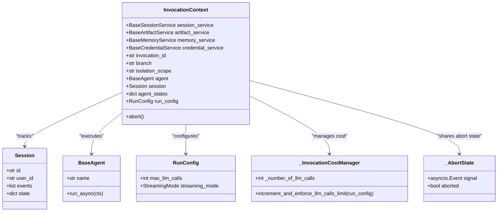
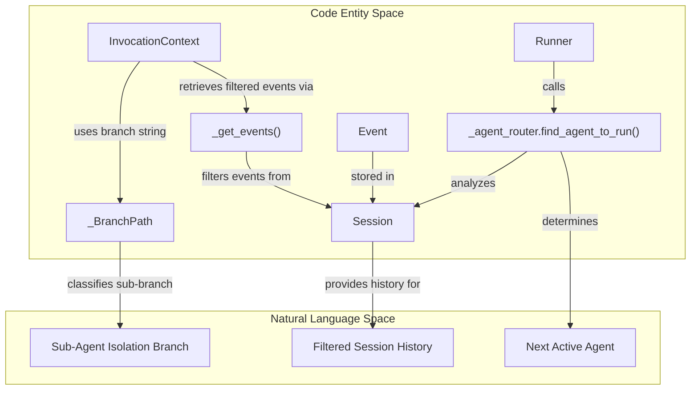
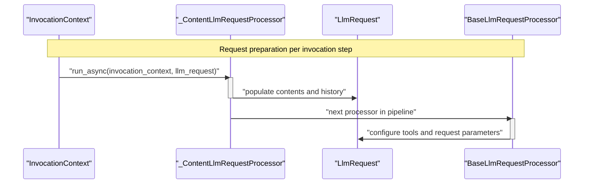

<!-- source: DeepWiki mcp.deepwiki.com · repo google/adk-python · page 4.2 Invocation Context · fetched 2026-10-29 -->

# Invocation Context

Relevant source files

The following files were used as context for generating this wiki page:

- [src/google/adk/agents/invocation_context.py](src/google/adk/agents/invocation_context.py)
- [src/google/adk/agents/live_request_queue.py](src/google/adk/agents/live_request_queue.py)
- [src/google/adk/agents/run_config.py](src/google/adk/agents/run_config.py)
- [src/google/adk/events/_branch_path.py](src/google/adk/events/_branch_path.py)
- [src/google/adk/events/_node_path_builder.py](src/google/adk/events/_node_path_builder.py)
- [src/google/adk/flows/llm_flows/basic.py](src/google/adk/flows/llm_flows/basic.py)
- [src/google/adk/flows/llm_flows/contents.py](src/google/adk/flows/llm_flows/contents.py)
- [src/google/adk/flows/llm_flows/context/_contents.py](src/google/adk/flows/llm_flows/context/_contents.py)
- [src/google/adk/models/_service_tier.py](src/google/adk/models/_service_tier.py)
- [src/google/adk/models/base_llm_connection.py](src/google/adk/models/base_llm_connection.py)
- [src/google/adk/models/gemini_llm_connection.py](src/google/adk/models/gemini_llm_connection.py)
- [src/google/adk/models/llm_response.py](src/google/adk/models/llm_response.py)
- [src/google/adk/utils/streaming_utils.py](src/google/adk/utils/streaming_utils.py)
- [src/google/adk/workflow/_llm_agent_wrapper.py](src/google/adk/workflow/_llm_agent_wrapper.py)
- [tests/integration/test_vertex_ai_search_grounding_streaming.py](tests/integration/test_vertex_ai_search_grounding_streaming.py)
- [tests/unittests/_invariants.py](tests/unittests/_invariants.py)
- [tests/unittests/agents/test_invocation_context.py](tests/unittests/agents/test_invocation_context.py)
- [tests/unittests/agents/test_live_request_queue.py](tests/unittests/agents/test_live_request_queue.py)
- [tests/unittests/agents/test_llm_agent_include_contents.py](tests/unittests/agents/test_llm_agent_include_contents.py)
- [tests/unittests/agents/test_run_config.py](tests/unittests/agents/test_run_config.py)
- [tests/unittests/events/test_branch_path.py](tests/unittests/events/test_branch_path.py)
- [tests/unittests/events/test_node_path_builder.py](tests/unittests/events/test_node_path_builder.py)
- [tests/unittests/flows/llm_flows/context/test_contents.py](tests/unittests/flows/llm_flows/context/test_contents.py)
- [tests/unittests/flows/llm_flows/context/test_contents_branch.py](tests/unittests/flows/llm_flows/context/test_contents_branch.py)
- [tests/unittests/flows/llm_flows/context/test_interactions.py](tests/unittests/flows/llm_flows/context/test_interactions.py)
- [tests/unittests/flows/llm_flows/test_basic_processor.py](tests/unittests/flows/llm_flows/test_basic_processor.py)
- [tests/unittests/flows/llm_flows/test_context_shims.py](tests/unittests/flows/llm_flows/test_context_shims.py)
- [tests/unittests/flows/llm_flows/test_progressive_sse_streaming.py](tests/unittests/flows/llm_flows/test_progressive_sse_streaming.py)
- [tests/unittests/models/test_fallback_model.py](tests/unittests/models/test_fallback_model.py)
- [tests/unittests/models/test_gemini_llm_connection.py](tests/unittests/models/test_gemini_llm_connection.py)
- [tests/unittests/models/test_llm_response.py](tests/unittests/models/test_llm_response.py)
- [tests/unittests/streaming/test_live_streaming_configs.py](tests/unittests/streaming/test_live_streaming_configs.py)
- [tests/unittests/test_invariants.py](tests/unittests/test_invariants.py)
- [tests/unittests/utils/test_streaming_utils.py](tests/unittests/utils/test_streaming_utils.py)
- [tests/unittests/workflow/test_llm_agent_as_node.py](tests/unittests/workflow/test_llm_agent_as_node.py)
- [tests/unittests/workflow/test_task_api_e2e.py](tests/unittests/workflow/test_task_api_e2e.py)
- [tests/unittests/workflow/test_workflow_llm_agent_interruptions.py](tests/unittests/workflow/test_workflow_llm_agent_interruptions.py)
- [tests/unittests/workflow/testing_utils.py](tests/unittests/workflow/testing_utils.py)

The `InvocationContext` class is the central runtime state container for a single agent invocation. It provides agents with access to services, session data, and runtime configuration, while managing the execution lifecycle, cost controls, and state tracking for resumable workflows.

For information about the Runner that creates invocation contexts, see [Runner](4.1). For details on agent execution lifecycle, see [Agent Execution Lifecycle](3.4). For session state management concepts, see [State Hierarchy](8.2).

## Purpose and Scope

An **invocation** represents the complete execution flow from a user message to a final response, which may involve multiple agent calls and LLM steps [src/google/adk/agents/invocation_context.py:127-165](). The `InvocationContext` class encapsulates all runtime information needed during execution:

-   **Services**: Access to `BaseSessionService`, `BaseArtifactService`, `BaseMemoryService`, and `BaseCredentialService` [src/google/adk/agents/invocation_context.py:173-176]().
-   **Identity and Scope**: Tracking of `invocation_id`, `session`, `user_content`, and `isolation_scope` for filtering session events [src/google/adk/agents/invocation_context.py:179-184]().
-   **Resumability and State**: `agent_states` dictionary for progress tracking and completion status dictionaries.
-   **Branching**: A `branch` field (e.g., `agent_1.agent_2`) to isolate conversation history for sub-agents using `_BranchPath` [src/google/adk/events/_branch_path.py:20-29]().
-   **Live Streaming and Routing**: Management of live request queues, active streaming tools (`ActiveStreamingTool`), and branch/event routing [src/google/adk/agents/invocation_context.py:43-46]().

Sources: [src/google/adk/agents/invocation_context.py:127-184](), [src/google/adk/events/_branch_path.py:20-29]()

## Structure Overview

The `InvocationContext` is implemented as a Pydantic `BaseModel` with `extra="forbid"`, ensuring strict schema validation during execution [src/google/adk/agents/invocation_context.py:167-170]().

### Code Entity Space to Natural Language Space

The following table maps internal code classes and fields to their functional roles within an invocation.

| Code Entity | Natural Language Role |
| :--- | :--- |
| `InvocationContext` | The central runtime data container for a single agent invocation [src/google/adk/agents/invocation_context.py:127-133](). |
| `Session` | The session container holding persistent history and events [src/google/adk/sessions/session.py:65]() (referenced at [src/google/adk/agents/invocation_context.py:50]()). |
| `RunConfig` | Defines runtime behavior limits like `max_llm_calls` and streaming options [src/google/adk/agents/run_config.py:84](). |
| `_InvocationCostManager` | Tracks LLM calls and enforces limits against `RunConfig.max_llm_calls` [src/google/adk/agents/invocation_context.py:67-94](). |
| `_AbortState` | Shared mutable state container for invocation abort signals across async tasks [src/google/adk/agents/invocation_context.py:97-124](). |
| `agent_states` | Tracks internal state dictionary per agent instance during execution. |

Diagram: InvocationContext Class Relationships

Sources: [src/google/adk/agents/invocation_context.py:50-184](), [src/google/adk/sessions/session.py:65](), [src/google/adk/agents/run_config.py:84]()

## Core Services and Configuration (`run_config`)

The context provides unified access to infrastructure services and runtime configuration parameters.

### Services
-   **`session_service`**: Mandatory service implementation for persisting session events and metadata [src/google/adk/agents/invocation_context.py:174]().
-   **`artifact_service`**: Optional service for managing file-based binary artifacts [src/google/adk/agents/invocation_context.py:173]().
-   **`memory_service`**: Optional service for long-term memory lookup and retrieval [src/google/adk/agents/invocation_context.py:175]().
-   **`credential_service`**: Optional service for resolving tool and API credentials [src/google/adk/agents/invocation_context.py:176]().

### Runtime Configuration (`run_config`)
The `run_config` attribute holds an instance of `RunConfig` which governs execution-wide policies such as streaming modes, thread pool settings, and call limitations (`max_llm_calls`) [src/google/adk/agents/invocation_context.py:58]().

Sources: [src/google/adk/agents/invocation_context.py:58-176]()

## State Tracking: `agent_states`, Active Tools, and Isolation

State management within `InvocationContext` is partitioned across multiple dictionaries and scope attributes:

-   **`agent_states`**: Maps individual agent identifiers to their state models (`BaseAgentState`), allowing agents to preserve state across multi-turn exchanges.
-   **Active Tools**: Manages streaming tools and real-time execution elements via `ActiveStreamingTool` references [src/google/adk/agents/invocation_context.py:43]().
-   **`isolation_scope`**: Restricts session event visibility to match specific agent scopes (such as task-mode sub-agents or tool delegations).

Sources: [src/google/adk/agents/invocation_context.py:43-56]()

## Execution Control and Cancellation (`_AbortState`)

### Cost Limits
The `InvocationContext` uses an internal `_InvocationCostManager` instance to track LLM invocations [src/google/adk/agents/invocation_context.py:67-94](). The method `increment_and_enforce_llm_calls_limit(run_config)` updates the counter and raises an `LlmCallsLimitExceededError` if `run_config.max_llm_calls` is exceeded [src/google/adk/agents/invocation_context.py:78-94]().

### Cancellation and Abort Signaling
The `_AbortState` class coordinates cancellation signals across cloned context instances [src/google/adk/agents/invocation_context.py:97-124](). Because Pydantic `model_copy()` shallow-copies private attributes, derived contexts share the same `_AbortState` reference, ensuring cancellation propagates across tasks [src/google/adk/agents/invocation_context.py:97-111](). The `abort()` method on `InvocationContext` sets the `is_aborted` flag and trips the internal `asyncio.Event` signal, which can be awaited by coroutines to react to cancellation [tests/unittests/agents/test_invocation_context.py:142-156](). This mechanism supports both immediate cancellation within the same event loop tick and cross-thread wake-up for tasks awaiting the signal [tests/unittests/agents/test_invocation_context.py:158-195]().

Sources: [src/google/adk/agents/invocation_context.py:67-124](), [tests/unittests/agents/test_invocation_context.py:142-195]()

## Branch and Event Routing

Events generated during an invocation carry branch path information formatted as dot-separated segments (e.g., `agent_1.agent_2`) [src/google/adk/events/_branch_path.py:20-29](). The `_BranchPath` utility parses and queries hierarchical execution paths [src/google/adk/events/_branch_path.py:31-41](). The `_get_events` method within `InvocationContext` allows filtering events based on the current invocation ID and branch, enabling agents to access relevant conversation history [tests/unittests/agents/test_invocation_context.py:82-104]().

The runner utilizes `_agent_router.find_agent_to_run` to determine which agent should handle the next user message in multi-agent scenarios or when resuming a session [src/google/adk/agents/_agent_router.py:146-150](). This function examines session history, looking for the last active, transferable agent or a function call that requires a response [src/google/adk/agents/_agent_router.py:151-191]().

Diagram: Branch and Event Routing Entity Space

Sources: [src/google/adk/events/_branch_path.py:20-41](), [tests/unittests/agents/test_invocation_context.py:82-104](), [src/google/adk/agents/_agent_router.py:146-191]()

## Data Flow and Request Construction

During execution steps, the invocation context coordinates with request processors to build model inputs and handle tool payloads [src/google/adk/flows/llm_flows/context/_contents.py:116-124]().

Diagram: Request Construction and Flow Architecture

Sources: [src/google/adk/flows/llm_flows/context/_contents.py:116-124]()

---

