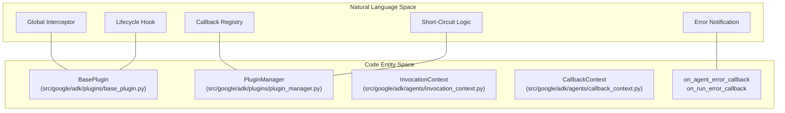
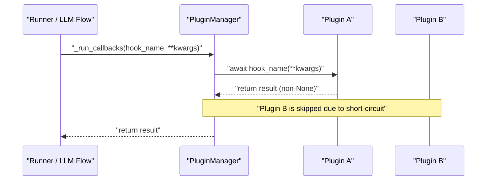
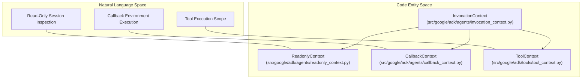
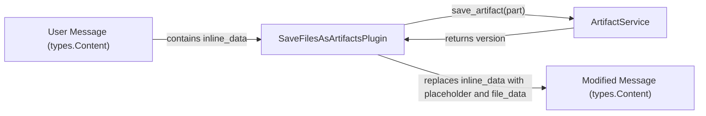

<!-- source: DeepWiki mcp.deepwiki.com · repo google/adk-python · page 4.3 Plugin System · fetched 2026-10-29 -->

# Plugin System

Relevant source files

The following files were used as context for generating this wiki page:

- [src/google/adk/agents/readonly_context.py](src/google/adk/agents/readonly_context.py)
- [src/google/adk/cli/plugins/replay_plugin.py](src/google/adk/cli/plugins/replay_plugin.py)
- [src/google/adk/plugins/auto_tracing_helpers.py](src/google/adk/plugins/auto_tracing_helpers.py)
- [src/google/adk/plugins/auto_tracing_plugin.py](src/google/adk/plugins/auto_tracing_plugin.py)
- [src/google/adk/plugins/base_plugin.py](src/google/adk/plugins/base_plugin.py)
- [src/google/adk/plugins/context_filter_plugin.py](src/google/adk/plugins/context_filter_plugin.py)
- [src/google/adk/plugins/debug_logging_plugin.py](src/google/adk/plugins/debug_logging_plugin.py)
- [src/google/adk/plugins/global_instruction_plugin.py](src/google/adk/plugins/global_instruction_plugin.py)
- [src/google/adk/plugins/logging_plugin.py](src/google/adk/plugins/logging_plugin.py)
- [src/google/adk/plugins/plugin_manager.py](src/google/adk/plugins/plugin_manager.py)
- [src/google/adk/plugins/save_files_as_artifacts_plugin.py](src/google/adk/plugins/save_files_as_artifacts_plugin.py)
- [tests/unittests/agents/test_readonly_context.py](tests/unittests/agents/test_readonly_context.py)
- [tests/unittests/plugins/test_auto_tracing_plugin.py](tests/unittests/plugins/test_auto_tracing_plugin.py)
- [tests/unittests/plugins/test_base_plugin.py](tests/unittests/plugins/test_base_plugin.py)
- [tests/unittests/plugins/test_context_filtering_plugin.py](tests/unittests/plugins/test_context_filtering_plugin.py)
- [tests/unittests/plugins/test_debug_logging_plugin.py](tests/unittests/plugins/test_debug_logging_plugin.py)
- [tests/unittests/plugins/test_global_instruction_plugin.py](tests/unittests/plugins/test_global_instruction_plugin.py)
- [tests/unittests/plugins/test_logging_plugin.py](tests/unittests/plugins/test_logging_plugin.py)
- [tests/unittests/plugins/test_notification_error_callbacks.py](tests/unittests/plugins/test_notification_error_callbacks.py)
- [tests/unittests/plugins/test_plugin_manager.py](tests/unittests/plugins/test_plugin_manager.py)
- [tests/unittests/plugins/test_save_files_as_artifacts.py](tests/unittests/plugins/test_save_files_as_artifacts.py)

The plugin system provides structured extension points throughout the agent execution lifecycle (`[src/google/adk/plugins/base_plugin.py:41-49]()`), allowing developers to intercept and modify behavior at key stages without altering core ADK code. Plugins can modify user messages, observe events, intercept tool calls, handle LLM requests/responses, and perform global setup or cleanup tasks (`[src/google/adk/plugins/base_plugin.py:44-49]()`).

While agent callbacks apply to a specific agent instance, plugins apply globally to all agents managed by the runner (`[src/google/adk/plugins/base_plugin.py:44-49]`, `[src/google/adk/plugins/base_plugin.py:56-62]()`).

Sources: `[src/google/adk/plugins/base_plugin.py:41-53]()`, `[src/google/adk/plugins/plugin_manager.py:61-66]()`

---

## Architecture Overview

The plugin system is coordinated by the `PluginManager` class (`[src/google/adk/plugins/plugin_manager.py:61-66]()`), which maintains a registry of `BasePlugin` instances (`[src/google/adk/plugins/base_plugin.py:41-53]()`). Plugins are registered at the application or runner level and intercept execution paths sequentially (`[src/google/adk/plugins/plugin_manager.py:61-66]()`, `[src/google/adk/plugins/plugin_manager.py:68-72]()`).

### Natural Language to Code Entity Space (Core Components)

The following diagram maps high-level plugin concepts to their specific implementations in the codebase.

**Plugin System Entity Mapping**

Sources: `[src/google/adk/plugins/base_plugin.py:41-53]()`, `[src/google/adk/plugins/plugin_manager.py:60-73]()`, `[src/google/adk/plugins/base_plugin.py:252-270]()`

---

## Plugin Manager and Execution Flow

The `PluginManager` class manages plugin registration, name uniqueness checks (`[src/google/adk/plugins/plugin_manager.py:109-122]()`), and hook execution (`[src/google/adk/plugins/plugin_manager.py:134-239]()`).

### Early Exit / Short-Circuiting
The core execution logic implements an early exit strategy: if any plugin callback returns a non-`None` value, execution of subsequent plugins for that specific hook is halted, and the returned value is propagated up the call stack (`[src/google/adk/plugins/plugin_manager.py:68-72]()`). Plugins take precedence over agent-specific callbacks (`[src/google/adk/plugins/base_plugin.py:58-62]()`).

**Plugin Execution Flow**

Sources: `[src/google/adk/plugins/base_plugin.py:56-62]()`, `[src/google/adk/plugins/plugin_manager.py:68-72]()`

---

## Plugin Lifecycle Hooks

Plugins can implement a wide variety of optional hooks defined in `BasePlugin` (`[src/google/adk/plugins/base_plugin.py:41-193]()`).

### Run-Level Callbacks
*   **`on_user_message_callback`**: Executed when a user message is received before an invocation starts (`[src/google/adk/plugins/base_plugin.py:114-134]()`).
*   **`before_run_callback`**: Executed before the runner runs, ideal for global setup (`[src/google/adk/plugins/base_plugin.py:136-153]()`).
*   **`on_event_callback`**: Executed when the runner produces an event, ideal for event modification (`[src/google/adk/plugins/base_plugin.py:155-172]()`).
*   **`after_run_callback`**: Executed after a run has completed (`[src/google/adk/plugins/base_plugin.py:174-188]()`).
*   **`close`**: Executed when the runner is closed for cleanup (`[src/google/adk/plugins/base_plugin.py:190-193]()`).

Sources: `[src/google/adk/plugins/base_plugin.py:114-193]()`, `[src/google/adk/plugins/plugin_manager.py:134-239]()`

---

## Execution Contexts and Data Structures

### Natural to Code Entity Space (Execution Contexts)

The following diagram maps context abstraction concepts to their corresponding Python classes in the codebase.

**Context Entity Mapping**

Sources: `[src/google/adk/agents/readonly_context.py:31-89]()`, `[src/google/adk/plugins/base_plugin.py:15-35]()`

### ReadonlyContext Reference
`ReadonlyContext` provides a read-only view of session state, invocation configuration, and user metadata for inspection during callbacks (`[src/google/adk/agents/readonly_context.py:31-77]()`).

| Property | Description | Source |
| :--- | :--- | :--- |
| `user_content` | The content that started the invocation | `[src/google/adk/agents/readonly_context.py:39-42]()` |
| `state` | A `MappingProxyType` view of session state | `[src/google/adk/agents/readonly_context.py:57-59]()` |
| `run_config` | The run configuration for the invocation | `[src/google/adk/agents/readonly_context.py:72-74]()` |
| `invocation_id` | Unique string identifier for the invocation | `[src/google/adk/agents/readonly_context.py:45-48]()` |

Sources: `[src/google/adk/agents/readonly_context.py:31-79]()`, `[src/google/adk/plugins/base_plugin.py:15-30]()`

---

## Built-In Plugins

ADK provides several built-in plugins for logging, artifact management, debugging, and testing.

### LoggingPlugin
`LoggingPlugin` prints critical execution events (user messages, agent transitions, tool calls, LLM requests/responses) to the console for terminal-based debugging (`[src/google/adk/plugins/logging_plugin.py:46-77]()`).

Sources: `[src/google/adk/plugins/logging_plugin.py:46-77]()`

### SaveFilesAsArtifactsPlugin
`SaveFilesAsArtifactsPlugin` intercepts `inline_data` blobs within user messages, saves them via `ArtifactService`, and replaces them with a text placeholder (`[Uploaded Artifact: "filename"]`) (`[src/google/adk/plugins/save_files_as_artifacts_plugin.py:41-54]()`).

**Artifact Saving Logic**

Sources: `[src/google/adk/plugins/save_files_as_artifacts_plugin.py:41-174]()`, `[tests/unittests/plugins/test_save_files_as_artifacts.py:60-92]()`

### DebugLoggingPlugin
`DebugLoggingPlugin` captures complete interaction data—including session state and LLM payloads—to an output YAML file with sensitive credential redaction (`[src/google/adk/plugins/debug_logging_plugin.py:16-156]()`).

Sources: `[src/google/adk/plugins/debug_logging_plugin.py:16-156]()`

### ReplayPlugin
`ReplayPlugin` supports ADK conformance testing by loading interaction recordings and replaying recorded tool responses instead of executing live tools (`[src/google/adk/cli/plugins/replay_plugin.py:68-132]()`).

Sources: `[src/google/adk/cli/plugins/replay_plugin.py:68-145]()`

---

