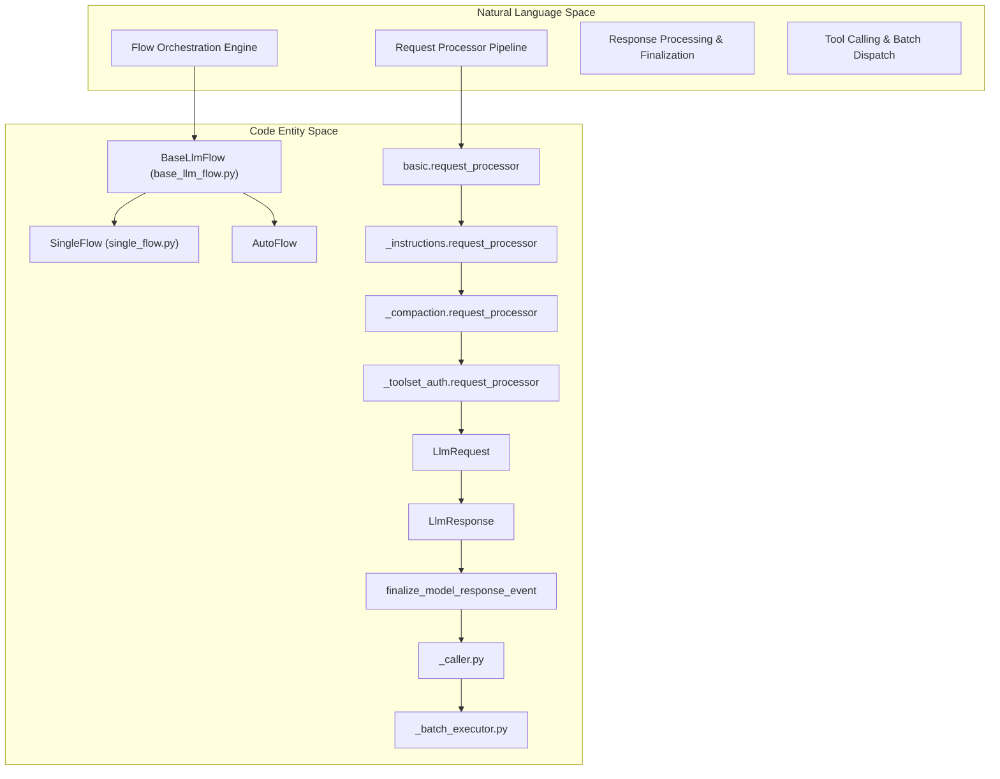
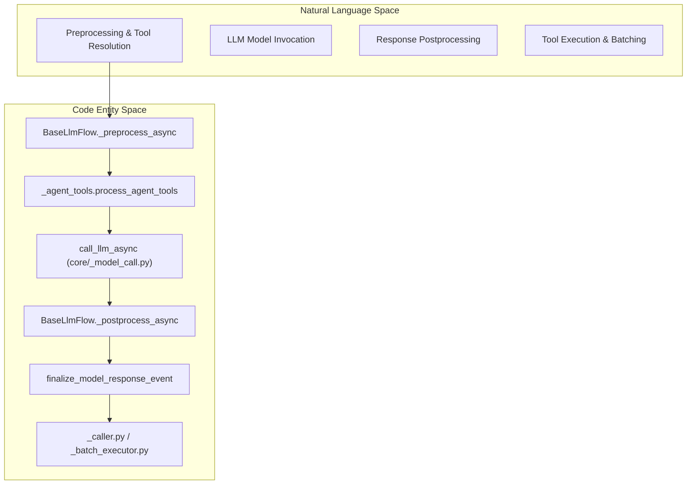
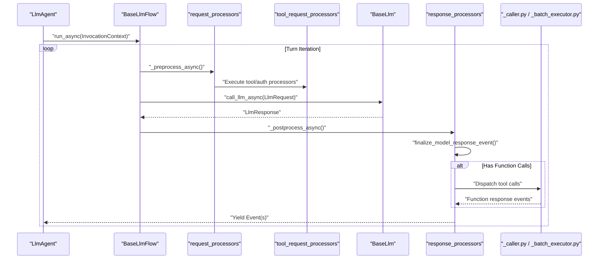

<!-- source: DeepWiki mcp.deepwiki.com · repo google/adk-python · page 4.4 LLM Flow Orchestration · fetched 2026-10-29 -->

# LLM Flow Orchestration

Relevant source files

The following files were used as context for generating this wiki page:

- [.agents/skills/adk-debug/references/failure-modes.md](.agents/skills/adk-debug/references/failure-modes.md)
- [docs/guides/plugins/reflect_retry_model_plugin/index.md](docs/guides/plugins/reflect_retry_model_plugin/index.md)
- [src/google/adk/flows/llm_flows/base_llm_flow.py](src/google/adk/flows/llm_flows/base_llm_flow.py)
- [src/google/adk/flows/llm_flows/core/_function_call_postprocessor.py](src/google/adk/flows/llm_flows/core/_function_call_postprocessor.py)
- [src/google/adk/flows/llm_flows/core/_resume.py](src/google/adk/flows/llm_flows/core/_resume.py)
- [src/google/adk/flows/llm_flows/extensions/_agent_transfer.py](src/google/adk/flows/llm_flows/extensions/_agent_transfer.py)
- [src/google/adk/flows/llm_flows/prompt/_identity.py](src/google/adk/flows/llm_flows/prompt/_identity.py)
- [src/google/adk/flows/llm_flows/prompt/_schema.py](src/google/adk/flows/llm_flows/prompt/_schema.py)
- [src/google/adk/flows/llm_flows/single_flow.py](src/google/adk/flows/llm_flows/single_flow.py)
- [src/google/adk/flows/llm_flows/tools/_batch_executor.py](src/google/adk/flows/llm_flows/tools/_batch_executor.py)
- [src/google/adk/flows/llm_flows/tools/_caller.py](src/google/adk/flows/llm_flows/tools/_caller.py)
- [src/google/adk/flows/llm_flows/tools/_confirmation.py](src/google/adk/flows/llm_flows/tools/_confirmation.py)
- [src/google/adk/flows/llm_flows/tools/_error_handler.py](src/google/adk/flows/llm_flows/tools/_error_handler.py)
- [src/google/adk/flows/llm_flows/tools/_live_caller.py](src/google/adk/flows/llm_flows/tools/_live_caller.py)
- [src/google/adk/flows/llm_flows/tools/_thread_pool.py](src/google/adk/flows/llm_flows/tools/_thread_pool.py)
- [src/google/adk/live/_cascade_live_connection.py](src/google/adk/live/_cascade_live_connection.py)
- [src/google/adk/live/_flow_utils.py](src/google/adk/live/_flow_utils.py)
- [src/google/adk/live/_live_llm_flow.py](src/google/adk/live/_live_llm_flow.py)
- [src/google/adk/plugins/_reflect_retry_model_plugin.py](src/google/adk/plugins/_reflect_retry_model_plugin.py)
- [src/google/adk/plugins/_reflect_retry_utils.py](src/google/adk/plugins/_reflect_retry_utils.py)
- [src/google/adk/plugins/reflect_retry_tool_plugin.py](src/google/adk/plugins/reflect_retry_tool_plugin.py)
- [src/google/adk/utils/_sync_runner.py](src/google/adk/utils/_sync_runner.py)
- [tests/unittests/auth/test_toolset_auth.py](tests/unittests/auth/test_toolset_auth.py)
- [tests/unittests/flows/llm_flows/core/test_function_call_postprocessor.py](tests/unittests/flows/llm_flows/core/test_function_call_postprocessor.py)
- [tests/unittests/flows/llm_flows/core/test_resume.py](tests/unittests/flows/llm_flows/core/test_resume.py)
- [tests/unittests/flows/llm_flows/prompt/test_schema.py](tests/unittests/flows/llm_flows/prompt/test_schema.py)
- [tests/unittests/flows/llm_flows/test_base_llm_flow.py](tests/unittests/flows/llm_flows/test_base_llm_flow.py)
- [tests/unittests/flows/llm_flows/test_base_llm_flow_realtime.py](tests/unittests/flows/llm_flows/test_base_llm_flow_realtime.py)
- [tests/unittests/flows/llm_flows/test_live_model_callbacks.py](tests/unittests/flows/llm_flows/test_live_model_callbacks.py)
- [tests/unittests/flows/llm_flows/tools/test_batch_executor.py](tests/unittests/flows/llm_flows/tools/test_batch_executor.py)
- [tests/unittests/flows/llm_flows/tools/test_caller.py](tests/unittests/flows/llm_flows/tools/test_caller.py)
- [tests/unittests/flows/llm_flows/tools/test_confirmation.py](tests/unittests/flows/llm_flows/tools/test_confirmation.py)
- [tests/unittests/flows/llm_flows/tools/test_functions_parallel.py](tests/unittests/flows/llm_flows/tools/test_functions_parallel.py)
- [tests/unittests/flows/llm_flows/tools/test_functions_parallel_error.py](tests/unittests/flows/llm_flows/tools/test_functions_parallel_error.py)
- [tests/unittests/flows/llm_flows/tools/test_functions_simple.py](tests/unittests/flows/llm_flows/tools/test_functions_simple.py)
- [tests/unittests/flows/llm_flows/tools/test_functions_thread_pool.py](tests/unittests/flows/llm_flows/tools/test_functions_thread_pool.py)
- [tests/unittests/flows/llm_flows/tools/test_live_caller.py](tests/unittests/flows/llm_flows/tools/test_live_caller.py)
- [tests/unittests/live/test_cascade_live_connection.py](tests/unittests/live/test_cascade_live_connection.py)
- [tests/unittests/live/test_live_llm_flow.py](tests/unittests/live/test_live_llm_flow.py)
- [tests/unittests/plugins/test_reflect_retry_model_plugin.py](tests/unittests/plugins/test_reflect_retry_model_plugin.py)
- [tests/unittests/plugins/test_reflect_retry_tool_plugin.py](tests/unittests/plugins/test_reflect_retry_tool_plugin.py)
- [tests/unittests/runners/__init__.py](tests/unittests/runners/__init__.py)
- [tests/unittests/runners/test_resume_invocation.py](tests/unittests/runners/test_resume_invocation.py)
- [tests/unittests/runners/test_run_tool_confirmation.py](tests/unittests/runners/test_run_tool_confirmation.py)
- [tests/unittests/streaming/test_live_tool_shutdown.py](tests/unittests/streaming/test_live_tool_shutdown.py)
- [tests/unittests/streaming/test_streaming.py](tests/unittests/streaming/test_streaming.py)
- [tests/unittests/utils/test_sync_runner.py](tests/unittests/utils/test_sync_runner.py)

## Purpose and Scope

LLM Flow Orchestration manages the interaction loop between agents and language models in the ADK Python framework. It handles the complete request/response cycle, including conversation history construction, request and response processors, preprocessing/postprocessing hooks, tool resolution and batch tool execution, authentication flows, compaction, streaming responses, and specialized flow types like `SingleFlow` and `AutoFlow`. This subsystem sits between the agent framework ([Agent System](#3)) and the model abstraction layer ([LLM Integration](#6)), coordinating multiple model calls, tool invocations, and state management within a single agent invocation.

For information about agent execution and runner orchestration, see [Agent Execution Lifecycle](#3.4) and [Runner](#4.1). For details on individual tool execution and toolsets, see [Tool Framework](#7.1).

Sources: `[src/google/adk/flows/llm_flows/base_llm_flow.py:94-158]`, `[src/google/adk/flows/llm_flows/single_flow.py:1-104]()`

## Architecture Overview

The flow orchestration engine is built around the `BaseLlmFlow` abstract base class `[src/google/adk/flows/llm_flows/base_llm_flow.py:94-109]`, with concrete specializations like `SingleFlow` `[src/google/adk/flows/llm_flows/single_flow.py:94-104]()` and `AutoFlow`. Flows coordinate a pipeline of request processors (`BaseLlmRequestProcessor`) and response processors (`BaseLlmResponseProcessor`) to transform agent state, conversation history, and user inputs into structured `LlmRequest` instances, invoke language models, and process incoming responses or function calls.

### System Mapping: Flow Logic to Code Entities

The following diagram bridges natural language orchestration concepts to specific classes and functions in the codebase.

Sources: `[src/google/adk/flows/llm_flows/base_llm_flow.py:94-158]`, `[src/google/adk/flows/llm_flows/single_flow.py:41-104]`, `[src/google/adk/flows/llm_flows/tools/_caller.py:1-188]()`

## BaseLlmFlow Class and Core Structure

The `BaseLlmFlow` class provides the foundation for executing agent model interactions. It maintains lists of request and response processors and manages execution state across multi-turn asynchronous runs and real-time live streaming sessions.

### Key Components

| Component | Type | Description |
|-----------|------|-------------|
| `request_processors` | `list[BaseLlmRequestProcessor]` | Pipeline components that mutate or build the outgoing `LlmRequest` `[src/google/adk/flows/llm_flows/base_llm_flow.py:110-110]()` |
| `tool_request_processors` | `list[BaseLlmRequestProcessor]` | Processors that run after `request_processors` to resolve agent toolsets and tools `[src/google/adk/flows/llm_flows/base_llm_flow.py:118-122]()` |
| `response_processors` | `list[BaseLlmResponseProcessor]` | Pipeline components that handle model responses or intermediate events `[src/google/adk/flows/llm_flows/base_llm_flow.py:124-124]()` |
| `_preprocess_async()` | Method | Orchestrates the request processor pipeline `[src/google/adk/flows/llm_flows/base_llm_flow.py:126-136]()` |
| `_postprocess_async()` | Method | Orchestrates the response processor pipeline `[src/google/adk/flows/llm_flows/base_llm_flow.py:138-158]()` |

Sources: `[src/google/adk/flows/llm_flows/base_llm_flow.py:92-158]()`

### System Mapping: Execution Lifecycle to Code Entities

Sources: `[src/google/adk/flows/llm_flows/base_llm_flow.py:92-158]`, `[src/google/adk/flows/llm_flows/tools/_caller.py:1-190]`, `[src/google/adk/flows/llm_flows/tools/_batch_executor.py:1-170]()`

### Flow Execution Sequence

Sources: `[src/google/adk/flows/llm_flows/base_llm_flow.py:92-158]`, `[src/google/adk/flows/llm_flows/tools/_caller.py:1-190]()`

## Execution Modes

### Asynchronous Mode

The asynchronous execution mode processes discrete request/response turns. Each step invokes preprocessing hooks, executes the model call, handles before/after model callbacks, and processes function calls or tool outputs iteratively until completion or interruption.

Sources: `[src/google/adk/flows/llm_flows/base_llm_flow.py:92-158]()`

### Live Streaming Mode

The live streaming mode manages bidirectional real-time sessions using `LiveRequestQueue` `[src/google/adk/live/_live_llm_flow.py:101-103]()`. It spawns concurrent read/write background tasks to stream audio, video, and text modalities. Background tool tasks started during live sessions are tracked and cleanly shut down via `stop_background_tool_tasks` upon session termination or agent handoff `[src/google/adk/live/_flow_utils.py:53-53]()`. The `send_to_model` function in `_live_llm_flow.py` handles sending various types of live requests to the LLM connection `[src/google/adk/live/_live_llm_flow.py:91-164]()`.

Sources: `[src/google/adk/live/_live_llm_flow.py:62-174]`, `[src/google/adk/live/_flow_utils.py:39-54]()`

## Request and Response Processors Pipeline

Request and response processors allow modular extension of the LLM interaction loop.

- **Request Processors (`BaseLlmRequestProcessor`)**: Each processor in the pipeline runs sequentially during preprocessing to append conversation turns, inject system instructions, apply context caching, handle compaction, or configure output schemas `[src/google/adk/flows/llm_flows/base_llm_flow.py:110-122]()`.
- **Response Processors (`BaseLlmResponseProcessor`)**: Processors that examine model outputs or intermediate chunks before final event generation. These are stored in the `response_processors` list `[src/google/adk/flows/llm_flows/base_llm_flow.py:124-124]()`.

Sources: `[src/google/adk/flows/llm_flows/base_llm_flow.py:110-124]`, `[src/google/adk/flows/llm_flows/single_flow.py:41-92]()`

## Preprocessing, Tool Resolution, and Authentication

Before dispatching an `LlmRequest` to the underlying model, preprocessing resolves agent tools and toolset authentication. The `_toolset_auth.request_processor` is part of the `tool_request_processors` list `[src/google/adk/flows/llm_flows/base_llm_flow.py:118-119]()`.

1. Iterates over agent tool unions (`agent.tools`).
2. Inspects toolsets for authentication configuration.
3. Retrieves credentials via `CredentialManager`.
4. If credentials are missing, generates an authorization request event and pauses the flow for human authorization.

Sources: `[src/google/adk/flows/llm_flows/base_llm_flow.py:118-121]()`

## Content Construction and Compaction Integration

Conversation history is assembled by content processors (`_contents.request_processor`). They respect `agent.include_contents` settings and correctly pair function calls with async function responses across providers `[src/google/adk/flows/llm_flows/single_flow.py:64-64]()`.

Compaction processors (`_compaction.request_processor`) and `LlmEventSummarizer` integrate into the request pipeline to compress lengthy conversation histories into summary events when token or turn thresholds are exceeded `[src/google/adk/flows/llm_flows/single_flow.py:60-60]()`.

Sources: `[src/google/adk/flows/llm_flows/single_flow.py:60-64]()`

## Interactions API Integration

For stateful cloud-backed sessions utilizing the Google Interactions API, the `_interactions.request_processor` is used `[src/google/adk/flows/llm_flows/single_flow.py:63-63]()`. Conversation turns are chained server-side using `previous_interaction_id` rather than sending full historical event arrays on every request.

Sources: `[src/google/adk/flows/llm_flows/single_flow.py:63-63]()`

## SingleFlow and AutoFlow Implementations

`SingleFlow` configures the standard execution pipeline for standalone `LlmAgent` instances without sub-agents `[src/google/adk/flows/llm_flows/single_flow.py:94-100]()`.

The standard request processor sequence in `SingleFlow` includes:
1. `basic.request_processor` `[src/google/adk/flows/llm_flows/single_flow.py:53-53]()`
2. `auth_preprocessor.request_processor` `[src/google/adk/flows/llm_flows/single_flow.py:54-54]()`
3. `request_confirmation.request_processor` `[src/google/adk/flows/llm_flows/single_flow.py:55-55]()`
4. `_instructions.request_processor` `[src/google/adk/flows/llm_flows/single_flow.py:56-56]()`
5. `_identity.request_processor` `[src/google/adk/flows/llm_flows/single_flow.py:57-57]()`
6. `_compaction.request_processor` `[src/google/adk/flows/llm_flows/single_flow.py:60-60]()`
7. `_interactions.request_processor` `[src/google/adk/flows/llm_flows/single_flow.py:63-63]()`
8. `_contents.request_processor` `[src/google/adk/flows/llm_flows/single_flow.py:64-64]()`
9. `_cache.request_processor` `[src/google/adk/flows/llm_flows/single_flow.py:67-67]()`
10. `_planning.request_processor` `[src/google/adk/flows/llm_flows/single_flow.py:71-71]()`
11. `_code_execution.request_processor` `[src/google/adk/flows/llm_flows/single_flow.py:74-74]()`
12. `_output_schema_processor.request_processor` `[src/google/adk/flows/llm_flows/single_flow.py:78-78]()`

`AutoFlow` extends flow orchestration to support dynamic agent routing and multi-agent hierarchies automatically.

Sources: `[src/google/adk/flows/llm_flows/single_flow.py:42-104]()`

## Tool Callers and Batch Tool Execution

When models return function or tool calls, the flow engine delegates execution to tool callers (`src/google/adk/flows/llm_flows/tools/_caller.py`) and batch tool executors (`src/google/adk/flows/llm_flows/tools/_batch_executor.py`).

- **Tool Callers (`_caller.py`)**: Handles single tool preparation, invocation, execution, thread pool dispatch for blocking synchronous tools, and response event construction `[src/google/adk/flows/llm_flows/tools/_caller.py:114-190]()`.
- **Batch Tool Execution (`_batch_executor.py`)**: Manages concurrent execution of multiple tool calls requested by the model in a single turn, optimizing latency while maintaining safe execution boundaries and tool context isolation `[src/google/adk/flows/llm_flows/tools/_batch_executor.py:62-169]()`.

Sources: `[src/google/adk/flows/llm_flows/tools/_caller.py:1-190]`, `[src/google/adk/flows/llm_flows/tools/_batch_executor.py:1-170]()`

## Callback Integration and Event Finalization

Flow execution invokes before-model and after-model callbacks (`handle_before_model_callback`, `handle_after_model_callback`) `[src/google/adk/flows/llm_flows/base_llm_flow.py:41-42]()` to allow inspection, modification, or short-circuiting of model requests and responses. Completed model responses are finalized into immutable `Event` records via `finalize_model_response_event` before being dispatched to tools or returned to the Runner `[src/google/adk/flows/llm_flows/base_llm_flow.py:40-40]()`.

Sources: `[src/google/adk/flows/llm_flows/base_llm_flow.py:40-43]()`

---

