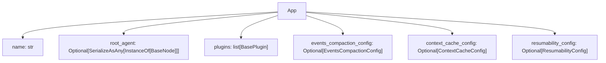
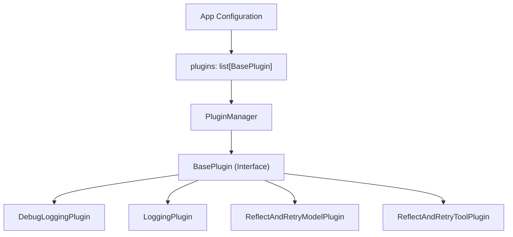
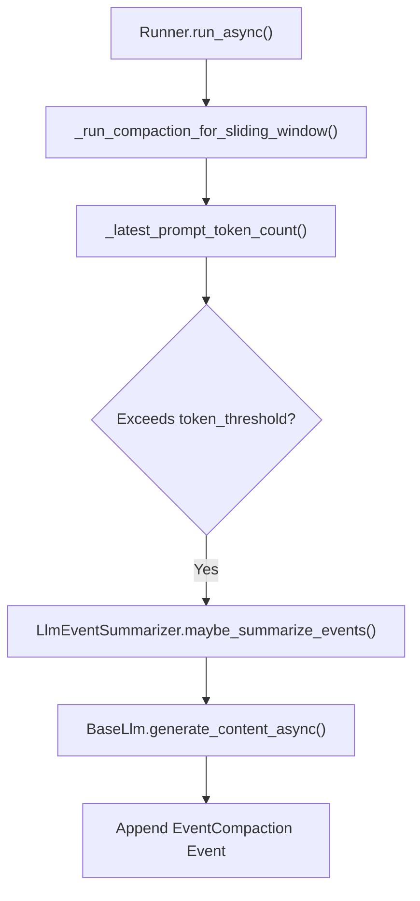
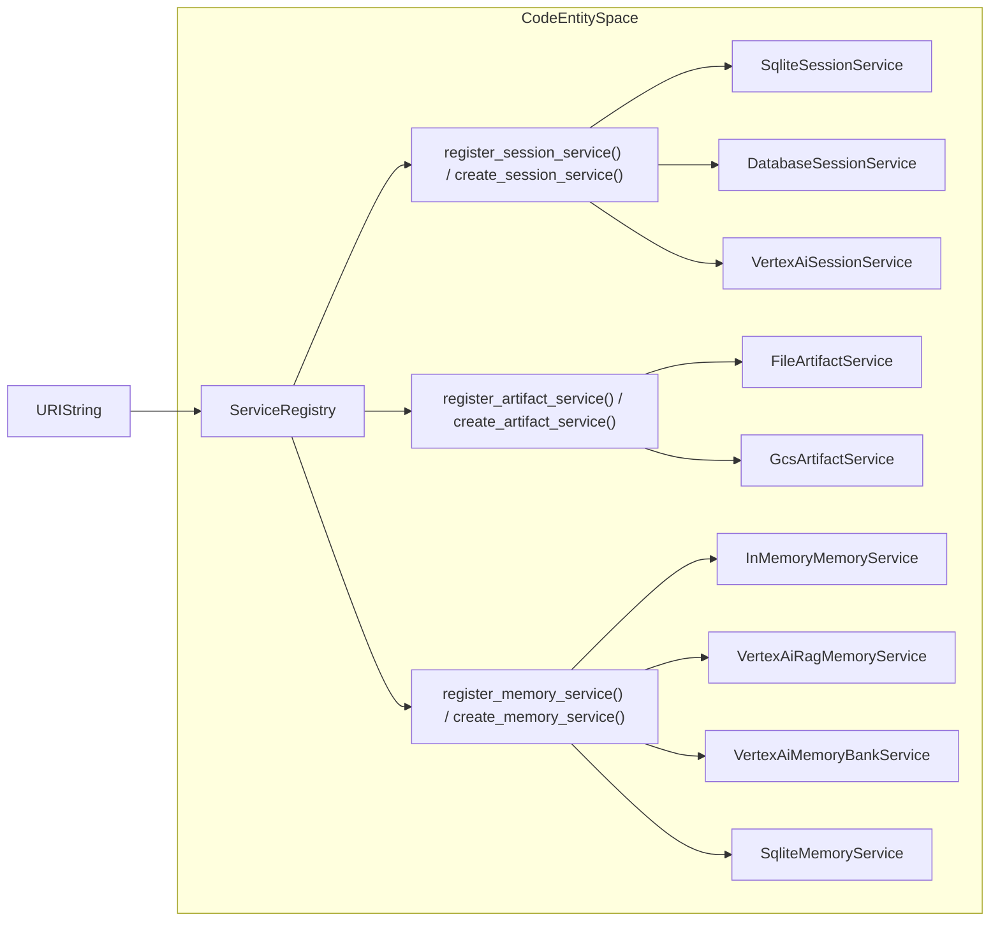

<!-- source: DeepWiki mcp.deepwiki.com · repo google/adk-python · page 4.5 App Configuration · fetched 2026-10-29 -->

# App Configuration

<details>
<summary>Relevant source files</summary>

The following files were used as context for generating this wiki page:

- [src/google/adk/apps/__init__.py](src/google/adk/apps/__init__.py)
- [src/google/adk/apps/app.py](src/google/adk/apps/app.py)
- [src/google/adk/cli/cli.py](src/google/adk/cli/cli.py)
- [src/google/adk/cli/service_registry.py](src/google/adk/cli/service_registry.py)
- [src/google/adk/cli/utils/_nested_agent_loader.py](src/google/adk/cli/utils/_nested_agent_loader.py)
- [src/google/adk/cli/utils/agent_loader.py](src/google/adk/cli/utils/agent_loader.py)
- [src/google/adk/cli/utils/base_agent_loader.py](src/google/adk/cli/utils/base_agent_loader.py)
- [src/google/adk/cli/utils/dot_adk_folder.py](src/google/adk/cli/utils/dot_adk_folder.py)
- [src/google/adk/cli/utils/local_storage.py](src/google/adk/cli/utils/local_storage.py)
- [src/google/adk/cli/utils/service_factory.py](src/google/adk/cli/utils/service_factory.py)
- [tests/unittests/apps/__init__.py](tests/unittests/apps/__init__.py)
- [tests/unittests/apps/test_apps.py](tests/unittests/apps/test_apps.py)
- [tests/unittests/cli/test_service_registry.py](tests/unittests/cli/test_service_registry.py)
- [tests/unittests/cli/utils/test_agent_loader.py](tests/unittests/cli/utils/test_agent_loader.py)
- [tests/unittests/cli/utils/test_cli.py](tests/unittests/cli/utils/test_cli.py)
- [tests/unittests/cli/utils/test_dot_adk_folder.py](tests/unittests/cli/utils/test_dot_adk_folder.py)
- [tests/unittests/cli/utils/test_local_storage.py](tests/unittests/cli/utils/test_local_storage.py)
- [tests/unittests/cli/utils/test_nested_agent_loader.py](tests/unittests/cli/utils/test_nested_agent_loader.py)
- [tests/unittests/cli/utils/test_service_factory.py](tests/unittests/cli/utils/test_service_factory.py)
- [tests/unittests/streaming/test_multi_agent_streaming.py](tests/unittests/streaming/test_multi_agent_streaming.py)

</details>


## Purpose and Scope

This document details the `App` class (`class App`) defined in `src/google/adk/apps/app.py`, which serves as the top-level container for agentic applications in ADK. The `App` instance encapsulates a root agent or node (`root_agent`), global application plugins (`plugins`), and configurations for event compaction (`events_compaction_config`), context caching (`context_cache_config`), and resumability (`resumability_config`).

Additionally, this document covers the `ServiceRegistry` (`class ServiceRegistry`) and service factory utilities located in `src/google/adk/cli/service_registry.py` and `src/google/adk/cli/utils/service_factory.py`, which manage pluggable storage backends for sessions, artifacts, and memory.

Sources: [src/google/adk/apps/app.py:53-100](), [src/google/adk/cli/service_registry.py:95-178](), [src/google/adk/cli/utils/service_factory.py:179-206]()

---

## App Class Overview and Fields

An `App` object represents an LLM-backed agentic application. It requires a unique application identifier (`name`) and exactly one execution entry point (`root_agent`) [src/google/adk/apps/app.py:69-78]().

### App Entity Relationship

Title: "AppConfigurationEntitySpace"

Sources: [src/google/adk/apps/app.py:53-100]()

### Field Specifications

| Field | Type | Description |
|-------|------|-------------|
| `name` | `str` | Identifier validated via `validate_app_name()` [src/google/adk/apps/app.py:42-51](). Must start with a letter and contain only letters, digits, underscores, and hyphens (cannot be `"user"`). |
| `root_agent` | `Optional[SerializeAsAny[InstanceOf[BaseNode]]]` | Entry point for execution, accepting any `BaseNode` instance including `BaseAgent` [src/google/adk/apps/app.py:74-78](). |
| `plugins` | `list[BasePlugin]` | Global plugin instances applied across the application lifecycle [src/google/adk/apps/app.py:80-82](). |
| `events_compaction_config` | `Optional[EventsCompactionConfig]` | Controls sliding window and token-threshold session compaction [src/google/adk/apps/app.py:83-85](). |
| `context_cache_config` | `Optional[ContextCacheConfig]` | Global LLM context caching configuration [src/google/adk/apps/app.py:86-88](). |
| `resumability_config` | `Optional[ResumabilityConfig]` | Configures pause/resume behavior for long-running executions [src/google/adk/apps/app.py:89-94](). |

Sources: [src/google/adk/apps/app.py:39-100]()

---

## Plugins

The `plugins` field in the `App` class accepts a list of `BasePlugin` instances [src/google/adk/apps/app.py:80-82](). These plugins provide shared capabilities and services across the application. The `google.adk.plugins` module defines the `BasePlugin` interface and several built-in plugin implementations [src/google/adk/apps/app.py:27-27]().

### Plugin System Overview

Title: "PluginSystemOverview"

Sources: [src/google/adk/apps/app.py:80-82]()

---

## Context Cache Configuration

The `context_cache_config` field allows global configuration for LLM context caching within the application [src/google/adk/apps/app.py:86-88](). This configuration is an instance of `ContextCacheConfig` [src/google/adk/apps/app.py:26-26](). If not provided, context caching is not enabled at the application level.

### `ContextCacheConfig` Fields

| Field | Type | Description | Default |
|---|---|---|---|
| `cache_intervals` | `int` | Number of intervals to cache. | 10 |
| `ttl_seconds` | `int` | Time-to-live for cache entries in seconds. | 1800 (30 minutes) |
| `min_tokens` | `int` | Minimum number of tokens required for caching. | 0 |

Sources: [src/google/adk/apps/app.py:86-88]()

---

## Resumability Configuration

The `resumability_config` field in the `App` class allows configuring resumability for the entire application [src/google/adk/apps/app.py:89-94](). This configuration is an instance of `ResumabilityConfig` [src/google/adk/apps/app.py:30-30](). If configured, it applies to all agents within the app [src/google/adk/apps/app.py:92-93](). By default, resumability is disabled if no `ResumabilityConfig` is provided.

### `ResumabilityConfig` Fields

| Field | Type | Description | Default |
|---|---|---|---|
| `is_resumable` | `bool` | Whether the application supports resumable invocations. | `False` |

Sources: [src/google/adk/apps/app.py:89-94]()

---

## Events Compaction Configuration

The `events_compaction_config` field allows configuring event compaction for the application [src/google/adk/apps/app.py:83-85](). This configuration is an instance of `EventsCompactionConfig` [src/google/adk/apps/app.py:29-29](). Event compaction helps manage the size of session histories by summarizing older events.

### Compaction Execution Flow

Title: "CompactionExecutionFlow"

Sources: [src/google/adk/apps/app.py:83-85]()

The `LlmEventSummarizer` formats historical events and invokes an underlying `BaseLlm` instance to generate a summarized compaction structure.

---

## Service Registry and Service Factories

ADK uses `ServiceRegistry` (`class ServiceRegistry`) in `src/google/adk/cli/service_registry.py` to register and instantiate pluggable storage backends for sessions, artifacts, and memory based on URI schemes [src/google/adk/cli/service_registry.py:95-178]().

### Service Architecture Mapping

Title: "ServiceRegistryAndFactoryMapping"

Sources: [src/google/adk/cli/service_registry.py:95-165]()

### Service Registration

Custom services can be registered in two ways:

1.  **YAML Configuration**: By creating a `services.yaml` or `services.yml` file in the agent directory. This is suitable for services instantiable with `MyService(uri="...", **kwargs)`.
    ```yaml
    services:
      - scheme: mysession
        type: session
        class: my_package.my_module.MyCustomSessionService
    ```
2.  **Python Registration**: By creating a `services.py` file in the agent directory. This allows for more complex initialization logic using factory functions.
    ```python
    from google.adk.cli.service_registry import get_service_registry
    from my_package.my_module import MyCustomSessionService

    def my_session_factory(uri: str, **kwargs):
        # custom logic
        return MyCustomSessionService(...)

    get_service_registry().register_session_service("mysession", my_session_factory)
    ```
If both `services.yaml` and `services.py` are present, services from both are loaded, with `services.py` definitions overriding YAML definitions for the same scheme [src/google/adk/cli/service_registry.py:22-61]().

The `get_service_registry()` function provides a singleton instance of `ServiceRegistry`, initializing it and registering built-in services if it's the first call [src/google/adk/cli/service_registry.py:179-185]().

Sources: [src/google/adk/cli/service_registry.py:22-61](), [src/google/adk/cli/service_registry.py:179-185]()

### Service Creation

The `ServiceRegistry` provides methods to create service instances based on a URI:
*   `create_session_service(uri: str, **kwargs: Any)`: Creates a `BaseSessionService` instance [src/google/adk/cli/service_registry.py:134-142]().
*   `create_artifact_service(uri: str, **kwargs: Any)`: Creates a `BaseArtifactService` instance [src/google/adk/cli/service_registry.py:144-152]().
*   `create_memory_service(uri: str, **kwargs: Any)`: Creates a `BaseMemoryService` instance [src/google/adk/cli/service_registry.py:154-162]().

These methods parse the scheme from the provided URI and use the corresponding registered factory to create the service [src/google/adk/cli/service_registry.py:138-164]().

The `create_session_service_from_options()` function in `src/google/adk/cli/utils/service_factory.py` is responsible for creating a session service based on CLI/web options. It first attempts to use the `ServiceRegistry` with a provided `session_service_uri`. If the registry does not support the URI scheme, it falls back to `DatabaseSessionService` [src/google/adk/cli/utils/service_factory.py:179-206](). Similarly, helper functions handle artifact and memory service creation options [src/google/adk/cli/utils/service_factory.py:290-310]().

Local storage for services is managed by `_resolve_use_local_storage()`, which determines whether to use local `.adk` storage based on environment variables (`ADK_DISABLE_LOCAL_STORAGE`, `ADK_FORCE_LOCAL_STORAGE`), runtime environment (Cloud Run, Kubernetes), and directory writability [src/google/adk/cli/utils/service_factory.py:113-152](). If local storage is disabled or unavailable, in-memory services are used as a fallback [src/google/adk/cli/utils/service_factory.py:155-177]().

Sources: [src/google/adk/cli/service_registry.py:134-162](), [src/google/adk/cli/utils/service_factory.py:113-206]()

---

