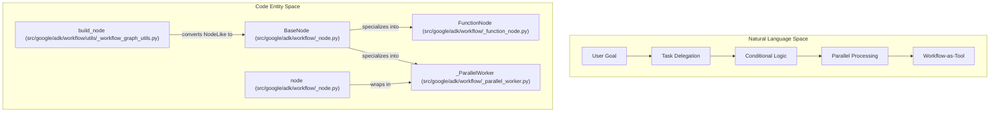
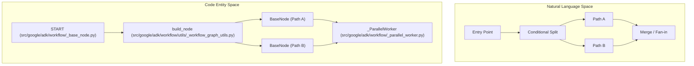

<!-- source: DeepWiki mcp.deepwiki.com · repo google/adk-python · page 5 Workflow Engine · fetched 2026-10-29 -->

# Workflow Engine

Relevant source files

The following files were used as context for generating this wiki page:

- [src/google/adk/utils/_schema_utils.py](src/google/adk/utils/_schema_utils.py)
- [src/google/adk/workflow/_function_node.py](src/google/adk/workflow/_function_node.py)
- [src/google/adk/workflow/_node.py](src/google/adk/workflow/_node.py)
- [src/google/adk/workflow/_parallel_worker.py](src/google/adk/workflow/_parallel_worker.py)
- [src/google/adk/workflow/utils/_workflow_graph_utils.py](src/google/adk/workflow/utils/_workflow_graph_utils.py)
- [tests/unittests/utils/test_schema_utils.py](tests/unittests/utils/test_schema_utils.py)
- [tests/unittests/workflow/test_function_node.py](tests/unittests/workflow/test_function_node.py)
- [tests/unittests/workflow/test_workflow.py](tests/unittests/workflow/test_workflow.py)
- [tests/unittests/workflow/test_workflow_node.py](tests/unittests/workflow/test_workflow_node.py)
- [tests/unittests/workflow/test_workflow_parallel_worker.py](tests/unittests/workflow/test_workflow_parallel_worker.py)
- [tests/unittests/workflow/utils/test_workflow_graph_utils.py](tests/unittests/workflow/utils/test_workflow_graph_utils.py)

The ADK 2.0 Workflow Engine introduces a graph-based execution model designed for complex, non-linear agent orchestration. While traditional agents often follow linear or simple hierarchical patterns, the Workflow Engine enables developers to build sophisticated systems involving conditional routing, parallel execution, cycles (loops), dynamic task scheduling, and direct YAML graph authoring.

The engine is model-agnostic and integrates directly with the runner to manage state, events, and persistence across complex multi-agent flows [src/google/adk/workflow/_node.py:189-195]().

### High-Level Architecture

The workflow system bridges the gap between discrete Python functions, LLM agents, and a structured execution graph. The following diagram illustrates how core workflow entities map to the codebase.

**Workflow Entity Mapping**

Sources: [src/google/adk/workflow/_node.py:86-195](), [src/google/adk/workflow/_parallel_worker.py:67-78](), [src/google/adk/workflow/utils/_workflow_graph_utils.py:45-84]()

---

### Workflow Core Concepts
The foundation of the engine is the node abstraction (`BaseNode`), `@node` decorator, and workflow container models that allow workflows to be nested hierarchically [src/google/adk/workflow/_node.py:189-195](). The engine uses robust state management and runner integration to coordinate execution.

For details, see [Workflow Core Concepts](#5.1).
Sources: [src/google/adk/workflow/_node.py:189-195]()

### Node Types
Nodes are the functional units of a workflow. The ADK provides several specialized node implementations and wrappers to handle function execution, agent encapsulation, parallel workers, and tool invocation [src/google/adk/workflow/_parallel_worker.py:67-78](), [src/google/adk/workflow/utils/_workflow_graph_utils.py:45-84]().

For details, see [Node Types](#5.2).
Sources: [src/google/adk/workflow/_parallel_worker.py:67-78](), [src/google/adk/workflow/utils/_workflow_graph_utils.py:45-84]()

### Graph Definition and Routing
Graphs are compiled from edge definitions and validated during initialization [src/google/adk/workflow/utils/_workflow_graph_utils.py:45-84](). The engine supports entry points, routing values, conditional branching, and graph parsers.

**Routing and Graph Definition Mapping**

Sources: [src/google/adk/workflow/utils/_workflow_graph_utils.py:45-84](), [src/google/adk/workflow/_parallel_worker.py:67-78]()

For details, see [Graph Definition and Routing](#5.3).
Sources: [src/google/adk/workflow/utils/_workflow_graph_utils.py:45-84]()

### Dynamic Nodes and Scheduling
Beyond static graphs, the engine supports runtime scheduling via `ctx.run_node()` and parallel workers that fan out execution across lists of items [src/google/adk/workflow/_parallel_worker.py:113-162](). The `_ParallelWorker` handles concurrent task creation, result aggregation, and error/interrupt propagation [src/google/adk/workflow/_parallel_worker.py:131-193]().

For details, see [Dynamic Nodes and Scheduling](#5.4).
Sources: [src/google/adk/workflow/_parallel_worker.py:113-193]()

### Retry, Timeout, and Resilience
To ensure production-grade reliability, the engine handles error states, retry configurations, timeouts, and recovery flags [src/google/adk/workflow/_node.py:86-98](). Nodes can specify custom retry policies and timeouts during definition or via the `@node` decorator [src/google/adk/workflow/_node.py:86-98]().

For details, see [Retry, Timeout, and Resilience](#5.5).
Sources: [src/google/adk/workflow/_node.py:86-98]()

### Workflow Execution Infrastructure
The engine features a robust execution infrastructure utilizing node runners, state tracking, triggers, and replay mechanisms to handle session rehydration and state persistence [src/google/adk/workflow/_parallel_worker.py:67-78]().

For details, see [Workflow Execution Infrastructure](#5.6).
Sources: [src/google/adk/workflow/_parallel_worker.py:67-78]()

### Workflow HITL and Agent Transfer
Workflows support Human-in-the-Loop (HITL) patterns, tool confirmations, and authentication interrupts via integration with request input events and resume utilities [src/google/adk/workflow/_function_node.py:38-59]().

For details, see [Workflow HITL and Agent Transfer](#5.7).
Sources: [src/google/adk/workflow/_function_node.py:38-59]()

---

