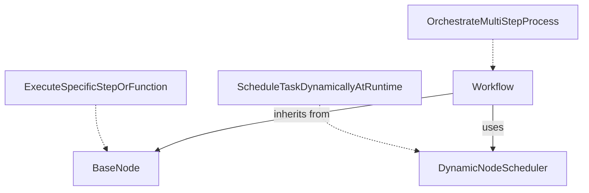
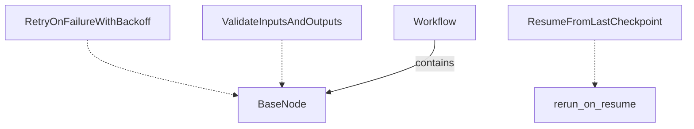
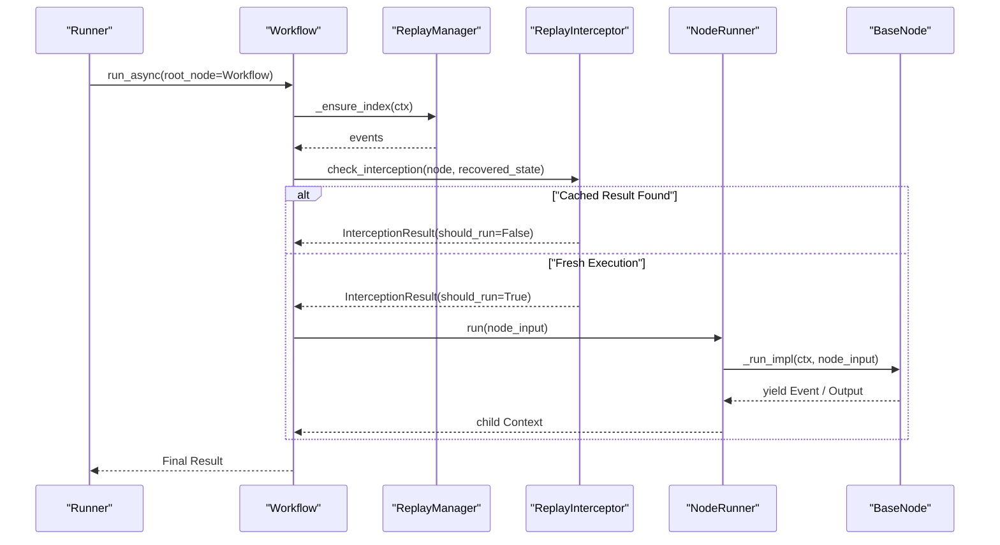

<!-- source: DeepWiki mcp.deepwiki.com · repo google/adk-python · page 5.1 Workflow Core Concepts · fetched 2026-10-29 -->

# Workflow Core Concepts

Relevant source files

The following files were used as context for generating this wiki page:

- [.agents/skills/adk-architecture/references/architecture-node-runner.md](.agents/skills/adk-architecture/references/architecture-node-runner.md)
- [docs/guides/workflow/dynamic_nodes/index.md](docs/guides/workflow/dynamic_nodes/index.md)
- [docs/guides/workflow/function_node/index.md](docs/guides/workflow/function_node/index.md)
- [docs/guides/workflow/graph/index.md](docs/guides/workflow/graph/index.md)
- [docs/guides/workflow/retry_config/index.md](docs/guides/workflow/retry_config/index.md)
- [docs/guides/workflow/workflow/index.md](docs/guides/workflow/workflow/index.md)
- [src/google/adk/utils/_schema_utils.py](src/google/adk/utils/_schema_utils.py)
- [src/google/adk/workflow/_base_node.py](src/google/adk/workflow/_base_node.py)
- [src/google/adk/workflow/_function_node.py](src/google/adk/workflow/_function_node.py)
- [src/google/adk/workflow/_node.py](src/google/adk/workflow/_node.py)
- [src/google/adk/workflow/_node_runner.py](src/google/adk/workflow/_node_runner.py)
- [src/google/adk/workflow/_parallel_worker.py](src/google/adk/workflow/_parallel_worker.py)
- [src/google/adk/workflow/utils/_workflow_graph_utils.py](src/google/adk/workflow/utils/_workflow_graph_utils.py)
- [tests/unittests/utils/test_schema_utils.py](tests/unittests/utils/test_schema_utils.py)
- [tests/unittests/workflow/test_dynamic_use_as_output.py](tests/unittests/workflow/test_dynamic_use_as_output.py)
- [tests/unittests/workflow/test_function_node.py](tests/unittests/workflow/test_function_node.py)
- [tests/unittests/workflow/test_node_runner_ctx.py](tests/unittests/workflow/test_node_runner_ctx.py)
- [tests/unittests/workflow/test_node_runner_failure.py](tests/unittests/workflow/test_node_runner_failure.py)
- [tests/unittests/workflow/test_workflow.py](tests/unittests/workflow/test_workflow.py)
- [tests/unittests/workflow/test_workflow_dynamic_nodes.py](tests/unittests/workflow/test_workflow_dynamic_nodes.py)
- [tests/unittests/workflow/test_workflow_node.py](tests/unittests/workflow/test_workflow_node.py)
- [tests/unittests/workflow/test_workflow_parallel_worker.py](tests/unittests/workflow/test_workflow_parallel_worker.py)
- [tests/unittests/workflow/test_workflow_routes.py](tests/unittests/workflow/test_workflow_routes.py)
- [tests/unittests/workflow/utils/test_workflow_graph_utils.py](tests/unittests/workflow/utils/test_workflow_graph_utils.py)

The Workflow engine in ADK 2.0 introduces a graph-based execution model for orchestrating non-linear, conditional, and cyclical agent and task workflows. This document covers the foundational architecture of the `Workflow` class, `BaseNode` [src/google/adk/workflow/_base_node.py:46-48](), `@node` decorator, graph execution mechanics, `Runner` integration, and validation rules enforcing graph-first execution semantics.

Sources: [src/google/adk/workflow/_workflow.py:15-19](), [src/google/adk/workflow/_base_node.py:46-50]()

---

## Graph-Based Execution Model

Workflows are modeled as directed graphs where nodes represent discrete units of work (such as functions, LLM agents, tools, or sub-workflows) and edges define transition paths, branching logic, and dependencies.

### Key Workflow Entities

| Entity | Description | File Reference |
| :--- | :--- | :--- |
| `Workflow` | The top-level graph container managing execution state, scheduling, and lifecycle loops via `_run_impl()`. | [src/google/adk/workflow/_workflow.py:136-143]() |
| `BaseNode` | Abstract base class defining the execution interface for all graph-compatible components. | [src/google/adk/workflow/_base_node.py:46-50]() |
| `DynamicNodeScheduler` | Manages dynamic node execution via `ctx.run_node()`, handling caching, resumption, and deduplication. | [src/google/adk/workflow/_dynamic_node_scheduler.py:142-161]() |

Title: Natural Language to Code Entity Mapping (Graph Architecture)

Sources: [src/google/adk/workflow/_workflow.py:136-143](), [src/google/adk/workflow/_base_node.py:46-50](), [src/google/adk/workflow/_dynamic_node_scheduler.py:142-161]()

---

## The BaseNode and @node Decorator

All execution components within a workflow graph must inherit from `BaseNode`. Python functions can be transformed into executable graph nodes using the `@node` decorator.

### Core Properties of BaseNode
*   **Validation**: Pydantic-backed validation for input and output schemas using `_validate_input_data()` and `_validate_output_data()` [src/google/adk/workflow/_base_node.py:157-163]().
*   **Resilience**: Configurable retry mechanisms via `RetryConfig` and execution `timeout` bounds [src/google/adk/workflow/_base_node.py:91-118]().
*   **Resumption Control**: `rerun_on_resume` determines whether interrupted nodes re-execute from scratch or fast-forward using cached states upon session resumption [src/google/adk/workflow/_base_node.py:69-78]().
*   **Name Validation**: Node names are strictly validated as valid Python identifiers during initialization [src/google/adk/workflow/_base_node.py:55-64]().

Title: Natural Language to Code Entity Mapping (Execution Controls)

Sources: [src/google/adk/workflow/_workflow.py:136-171](), [src/google/adk/workflow/_base_node.py:46-170]()

---

## Workflow Integration with Runner

The `Runner` acts as the stateless orchestration engine supporting both `BaseAgent` and `BaseNode` (including `Workflow` graphs) as root execution targets.

### Invocation Lifecycle
When executing a workflow, the runtime coordinates through several structured phases managed by `NodeRunner` and `Workflow._run_impl()`:
1.  **Rehydration**: Historical events are scanned and reconstructed into node states using `ReplayManager._ensure_index()` [src/google/adk/workflow/utils/_replay_manager.py:53-70]().
2.  **Execution Loop**: The workflow evaluates triggers, schedules ready nodes through node runners, and monitors concurrency limits (`max_concurrency`) [src/google/adk/workflow/_workflow.py:152-171]().
3.  **Interception**: `check_interception()` inspects whether a node should execute natively or replay cached outputs and routes based on `_ChildScanState` [src/google/adk/workflow/utils/_replay_interceptor.py:57-62]().
4.  **Context Propagation**: Child execution contexts maintain isolated `node_path` and `run_id` namespaces [src/google/adk/agents/context.py]()

Title: Runner and Workflow Interaction

Sources: [src/google/adk/workflow/_workflow.py:136-171](), [src/google/adk/workflow/utils/_replay_manager.py:53-70](), [src/google/adk/workflow/utils/_replay_interceptor.py:57-62]()

---

