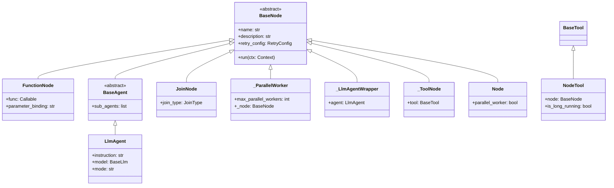
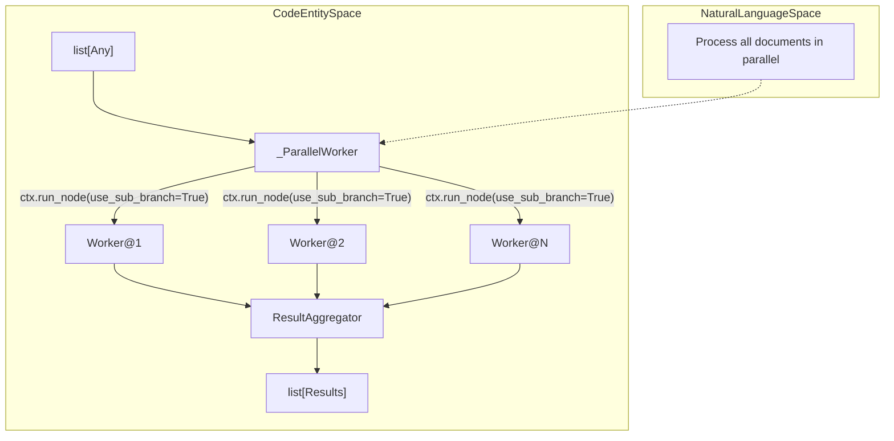
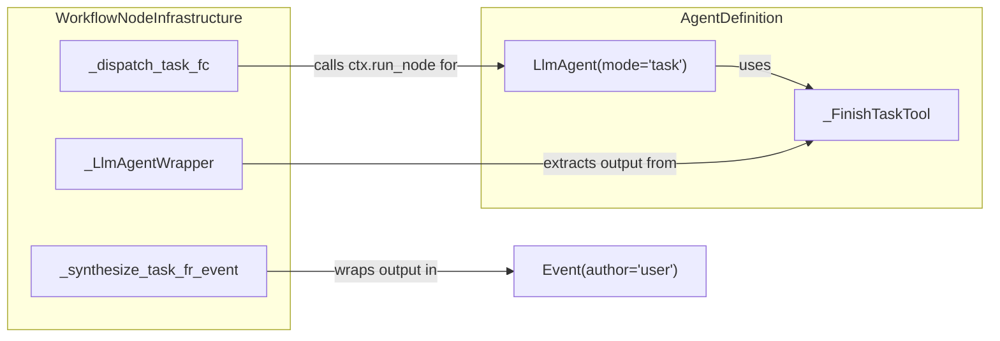
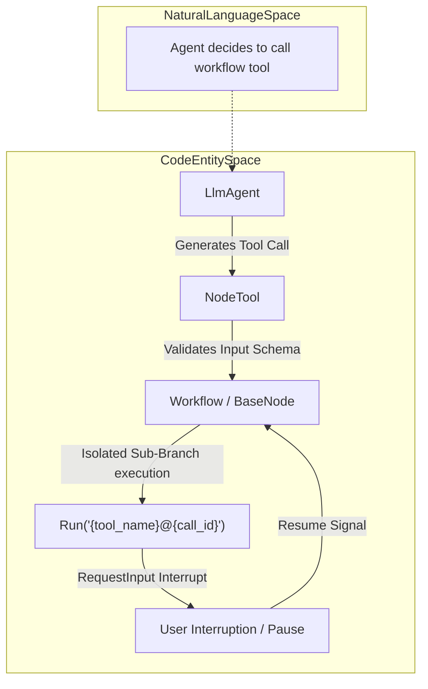

<!-- source: DeepWiki mcp.deepwiki.com · repo google/adk-python · page 5.2 Node Types · fetched 2026-10-29 -->

# Node Types

Relevant source files

The following files were used as context for generating this wiki page:

- [.agents/skills/adk-sample-creator/SKILL.md](.agents/skills/adk-sample-creator/SKILL.md)
- [contributing/samples/multi_agent/single_turn_sub_agent/README.md](contributing/samples/multi_agent/single_turn_sub_agent/README.md)
- [contributing/samples/multi_agent/task_sub_agent/README.md](contributing/samples/multi_agent/task_sub_agent/README.md)
- [contributing/samples/tools/function_tools/README.md](contributing/samples/tools/function_tools/README.md)
- [contributing/samples/tools/function_tools/agent.py](contributing/samples/tools/function_tools/agent.py)
- [docs/guides/agents/llm_agent/index.md](docs/guides/agents/llm_agent/index.md)
- [docs/guides/agents/llm_agent/single_turn.md](docs/guides/agents/llm_agent/single_turn.md)
- [docs/guides/tools/function_tool/index.md](docs/guides/tools/function_tool/index.md)
- [docs/guides/tools/node_tool/index.md](docs/guides/tools/node_tool/index.md)
- [docs/guides/workflow/join_node/index.md](docs/guides/workflow/join_node/index.md)
- [docs/guides/workflow/parallel_worker/index.md](docs/guides/workflow/parallel_worker/index.md)
- [src/google/adk/agents/context.py](src/google/adk/agents/context.py)
- [src/google/adk/tools/_node_tool.py](src/google/adk/tools/_node_tool.py)
- [src/google/adk/utils/__init__.py](src/google/adk/utils/__init__.py)
- [src/google/adk/utils/_schema_utils.py](src/google/adk/utils/_schema_utils.py)
- [src/google/adk/utils/agent_info.py](src/google/adk/utils/agent_info.py)
- [src/google/adk/utils/instructions_utils.py](src/google/adk/utils/instructions_utils.py)
- [src/google/adk/workflow/_function_node.py](src/google/adk/workflow/_function_node.py)
- [src/google/adk/workflow/_join_node.py](src/google/adk/workflow/_join_node.py)
- [src/google/adk/workflow/_node.py](src/google/adk/workflow/_node.py)
- [src/google/adk/workflow/_parallel_worker.py](src/google/adk/workflow/_parallel_worker.py)
- [src/google/adk/workflow/utils/_workflow_graph_utils.py](src/google/adk/workflow/utils/_workflow_graph_utils.py)
- [tests/unittests/agents/test_context.py](tests/unittests/agents/test_context.py)
- [tests/unittests/runners/test_runner_node.py](tests/unittests/runners/test_runner_node.py)
- [tests/unittests/utils/test_agent_info.py](tests/unittests/utils/test_agent_info.py)
- [tests/unittests/utils/test_schema_utils.py](tests/unittests/utils/test_schema_utils.py)
- [tests/unittests/workflow/test_dynamic_node_executor.py](tests/unittests/workflow/test_dynamic_node_executor.py)
- [tests/unittests/workflow/test_function_node.py](tests/unittests/workflow/test_function_node.py)
- [tests/unittests/workflow/test_join_node.py](tests/unittests/workflow/test_join_node.py)
- [tests/unittests/workflow/test_node_tool.py](tests/unittests/workflow/test_node_tool.py)
- [tests/unittests/workflow/test_workflow.py](tests/unittests/workflow/test_workflow.py)
- [tests/unittests/workflow/test_workflow_node.py](tests/unittests/workflow/test_workflow_node.py)
- [tests/unittests/workflow/test_workflow_parallel_worker.py](tests/unittests/workflow/test_workflow_parallel_worker.py)
- [tests/unittests/workflow/utils/test_workflow_graph_utils.py](tests/unittests/workflow/utils/test_workflow_graph_utils.py)

The ADK workflow engine represents execution logic as a graph of interconnected nodes. Every node in the graph must inherit from `BaseNode` [src/google/adk/workflow/_base_node.py:39-40](). This architecture supports specialized node types ranging from simple Python function wrappers to complex multi-agent orchestrators and "Workflow-as-Tool" integrations with strict input schema validation and Human-in-the-Loop (HITL) resumption.

## Core Node Class Hierarchy

The following diagram illustrates the relationship between the base classes and the concrete node implementations available in the SDK.

### Node Type Class Diagram

Sources: [src/google/adk/workflow/_base_node.py:39-40](), [src/google/adk/agents/base_agent.py:93-93](), [src/google/adk/agents/llm_agent.py:198-198](), [src/google/adk/workflow/_parallel_worker.py:35-41](), [src/google/adk/workflow/_node.py:180-180](), [src/google/adk/tools/_node_tool.py:29-30](), [src/google/adk/workflow/_llm_agent_wrapper.py:34-34]()

---

## FunctionNode and the @node Decorator

The standard mechanism for defining custom execution logic is wrapping a Python callable via `FunctionNode` or the `@node` decorator [src/google/adk/workflow/_function_node.py:35-36]().

### FunctionNode
`FunctionNode` wraps standard Python functions or coroutines [src/google/adk/workflow/_function_node.py:99-99](). It supports two parameter binding strategies governed by `parameter_binding` [src/google/adk/workflow/_function_node.py:121-127]():
*   **`'state'` (default):** Binds parameters from `ctx.state` [src/google/adk/workflow/_function_node.py:123-123]().
*   **`'node_input'`:** Binds parameters from the incoming `node_input` dictionary and infers `input_schema` and `output_schema` from the function signature [src/google/adk/workflow/_function_node.py:124-127]().

Type coercions are automatically applied via `TypeAdapter` [src/google/adk/workflow/_function_node.py:101-101]():
*   `dict` to Pydantic `BaseModel` when the annotation is a Pydantic model [src/google/adk/workflow/_function_node.py:103-103]().
*   `types.Content` to `str` when the annotation expects `str` [src/google/adk/workflow/_function_node.py:106-107]().

### @node Decorator
The `@node` decorator serves as a factory helper that transforms plain Python functions into `FunctionNode` instances [src/google/adk/workflow/_node.py:91-128](). It allows declarative configuration of parameters such as `name`, `rerun_on_resume`, and `retry_config` directly on the function [src/google/adk/workflow/_node.py:109-113]().

Sources: [src/google/adk/workflow/_function_node.py:35-177](), [src/google/adk/workflow/_node.py:91-128]()

---

## JoinNode (Fan-in Synchronization)

`JoinNode` synchronizes multiple incoming execution paths in a graph topology. It acts as an execution barrier enforcing synchronization semantics before allowing downstream nodes to execute:
*   **Wait For All:** Blocks until every upstream node pointing to the join node completes [src/google/adk/workflow/_join_node.py:40-40]().
*   **Wait For Any:** Triggers execution immediately upon completion of the first incoming upstream node [src/google/adk/workflow/_join_node.py:40-40]().

The `wait_for_output` property controls whether intermediate states are gathered or deferred [src/google/adk/workflow/_join_node.py:40-40]().

Sources: [src/google/adk/workflow/_join_node.py:40-40]()

---

## _ParallelWorker (Fan-out)

The `_ParallelWorker` executes a wrapped node concurrently across an input collection [src/google/adk/workflow/_parallel_worker.py:36-41]().

### Parallel Execution Flow

Sources: [src/google/adk/workflow/_parallel_worker.py:35-135]()

### Key Behaviors:
*   **Concurrency Control:** Configurable via `max_parallel_workers` to limit active task execution [src/google/adk/workflow/_parallel_worker.py:95-98]().
*   **Ordering:** Gathers output lists maintaining original input sequencing [src/google/adk/workflow/_parallel_worker.py:89-135]().
*   **Fail-Fast Semantics:** If any parallel branch raises an exception, pending tasks are cancelled and the exception is propagated [src/google/adk/workflow/_parallel_worker.py:121-129]().

Sources: [src/google/adk/workflow/_parallel_worker.py:35-135]()

---

## _LlmAgentWrapper (LlmAgent as a Workflow Node)

ADK integrates agent logic into graph workflows by treating `BaseAgent` as a subclass of `BaseNode` [src/google/adk/agents/base_agent.py:93-93]().

### _LlmAgentWrapper and build_node
When an `LlmAgent` is referenced inside a workflow, `build_node` wraps it via `_LlmAgentWrapper` [src/google/adk/workflow/utils/_workflow_graph_utils.py:116-149]().
*   **Mode Handling:** Standalone agents default to `single_turn`, while sub-agents default to `chat` [src/google/adk/workflow/utils/_workflow_graph_utils.py:126-131]().
*   **Task Mode Synchronization:** For `task` mode agents, the engine sets `wait_for_output = True` [src/google/adk/workflow/utils/_workflow_graph_utils.py:136-137]().
*   **Validation:** Inputs are validated against strict schemas using `validate_schema` [src/google/adk/workflow/_llm_agent_wrapper.py:33-33]().

### Agent-to-Node Mapping

Sources: [src/google/adk/agents/base_agent.py:93-93](), [src/google/adk/workflow/_llm_agent_wrapper.py:34-210](), [src/google/adk/workflow/utils/_workflow_graph_utils.py:116-149]()

### Key Capabilities:
*   **Input Conversion:** Converts workflow input parameters into `types.Content` structures consumable by the underlying LLM [src/google/adk/workflow/_llm_agent_wrapper.py:35-35]().
*   **Task Delegation:** Tracks pending sub-task states across workflow resumption cycles via `_find_unresolved_task_delegations` [src/google/adk/workflow/_llm_agent_wrapper.py:161-166]().
*   **Task Completion:** Monitors `finish_task` function calls to finalize agent node execution states [src/google/adk/workflow/_llm_agent_wrapper.py:45-56]().

Sources: [src/google/adk/agents/base_agent.py:93-93](), [src/google/adk/workflow/_llm_agent_wrapper.py:34-210](), [src/google/adk/workflow/utils/_workflow_graph_utils.py:116-149]()

---

## Specialized Node Types

### _ToolNode
`_ToolNode` wraps any ADK `BaseTool` implementation so it can be invoked directly as a standalone node within a workflow graph [src/google/adk/workflow/_tool_node.py:69-70](). This enables deterministic execution of tool logic outside an agent reasoning loop [src/google/adk/workflow/_tool_node.py:93-101]().

### NodeTool
`NodeTool` wraps a `BaseNode` or an entire `Workflow` graph, exposing it as an LLM-callable tool via automatic schema inference [src/google/adk/tools/_node_tool.py:38-39]().
*   **Schema Alignment:** Dynamically derives function calling parameters from the node's schema definitions [src/google/adk/tools/_node_tool.py:69-74]().
*   **HITL Resumption:** Supports deep Human-in-the-Loop interruptions. If the underlying workflow suspends on `RequestInput`, `NodeTool` propagates the interruption upstream, pausing the execution runner until user resumption messages arrive [src/google/adk/tools/_node_tool.py:155-157]().

### Tool Wrapping Architecture

Sources: [src/google/adk/workflow/_base_node.py:75-112](), [src/google/adk/tools/_node_tool.py:38-157]()

### Node Class for Subclassing
The base `Node` class provides a foundation for custom subclassing, supporting integrated configuration like `parallel_worker` via Pydantic model fields [src/google/adk/workflow/_node.py:180-188]().

### Resilience and Validation
All node types inherit enterprise resilience capabilities from `BaseNode`:
*   **Validation:** Utilizes Pydantic `TypeAdapter` against `input_schema` and `output_schema` [src/google/adk/workflow/_base_node.py:93-112]().
*   **Retry and Timeout:** Implements exponential backoff via `RetryConfig` [src/google/adk/workflow/_base_node.py:75-80]() and strict execution duration enforcement via `timeout` fields [src/google/adk/workflow/_base_node.py:83-88]().

Sources: [src/google/adk/workflow/_base_node.py:75-112](), [src/google/adk/workflow/_node.py:180-202](), [src/google/adk/workflow/_tool_node.py:69-187](), [src/google/adk/tools/_node_tool.py:38-157]()

---

