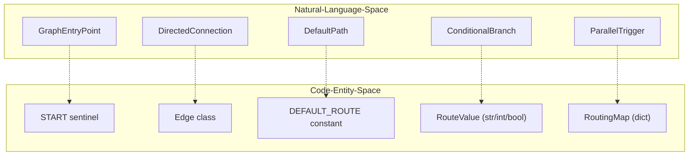
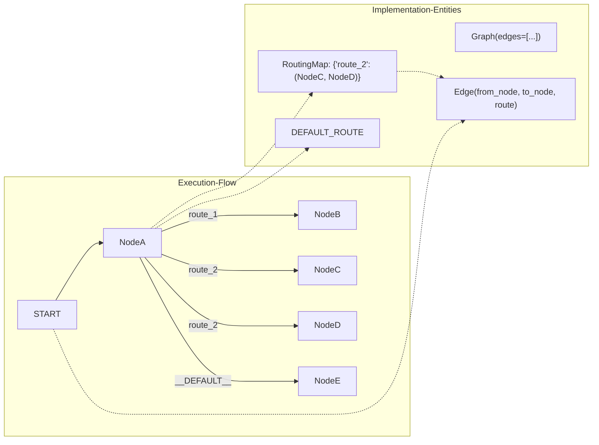
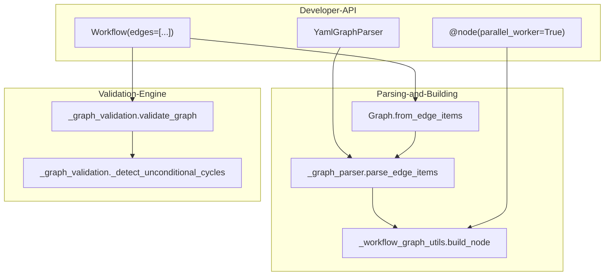

<!-- source: DeepWiki mcp.deepwiki.com · repo google/adk-python · page 5.3 Graph Definition and Routing · fetched 2026-10-29 -->

# Graph Definition and Routing

Relevant source files

The following files were used as context for generating this wiki page:

- [.agents/skills/adk-agent-builder/references/routing-and-conditions.md](.agents/skills/adk-agent-builder/references/routing-and-conditions.md)
- [docs/guides/labs/classifiers/classifier_node/index.md](docs/guides/labs/classifiers/classifier_node/index.md)
- [src/google/adk/labs/classifiers/__init__.py](src/google/adk/labs/classifiers/__init__.py)
- [src/google/adk/labs/classifiers/_classifier_node.py](src/google/adk/labs/classifiers/_classifier_node.py)
- [src/google/adk/labs/classifiers/_llm_classifier.py](src/google/adk/labs/classifiers/_llm_classifier.py)
- [src/google/adk/workflow/_graph.py](src/google/adk/workflow/_graph.py)
- [src/google/adk/workflow/utils/_graph_parser.py](src/google/adk/workflow/utils/_graph_parser.py)
- [src/google/adk/workflow/utils/_graph_validation.py](src/google/adk/workflow/utils/_graph_validation.py)
- [tests/unittests/labs/classifiers/test_classifier_node.py](tests/unittests/labs/classifiers/test_classifier_node.py)
- [tests/unittests/labs/classifiers/test_llm_classifier.py](tests/unittests/labs/classifiers/test_llm_classifier.py)
- [tests/unittests/workflow/test_graph.py](tests/unittests/workflow/test_graph.py)
- [tests/unittests/workflow/utils/test_graph_parser.py](tests/unittests/workflow/utils/test_graph_parser.py)
- [tests/unittests/workflow/utils/test_graph_validation.py](tests/unittests/workflow/utils/test_graph_validation.py)

This page details the mechanisms for defining non-linear execution patterns within the ADK 2.0 Workflow engine. It covers the construction of execution graphs using core classes (`Graph`, `Edge`, `RouteValue`, `RoutingMap`), special sentinels (`START`, `DEFAULT_ROUTE`), conditional routing and fan-out semantics, graph validation rules, and the YAML graph parser.

Sources: [src/google/adk/workflow/_graph.py:1-194](), [src/google/adk/workflow/utils/_graph_validation.py:1-198]()

---

## Graph Architecture and Core Entities

The ADK Workflow engine utilizes a directed graph structure where nodes represent units of work (Agents, Tools, or Functions) and edges represent the flow of control and data.

### Core Entities

| Class / Symbol | Purpose |
| :--- | :--- |
| `Graph` | The container for the entire workflow structure, holding nodes and their connections [src/google/adk/workflow/_graph.py:96-108](). |
| `Edge` | Defines a directed connection between two nodes, optionally associated with a specific route [src/google/adk/workflow/_graph.py:59-78](). |
| `RouteValue` | Type alias for valid routing values: `bool | int | str` [src/google/adk/workflow/_graph.py:38-39](). |
| `RoutingMap` | A dictionary mapping `RouteValue` keys to destination nodes or tuples of nodes for fan-out [src/google/adk/workflow/_graph.py:46-56](). |
| `START` | A sentinel value used to indicate the entry point of the graph [src/google/adk/workflow/_base_node.py:25]() (referenced in [src/google/adk/workflow/_graph.py:41-43]()). |
| `DEFAULT_ROUTE` | A fallback route (`__DEFAULT__`) used when no specific named route matches [src/google/adk/workflow/_graph.py:91](). |
| `NodeLike` | Type alias for objects that can be converted to nodes: `BaseNode`, `BaseTool`, `Callable`, or `"START"` [src/google/adk/workflow/_graph.py:41-43](). |

### Code-to-System Mapping: Graph Structure

Title: "Graph Entity Mapping"

Sources: [src/google/adk/workflow/_graph.py:38-91](), [src/google/adk/workflow/_base_node.py:20-30]()

---

## Defining the Graph and Parsing

Graphs are defined by providing a list of `Edge` objects or `EdgeItem` chains to the `Graph` or `Workflow` class [src/google/adk/workflow/_graph.py:116-121](). The parsing system translates edge items, tuples, and YAML declarations into formal `Edge` instances via `parse_edge_items` [src/google/adk/workflow/utils/_graph_parser.py:197-209]().

### Node Coercion and Wrapping
The `build_node` utility automatically wraps various types into `BaseNode` implementations [src/google/adk/workflow/utils/_graph_parser.py:103-124]():
*   **Functions**: Wrapped in `FunctionNode`.
*   **Tools**: Wrapped in `_ToolNode` (or unwrapped if a `NodeTool`).
*   **Agents**: `LlmAgent` instances are cloned and configured.

### YAML Graph Authoring
ADK 2.0 supports authoring graph workflows directly in YAML configuration files. The YAML parser parses edge descriptions and routing maps into `EdgeItem` chains, which are then passed to `Graph.from_edge_items()` [src/google/adk/workflow/_graph.py:116-121]() to materialize the execution graph.

Sources: [src/google/adk/workflow/_graph.py:116-121](), [src/google/adk/workflow/utils/_graph_parser.py:103-124](), [src/google/adk/workflow/utils/_graph_parser.py:197-209]()

---

## Conditional Routing and Fan-Out

Routing is determined by the `get_next_pending_nodes` method, which matches emitted routes against defined edges [src/google/adk/workflow/_graph.py:138-188]().

*   **RoutingMap**: Allows defining multiple routes in a single dictionary. If the destination value is a `tuple` of nodes, it triggers a **fan-out**, where all nodes in the tuple are scheduled simultaneously [src/google/adk/workflow/_graph.py:46-56]().
*   **DEFAULT_ROUTE**: If a node returns a value that doesn't match any specific route, the engine follows the edge marked with `DEFAULT_ROUTE` (`__DEFAULT__`) [src/google/adk/workflow/_graph.py:145-179]().
*   **Unconditional Edges**: Edges with no route tag (`route=None`) are always triggered when the source node completes [src/google/adk/workflow/_graph.py:151-154]().

Title: "Routing and Fan-Out Logic"

Sources: [src/google/adk/workflow/_graph.py:46-188]()

---

## Graph Validation

The `validate_graph` utility performs rigorous integrity checks to ensure the workflow graph is executable and free of structural errors [src/google/adk/workflow/utils/_graph_validation.py:30-198]().

1.  **START Presence**: Ensures the `START` sentinel exists in the node set [src/google/adk/workflow/utils/_graph_validation.py:84-90]().
2.  **Reachability**: Performs a breadth-first search (BFS) from `START` to verify that every node is reachable and that `START` has no incoming edges [src/google/adk/workflow/utils/_graph_validation.py:93-120]().
3.  **Cycle Detection**: Detects unconditional cycles (infinite loops consisting entirely of edges with `route=None`) via depth-first search [src/google/adk/workflow/utils/_graph_validation.py:30-64]().
4.  **Unique Names**: Validates that all node names are unique to prevent state tracking collisions [src/google/adk/workflow/utils/_graph_validation.py:66-81]().
5.  **Route Integrity**: Ensures a node has correct route definitions and that `DEFAULT_ROUTE` is not combined with other routes in a list [src/google/adk/workflow/utils/_graph_validation.py:165-175]().
6.  **Schema Validation**: Validates static schema compatibility between a source node's `output_schema` and a destination node's `input_schema` [src/google/adk/workflow/utils/_graph_validation.py:177-190]().
7.  **Chat Agent Wiring**: Validates that `LlmAgent` nodes configured in chat mode satisfy appropriate incoming edge constraints [src/google/adk/workflow/utils/_graph_validation.py:192-198]().

Sources: [src/google/adk/workflow/utils/_graph_validation.py:30-198](), [src/google/adk/workflow/_graph.py:190-194]()

---

## Code Entity Association

This diagram bridges the conceptual graph definition to the internal utility functions that handle parsing, building, and validation.

Title: "Graph Definition Utilities"

Sources: [src/google/adk/workflow/_graph.py:116-121](), [src/google/adk/workflow/utils/_graph_parser.py:103-124](), [src/google/adk/workflow/utils/_graph_validation.py:30-198]()

---

