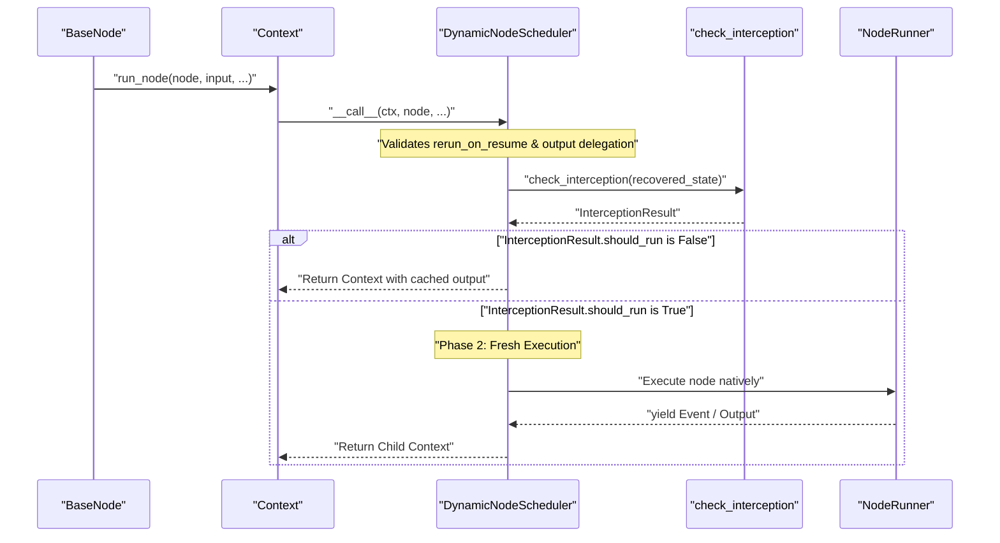
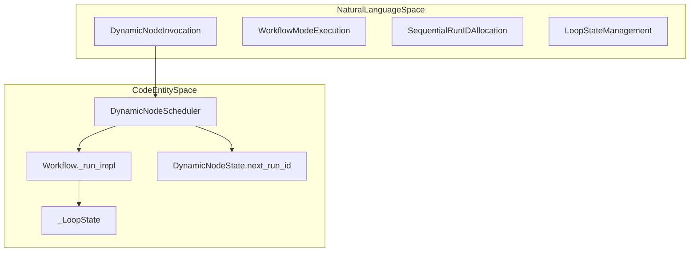
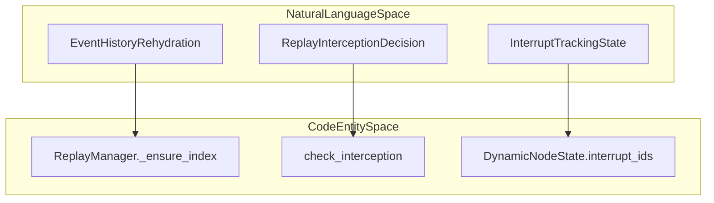

<!-- source: DeepWiki mcp.deepwiki.com · repo google/adk-python · page 5.4 Dynamic Nodes and Scheduling · fetched 2026-10-29 -->

# Dynamic Nodes and Scheduling

Relevant source files

The following files were used as context for generating this wiki page:

- [src/google/adk/events/_isolation_scope.py](src/google/adk/events/_isolation_scope.py)
- [src/google/adk/workflow/_dynamic_node_scheduler.py](src/google/adk/workflow/_dynamic_node_scheduler.py)
- [src/google/adk/workflow/_workflow.py](src/google/adk/workflow/_workflow.py)
- [src/google/adk/workflow/utils/_rehydration_utils.py](src/google/adk/workflow/utils/_rehydration_utils.py)
- [src/google/adk/workflow/utils/_replay_interceptor.py](src/google/adk/workflow/utils/_replay_interceptor.py)
- [src/google/adk/workflow/utils/_replay_manager.py](src/google/adk/workflow/utils/_replay_manager.py)
- [tests/unittests/workflow/test_dynamic_node_scheduler.py](tests/unittests/workflow/test_dynamic_node_scheduler.py)
- [tests/unittests/workflow/test_workflow_hitl.py](tests/unittests/workflow/test_workflow_hitl.py)
- [tests/unittests/workflow/utils/test_rehydration_utils.py](tests/unittests/workflow/utils/test_rehydration_utils.py)
- [tests/unittests/workflow/utils/test_replay_interceptor.py](tests/unittests/workflow/utils/test_replay_interceptor.py)
- [tests/unittests/workflow/utils/test_replay_manager.py](tests/unittests/workflow/utils/test_replay_manager.py)

This page covers the mechanisms for runtime node scheduling within the ADK 2.0 Workflow engine. Unlike static graph definitions where edges are fixed at design time, dynamic scheduling allows a node to programmatically dispatch other nodes during execution. This is primarily facilitated via `ctx.run_node()`, the `DynamicNodeScheduler`, the dynamic node execution engine, and replay interceptors [src/google/adk/workflow/_dynamic_node_scheduler.py:15-20]().

## Dynamic Node Execution Overview

Dynamic scheduling allows workflows to adapt to runtime data. For example, a supervisor node might analyze a user request and decide to schedule multiple specialized worker nodes that were not explicitly linked in the initial graph topology.

The `InvocationContext` (via the `Context` wrapper) provides the `run_node` method as the primary interface [src/google/adk/workflow/_dynamic_node_scheduler.py:17-20](). When a node invokes `ctx.run_node()`, it delegates to the active scheduler or execution routine [src/google/adk/workflow/_dynamic_node_scheduler.py:17-20]().

### Core Components

| Component | Description | File Pointer |
| :--- | :--- | :--- |
| `ctx.run_node()` | The runtime method used by a node to schedule another node. | [src/google/adk/workflow/_dynamic_node_scheduler.py:17-20]() |
| `DynamicNodeScheduler` | Service that manages the lifecycle (dedup, resume, execution) of dynamic nodes. | [src/google/adk/workflow/_dynamic_node_scheduler.py:15-20]() |
| `DynamicNodeState` | Base class for tracking dynamic node runs, tasks, and interrupts. | [src/google/adk/workflow/_dynamic_node_scheduler.py:91-130]() |
| `DynamicNodeRun` | Data class combining `NodeState`, cached output, and the active `asyncio.Task`. | [src/google/adk/workflow/_dynamic_node_scheduler.py:62-89]() |
| `check_interception` | Determines whether a node should be run natively or fast-forwarded from cached event history. | [src/google/adk/workflow/utils/_replay_interceptor.py:57-179]() |
| `ReplayManager` | Unified orchestrator for event rehydration, interception, and sequence barriers. | [src/google/adk/workflow/utils/_replay_manager.py:36-48]() |

Sources: [src/google/adk/workflow/_dynamic_node_scheduler.py:15-130](), [src/google/adk/workflow/utils/_replay_interceptor.py:57-179](), [src/google/adk/workflow/utils/_replay_manager.py:36-48]()

## The `ctx.run_node()` Protocol and Scheduler

The dynamic node invocation protocol is established via `DynamicNodeScheduler` and its state tracking utilities [src/google/adk/workflow/_dynamic_node_scheduler.py:15-20](). It supports deduplication of cached outputs, lazy event scanning for resumption, and fresh execution of nodes [src/google/adk/workflow/_dynamic_node_scheduler.py:17-20]().

### Sequence Diagram: Dynamic Dispatch & Execution Flow
This diagram illustrates the flow from a node calling `ctx.run_node()` to the scheduler and the dynamic node executor.

Sources: [src/google/adk/workflow/_dynamic_node_scheduler.py:15-20](), [src/google/adk/workflow/utils/_replay_interceptor.py:57-179]()

## Dynamic Node Executor and Orchestration Modes

The dynamic node executor coordinates execution across different context structures and loop states, such as `_LoopState` within `Workflow` [src/google/adk/workflow/_workflow.py:71-137](). The scheduler manages lifecycle tasks including deduplication, resumption, sequential run ID allocation via `DynamicNodeState.next_run_id()`, and graph-aware state tracking [src/google/adk/workflow/_dynamic_node_scheduler.py:91-130]().

### Code Mapping: Dynamic Execution Architecture

This diagram maps high-level scheduling concepts to their specific code entities in the codebase.

Sources: [src/google/adk/workflow/_dynamic_node_scheduler.py:91-130](), [src/google/adk/workflow/_workflow.py:71-137]()

## Deduplication, Rehydration, and Interception

When resuming an interrupted session or evaluating a previously visited dynamic node, the `DynamicNodeScheduler` performs lazy rehydration by scanning session event history [src/google/adk/workflow/_dynamic_node_scheduler.py:17-20](). This process is managed by `ReplayManager._ensure_index()` which ensures event indexes are up-to-date [src/google/adk/workflow/utils/_replay_manager.py:54-90]().

### Replay Interception Logic
The `check_interception` function evaluates the historical state (`_ChildScanState`) and returns an `InterceptionResult` covering several cases [src/google/adk/workflow/utils/_replay_interceptor.py:34-179]():

1.  **Same-Turn Completed / Waiting:** Bypasses execution if the dynamic node already completed or blocked in the current turn [src/google/adk/workflow/utils/_replay_interceptor.py:74-94]().
2.  **Cross-Turn Unresolved Interrupts:** If interrupts remain unresolved, the node either remains waiting or reruns natively with `resume_inputs` if `rerun_on_resume` is enabled [src/google/adk/workflow/utils/_replay_interceptor.py:113-122]().
3.  **Cross-Turn Failure:** If a prior turn failed, execution is re-attempted rather than replayed as a no-op [src/google/adk/workflow/utils/_replay_interceptor.py:123-129]().
4.  **Cross-Turn Successful Completion (Fast-Forward):** Bypasses execution entirely, returning cached outputs and routes [src/google/adk/workflow/utils/_replay_interceptor.py:130-139]().

### Code Mapping: State and Rehydration Subsystems

Sources: [src/google/adk/workflow/_dynamic_node_scheduler.py:91-130](), [src/google/adk/workflow/utils/_replay_interceptor.py:34-179](), [src/google/adk/workflow/utils/_replay_manager.py:54-90]()

## Resumption from Interrupts & Error Propagation

When a dynamic node encounters an interrupt (e.g., waiting for tool confirmation or long-running input), the execution layer catches interruptions and bubble-ups [src/google/adk/workflow/_dynamic_node_scheduler.py:108-120]().

-   **Interrupt Propagation:** Child interrupt IDs are bubbled up to the parent container's `interrupt_ids` collection so that node runners correctly mark parent nodes as `WAITING` [src/google/adk/workflow/_dynamic_node_scheduler.py:108-120]().
-   **Error Propagation:** Unhandled dynamic node failures raise `DynamicNodeFailError`, capturing the failing node path and exception details [src/google/adk/workflow/_errors.py:40-40]().
-   **Idempotency Requirement:** Because resumed failed or interrupted nodes re-run when waking up from session state, node bodies must be designed to be idempotent [src/google/adk/workflow/utils/_replay_interceptor.py:113-129]().

Sources: [src/google/adk/workflow/_dynamic_node_scheduler.py:108-120](), [src/google/adk/workflow/_errors.py:40-40](), [src/google/adk/workflow/utils/_replay_interceptor.py:113-129]()

---

