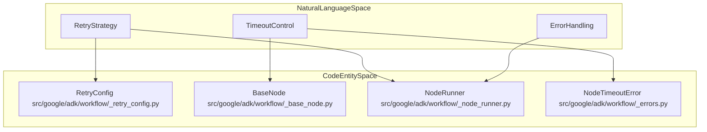
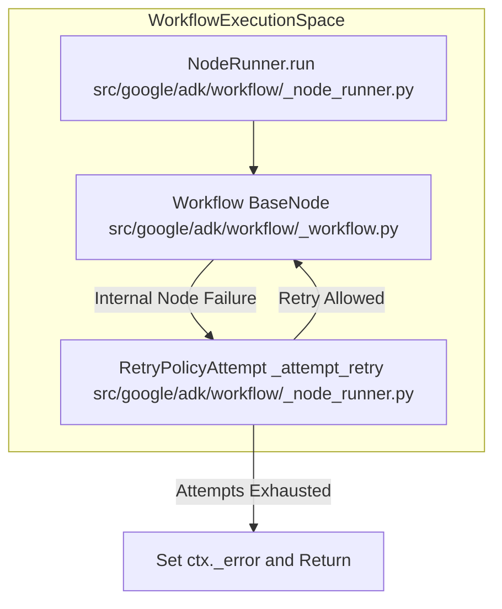

<!-- source: DeepWiki mcp.deepwiki.com · repo google/adk-python · page 5.5 Retry, Timeout, and Resilience · fetched 2026-10-29 -->

# Retry, Timeout, and Resilience

Relevant source files

The following files were used as context for generating this wiki page:

- [.agents/skills/adk-architecture/references/architecture-node-runner.md](.agents/skills/adk-architecture/references/architecture-node-runner.md)
- [docs/guides/workflow/dynamic_nodes/index.md](docs/guides/workflow/dynamic_nodes/index.md)
- [docs/guides/workflow/function_node/index.md](docs/guides/workflow/function_node/index.md)
- [docs/guides/workflow/graph/index.md](docs/guides/workflow/graph/index.md)
- [docs/guides/workflow/retry_config/index.md](docs/guides/workflow/retry_config/index.md)
- [docs/guides/workflow/workflow/index.md](docs/guides/workflow/workflow/index.md)
- [src/google/adk/workflow/_base_node.py](src/google/adk/workflow/_base_node.py)
- [src/google/adk/workflow/_node_runner.py](src/google/adk/workflow/_node_runner.py)
- [tests/unittests/workflow/test_dynamic_use_as_output.py](tests/unittests/workflow/test_dynamic_use_as_output.py)
- [tests/unittests/workflow/test_node_runner_ctx.py](tests/unittests/workflow/test_node_runner_ctx.py)
- [tests/unittests/workflow/test_node_runner_failure.py](tests/unittests/workflow/test_node_runner_failure.py)
- [tests/unittests/workflow/test_workflow_bytes.py](tests/unittests/workflow/test_workflow_bytes.py)
- [tests/unittests/workflow/test_workflow_dynamic_nodes.py](tests/unittests/workflow/test_workflow_dynamic_nodes.py)
- [tests/unittests/workflow/test_workflow_failures.py](tests/unittests/workflow/test_workflow_failures.py)
- [tests/unittests/workflow/test_workflow_nested.py](tests/unittests/workflow/test_workflow_nested.py)
- [tests/unittests/workflow/test_workflow_node_timeout.py](tests/unittests/workflow/test_workflow_node_timeout.py)
- [tests/unittests/workflow/test_workflow_routes.py](tests/unittests/workflow/test_workflow_routes.py)
- [tests/unittests/workflow/workflow_testing_utils.py](tests/unittests/workflow/workflow_testing_utils.py)

This page details the resilience mechanisms within the ADK 2.0 Workflow engine. It covers node-level retry strategies with exponential backoff and jitter, nested workflow retry behavior, timeout controls, `NodeTimeoutError`, cancellation handling, and session resumption requirements where failed nodes re-run, requiring node bodies to be strictly idempotent.

## Overview

In complex multi-agent workflows, individual execution nodes (such as LLM generation steps, tool invocations, or custom Python functions) may fail due to transient network conditions, rate limits, or downstream infrastructure instability. ADK provides a robust architecture to manage these failures through `RetryConfig`, timeout controls, and structured error handling integrated directly into `BaseNode` and coordinated by `NodeRunner` `[src/google/adk/workflow/_base_node.py:91-118]()`, `[src/google/adk/workflow/_node_runner.py:83-186]()`.

### Resilience Entity Mapping
The following diagram bridges natural language resilience concepts to concrete code entities in the codebase.

**Resilience Entity Mapping**

Sources: `[src/google/adk/workflow/_base_node.py:91-118]()`, `[src/google/adk/workflow/_node_runner.py:83-186]()`

---

## Retry Configuration and Exponential Backoff

Node-level retries are governed by `RetryConfig`, a Pydantic model attachable to any `BaseNode` via the `retry_config` field `[src/google/adk/workflow/_base_node.py:91-107]()`.

### RetryConfig Attributes
| Attribute | Type | Default | Description |
| :--- | :--- | :--- | :--- |
| `max_attempts` | `int \| None` | `5` | Maximum number of attempts, including the original request. Explicit `0` or `1` disables retries. |
| `initial_delay` | `float \| None` | `1.0` | Initial delay before the first retry, in seconds. |
| `max_delay` | `float \| None` | `60.0` | Maximum delay between retries, in seconds. |
| `backoff_factor` | `float \| None` | `2.0` | Multiplier by which delay increases after each failed attempt. |
| `jitter` | `float \| None` | `1.0` | Randomness factor for delay distribution. Set to `0.0` for deterministic delays. |
| `exceptions` | `list[str \| type[BaseException]] \| None` | `None` | Target exceptions or class name strings to retry on. `None` matches all exceptions `[docs/guides/workflow/retry_config/index.md:61]()`. |

Sources: `[src/google/adk/workflow/_base_node.py:91-107]()`, `[docs/guides/workflow/retry_config/index.md:52-62]()`

### Delay Calculation and Jitter Math
When a node fails, ADK computes the backoff duration `[docs/guides/workflow/retry_config/index.md:44-45]()`. To prevent the "thundering herd" phenomenon without clumping overshooting retries at `max_delay`, ADK caps the base delay *before* applying jitter `[docs/guides/workflow/retry_config/index.md:45]()`. The formula for the base delay is:

$$\text{delay} = \text{initial\_delay} \times \text{backoff\_factor}^{\text{attempt\_count} - 1}$$

If `jitter > 0.0`, the delay is capped at $\frac{\text{max\_delay}}{1 + \text{jitter}}$, a uniform random offset in $[-\text{jitter} \times \text{delay}, +\text{jitter} \times \text{delay}]$ is added, and the final result is clamped to be non-negative and capped at `max_delay` `[docs/guides/workflow/retry_config/index.md:45]()`.

Sources: `[docs/guides/workflow/retry_config/index.md:38-47]()`

---

## Nested Workflow Retry and Propagation

Because a `Workflow` inherits from `BaseNode`, it can itself be assigned a `RetryConfig` `[docs/guides/workflow/retry_config/index.md:83-85]()`. When any node inside a nested workflow fails, that failure propagates to the workflow boundary `[src/google/adk/workflow/_node_runner.py:170-176]()`. If the nested `Workflow` has a `retry_config`, the entire sub-workflow is re-run `[docs/guides/workflow/retry_config/index.md:83-85]()`. Children within the sub-workflow that previously completed successfully and yielded state changes or outputs are replayed rather than re-executed from scratch `[src/google/adk/workflow/_base_node.py:97-105]()`.

### Workflow Retry Execution Flow

Sources: `[src/google/adk/workflow/_node_runner.py:143-186]()`, `[src/google/adk/workflow/_base_node.py:91-107]()`

---

## Timeouts and Cancellation

Nodes support a `timeout` property specifying a maximum execution duration in seconds `[src/google/adk/workflow/_base_node.py:109-118]()`.

*   If a node exceeds its configured `timeout`, execution is cancelled, raising a `NodeTimeoutError` `[src/google/adk/workflow/_base_node.py:109-118]()`.
*   Timeouts integrate directly with `retry_config`: a timed-out node can be retried automatically if `NodeTimeoutError` (or a base exception category) is included in its retry policy exceptions list `[src/google/adk/workflow/_base_node.py:109-118]()`.

Sources: `[src/google/adk/workflow/_base_node.py:109-118]()`, `[.agents/skills/adk-architecture/references/architecture-node-runner.md:72-75]()`

---

## Resumption, Re-run, and Idempotency

Workflow execution state is persistent and resumable. However, session resumption and error recovery introduce specific execution guarantees for node bodies.

*   **Re-run on Resume:** Resumed failed nodes re-run from scratch rather than resuming midway through an uncompleted generator frame `[src/google/adk/workflow/_base_node.py:69-78]()`. The `rerun_on_resume` property on `BaseNode` controls this behavior `[src/google/adk/workflow/_base_node.py:69-78]()`.
*   **Idempotency Requirement:** Because failed nodes and resumed nodes re-run, **node bodies must be idempotent** (safe to execute multiple times with identical inputs without duplicating external side effects or mutating state incorrectly) `[src/google/adk/workflow/_base_node.py:69-78]()`. This is particularly important for tool execution and sub-workflows where partial state changes are replayed.

Sources: `[src/google/adk/workflow/_base_node.py:69-78]()`, `[.agents/skills/adk-architecture/references/architecture-node-runner.md:76-80]()`

---

