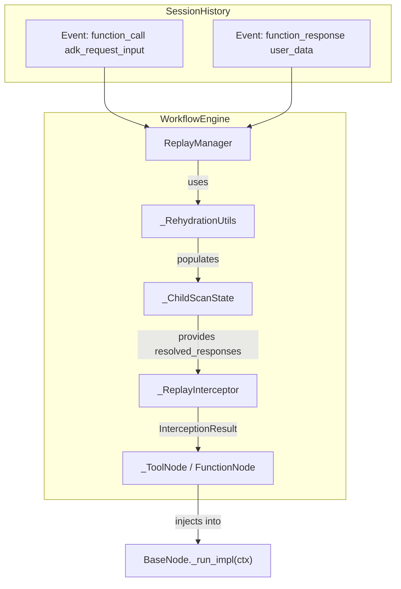
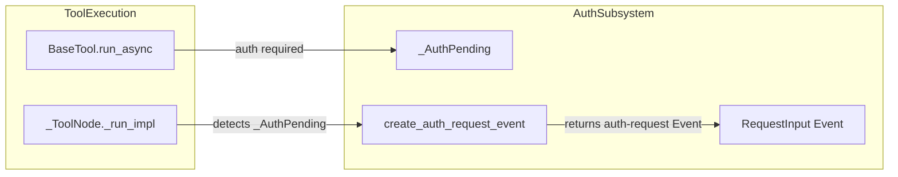
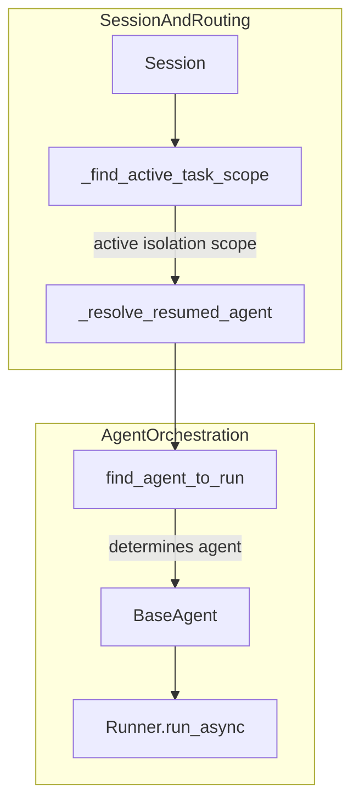

<!-- source: DeepWiki mcp.deepwiki.com · repo google/adk-python · page 5.7 Workflow HITL and Agent Transfer · fetched 2026-10-29 -->

# Workflow HITL and Agent Transfer

Relevant source files

The following files were used as context for generating this wiki page:

- [src/google/adk/agents/_agent_router.py](src/google/adk/agents/_agent_router.py)
- [src/google/adk/auth/_auth_resume.py](src/google/adk/auth/_auth_resume.py)
- [src/google/adk/auth/auth_credential.py](src/google/adk/auth/auth_credential.py)
- [src/google/adk/auth/auth_handler.py](src/google/adk/auth/auth_handler.py)
- [src/google/adk/auth/auth_preprocessor.py](src/google/adk/auth/auth_preprocessor.py)
- [src/google/adk/auth/exchanger/oauth2_credential_exchanger.py](src/google/adk/auth/exchanger/oauth2_credential_exchanger.py)
- [src/google/adk/auth/oauth2_credential_util.py](src/google/adk/auth/oauth2_credential_util.py)
- [src/google/adk/auth/refresher/oauth2_credential_refresher.py](src/google/adk/auth/refresher/oauth2_credential_refresher.py)
- [src/google/adk/events/_abort_events.py](src/google/adk/events/_abort_events.py)
- [src/google/adk/runners.py](src/google/adk/runners.py)
- [src/google/adk/workflow/_node_runner_utils.py](src/google/adk/workflow/_node_runner_utils.py)
- [src/google/adk/workflow/_tool_node.py](src/google/adk/workflow/_tool_node.py)
- [src/google/adk/workflow/utils/_transfer_utils.py](src/google/adk/workflow/utils/_transfer_utils.py)
- [src/google/adk/workflow/utils/_workflow_hitl_utils.py](src/google/adk/workflow/utils/_workflow_hitl_utils.py)
- [tests/unittests/agents/test_agent_router.py](tests/unittests/agents/test_agent_router.py)
- [tests/unittests/agents/test_llm_agent_interruptions.py](tests/unittests/agents/test_llm_agent_interruptions.py)
- [tests/unittests/agents/test_resumable_llm_agent.py](tests/unittests/agents/test_resumable_llm_agent.py)
- [tests/unittests/auth/exchanger/test_oauth2_credential_exchanger.py](tests/unittests/auth/exchanger/test_oauth2_credential_exchanger.py)
- [tests/unittests/auth/refresher/test_oauth2_credential_refresher.py](tests/unittests/auth/refresher/test_oauth2_credential_refresher.py)
- [tests/unittests/auth/test_auth_credential.py](tests/unittests/auth/test_auth_credential.py)
- [tests/unittests/auth/test_auth_handler.py](tests/unittests/auth/test_auth_handler.py)
- [tests/unittests/auth/test_auth_preprocessor.py](tests/unittests/auth/test_auth_preprocessor.py)
- [tests/unittests/auth/test_auth_resume.py](tests/unittests/auth/test_auth_resume.py)
- [tests/unittests/auth/test_oauth2_credential_util.py](tests/unittests/auth/test_oauth2_credential_util.py)
- [tests/unittests/events/test_abort_events.py](tests/unittests/events/test_abort_events.py)
- [tests/unittests/test_runners.py](tests/unittests/test_runners.py)
- [tests/unittests/workflow/test_agent_transfer.py](tests/unittests/workflow/test_agent_transfer.py)
- [tests/unittests/workflow/test_node_runner_utils.py](tests/unittests/workflow/test_node_runner_utils.py)
- [tests/unittests/workflow/test_tool_node.py](tests/unittests/workflow/test_tool_node.py)
- [tests/unittests/workflow/test_workflow_agent_as_node.py](tests/unittests/workflow/test_workflow_agent_as_node.py)
- [tests/unittests/workflow/test_workflow_function_tool_as_node.py](tests/unittests/workflow/test_workflow_function_tool_as_node.py)
- [tests/unittests/workflow/test_workflow_live.py](tests/unittests/workflow/test_workflow_live.py)
- [tests/unittests/workflow/test_workflow_rewind.py](tests/unittests/workflow/test_workflow_rewind.py)
- [tests/unittests/workflow/test_workflow_schema.py](tests/unittests/workflow/test_workflow_schema.py)
- [tests/unittests/workflow/utils/test_transfer_utils.py](tests/unittests/workflow/utils/test_transfer_utils.py)
- [tests/unittests/workflow/utils/test_workflow_hitl_utils.py](tests/unittests/workflow/utils/test_workflow_hitl_utils.py)

## Purpose and Scope

The workflow Human-in-the-Loop (HITL) and agent transfer subsystems provide mechanisms to pause workflow execution when human input or external authorization is required, securely manage end-user credentials (EUC), and transition control between distinct agent nodes or workflows. This page details the internal classes, event models, data flows, and rehydration utilities that make stateful resumption and multi-agent coordination possible.

Sources: [src/google/adk/workflow/utils/_workflow_hitl_utils.py:15-16]()

---

## Human-in-the-Loop (HITL) Lifecycle

ADK workflows support HITL via a Request-Interrupt-Resume lifecycle. This is primarily driven by the `RequestInput` event model and internal rehydration utilities that manage session state across turns.

### RequestInput Event Model
The `RequestInput` model signals that a workflow or node requires external information before it can proceed. This is typically emitted as a `function_call` event with the name `adk_request_input`.

*   **Implementation**: Defined in `src/google/adk/events/request_input.py`.
*   **Function Name**: `REQUEST_INPUT_FUNCTION_CALL_NAME = 'adk_request_input'` [src/google/adk/workflow/utils/_workflow_hitl_utils.py:32]().
*   **Structure**: Includes a message for the user, an optional payload, and a `response_schema` to validate the user's reply.

Sources: [src/google/adk/workflow/utils/_workflow_hitl_utils.py:28-35]()

### Interrupt and Resume Flow
When a node requires input, it yields a `RequestInput` event. The orchestration engine detects this and pauses execution.

1.  **Interrupt**: A node or `_ToolNode` checks preconditions, handles user confirmation via `apply_confirmation_resume` [src/google/adk/workflow/utils/_workflow_hitl_utils.py:76-82](), and yields `RequestInput` when approval is needed [src/google/adk/workflow/_tool_node.py:154-156]().
2.  **Event Generation**: `create_request_input_event` converts the `RequestInput` object into a model-role `Event` containing a `function_call` [src/google/adk/workflow/utils/_workflow_hitl_utils.py:105-127]().
3.  **Persistence**: The interruption is recorded in the session history, with `long_running_tool_ids` tracking active interrupts [src/google/adk/workflow/utils/_workflow_hitl_utils.py:126]().
4.  **Resume**: The user provides input via a `function_response` part, created using `create_request_input_response`, which matches the original `interrupt_id` [src/google/adk/workflow/utils/_workflow_hitl_utils.py:130-150]().
5.  **Rehydration**: Upon restart, rehydration utilities scan history to match `function_response` events to their `function_call` counterparts.

Sources: [src/google/adk/workflow/utils/_workflow_hitl_utils.py:76-150](), [src/google/adk/workflow/_tool_node.py:154-156]()

### Data Flow: HITL Rehydration
The following diagram illustrates how the system bridges stored events and the resumed execution context using core code entities.

Title: "Workflow Rehydration and HITL Mapping"

Sources: [src/google/adk/workflow/utils/_workflow_hitl_utils.py:105-150](), [src/google/adk/workflow/_tool_node.py:93-101]()

---

## Credential Requests and End-User Credentials (EUC)

End-User Credentials (EUC) represent a specialized form of HITL where a tool requires authentication (e.g., OAuth2 or API keys) to proceed.

*   **Authentication Config**: Defined via `AuthConfig` which holds the auth scheme, raw credentials, and exchanged credentials [src/google/adk/workflow/_tool_node.py:50-59]().
*   **Request Generation**: `create_auth_request_event` builds an `adk_request_credential` function call event [src/google/adk/workflow/utils/_workflow_hitl_utils.py:177-193]().
*   **ToolNode Integration**: The `_ToolNode` class checks for auth-pending responses (`_AuthPending`) from tool execution and, if found, generates an authentication request event using `create_auth_request_event` [src/google/adk/workflow/_tool_node.py:157-161]().

Title: "Credential Exchange and Auth Flow"

Sources: [src/google/adk/workflow/_tool_node.py:50-161](), [src/google/adk/workflow/utils/_workflow_hitl_utils.py:177-193]()

---

## Nested HITL Pauses and Agent Transfer

Nested workflows and multi-agent systems require hierarchical handling of interrupt states and active task scopes.

*   **Active Task Scopes**: `_find_active_task_scope` walks session events backward to locate paused task agent scopes or workflow nodes awaiting user replies [src/google/adk/runners.py:92-156]().
*   **Agent Resolution**: `_resolve_resumed_agent` and `find_agent_to_run` manage the resolution of agent hierarchies when processing incoming user messages or function responses [src/google/adk/agents/_agent_router.py:46-92]().
*   **Task-Mode Delegation**: Handled through task-mode agent structures and tools like `_finish_task_tool` [src/google/adk/runners.py:43-45](), allowing sub-agents to report completion or errors back to parent coordinators.

Title: "Nested HITL and Agent Transfer Flow"

Sources: [src/google/adk/runners.py:92-156](), [src/google/adk/agents/_agent_router.py:46-92](), [src/google/adk/agents/_agent_router.py:146-191]()

---

## Key Utilities and Summary Table

| Function/Class | File Path | Role |
| :--- | :--- | :--- |
| `RequestInput` | `src/google/adk/events/request_input.py` | Data model for HITL requests. |
| `_ToolNode` | `src/google/adk/workflow/_tool_node.py` | Workflow node wrapping ADK tools, handling confirmation gates and `_AuthPending` states [src/google/adk/workflow/_tool_node.py:69-161](). |
| `_workflow_hitl_utils.py` | `src/google/adk/workflow/utils/_workflow_hitl_utils.py` | Contains utility functions for creating HITL/Auth events and processing responses [src/google/adk/workflow/utils/_workflow_hitl_utils.py:40-193](). |
| `_find_active_task_scope` | `src/google/adk/runners.py` | Scans session history backwards to locate active paused task scopes [src/google/adk/runners.py:92-156](). |
| `_resolve_resumed_agent` | `src/google/adk/agents/_agent_router.py` | Resolves the specific agent in the hierarchy owning a resumption event [src/google/adk/agents/_agent_router.py:46-92](). |

Sources: [src/google/adk/workflow/_tool_node.py:69-161](), [src/google/adk/workflow/utils/_workflow_hitl_utils.py:40-193](), [src/google/adk/runners.py:92-156](), [src/google/adk/agents/_agent_router.py:46-92]()

---

