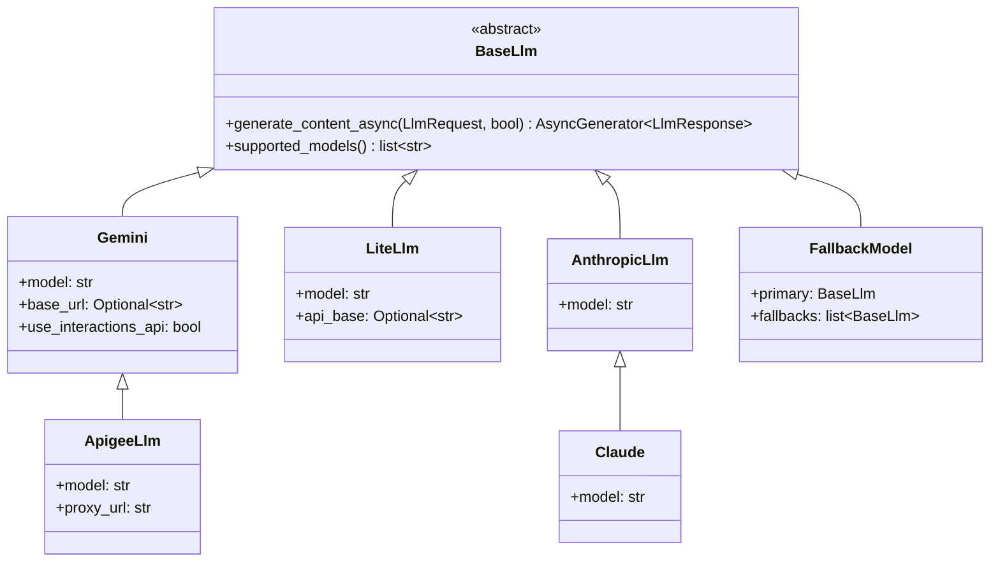
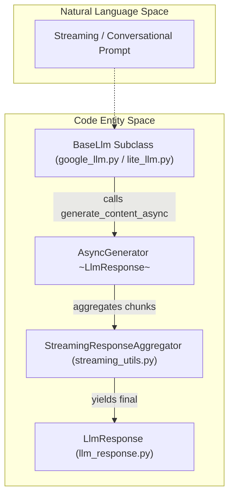

<!-- source: DeepWiki mcp.deepwiki.com · repo google/adk-python · page 6 LLM Integration · fetched 2026-10-29 -->

# LLM Integration

<details>
<summary>Relevant source files</summary>

The following files were used as context for generating this wiki page:

- [src/google/adk/models/anthropic_llm.py](src/google/adk/models/anthropic_llm.py)
- [src/google/adk/models/apigee_llm.py](src/google/adk/models/apigee_llm.py)
- [src/google/adk/models/google_llm.py](src/google/adk/models/google_llm.py)
- [src/google/adk/models/lite_llm.py](src/google/adk/models/lite_llm.py)
- [tests/unittests/models/test_anthropic_llm.py](tests/unittests/models/test_anthropic_llm.py)
- [tests/unittests/models/test_apigee_llm.py](tests/unittests/models/test_apigee_llm.py)
- [tests/unittests/models/test_completions_http_client.py](tests/unittests/models/test_completions_http_client.py)
- [tests/unittests/models/test_google_llm.py](tests/unittests/models/test_google_llm.py)
- [tests/unittests/models/test_lite_llm_gemma_tool_role.py](tests/unittests/models/test_lite_llm_gemma_tool_role.py)
- [tests/unittests/models/test_litellm.py](tests/unittests/models/test_litellm.py)

</details>


## Purpose and Scope

The LLM Integration subsystem provides a unified abstraction layer for interacting with multiple Large Language Model providers within the ADK framework. This enables agents to work seamlessly across different backends—including Gemini, Anthropic Claude, LiteLLM-backed providers, Apigee proxies, Gemma/Ollama, experimental OpenAI/Azure Responses API in `labs/openai`, and `AntigravityAgent` in `labs/antigravity`—without requiring modifications to agent logic [src/google/adk/models/google_llm.py:99-125]().

This page serves as a high-level parent overview linking to child pages detailing specific providers, interfaces, and processing pipelines.

**Sources:** [src/google/adk/models/google_llm.py:99-125](), [src/google/adk/models/anthropic_llm.py:15-16](), [src/google/adk/models/lite_llm.py:15-16]()

---

## Architecture Overview

The integration layer relies on `BaseLlm` as the abstract interface implemented by each provider wrapper. The `LLMRegistry` handles model name matching and routing, while request/response structures (`LlmRequest` and `LlmResponse`) normalize payloads across APIs.

### LLM Provider Class Hierarchy



**Sources:** [src/google/adk/models/google_llm.py:99-125](), [src/google/adk/models/lite_llm.py:70-75](), [src/google/adk/models/anthropic_llm.py:66-66](), [src/google/adk/models/apigee_llm.py:94-94]()

### Provider Routing and Selection (Natural Language to Code Entity Space)

```mermaid
graph TB
    subgraph "Natural Language Space"
        UserReq["User Prompt / Intent"]
    end

    subgraph "Code Entity Space"
        Agent["LlmAgent (llm_agent.py)"] -- "creates" --> Request["LlmRequest (llm_request.py)"]
        Request -- "model string" --> Registry["LLMRegistry (registry.py)"]
        
        Registry -->| "gemini-*" | Google["Gemini (google_llm.py)"]
        Registry -->| "claude-*" | Anthropic["Claude (anthropic_llm.py)"]
        Registry -->| "openai/*" | LiteLLM["LiteLlm (lite_llm.py)"]
        Registry -->| "apigee/*" | Apigee["ApigeeLlm (apigee_llm.py)"]
        Registry -->| "fallback/*" | Fallback["FallbackModel (_fallback_model.py)"]
    end

    UserReq -.-> Agent
```

**Sources:** [src/google/adk/models/google_llm.py:99-125](), [src/google/adk/models/anthropic_llm.py:66-66](), [src/google/adk/models/lite_llm.py:70-75](), [src/google/adk/models/apigee_llm.py:94-94]()

### Request Execution Flow (Natural Language to Code Entity Space)



**Sources:** [src/google/adk/models/google_llm.py:52-55](), [src/google/adk/models/lite_llm.py:66-69](), [src/google/adk/utils/streaming_utils.py:48-48]()

---

## 6.1. Model Providers

For deep-dive configuration, supported models, and quirks for each backend, see [Model Providers](#6.1).

### Supported Providers Summary

| Provider | Class | Default Model | Key Features |
|----------|-------|---------------|--------------|
| Gemini API / Vertex AI | `Gemini` | `gemini-2.5-flash` | Interactions API, Context Caching, Thinking Config, Live API [src/google/adk/models/google_llm.py:99-188]() |
| OpenAI / Azure / Others | `LiteLlm` | `gpt-4o` | LiteLLM Proxy, Dynamic Headers, Reasoning Replay [src/google/adk/models/lite_llm.py:70-75]() |
| Anthropic Direct | `AnthropicLlm` | `claude-3-5-sonnet-v2-20241022` | Reasoning Effort, PDF Support, Thinking Blocks [src/google/adk/models/anthropic_llm.py:66-66]() |
| Vertex AI Claude | `Claude` | `claude-3-5-sonnet-v2@20241022` | Managed Vertex AI routing [src/google/adk/models/anthropic_llm.py:66-66]() |
| Apigee Proxy | `ApigeeLlm` | Model dependent | Custom Routing, API Type selection [src/google/adk/models/apigee_llm.py:94-114]() |

**Sources:** [src/google/adk/models/google_llm.py:132-132](), [src/google/adk/models/lite_llm.py:70-70](), [src/google/adk/models/anthropic_llm.py:66-66](), [src/google/adk/models/apigee_llm.py:94-114]()

---

## 6.2. BaseLlm Interface

The `BaseLlm` abstract class defines the contract for all model integrations. Key operations include `generate_content_async()`, `supported_models()`, and model name matching utilities.

For details, see [BaseLlm Interface](#6.2).

**Sources:** [src/google/adk/models/google_llm.py:52-52](), [src/google/adk/models/lite_llm.py:66-66](), [src/google/adk/models/anthropic_llm.py:58-58]()

---

## 6.3. Request and Response Processing

ADK standardizes inputs and outputs across providers using `LlmRequest` and `LlmResponse` containers. This includes automatic content conversion, contents processing, tool-call rearranging, and type mapping.

For details, see [Request and Response Processing](#6.3).

**Sources:** [src/google/adk/models/lite_llm.py:68-69]()

---

## 6.4. Streaming and Response Handling

Streaming is supported across backends via Server-Sent Events (SSE) and bidirectional (BIDI) streams. The `StreamingResponseAggregator` processes partial events and progressive streams.

For details, see [Streaming and Response Handling](#6.4).

**Sources:** [src/google/adk/utils/streaming_utils.py:48-48]()

---

## 6.5. Live Streaming and Real-time Interactions

For real-time voice and multimodal interactions, Gemini's Live API via `GeminiLlmConnection` handles `LiveRequestQueue`, audio/video streaming, VAD events, and session replay on reconnect.

For details, see [Live Streaming and Real-time Interactions](#6.5).

**Sources:** [src/google/adk/models/google_llm.py:54-54]()

---

## 6.6. Function Call Handling

Function calling converts ADK `BaseTool` declarations into provider-specific schemas. It handles automatic function calling, argument parsing, and function response handling.

For details, see [Function Call Handling](#6.6).

**Sources:** [src/google/adk/models/lite_llm.py:75-78](), [src/google/adk/models/anthropic_llm.py:84-86]()

---

## 6.7. Context Caching

Context caching optimizes token usage and latency for large prompts using `ContextCacheConfig` and `GeminiContextCacheManager` with support for `static_instruction` caching and server-reported expiry.

For details, see [Context Caching](#6.7).

**Sources:** [tests/unittests/models/test_google_llm.py:25-25](), [tests/unittests/models/test_anthropic_llm.py:29-29](), [tests/unittests/models/test_litellm.py:30-30]()

---

## 6.8. Structured Output and Response Schemas

Structured outputs are enforced via `output_schema` and `response_format`, leveraging Pydantic integration and provider-specific schema converters.

For details, see [Structured Output and Response Schemas](#6.8).

**Sources:** [src/google/adk/models/lite_llm.py:110-110]()

---

## 6.9. Provider-Specific Features

Unique capabilities—such as Gemini's `thinking_config`, Anthropic's PDF/effort configuration and thinking blocks, and ApigeeLlm routing—are exposed via specialized configuration classes.

For details, see [Provider-Specific Features](#6.9).

**Sources:** [src/google/adk/models/google_llm.py:170-188](), [src/google/adk/models/anthropic_llm.py:147-176](), [src/google/adk/models/apigee_llm.py:101-114]()

---

## 6.10. Model Failover with FallbackModel

`FallbackModel` wraps a primary LLM with an ordered list of backup models. It automatically fails over on error codes or empty content to improve agent uptime.

For details, see [Model Failover with FallbackModel](#6.10).

**Sources:** [src/google/adk/models/google_llm.py:49-49]()

---

