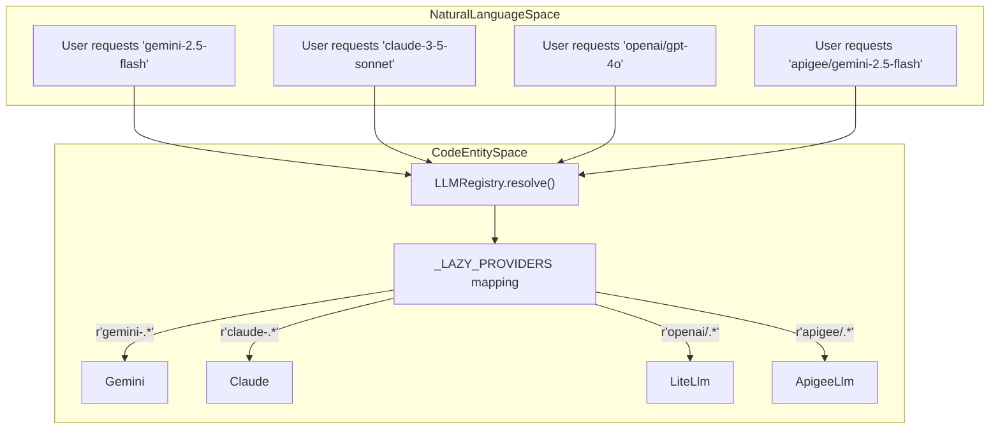
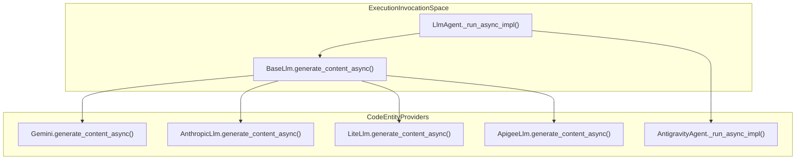
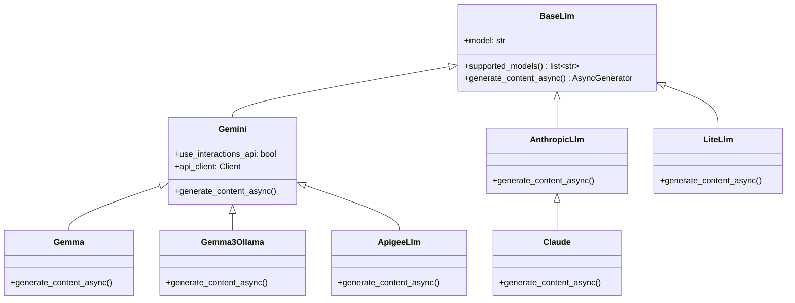

<!-- source: DeepWiki mcp.deepwiki.com · repo google/adk-python · page 6.1 Model Providers · fetched 2026-10-29 -->

# Model Providers

Relevant source files

The following files were used as context for generating this wiki page:

- [contributing/samples/integrations/antigravity_agent/.gitignore](contributing/samples/integrations/antigravity_agent/.gitignore)
- [contributing/samples/integrations/antigravity_agent/README.md](contributing/samples/integrations/antigravity_agent/README.md)
- [contributing/samples/integrations/antigravity_agent/agent.py](contributing/samples/integrations/antigravity_agent/agent.py)
- [contributing/samples/integrations/bigquery/README.md](contributing/samples/integrations/bigquery/README.md)
- [contributing/samples/integrations/bigtable/README.md](contributing/samples/integrations/bigtable/README.md)
- [contributing/samples/integrations/files_retrieval_agent/README.md](contributing/samples/integrations/files_retrieval_agent/README.md)
- [contributing/samples/integrations/gepa/README.md](contributing/samples/integrations/gepa/README.md)
- [contributing/samples/integrations/gepa/gepa_tau_bench.ipynb](contributing/samples/integrations/gepa/gepa_tau_bench.ipynb)
- [contributing/samples/integrations/gepa/voter_agent/gepa.ipynb](contributing/samples/integrations/gepa/voter_agent/gepa.ipynb)
- [contributing/samples/integrations/oauth2_client_credentials/README.md](contributing/samples/integrations/oauth2_client_credentials/README.md)
- [contributing/samples/integrations/spanner/README.md](contributing/samples/integrations/spanner/README.md)
- [contributing/samples/mcp/mcp_server_side_sampling/README.md](contributing/samples/mcp/mcp_server_side_sampling/README.md)
- [contributing/samples/models/hello_world_nvidia/README.md](contributing/samples/models/hello_world_nvidia/README.md)
- [contributing/samples/models/hello_world_nvidia/__init__.py](contributing/samples/models/hello_world_nvidia/__init__.py)
- [contributing/samples/models/hello_world_nvidia/agent.py](contributing/samples/models/hello_world_nvidia/agent.py)
- [contributing/samples/models/hello_world_nvidia/main.py](contributing/samples/models/hello_world_nvidia/main.py)
- [src/google/adk/cli/utils/graph_serialization.py](src/google/adk/cli/utils/graph_serialization.py)
- [src/google/adk/labs/antigravity/README.md](src/google/adk/labs/antigravity/README.md)
- [src/google/adk/labs/antigravity/__init__.py](src/google/adk/labs/antigravity/__init__.py)
- [src/google/adk/labs/antigravity/_antigravity_agent.py](src/google/adk/labs/antigravity/_antigravity_agent.py)
- [src/google/adk/labs/antigravity/_event_converter.py](src/google/adk/labs/antigravity/_event_converter.py)
- [src/google/adk/labs/antigravity/_tool_result_capture.py](src/google/adk/labs/antigravity/_tool_result_capture.py)
- [src/google/adk/models/__init__.py](src/google/adk/models/__init__.py)
- [src/google/adk/models/anthropic_llm.py](src/google/adk/models/anthropic_llm.py)
- [src/google/adk/models/apigee_llm.py](src/google/adk/models/apigee_llm.py)
- [src/google/adk/models/gemma_llm.py](src/google/adk/models/gemma_llm.py)
- [src/google/adk/models/google_llm.py](src/google/adk/models/google_llm.py)
- [src/google/adk/models/lite_llm.py](src/google/adk/models/lite_llm.py)
- [src/google/adk/models/registry.py](src/google/adk/models/registry.py)
- [tests/unittests/cli/utils/test_graph_serialization.py](tests/unittests/cli/utils/test_graph_serialization.py)
- [tests/unittests/labs/antigravity/test_antigravity_agent.py](tests/unittests/labs/antigravity/test_antigravity_agent.py)
- [tests/unittests/labs/antigravity/test_event_converter.py](tests/unittests/labs/antigravity/test_event_converter.py)
- [tests/unittests/labs/antigravity/test_tool_result_capture.py](tests/unittests/labs/antigravity/test_tool_result_capture.py)
- [tests/unittests/models/test_anthropic_llm.py](tests/unittests/models/test_anthropic_llm.py)
- [tests/unittests/models/test_apigee_llm.py](tests/unittests/models/test_apigee_llm.py)
- [tests/unittests/models/test_completions_http_client.py](tests/unittests/models/test_completions_http_client.py)
- [tests/unittests/models/test_gemma_llm.py](tests/unittests/models/test_gemma_llm.py)
- [tests/unittests/models/test_google_llm.py](tests/unittests/models/test_google_llm.py)
- [tests/unittests/models/test_lite_llm_gemma_tool_role.py](tests/unittests/models/test_lite_llm_gemma_tool_role.py)
- [tests/unittests/models/test_litellm.py](tests/unittests/models/test_litellm.py)
- [tests/unittests/models/test_models.py](tests/unittests/models/test_models.py)

This page documents the model provider integration layer in ADK Python, detailing how `BaseLlm` implementations translate requests and responses between ADK's internal types (`google.genai.types`) and external provider APIs. For details on the abstract `BaseLlm` interface, see [BaseLlm Interface](#6.2). For request/response conversion mechanics, see [Request and Response Processing](#6.3).

Sources: [src/google/adk/models/base_llm.py:1-35](), [src/google/adk/models/__init__.py:15-30]()

## Purpose and Scope

The model provider subsystem serves as the translation and execution layer connecting ADK agents (`LlmAgent`, `AntigravityAgent`, etc.) to foundational language models across multiple vendors. By abstracting provider-specific APIs behind the uniform `BaseLlm` interface [src/google/adk/models/base_llm.py:27-31](), ADK enables transparent model failover, context caching, tool calling, and streaming across Gemini, Anthropic Claude, LiteLLM-backed endpoints, Apigee gateways, Gemma/Ollama, experimental OpenAI/Azure Responses APIs, and Antigravity SDK agents.

Sources: [src/google/adk/models/base_llm.py:27-31](), [src/google/adk/models/__init__.py:15-30]()

## Supported Providers Matrix

| Provider Class | Supported Model Patterns | API Backend / SDK | Description |
|---------------|-------------------------|-------------------|-------------|
| `Gemini` | `gemini-*`, `gemma-4.*`, `model-optimizer-*` | Gemini API / Vertex AI (`google.genai`) | Google native models and Gemini Enterprise endpoints [src/google/adk/models/google_llm.py:132-140]() |
| `Gemma` | `gemma-.*` | Gemini API / Emulated | Gemma 3 emulation with function-calling workarounds [src/google/adk/models/__init__.py:71-72]() |
| `Gemma3Ollama` | `ollama/gemma3.*` | Ollama Local Engine | Local Gemma 3 hosting via Ollama [src/google/adk/models/__init__.py:79-79]() |
| `AnthropicLlm` | `claude-3-.*`, `claude-.*-4.*` | Anthropic API (`AsyncAnthropic`) | Direct Anthropic Claude integration [src/google/adk/models/anthropic_llm.py:40-41]() |
| `Claude` | `claude-3-.*`, `claude-.*-4.*` | Vertex AI (`AsyncAnthropicVertex`) | Vertex AI-hosted Claude models [src/google/adk/models/anthropic_llm.py:40-41]() |
| `LiteLlm` | `openai/.*`, `azure/.*`, `groq/.*`, `deepseek/.*`, etc. | LiteLLM Proxy (`litellm.acompletion`) | Multi-provider fallback and proxy routing [src/google/adk/models/lite_llm.py:72-73]() |
| `ApigeeLlm` | `apigee/.*` | Apigee Gateway (`genai.Client` with custom base URL) | Enterprise routing and gateway proxying [src/google/adk/models/apigee_llm.py:95-101]() |
| `OpenAILlm` | `gpt-.*`, `o\d+-.*` | OpenAI Native (`google.adk.integrations.openai`) | Experimental native OpenAI integration [src/google/adk/models/__init__.py:80-83]() |
| `AntigravityAgent` | N/A | Antigravity SDK (`google.antigravity`) | Google Antigravity agent runner wrapped as a `BaseAgent` [src/google/adk/labs/antigravity/_antigravity_agent.py:148-162]() |

Sources: [src/google/adk/models/google_llm.py:132-140](), [src/google/adk/models/anthropic_llm.py:40-41](), [src/google/adk/models/lite_llm.py:72-73](), [src/google/adk/models/apigee_llm.py:95-101](), [src/google/adk/labs/antigravity/_antigravity_agent.py:148-162]()

## Provider Selection and LLMRegistry Resolution

Model strings passed to agents are resolved dynamically to concrete `BaseLlm` subclasses via the `LLMRegistry` pattern matching dictionary.

Title: Natural Language Space to Code Entity Space - LLMRegistry Resolution

Sources: [src/google/adk/models/__init__.py:58-124]()

## Execution Flow Across Providers

Title: Natural Language Space to Code Entity Space - Execution Routing

Sources: [src/google/adk/models/base_llm.py:27-31](), [src/google/adk/models/google_llm.py:99-130](), [src/google/adk/models/anthropic_llm.py:40-62](), [src/google/adk/models/lite_llm.py:66-70](), [src/google/adk/labs/antigravity/_antigravity_agent.py:148-162]()

## Detailed Provider Implementation & Configuration

### Gemini, Gemma, and Gemma3Ollama
- **Gemini (`Gemini`)**: Managed via `google_llm.py`. Supports native features including `thinking_config`, context caching, and the stateful Interactions API (`use_interactions_api=True`) [src/google/adk/models/google_llm.py:132-188]().
- **Gemma (`Gemma`)**: Handles Gemma 3 emulation, translating system instructions and tool declarations into structured prompts suitable for models without native tool execution [src/google/adk/models/__init__.py:71-72](). Gemma 4+ models resolve directly to `Gemini` [src/google/adk/models/__init__.py:61-64]().
- **Gemma3Ollama (`Gemma3Ollama`)**: Integrates local Gemma 3 instances running via Ollama [src/google/adk/models/__init__.py:79-79]().

Sources: [src/google/adk/models/google_llm.py:132-188](), [src/google/adk/models/__init__.py:58-79]()

### Anthropic Claude (`AnthropicLlm` and `Claude`)
Implemented in `anthropic_llm.py`. Connects either directly via `AsyncAnthropic` or through Vertex AI via `AsyncAnthropicVertex` [src/google/adk/models/anthropic_llm.py:40-41](). Handles `genai.ThinkingConfig` to Anthropic thinking parameter mapping, reasoning effort configuration, and document block conversions [src/google/adk/models/anthropic_llm.py:156-185]().

Sources: [src/google/adk/models/anthropic_llm.py:40-185]()

### LiteLLM-backed Providers (`LiteLlm`)
Implemented in `lite_llm.py`. Integrates multi-provider endpoints (OpenAI, Azure, Groq, DeepSeek, Mistral, Cohere, etc.) through `litellm.acompletion` [src/google/adk/models/lite_llm.py:72-73](). Features robust response parsing, tool argument JSON repair (`_parse_tool_call_arguments`), and finish reason mapping (`_FINISH_REASON_MAPPING`) [src/google/adk/models/lite_llm.py:129-210]().

Sources: [src/google/adk/models/lite_llm.py:72-210]()

### Apigee Proxy (`ApigeeLlm`)
Implemented in `apigee_llm.py`. Inherits from `Gemini` and routes client requests through an Apigee gateway proxy URL (`proxy_url`), overriding base URLs and injecting custom enterprise headers (`custom_headers`) while maintaining support for both `GENAI` and `CHAT_COMPLETIONS` API types [src/google/adk/models/apigee_llm.py:95-147]().

Sources: [src/google/adk/models/apigee_llm.py:95-147]()

### Experimental OpenAI (`labs/openai`)
Located in `src/google/adk/integrations/openai/`. Provides experimental native OpenAI integration (`OpenAILlm`) and stateful Responses API wrappers (`OpenAIResponsesLlm`) for advanced reasoning models (`o1`, `o3`, `gpt-4o`) [src/google/adk/models/__init__.py:80-83]().

Sources: [src/google/adk/models/__init__.py:80-83]()

### AntigravityAgent (`labs/antigravity`)
Implemented in `_antigravity_agent.py`. Wraps a pre-configured `google.antigravity.Agent` as a native ADK `BaseAgent` node [src/google/adk/labs/antigravity/_antigravity_agent.py:15-26](). It delegates conversation turns to the Antigravity SDK runner and translates execution steps into ADK session events [src/google/adk/labs/antigravity/_antigravity_agent.py:15-26]().

The `AntigravityAgent` can operate in two modes:
- **Root Agent**: When `mode` is `None`, it acts as a standalone root ADK agent, managing its own conversation state.
- **Sub-Agent**: When `mode='single_turn'`, it can be used as a sub-agent, where each call is an independent conversation without forwarding session history [src/google/adk/labs/antigravity/_antigravity_agent.py:168-186]().

ADK `sub_agents` can be bridged onto the Antigravity SDK config as client-side tools, requiring a non-empty `description` for each child [src/google/adk/labs/antigravity/_antigravity_agent.py:148-162]().

Sources: [src/google/adk/labs/antigravity/_antigravity_agent.py:15-186]()

## Provider Class Hierarchy

Title: BaseLlm Class Inheritance Hierarchy

Sources: [src/google/adk/models/base_llm.py:27-31](), [src/google/adk/models/google_llm.py:99-130](), [src/google/adk/models/anthropic_llm.py:40-62](), [src/google/adk/models/lite_llm.py:66-70](), [src/google/adk/models/apigee_llm.py:95-147]()

---

