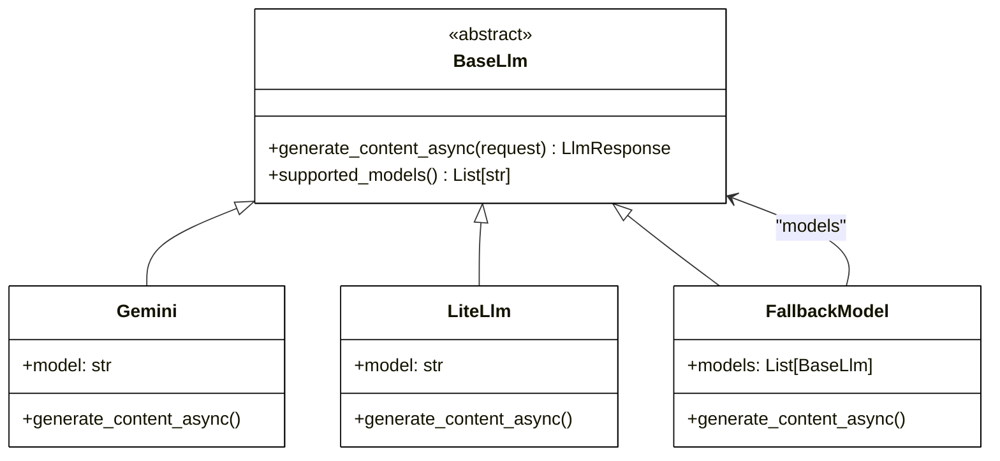

<!-- source: DeepWiki mcp.deepwiki.com · repo google/adk-python · page 6.10 Model Failover with FallbackModel · fetched 2026-10-29 -->

# Model Failover with FallbackModel

<details>
<summary>Relevant source files</summary>

The following files were used as context for generating this wiki page:

- [contributing/samples/integrations/bigquery/README.md](contributing/samples/integrations/bigquery/README.md)
- [contributing/samples/integrations/bigtable/README.md](contributing/samples/integrations/bigtable/README.md)
- [contributing/samples/integrations/files_retrieval_agent/README.md](contributing/samples/integrations/files_retrieval_agent/README.md)
- [contributing/samples/integrations/gepa/README.md](contributing/samples/integrations/gepa/README.md)
- [contributing/samples/integrations/gepa/gepa_tau_bench.ipynb](contributing/samples/integrations/gepa/gepa_tau_bench.ipynb)
- [contributing/samples/integrations/gepa/voter_agent/gepa.ipynb](contributing/samples/integrations/gepa/voter_agent/gepa.ipynb)
- [contributing/samples/integrations/oauth2_client_credentials/README.md](contributing/samples/integrations/oauth2_client_credentials/README.md)
- [contributing/samples/integrations/spanner/README.md](contributing/samples/integrations/spanner/README.md)
- [contributing/samples/mcp/mcp_server_side_sampling/README.md](contributing/samples/mcp/mcp_server_side_sampling/README.md)
- [contributing/samples/models/hello_world_nvidia/README.md](contributing/samples/models/hello_world_nvidia/README.md)
- [contributing/samples/models/hello_world_nvidia/__init__.py](contributing/samples/models/hello_world_nvidia/__init__.py)
- [contributing/samples/models/hello_world_nvidia/agent.py](contributing/samples/models/hello_world_nvidia/agent.py)
- [contributing/samples/models/hello_world_nvidia/main.py](contributing/samples/models/hello_world_nvidia/main.py)
- [src/google/adk/agents/live_request_queue.py](src/google/adk/agents/live_request_queue.py)
- [src/google/adk/agents/run_config.py](src/google/adk/agents/run_config.py)
- [src/google/adk/flows/llm_flows/basic.py](src/google/adk/flows/llm_flows/basic.py)
- [src/google/adk/flows/llm_flows/contents.py](src/google/adk/flows/llm_flows/contents.py)
- [src/google/adk/models/__init__.py](src/google/adk/models/__init__.py)
- [src/google/adk/models/_service_tier.py](src/google/adk/models/_service_tier.py)
- [src/google/adk/models/base_llm_connection.py](src/google/adk/models/base_llm_connection.py)
- [src/google/adk/models/gemini_llm_connection.py](src/google/adk/models/gemini_llm_connection.py)
- [src/google/adk/models/gemma_llm.py](src/google/adk/models/gemma_llm.py)
- [src/google/adk/models/llm_response.py](src/google/adk/models/llm_response.py)
- [src/google/adk/models/registry.py](src/google/adk/models/registry.py)
- [src/google/adk/utils/streaming_utils.py](src/google/adk/utils/streaming_utils.py)
- [tests/integration/test_vertex_ai_search_grounding_streaming.py](tests/integration/test_vertex_ai_search_grounding_streaming.py)
- [tests/unittests/agents/test_live_request_queue.py](tests/unittests/agents/test_live_request_queue.py)
- [tests/unittests/agents/test_llm_agent_include_contents.py](tests/unittests/agents/test_llm_agent_include_contents.py)
- [tests/unittests/agents/test_run_config.py](tests/unittests/agents/test_run_config.py)
- [tests/unittests/flows/llm_flows/context/test_interactions.py](tests/unittests/flows/llm_flows/context/test_interactions.py)
- [tests/unittests/flows/llm_flows/test_basic_processor.py](tests/unittests/flows/llm_flows/test_basic_processor.py)
- [tests/unittests/flows/llm_flows/test_progressive_sse_streaming.py](tests/unittests/flows/llm_flows/test_progressive_sse_streaming.py)
- [tests/unittests/models/test_fallback_model.py](tests/unittests/models/test_fallback_model.py)
- [tests/unittests/models/test_gemini_llm_connection.py](tests/unittests/models/test_gemini_llm_connection.py)
- [tests/unittests/models/test_gemma_llm.py](tests/unittests/models/test_gemma_llm.py)
- [tests/unittests/models/test_llm_response.py](tests/unittests/models/test_llm_response.py)
- [tests/unittests/models/test_models.py](tests/unittests/models/test_models.py)
- [tests/unittests/streaming/test_live_streaming_configs.py](tests/unittests/streaming/test_live_streaming_configs.py)
- [tests/unittests/utils/test_streaming_utils.py](tests/unittests/utils/test_streaming_utils.py)

</details>


## Purpose and Scope
Introduced to provide automatic model failover and resilience for ADK agents, the `FallbackModel` (`[src/google/adk/models/__init__.py:34-34]`, `[src/google/adk/models/__init__.py:128-128]()`) wraps a primary model implementation (such as `Gemini`, `Claude`, or `LiteLlm`) with an ordered sequence of backup model instances. When generation requests (`generate_content_async`) are executed, `FallbackModel` intercepts qualifying provider errors (e.g., rate limits, quota exhaustion, timeouts) or empty content outputs, and transparently retries execution with subsequent backup models. This page details its configuration, error classification logic, streaming behavior, sample usage patterns, and underlying architecture.

Sources: `[src/google/adk/models/__init__.py:34-34]`, `[src/google/adk/models/__init__.py:128-128]()`

## Configuration and Initialization
`FallbackModel` inherits from the abstract base class `BaseLlm` (`[src/google/adk/models/base_llm.py:1-50]()`) and accepts a list or sequence of models. Any concrete `BaseLlm` implementation can be composed within the failover chain.

```python
from google.adk.models import Gemini, LiteLlm
from google.adk.models import FallbackModel

# Configure a resilient model wrapping primary Gemini with backup models
resilient_model = FallbackModel(
    models=[
        Gemini(model="gemini-2.5-pro"),
        Gemini(model="gemini-2.5-flash"),
        LiteLlm(model="openai/gpt-4o"),
    ]
)
```
The `FallbackModel`'s own `model` attribute defaults to the model name of its primary model (`[tests/unittests/models/test_fallback_model.py:102-107]()`). Setting the `model` attribute directly on `FallbackModel` is rejected (`[tests/unittests/models/test_fallback_model.py:119-121]()`).

Sources: `[src/google/adk/models/__init__.py:34-34]`, `[src/google/adk/models/__init__.py:128-128]`, `[src/google/adk/models/base_llm.py:1-50]`, `[tests/unittests/models/test_fallback_model.py:102-107]`, `[tests/unittests/models/test_fallback_model.py:119-121]()`

## Error Classification and Failover Logic
When `FallbackModel.generate_content_async()` is invoked, it delegates the request execution to the primary model. If the primary model raises an exception classified as recoverable (such as rate limit errors like status code 429 or server errors like status code 503), or if the resulting response contains no text or tool calls, `FallbackModel` catches the failure and proceeds to the next model in the `models` fallback list.

If a backup model succeeds, its response is returned to the runner as if it came from the primary model. If all models in the chain fail, the final exception is raised to the caller.

The `FallbackModel` specifically handles `google.genai.errors.ClientError` and similar exceptions with status codes indicating retriable conditions (`[tests/unittests/models/test_fallback_model.py:159-169]()`). Non-retriable errors, such as 400 Bad Request, are propagated immediately without attempting failover (`[tests/unittests/models/test_fallback_model.py:187-198]()`). Other exceptions without a status code are also propagated (`[tests/unittests/models/test_fallback_model.py:201-208]()`).

Sources: `[src/google/adk/models/base_llm.py:1-50]`, `[tests/unittests/models/test_fallback_model.py:159-169]`, `[tests/unittests/models/test_fallback_model.py:187-198]`, `[tests/unittests/models/test_fallback_model.py:201-208]()`

## Streaming Behavior
Streaming requests (`stream=True`) handled by `FallbackModel` coordinate across model boundaries. If a failure occurs before any chunks have been yielded to the consumer, failover proceeds to the next backup model seamlessly (`[tests/unittests/models/test_fallback_model.py:211-221]()`). If an error occurs mid-stream after chunks have already been emitted, failover behavior depends on the stream accumulator state and model capabilities.

Sources: `[src/google/adk/models/base_llm.py:1-50]`, `[tests/unittests/models/test_fallback_model.py:211-221]()`

## Samples and Unit Tests
The ADK unit tests and samples demonstrate combining native and third-party models with `FallbackModel` (`[tests/unittests/models/test_fallback_model.py:102-132]()`). This integration allows developers to blend native provider integrations with multi-provider endpoints under a unified agent interface, ensuring high availability across distinct cloud APIs (`[src/google/adk/models/__init__.py:84-104]()`).

Sources: `[src/google/adk/models/__init__.py:84-104]`, `[tests/unittests/models/test_fallback_model.py:102-132]()`

## Architecture and Data Flow

### Diagram 1: FallbackModel Execution and Routing Flow
```mermaid
graph TD
    "AgentInvocationRequest" --> "FallbackModel.generate_content_async()"
    "FallbackModel.generate_content_async()" --> "PrimaryModel.generate_content_async()"
    "PrimaryModel.generate_content_async()" -- "Success / Valid Response" --> "ReturnLlmResponse"
    "PrimaryModel.generate_content_async()" -- "Error or Empty Content" --> "IterateBackupModels"
    "IterateBackupModels" --> "FallbackModel.generate_content_async()"
    "FallbackModel.generate_content_async()" -- "Success" --> "ReturnLlmResponse"
    "FallbackModel.generate_content_async()" -- "All Fallbacks Exhausted" --> "RaiseFinalException"

    style "AgentInvocationRequest" fill:#fff,stroke:#000,stroke-width:1px
    style "FallbackModel.generate_content_async()" fill:#fff,stroke:#000,stroke-width:1px
    style "PrimaryModel.generate_content_async()" fill:#fff,stroke:#000,stroke-width:1px
    style "ReturnLlmResponse" fill:#fff,stroke:#000,stroke-width:1px
    style "IterateBackupModels" fill:#fff,stroke:#000,stroke-width:1px
    style "RaiseFinalException" fill:#fff,stroke:#000,stroke-width:1px
```
Sources: `[src/google/adk/models/base_llm.py:1-50]`, `[src/google/adk/models/google_llm.py:49-52]()`

### Diagram 2: Model Abstraction Class Hierarchy

Sources: `[src/google/adk/models/base_llm.py:1-50]`, `[src/google/adk/models/__init__.py:34-34]`

---

