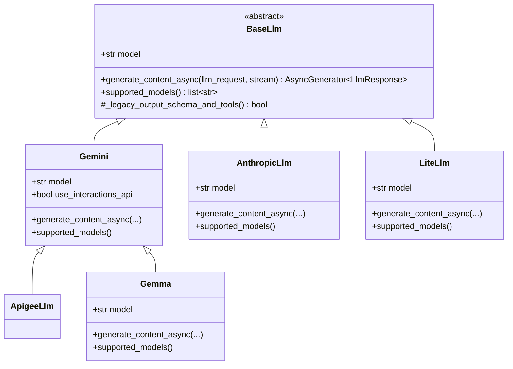
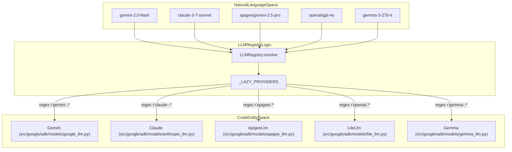
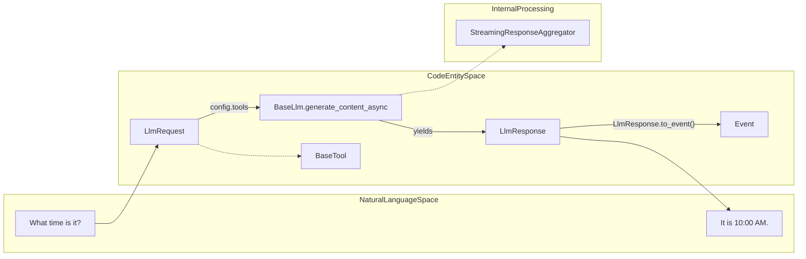

<!-- source: DeepWiki mcp.deepwiki.com · repo google/adk-python · page 6.2 BaseLlm Interface · fetched 2026-10-29 -->

# BaseLlm Interface

<details>
<summary>Relevant source files</summary>

The following files were used as context for generating this wiki page:

- [.agents/skills/adk-agent-builder/references/function-nodes.md](.agents/skills/adk-agent-builder/references/function-nodes.md)
- [contributing/samples/integrations/bigquery/README.md](contributing/samples/integrations/bigquery/README.md)
- [contributing/samples/integrations/bigtable/README.md](contributing/samples/integrations/bigtable/README.md)
- [contributing/samples/integrations/files_retrieval_agent/README.md](contributing/samples/integrations/files_retrieval_agent/README.md)
- [contributing/samples/integrations/gepa/README.md](contributing/samples/integrations/gepa/README.md)
- [contributing/samples/integrations/gepa/gepa_tau_bench.ipynb](contributing/samples/integrations/gepa/gepa_tau_bench.ipynb)
- [contributing/samples/integrations/gepa/voter_agent/gepa.ipynb](contributing/samples/integrations/gepa/voter_agent/gepa.ipynb)
- [contributing/samples/integrations/oauth2_client_credentials/README.md](contributing/samples/integrations/oauth2_client_credentials/README.md)
- [contributing/samples/integrations/spanner/README.md](contributing/samples/integrations/spanner/README.md)
- [contributing/samples/mcp/mcp_server_side_sampling/README.md](contributing/samples/mcp/mcp_server_side_sampling/README.md)
- [contributing/samples/models/hello_world_nvidia/README.md](contributing/samples/models/hello_world_nvidia/README.md)
- [contributing/samples/models/hello_world_nvidia/__init__.py](contributing/samples/models/hello_world_nvidia/__init__.py)
- [contributing/samples/models/hello_world_nvidia/agent.py](contributing/samples/models/hello_world_nvidia/agent.py)
- [contributing/samples/models/hello_world_nvidia/main.py](contributing/samples/models/hello_world_nvidia/main.py)
- [docs/guides/models/llm_registry/index.md](docs/guides/models/llm_registry/index.md)
- [docs/guides/workflow/base_node/index.md](docs/guides/workflow/base_node/index.md)
- [docs/guides/workflow/node/index.md](docs/guides/workflow/node/index.md)
- [src/google/adk/code_executors/built_in_code_executor.py](src/google/adk/code_executors/built_in_code_executor.py)
- [src/google/adk/events/event.py](src/google/adk/events/event.py)
- [src/google/adk/models/__init__.py](src/google/adk/models/__init__.py)
- [src/google/adk/models/base_llm.py](src/google/adk/models/base_llm.py)
- [src/google/adk/models/gemma_llm.py](src/google/adk/models/gemma_llm.py)
- [src/google/adk/models/registry.py](src/google/adk/models/registry.py)
- [src/google/adk/sessions/session.py](src/google/adk/sessions/session.py)
- [src/google/adk/sessions/state.py](src/google/adk/sessions/state.py)
- [src/google/adk/tools/enterprise_search_tool.py](src/google/adk/tools/enterprise_search_tool.py)
- [src/google/adk/tools/google_maps_grounding_tool.py](src/google/adk/tools/google_maps_grounding_tool.py)
- [src/google/adk/tools/google_search_tool.py](src/google/adk/tools/google_search_tool.py)
- [src/google/adk/tools/retrieval/vertex_ai_rag_retrieval.py](src/google/adk/tools/retrieval/vertex_ai_rag_retrieval.py)
- [src/google/adk/tools/url_context_tool.py](src/google/adk/tools/url_context_tool.py)
- [src/google/adk/tools/vertex_ai_search_tool.py](src/google/adk/tools/vertex_ai_search_tool.py)
- [src/google/adk/utils/model_name_utils.py](src/google/adk/utils/model_name_utils.py)
- [tests/unittests/code_executors/test_built_in_code_executor.py](tests/unittests/code_executors/test_built_in_code_executor.py)
- [tests/unittests/events/test_event.py](tests/unittests/events/test_event.py)
- [tests/unittests/models/test_gemma_llm.py](tests/unittests/models/test_gemma_llm.py)
- [tests/unittests/models/test_models.py](tests/unittests/models/test_models.py)
- [tests/unittests/sessions/test_state.py](tests/unittests/sessions/test_state.py)
- [tests/unittests/tools/retrieval/test_vertex_ai_rag_retrieval.py](tests/unittests/tools/retrieval/test_vertex_ai_rag_retrieval.py)
- [tests/unittests/tools/test_google_search_tool.py](tests/unittests/tools/test_google_search_tool.py)
- [tests/unittests/tools/test_url_context_tool.py](tests/unittests/tools/test_url_context_tool.py)
- [tests/unittests/tools/test_vertex_ai_search_tool.py](tests/unittests/tools/test_vertex_ai_search_tool.py)
- [tests/unittests/utils/test_model_name_utils.py](tests/unittests/utils/test_model_name_utils.py)
- [tests/unittests/workflow/test_state_schema.py](tests/unittests/workflow/test_state_schema.py)

</details>


The `BaseLlm` interface defines the abstract contract for integrating Large Language Model (LLM) providers into ADK. It provides a unified API for invoking models, streaming responses, and establishing live connections, while allowing provider-specific implementations to handle the complexities of different LLM backends (Gemini, OpenAI, Anthropic, Gemma, etc.).

Sources:
- [src/google/adk/models/base_llm.py:36-47]()

## Interface Contract

The `BaseLlm` abstract class establishes the core contract that all LLM provider implementations must satisfy. It is a Pydantic `BaseModel` that defines the interface for model invocation, capabilities, and configuration [src/google/adk/models/base_llm.py:36-43]().

Title: "BaseLlm Class Hierarchy"


Sources:
- [src/google/adk/models/base_llm.py:36-47]()
- [src/google/adk/models/google_llm.py:89-116]()
- [src/google/adk/models/anthropic_llm.py:214-230]()
- [src/google/adk/models/lite_llm.py:350-362]()
- [src/google/adk/models/apigee_llm.py:66-71]()
- [src/google/adk/models/gemma_llm.py:166-194]()

## Core Methods

### generate_content_async

The primary method for invoking LLMs. Returns an async generator that yields `LlmResponse` objects, supporting both streaming and non-streaming modes [src/google/adk/models/base_llm.py:137-139]().

**Method Signature:**
```python
@abstractmethod
async def generate_content_async(
    self, 
    llm_request: LlmRequest, 
    stream: bool = False
) -> AsyncGenerator[LlmResponse, None]
```

**Implementation Details:**
- **Gemini**: Handles context caching via `GeminiContextCacheManager` and manages the `google.genai` client lifecycle [src/google/adk/models/google_llm.py:185-216](). It also supports the Interactions API for stateful conversations when `use_interactions_api` is enabled [src/google/adk/models/google_llm.py:129-145]().
- **Anthropic**: Maps `LlmRequest` to Anthropic's message parameters, including specialized logic for `thinking` and `effort` parameters for Claude models via `AnthropicGenerateContentConfig` [src/google/adk/models/anthropic_llm.py:143-163]().
- **LiteLlm**: Provides a bridge to the LiteLLM library, allowing access to 100+ model providers (OpenAI, Azure, DeepSeek, etc.) through a unified schema mapping [src/google/adk/models/lite_llm.py:586-620]().
- **Gemma**: Specialized implementation for Gemma 3 models. Since Gemma 3 lacks native function calling, this class uses `GemmaFunctionCallingMixin` to inject tool definitions into prompts and parse function calls from text responses [src/google/adk/models/gemma_llm.py:41-52]().
- **ApigeeLlm**: Proxies requests through an Apigee gateway, supporting both `GENAI` (Gemini-style) and `CHAT_COMPLETIONS` (OpenAI-style) API types [src/google/adk/models/apigee_llm.py:199-215]().

Sources:
- [src/google/adk/models/base_llm.py:137-175]()
- [src/google/adk/models/google_llm.py:185-245]()
- [src/google/adk/models/anthropic_llm.py:302-364]()
- [src/google/adk/models/lite_llm.py:586-630]()
- [src/google/adk/models/gemma_llm.py:41-155]()

### supported_models

A class method that returns regex patterns matching the model names this provider supports. Used by the `LLMRegistry` to route requests to the correct implementation [src/google/adk/models/base_llm.py:131-134]().

Sources:
- [src/google/adk/models/base_llm.py:131-134]()
- [src/google/adk/models/google_llm.py:164-183]()
- [src/google/adk/models/anthropic_llm.py:286-295]()

## Model Name Matching Utilities

ADK includes dedicated utilities in `src/google/adk/utils/model_name_utils.py` to parse, normalize, and inspect model names across different provider formats (simple names, GCP resource paths, provider-prefixed IDs) [src/google/adk/utils/model_name_utils.py:49-108]().

**Key Functions:**
- `extract_model_name(model_string: str) -> str`: Parses path-based resource names (e.g., `projects/.../models/gemini-2.5-flash`), `models/` prefixes, and provider prefixes (`gemini/...`, `apigee/...`) down to the core model identifier [src/google/adk/utils/model_name_utils.py:49-91]().
- `is_gemini_model(model_string: Optional[str]) -> bool`: Validates whether a given model string maps to a Gemini model family using regex pattern matching on the extracted model name [src/google/adk/utils/model_name_utils.py:94-107]().
- `is_gemini_model_id_check_disabled() -> bool`: Checks the environment variable `ADK_DISABLE_GEMINI_MODEL_ID_CHECK` to allow bypassing strict Gemini ID validation in specialized environments [src/google/adk/utils/model_name_utils.py:35-41](). This is used by built-in tools like `GoogleSearchTool` [src/google/adk/tools/google_search_tool.py:71](), `VertexAiSearchTool` [src/google/adk/tools/vertex_ai_search_tool.py:152](), and `VertexAiRagRetrieval` [src/google/adk/tools/retrieval/vertex_ai_rag_retrieval.py:152]() to determine if they can be applied to the current LLM request.

Sources:
- [src/google/adk/utils/model_name_utils.py:35-107]()
- [tests/unittests/utils/test_model_name_utils.py:28-114]()
- [src/google/adk/tools/google_search_tool.py:71]()
- [src/google/adk/tools/vertex_ai_search_tool.py:152]()
- [src/google/adk/tools/retrieval/vertex_ai_rag_retrieval.py:152]()

## LLM Registry and Model Resolution

The `LLMRegistry` manages the mapping between model name strings and their corresponding `BaseLlm` implementations. It supports lazy loading of providers to minimize initialization overhead [src/google/adk/models/__init__.py:58-123]().

### Registration and Resolution Flow

The registry uses regex patterns to match model strings to provider classes. Lazy registration allows ADK to register patterns and module paths without importing the actual provider classes until needed [src/google/adk/models/__init__.py:58-123]().

Title: "Model Resolution Bridge"


Sources:
- [src/google/adk/models/registry.py:36-182]()
- [src/google/adk/models/__init__.py:58-123]()

**Key Registry Functions:**
- `LLMRegistry.new_llm(model)`: High-level factory that resolves the class and instantiates it with the provided model string and configuration [src/google/adk/models/registry.py:66-83]().
- `LLMRegistry.resolve(model)`: Searches registered patterns for a match, prioritizing specific providers. It uses an `lru_cache` for performance [src/google/adk/models/registry.py:146-186](). If a model is not found, it provides helpful error messages, suggesting `pip install` commands for optional dependencies like `anthropic` or `openai` [src/google/adk/models/registry.py:193-208]().

Sources:
- [src/google/adk/models/registry.py:66-212]()
- [src/google/adk/models/__init__.py:58-123]()
- [tests/unittests/models/test_models.py:137-180]()

## Data Flow: Request to Response

The interaction between the `LlmRequest` and the `BaseLlm` interface forms the core execution pipeline.

Title: "Request Execution Data Flow"


Sources:
- [src/google/adk/models/llm_request.py:51-112]()
- [src/google/adk/models/llm_response.py:27-40]()
- [src/google/adk/events/event.py:87-118]()
- [src/google/adk/models/google_llm.py:185-216]()

**Key Components:**
- **LlmRequest**: Encapsulates model name, contents, tools, and configuration [src/google/adk/models/llm_request.py:51-112]().
- **LlmResponse**: A unified response format convertible into an `Event` via `LlmResponse.to_event()` [src/google/adk/models/llm_response.py:27-40]() [src/google/adk/events/event.py:87-118]().
- **StreamingResponseAggregator**: Collects partial streaming chunks into a final complete response.

Sources:
- [src/google/adk/models/llm_request.py:51-112]()
- [src/google/adk/models/llm_response.py:27-40]()
- [src/google/adk/events/event.py:87-118]()
- [src/google/adk/models/google_llm.py:185-216]()

## Model Configuration and Features

| Feature | Provider Support | Code Reference |
| :--- | :--- | :--- |
| **Context Caching** | Gemini | `GeminiContextCacheManager` [src/google/adk/models/google_llm.py:203-216]() |
| **Thinking/Reasoning** | Gemini, Anthropic, LiteLLM | `thinking_config`, `effort` [src/google/adk/models/anthropic_llm.py:143-163]() |
| **Interactions API** | Gemini | `use_interactions_api` [src/google/adk/models/google_llm.py:129-145]() |
| **Tool Calling** | All (Native or Mixin) | `GemmaFunctionCallingMixin` [src/google/adk/models/gemma_llm.py:41-52]() |

Sources:
- [src/google/adk/models/google_llm.py:129-216]()
- [src/google/adk/models/anthropic_llm.py:143-163]()
- [src/google/adk/models/gemma_llm.py:41-52]()

---

