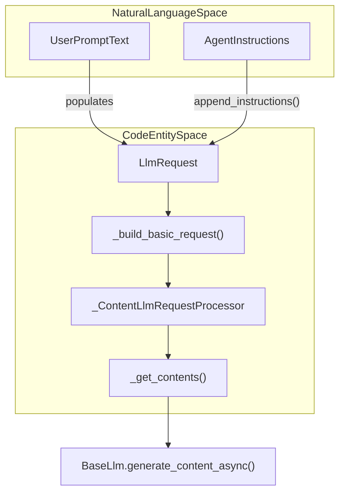
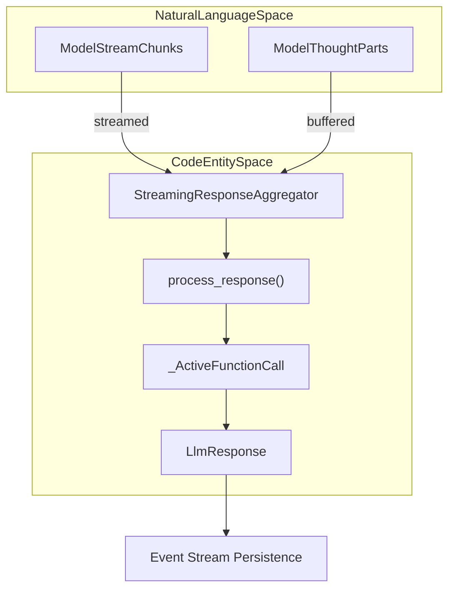

<!-- source: DeepWiki mcp.deepwiki.com · repo google/adk-python · page 6.3 Request and Response Processing · fetched 2026-10-29 -->

# Request and Response Processing

Relevant source files

The following files were used as context for generating this wiki page:

- [docs/guides/examples/example/index.md](docs/guides/examples/example/index.md)
- [src/google/adk/agents/live_request_queue.py](src/google/adk/agents/live_request_queue.py)
- [src/google/adk/agents/run_config.py](src/google/adk/agents/run_config.py)
- [src/google/adk/examples/example_util.py](src/google/adk/examples/example_util.py)
- [src/google/adk/examples/vertex_ai_example_store.py](src/google/adk/examples/vertex_ai_example_store.py)
- [src/google/adk/flows/llm_flows/basic.py](src/google/adk/flows/llm_flows/basic.py)
- [src/google/adk/flows/llm_flows/contents.py](src/google/adk/flows/llm_flows/contents.py)
- [src/google/adk/models/_service_tier.py](src/google/adk/models/_service_tier.py)
- [src/google/adk/models/base_llm_connection.py](src/google/adk/models/base_llm_connection.py)
- [src/google/adk/models/gemini_llm_connection.py](src/google/adk/models/gemini_llm_connection.py)
- [src/google/adk/models/llm_request.py](src/google/adk/models/llm_request.py)
- [src/google/adk/models/llm_response.py](src/google/adk/models/llm_response.py)
- [src/google/adk/tools/agent_tool.py](src/google/adk/tools/agent_tool.py)
- [src/google/adk/tools/base_tool.py](src/google/adk/tools/base_tool.py)
- [src/google/adk/tools/example_tool.py](src/google/adk/tools/example_tool.py)
- [src/google/adk/tools/google_search_agent_tool.py](src/google/adk/tools/google_search_agent_tool.py)
- [src/google/adk/tools/long_running_tool.py](src/google/adk/tools/long_running_tool.py)
- [src/google/adk/utils/_dependency.py](src/google/adk/utils/_dependency.py)
- [src/google/adk/utils/content_utils.py](src/google/adk/utils/content_utils.py)
- [src/google/adk/utils/streaming_utils.py](src/google/adk/utils/streaming_utils.py)
- [tests/integration/test_vertex_ai_search_grounding_streaming.py](tests/integration/test_vertex_ai_search_grounding_streaming.py)
- [tests/unittests/agents/test_live_request_queue.py](tests/unittests/agents/test_live_request_queue.py)
- [tests/unittests/agents/test_llm_agent_include_contents.py](tests/unittests/agents/test_llm_agent_include_contents.py)
- [tests/unittests/agents/test_run_config.py](tests/unittests/agents/test_run_config.py)
- [tests/unittests/examples/__init__.py](tests/unittests/examples/__init__.py)
- [tests/unittests/examples/test_example_util.py](tests/unittests/examples/test_example_util.py)
- [tests/unittests/examples/test_vertex_ai_example_store.py](tests/unittests/examples/test_vertex_ai_example_store.py)
- [tests/unittests/flows/llm_flows/context/test_interactions.py](tests/unittests/flows/llm_flows/context/test_interactions.py)
- [tests/unittests/flows/llm_flows/test_basic_processor.py](tests/unittests/flows/llm_flows/test_basic_processor.py)
- [tests/unittests/flows/llm_flows/test_progressive_sse_streaming.py](tests/unittests/flows/llm_flows/test_progressive_sse_streaming.py)
- [tests/unittests/models/test_fallback_model.py](tests/unittests/models/test_fallback_model.py)
- [tests/unittests/models/test_gemini_llm_connection.py](tests/unittests/models/test_gemini_llm_connection.py)
- [tests/unittests/models/test_llm_request.py](tests/unittests/models/test_llm_request.py)
- [tests/unittests/models/test_llm_response.py](tests/unittests/models/test_llm_response.py)
- [tests/unittests/streaming/test_live_streaming_configs.py](tests/unittests/streaming/test_live_streaming_configs.py)
- [tests/unittests/tools/test_agent_tool.py](tests/unittests/tools/test_agent_tool.py)
- [tests/unittests/tools/test_base_tool.py](tests/unittests/tools/test_base_tool.py)
- [tests/unittests/tools/test_example_tool.py](tests/unittests/tools/test_example_tool.py)
- [tests/unittests/tools/test_google_search_agent_tool.py](tests/unittests/tools/test_google_search_agent_tool.py)
- [tests/unittests/tools/test_long_running_tool.py](tests/unittests/tools/test_long_running_tool.py)
- [tests/unittests/utils/test_content_utils.py](tests/unittests/utils/test_content_utils.py)
- [tests/unittests/utils/test_dependency.py](tests/unittests/utils/test_dependency.py)
- [tests/unittests/utils/test_streaming_utils.py](tests/unittests/utils/test_streaming_utils.py)

This page documents the request and response processing layer that translates between ADK's canonical types (`LlmRequest` and `LlmResponse`) and provider-specific wire formats [src/google/adk/models/llm_request.py:52-105](). This layer enables ADK to support multiple LLM providers uniformly while handling complex context construction, instruction injection, tool-call rearranging, structured output wrapping, and streaming aggregation.

**Scope**: Covers `LlmRequest` structure, `LlmResponse` fields, the `_ContentLlmRequestProcessor` content conversion pipeline [src/google/adk/flows/llm_flows/contents.py:29-29](), history management, tool-call rearranging utilities (`drop_orphaned_function_calls`, `_drop_orphaned_function_responses`) [src/google/adk/flows/llm_flows/contents.py:49-52](), basic request building via `_build_basic_request()` [src/google/adk/flows/llm_flows/basic.py:92-104](), and streaming aggregation via `StreamingResponseAggregator` [src/google/adk/utils/streaming_utils.py:170-176]().

Sources: [src/google/adk/models/llm_request.py:52-110](), [src/google/adk/flows/llm_flows/contents.py:15-53](), [src/google/adk/flows/llm_flows/basic.py:92-104](), [src/google/adk/utils/streaming_utils.py:170-176]()

---

## Overview and Canonical Data Structures

ADK relies on canonical request and response representations built on top of `google.genai.types` (`Content`, `Part`, `GenerateContentConfig`) [src/google/adk/models/llm_request.py:21-25](). Providers translate these canonical structures into their respective API payloads.

### LlmRequest
`LlmRequest` encapsulates all parameters required for an LLM invocation.

| Field | Type | Description |
|-------|------|-------------|
| `model` | `str \| None` | Target model name/identifier [src/google/adk/models/llm_request.py:69-70]() |
| `contents` | `list[types.Content]` | Conversation history and current turn inputs [src/google/adk/models/llm_request.py:72-73]() |
| `config` | `types.GenerateContentConfig` | Generation configuration parameters [src/google/adk/models/llm_request.py:75-77]() |
| `live_connect_config` | `types.LiveConnectConfig` | Configuration settings for real-time live sessions [src/google/adk/models/llm_request.py:78-80]() |
| `tools_dict` | `dict[str, BaseTool]` | Mapped dictionary of tool instances available to the request [src/google/adk/models/llm_request.py:85-86]() |
| `cache_config` | `ContextCacheConfig \| None` | Context caching configuration rules [src/google/adk/models/llm_request.py:88-89]() |
| `cache_metadata` | `CacheMetadata \| None` | Metadata from previous turns for cache tracking [src/google/adk/models/llm_request.py:91-92]() |
| `previous_interaction_id` | `str \| None` | ID chaining state across stateful interactions API turns [src/google/adk/models/llm_request.py:97-103]() |
| `service_tier` | `ServiceTier \| str \| None` | Serving tier configuration [src/google/adk/models/llm_request.py:105-110]() |

Sources: [src/google/adk/models/llm_request.py:52-110]()

### LlmResponse
`LlmResponse` standardizes model outputs across backends, capturing text, tool calls, metadata, and streaming states.

| Field | Type | Description |
|-------|------|-------------|
| `content` | `types.Content \| None` | Generative content emitted by the model [src/google/adk/models/llm_response.py:62-67]() |
| `grounding_metadata` | `types.GroundingMetadata \| None` | Grounding and search metadata [src/google/adk/models/llm_response.py:69-70]() |
| `partial` | `bool \| None` | Incomplete fragment flag for streaming modes [src/google/adk/models/llm_response.py:72-83]() |
| `turn_complete` | `bool \| None` | Indicates turn completion status [src/google/adk/models/llm_response.py:85-89]() |
| `finish_reason` | `types.FinishReason \| None` | Reason for completion or termination [src/google/adk/models/llm_response.py:117-118]() |
| `error_code` | `str \| None` | Error code if invocation failed [src/google/adk/models/llm_response.py:120-121]() |
| `error_message` | `str \| None` | Error description if invocation failed [src/google/adk/models/llm_response.py:123-124]() |
| `cache_metadata` | `CacheMetadata \| None` | Context caching metrics and metadata [src/google/adk/models/llm_response.py:168-173]() |

Sources: [src/google/adk/models/llm_response.py:29-174]()

---

## Request Processing Pipeline

The request processing pipeline converts session history, system instructions, and registered tools into structured `LlmRequest` items via processors such as `_ContentLlmRequestProcessor` [src/google/adk/flows/llm_flows/contents.py:29-29]() and `_build_basic_request()` [src/google/adk/flows/llm_flows/basic.py:92-104]().

### Data Flow & Request Space Mapping

Title: "Request Processing Pipeline Data Flow"

Sources: [src/google/adk/models/llm_request.py:72-110](), [src/google/adk/flows/llm_flows/contents.py:29-31](), [src/google/adk/flows/llm_flows/basic.py:92-104]()

### History Selection and Content Filtering
The `_ContentLlmRequestProcessor` filters session event logs to build context [src/google/adk/flows/llm_flows/contents.py:29-29](). It pulls conversation history via `_get_contents()` or isolated turn messages via `_get_current_turn_contents()` [src/google/adk/flows/llm_flows/contents.py:31-32](). Request-scoped fields are copied safely using `_copy_request_scoped_fields()` in basic flows to prevent cross-invocation mutation [src/google/adk/flows/llm_flows/basic.py:63-90]().

Sources: [src/google/adk/flows/llm_flows/contents.py:23-46](), [src/google/adk/flows/llm_flows/basic.py:63-90]()

---

## Tool-Call Rearranging and History Management

Different model providers enforce strict structural rules regarding tool calls and function responses in conversation histories.

### Tool-Call Rearranging
ADK provides utilities in `_rearranger` to correct disordered or orphaned records:
- `drop_orphaned_function_calls`: Removes function calls that lack matching execution responses [src/google/adk/flows/llm_flows/contents.py:52-52]().
- `_drop_orphaned_function_responses`: Cleans out unpaired responses [src/google/adk/flows/llm_flows/contents.py:49-49]().
- `_rearrange_events_for_latest_function_response` / `_rearrange_events_for_async_function_responses_in_history`: Reorders execution events to align with asynchronous completion semantics [src/google/adk/flows/llm_flows/contents.py:50-51]().

Sources: [src/google/adk/flows/llm_flows/contents.py:49-52]()

---

## Streaming Response Aggregation and Type Mapping

ADK normalizes raw streaming chunks and wire responses into uniform `LlmResponse` instances using `StreamingResponseAggregator` [src/google/adk/utils/streaming_utils.py:170-176]().

### Streaming Aggregation Space Mapping

Title: "Streaming Aggregation Space Mapping"

Sources: [src/google/adk/utils/streaming_utils.py:170-210](), [src/google/adk/models/llm_response.py:29-73]()

### Response Mapping and Normalization
The aggregator handles progressive SSE streaming, buffering consecutive text and thought segments while retaining thought signatures required by reasoning models [src/google/adk/utils/streaming_utils.py:187-210](). It tracks active function calls across chunks to construct fully populated tool execution requests before passing them to the agent execution engine [src/google/adk/utils/streaming_utils.py:194-196]().

Sources: [src/google/adk/utils/streaming_utils.py:170-210]()

---

