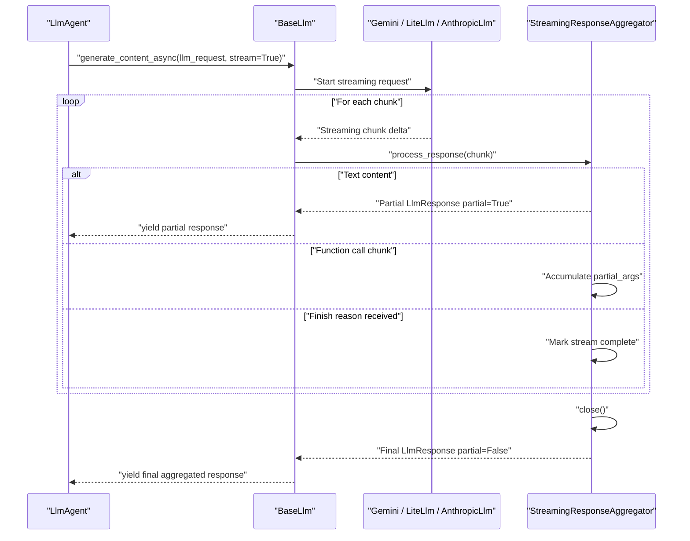
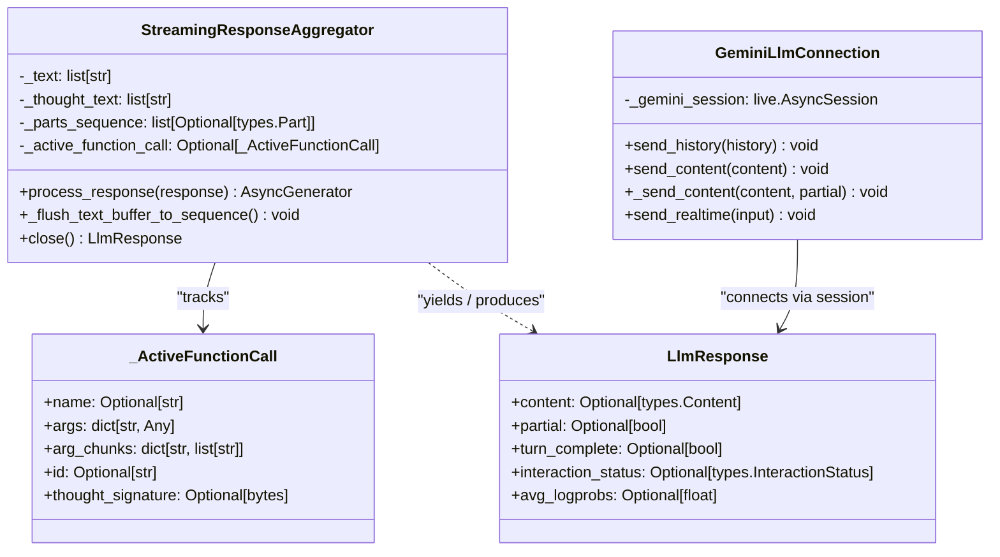

<!-- source: DeepWiki mcp.deepwiki.com · repo google/adk-python · page 6.4 Streaming and Response Handling · fetched 2026-10-29 -->

# Streaming and Response Handling

<details>
<summary>Relevant source files</summary>

The following files were used as context for generating this wiki page:

- [src/google/adk/agents/live_request_queue.py](src/google/adk/agents/live_request_queue.py)
- [src/google/adk/agents/run_config.py](src/google/adk/agents/run_config.py)
- [src/google/adk/flows/llm_flows/basic.py](src/google/adk/flows/llm_flows/basic.py)
- [src/google/adk/flows/llm_flows/contents.py](src/google/adk/flows/llm_flows/contents.py)
- [src/google/adk/models/_service_tier.py](src/google/adk/models/_service_tier.py)
- [src/google/adk/models/base_llm_connection.py](src/google/adk/models/base_llm_connection.py)
- [src/google/adk/models/gemini_llm_connection.py](src/google/adk/models/gemini_llm_connection.py)
- [src/google/adk/models/llm_response.py](src/google/adk/models/llm_response.py)
- [src/google/adk/utils/streaming_utils.py](src/google/adk/utils/streaming_utils.py)
- [tests/integration/test_vertex_ai_search_grounding_streaming.py](tests/integration/test_vertex_ai_search_grounding_streaming.py)
- [tests/unittests/agents/test_live_request_queue.py](tests/unittests/agents/test_live_request_queue.py)
- [tests/unittests/agents/test_llm_agent_include_contents.py](tests/unittests/agents/test_llm_agent_include_contents.py)
- [tests/unittests/agents/test_run_config.py](tests/unittests/agents/test_run_config.py)
- [tests/unittests/flows/llm_flows/context/test_interactions.py](tests/unittests/flows/llm_flows/context/test_interactions.py)
- [tests/unittests/flows/llm_flows/test_basic_processor.py](tests/unittests/flows/llm_flows/test_basic_processor.py)
- [tests/unittests/flows/llm_flows/test_progressive_sse_streaming.py](tests/unittests/flows/llm_flows/test_progressive_sse_streaming.py)
- [tests/unittests/models/test_fallback_model.py](tests/unittests/models/test_fallback_model.py)
- [tests/unittests/models/test_gemini_llm_connection.py](tests/unittests/models/test_gemini_llm_connection.py)
- [tests/unittests/models/test_llm_response.py](tests/unittests/models/test_llm_response.py)
- [tests/unittests/streaming/test_live_streaming_configs.py](tests/unittests/streaming/test_live_streaming_configs.py)
- [tests/unittests/utils/test_streaming_utils.py](tests/unittests/utils/test_streaming_utils.py)

</details>


This page documents how the ADK handles streaming and non-streaming responses from LLM providers, including response aggregation, partial event processing, progressive SSE streaming, and specialized handling for live multimodal interactions via connection managers and `StreamingResponseAggregator`.

Sources: `[src/google/adk/models/llm_response.py:29-184]`, `[src/google/adk/utils/streaming_utils.py:170-208]`

## Streaming Architecture Overview

All LLM providers in ADK implement an async generator pattern for streaming responses through `BaseLlm.generate_content_async`. The `stream` parameter determines whether responses are yielded incrementally or returned as a single aggregated response.

### Streaming Modes
The `StreamingMode` enum defines different streaming behaviors for how the agent returns events as model responses:
- **`NONE`**: Non-streaming mode (default). Returns one single content in a turn with no intermediate partial events.
- **`SSE`**: Server-Sent Events mode. Progressively yields events as the LLM generates responses, including partial text chunks for typewriter effects and partial function call chunks.
- **`BIDI`**: Bidirectional streaming mode used for real-time interactions via `Runner.run_live()`.

Sources: `[src/google/adk/agents/run_config.py:153-154]`

### Progressive SSE Streaming Flow
When progressive SSE streaming is active, `StreamingResponseAggregator` preserves original part ordering and handles streaming of function call arguments across chunks.

Title: ADK Streaming Data Flow (`BaseLlm` to `StreamingResponseAggregator`)

Sources: `[src/google/adk/utils/streaming_utils.py:170-208]`, `[src/google/adk/agents/run_config.py:145-147]`

## LlmResponse Structure

The `LlmResponse` class represents both partial streaming fragments and complete responses from LLM providers `[src/google/adk/models/llm_response.py:29-50]`.

| Field | Type | Description |
|-------|------|-------------|
| `content` | `types.Content` | The generative content of the response `[src/google/adk/models/llm_response.py:62-67]` |
| `usage_metadata` | `types.GenerateContentResponseUsageMetadata` | Token counts and usage metrics `[src/google/adk/models/llm_response.py:139-140]` |
| `partial` | `bool` | Marks this response as an incomplete fragment of a larger response. Only used in streaming mode `[src/google/adk/models/llm_response.py:72-83]` |
| `turn_complete` | `bool` | Indicates whether the response from the model is complete. Only used for streaming mode `[src/google/adk/models/llm_response.py:85-89]` |
| `interaction_status` | `types.InteractionStatus` | Activity status of the live session (`IN_PROGRESS` vs `IDLE`) `[src/google/adk/models/llm_response.py:97-115]` |
| `finish_reason` | `types.FinishReason` | The finish reason of the response `[src/google/adk/models/llm_response.py:117-118]` |
| `avg_logprobs` | `float` | Average log probability of the generated tokens `[src/google/adk/models/llm_response.py:162-163]` |
| `logprobs_result` | `types.LogprobsResult` | Detailed log probabilities for chosen and top candidate tokens `[src/google/adk/models/llm_response.py:165-166]` |
| `input_transcription` | `types.Transcription` | Audio transcription of user input `[src/google/adk/models/llm_response.py:156-157]` |
| `output_transcription`| `types.Transcription` | Audio transcription of model output `[src/google/adk/models/llm_response.py:159-160]` |
| `grounding_metadata` | `types.GroundingMetadata` | The grounding metadata of the response `[src/google/adk/models/llm_response.py:69-70]` |
| `citation_metadata` | `types.CitationMetadata` | Citation metadata for the response `[src/google/adk/models/llm_response.py:175-178]` |

Sources: `[src/google/adk/models/llm_response.py:29-184]`

## Response Aggregation and Code Entity Mapping

### StreamingResponseAggregator Internals
The `StreamingResponseAggregator` class processes streaming chunks and manages aggregation `[src/google/adk/utils/streaming_utils.py:170-187]`. It aggregates content from partial responses and generates `LlmResponse` objects for individual (partial) model responses, as well as for aggregated content.

**Core Aggregation Mechanics:**
1. **Text Accumulation**: Regular text and thought content chunks are buffered into `_text` and `_thought_text` lists `[src/google/adk/utils/streaming_utils.py:178-179]`.
2. **Part Sequencing**: Preserves strict ordering in `_parts_sequence` for progressive SSE streaming `[src/google/adk/utils/streaming_utils.py:187-188]`.
3. **Buffer Flushing**: `_flush_text_buffer_to_sequence` merges consecutive text or thought parts while retaining thought signatures `[src/google/adk/utils/streaming_utils.py:197-210]`.
4. **Function Call Argument Streaming**: Accumulates incremental argument chunks via `_active_function_call` `[src/google/adk/utils/streaming_utils.py:194-195]`. The `_ActiveFunctionCall` class tracks the name, arguments, argument chunks, ID, thought signature, and sequence index of an in-flight streaming function call `[src/google/adk/utils/streaming_utils.py:158-168]`.
5. **JSON Path Utilities**: Helper functions like `_parse_json_path`, `_get_value_by_json_path`, and `_set_value_by_json_path` navigate and modify nested JSON structures for streaming function call arguments `[src/google/adk/utils/streaming_utils.py:60-156]`.

Title: Code Entity Space for Streaming Infrastructure (`StreamingResponseAggregator` and `GeminiLlmConnection`)

Sources: `[src/google/adk/utils/streaming_utils.py:60-210]`, `[src/google/adk/models/gemini_llm_connection.py:44-183]`

## Real-time and Multimodal Handling

For live streaming (BIDI), `LiveRequestQueue` handles bidirectional interaction with the underlying model. The `GeminiLlmConnection` class manages asynchronous sessions with the Gemini Live API, implementing `send_history`, `send_content`, and `send_realtime` to support audio, video, and text streams `[src/google/adk/models/gemini_llm_connection.py:44-183]`.

### Live Request Processing Flow
- `send_content`: Sends `types.Content` to the model, supporting partial updates via `_send_content(content, partial=True)` `[src/google/adk/models/gemini_llm_connection.py:120-170]`.
- `send_realtime`: Sends binary `types.Blob` data (audio/video chunks) to the active session `[src/google/adk/models/gemini_llm_connection.py:171-183]`.
- `send_history`: Replays historical conversation turns to establish context upon session initialization or agent transfer `[src/google/adk/models/gemini_llm_connection.py:65-119]`.

Title: Natural Language Space to Code Entity Space (`Runner` to `GeminiLlmConnection`)
```mermaid
graph TD
    subgraph "NaturalLanguageSpace"
        User["User Voice/Text Input"]
        LiveAgent["Live Multimodal Agent"]
    end

    subgraph "CodeEntitySpace"
        Runner["Runner.run_live()"]
        Connection["GeminiLlmConnection"]
        Session["live.AsyncSession"]
        Aggregator["StreamingResponseAggregator"]
        Response["LlmResponse"]
    end

    User -->| "stream input audio/text" | Runner
    Runner -->| "delegates to" | Connection
    Connection -->| "send_realtime / send_content" | Session
    Session -->| "yields chunks" | Aggregator
    Aggregator -->| "aggregate / partial" | Response
    Response -->| "yield transcriptions/content" | Runner
```
Sources: `[src/google/adk/models/gemini_llm_connection.py:44-183]`, `[src/google/adk/utils/streaming_utils.py:170-210]`

## Grounding and Metadata Preservation

`StreamingResponseAggregator` aggregates grounding, citation, and usage metadata across streaming fragments to ensure they appear on the final non-partial `LlmResponse` `[src/google/adk/utils/streaming_utils.py:170-186]`. Additionally, `LlmResponse` parsing extracts `avg_logprobs` and `logprobs_result` directly from provider candidates `[src/google/adk/models/llm_response.py:162-166]`. This ensures that even with streaming, the final aggregated response contains complete metadata.

Sources: `[src/google/adk/utils/streaming_utils.py:170-186]`, `[src/google/adk/models/llm_response.py:162-166]`

---

