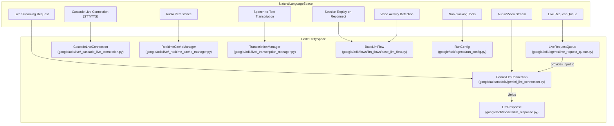
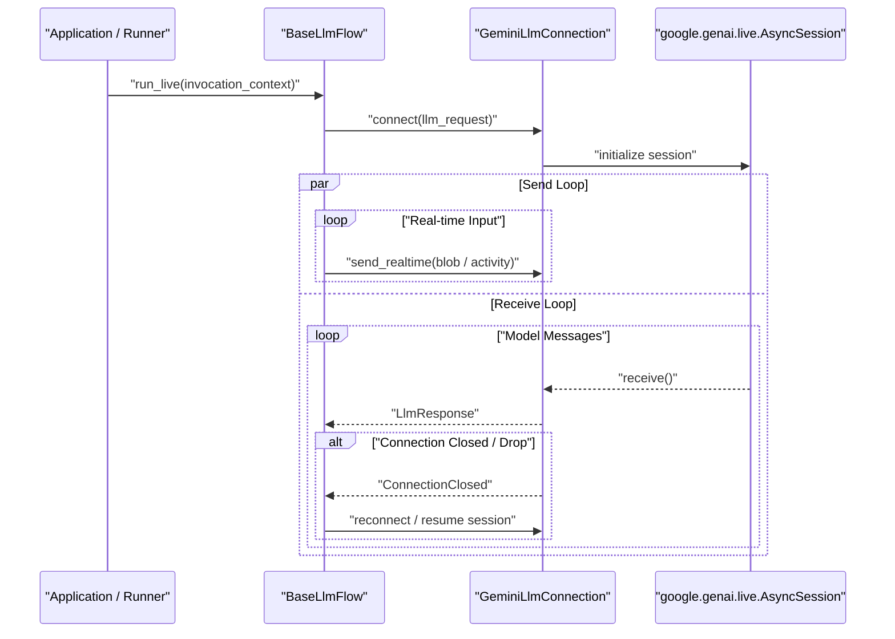
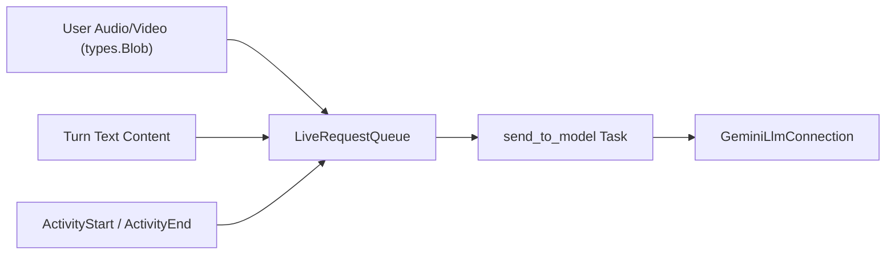

<!-- source: DeepWiki mcp.deepwiki.com · repo google/adk-python · page 6.5 Live Streaming and Real-time Interactions · fetched 2026-10-29 -->

# Live Streaming and Real-time Interactions

Relevant source files

The following files were used as context for generating this wiki page:

- [src/google/adk/cli/utils/envs.py](src/google/adk/cli/utils/envs.py)
- [src/google/adk/flows/llm_flows/audio_cache_manager.py](src/google/adk/flows/llm_flows/audio_cache_manager.py)
- [src/google/adk/flows/llm_flows/audio_transcriber.py](src/google/adk/flows/llm_flows/audio_transcriber.py)
- [src/google/adk/flows/llm_flows/base_llm_flow.py](src/google/adk/flows/llm_flows/base_llm_flow.py)
- [src/google/adk/flows/llm_flows/single_flow.py](src/google/adk/flows/llm_flows/single_flow.py)
- [src/google/adk/flows/llm_flows/tools/_live_caller.py](src/google/adk/flows/llm_flows/tools/_live_caller.py)
- [src/google/adk/flows/llm_flows/transcription_manager.py](src/google/adk/flows/llm_flows/transcription_manager.py)
- [src/google/adk/live/_audio_transcriber.py](src/google/adk/live/_audio_transcriber.py)
- [src/google/adk/live/_cascade_live_connection.py](src/google/adk/live/_cascade_live_connection.py)
- [src/google/adk/live/_flow_utils.py](src/google/adk/live/_flow_utils.py)
- [src/google/adk/live/_live_llm_flow.py](src/google/adk/live/_live_llm_flow.py)
- [src/google/adk/live/_runner_utils.py](src/google/adk/live/_runner_utils.py)
- [src/google/adk/live/_transcription_manager.py](src/google/adk/live/_transcription_manager.py)
- [src/google/adk/live/live_request_queue.py](src/google/adk/live/live_request_queue.py)
- [src/google/adk/utils/_gcp_metadata.py](src/google/adk/utils/_gcp_metadata.py)
- [tests/unittests/auth/test_toolset_auth.py](tests/unittests/auth/test_toolset_auth.py)
- [tests/unittests/cli/utils/test_envs.py](tests/unittests/cli/utils/test_envs.py)
- [tests/unittests/flows/llm_flows/test_audio_cache_manager.py](tests/unittests/flows/llm_flows/test_audio_cache_manager.py)
- [tests/unittests/flows/llm_flows/test_audio_transcriber.py](tests/unittests/flows/llm_flows/test_audio_transcriber.py)
- [tests/unittests/flows/llm_flows/test_base_llm_flow.py](tests/unittests/flows/llm_flows/test_base_llm_flow.py)
- [tests/unittests/flows/llm_flows/test_base_llm_flow_realtime.py](tests/unittests/flows/llm_flows/test_base_llm_flow_realtime.py)
- [tests/unittests/flows/llm_flows/test_live_model_callbacks.py](tests/unittests/flows/llm_flows/test_live_model_callbacks.py)
- [tests/unittests/flows/llm_flows/test_transcription_manager.py](tests/unittests/flows/llm_flows/test_transcription_manager.py)
- [tests/unittests/flows/llm_flows/tools/test_live_caller.py](tests/unittests/flows/llm_flows/tools/test_live_caller.py)
- [tests/unittests/live/test__runner_utils.py](tests/unittests/live/test__runner_utils.py)
- [tests/unittests/live/test_cascade_live_connection.py](tests/unittests/live/test_cascade_live_connection.py)
- [tests/unittests/live/test_live_llm_flow.py](tests/unittests/live/test_live_llm_flow.py)
- [tests/unittests/live/test_live_request_queue.py](tests/unittests/live/test_live_request_queue.py)
- [tests/unittests/streaming/test_live_tool_shutdown.py](tests/unittests/streaming/test_live_tool_shutdown.py)
- [tests/unittests/streaming/test_streaming.py](tests/unittests/streaming/test_streaming.py)
- [tests/unittests/streaming/test_streaming_audio_storage.py](tests/unittests/streaming/test_streaming_audio_storage.py)
- [tests/unittests/utils/test_gcp_metadata.py](tests/unittests/utils/test_gcp_metadata.py)

This document describes the ADK's Live API integration for real-time bidirectional streaming with LLM models. The Live API enables continuous audio/video input, real-time transcription, and streaming responses while maintaining the ability to execute function calls, handle Voice Activity Detection (VAD) events, and support session replay on reconnect.

Sources: `[src/google/adk/flows/llm_flows/base_llm_flow.py:92-131](), [src/google/adk/live/_live_llm_flow.py:15-59]()`

## Overview

The ADK provides live streaming capabilities primarily through the Gemini model's Live API via `GeminiLlmConnection` [src/google/adk/models/gemini_llm_connection.py:44-70](). This enables real-time interactions where audio/video input streams continuously to the model while receiving streaming text, audio, and transcription responses concurrently. Live streaming maintains a persistent bidirectional connection using `live.AsyncSession` [src/google/adk/models/gemini_llm_connection.py:47-53]().

**Key Characteristics:**
- **Persistent Connection**: WebSocket-based connection abstracted in the connection layer via `BaseLlmConnection` [src/google/adk/models/base_llm_connection.py:1-40]().
- **Real-time Media**: Processing via `types.Blob` and `LiveRequest` for audio/video chunks [src/google/adk/agents/live_request_queue.py:15-25]().
- **Transcription**: Real-time input and output transcription tracking via `TranscriptionManager` [src/google/adk/live/_transcription_manager.py:1-35]() (with backward compatibility in [src/google/adk/flows/llm_flows/audio_transcriber.py:1-33]() and [src/google/adk/flows/llm_flows/transcription_manager.py:1-34]()).
- **Audio Caching**: Automatic persistence of live audio streams to artifact storage using `RealtimeCacheManager` (formerly `AudioCacheManager`) [src/google/adk/live/_audio_cache_manager.py:1-37]().
- **Cascade Live Connection**: Multi-modal STT/TTS cascading connections for intermediate audio processing [src/google/adk/live/_cascade_live_connection.py:1-50]().
- **Session Replay on Reconnect**: Automatic resynchronization and state recovery when WebSocket connections drop or reconnect, managed by `_ReconnectMode` and `_ReconnectSentinel` [src/google/adk/live/_flow_utils.py:1-60]().
- **VAD Events**: Voice Activity Detection (VAD) activity signals managed through `LiveRequestQueue` and model connection layers [src/google/adk/agents/run_config.py:158-163]().
- **Non-blocking Tools**: Background tool tasks executed concurrently without halting the real-time stream via active tool registries [src/google/adk/flows/llm_flows/base_llm_flow.py:128-135]().

Sources: `[src/google/adk/models/gemini_llm_connection.py:44-70](), [src/google/adk/models/base_llm_connection.py:1-40](), [src/google/adk/agents/live_request_queue.py:15-25](), [src/google/adk/live/_transcription_manager.py:1-35](), [src/google/adk/flows/llm_flows/audio_transcriber.py:1-33](), [src/google/adk/flows/llm_flows/transcription_manager.py:1-34](), [src/google/adk/live/_audio_cache_manager.py:1-37](), [src/google/adk/live/_cascade_live_connection.py:1-50](), [src/google/adk/live/_flow_utils.py:1-60](), [src/google/adk/agents/run_config.py:158-163](), [src/google/adk/flows/llm_flows/base_llm_flow.py:128-135]()`

## Architecture and Natural Language to Code Entity Mapping

The following diagram bridges the Natural Language concepts of live streaming to the specific Code Entities in the ADK repository.

### System Architecture to Code Entity Mapping

**Component Responsibilities:**

| Component | Purpose | Key Methods / Attributes |
|-----------|---------|-------------|
| `LiveRequestQueue` | Thread-safe queue for incoming user media, text, and VAD signals. | `get()`, `send()`, `close()` `[src/google/adk/agents/live_request_queue.py:15-25](), [src/google/adk/live/live_request_queue.py:1-25]()` |
| `GeminiLlmConnection` | Manages the bidirectional session with the Gemini Live API. | `send_realtime()`, `send_content()`, `send_history()` `[src/google/adk/models/gemini_llm_connection.py:65-174]()` |
| `CascadeLiveConnection` | Orchestrates cascaded speech-to-text and text-to-speech pipelines. | `send_realtime()`, `receive()` `[src/google/adk/live/_cascade_live_connection.py:20-80]()` |
| `RealtimeCacheManager` | Handles buffering and flushing live audio to artifact storage. | `cache_blob()`, `flush_caches()` `[src/google/adk/live/_audio_cache_manager.py:1-37](), [src/google/adk/live/_realtime_cache_manager.py:1-50]()` |
| `TranscriptionManager` | Manages real-time input and output transcription state for the session. | `handle_input_transcription()`, `handle_output_transcription()` `[src/google/adk/live/_transcription_manager.py:1-35]()` |
| `BaseLlmFlow` | Coordinates bidirectional loop, reconnection modes, and background tool tasks. | `_request_processor_lists()` `[src/google/adk/flows/llm_flows/base_llm_flow.py:130-135]()` |

Sources: `[src/google/adk/agents/live_request_queue.py:15-25](), [src/google/adk/models/gemini_llm_connection.py:65-174](), [src/google/adk/live/_cascade_live_connection.py:20-80](), [src/google/adk/live/_audio_cache_manager.py:1-37](), [src/google/adk/live/_transcription_manager.py:1-35](), [src/google/adk/flows/llm_flows/base_llm_flow.py:130-135]()`

## Live Connection Lifecycle and Session Resumption

The live interaction lifecycle establishes a persistent session and manages concurrent send/receive loops. When network disconnects occur, ADK supports reconnection modes (`RESUME` vs `RESTART`) using internal sentinel handlers [src/google/adk/live/_flow_utils.py:1-60]().

**Connection, Reconnection & Resumption Details:**
- **Initialization**: The flow establishes an asynchronous connection using `GeminiLlmConnection` [src/google/adk/models/gemini_llm_connection.py:44-70]().
- **Session Resumption**: Handles `LiveServerSessionResumptionUpdate` payloads to issue new session handles and maintain continuous dialog state across disconnects [tests/unittests/live/test_live_llm_flow.py:90-111]().
- **History Replay**: Previous session history is transmitted via `send_history()` to establish context upon connection or agent transfer [src/google/adk/models/gemini_llm_connection.py:65-119]().
- **Reconnect Handling**: Internal sentinels (`_ReconnectSentinel`) manage silent reconnection requests within the flow pipeline [src/google/adk/live/_flow_utils.py:1-60]().

Sources: `[src/google/adk/models/gemini_llm_connection.py:44-119](), [src/google/adk/live/_flow_utils.py:1-60](), [src/google/adk/live/_runner_utils.py:183-198](), [tests/unittests/live/test_live_llm_flow.py:90-111]()`

## LiveRequestQueue and Audio/Video Streaming

The `LiveRequestQueue` acts as the thread-safe ingestion buffer for media blobs, text contents, and activity signals [src/google/adk/agents/live_request_queue.py:15-25]().

- **Streaming Media**: Audio and video chunks are transmitted via `send_realtime()` on the underlying `GeminiLlmConnection` model connection [src/google/adk/models/gemini_llm_connection.py:169-181]().
- **Blob Handling**: Large binary objects like audio PCM or image data are sent without logging heavy debug payloads [src/google/adk/models/gemini_llm_connection.py:175-181]().
- **Queue Consumption**: Handled via `send_to_model` in [src/google/adk/live/_live_llm_flow.py:91-148](), which duplicates items to active background tools and relays them to the LLM connection.

Sources: `[src/google/adk/agents/live_request_queue.py:15-25](), [src/google/adk/models/gemini_llm_connection.py:169-181](), [src/google/adk/live/_live_llm_flow.py:91-148]()`

## Audio Cache and Transcription Managers

Real-time audio streams and transcriptions are managed via dedicated background handlers to ensure historical persistence and UI synchronization.

- **Audio Caching**: `RealtimeCacheManager` buffers live input and output audio chunks into `RealtimeCacheEntry` records within the invocation context [src/google/adk/live/_audio_cache_manager.py:1-37](), [src/google/adk/live/_realtime_cache_manager.py:1-50](). Upon turn completion or session teardown, cached buffers are flushed to artifact storage [src/google/adk/live/_realtime_cache_manager.py:51-120]().
- **Transcription Management**: `TranscriptionManager` captures input and output streaming transcripts from the model connection and commits corresponding transcription events [src/google/adk/live/_transcription_manager.py:1-35]().

Sources: `[src/google/adk/live/_audio_cache_manager.py:1-37](), [src/google/adk/live/_realtime_cache_manager.py:1-120](), [src/google/adk/live/_transcription_manager.py:1-35]()`

## Voice Activity Detection (VAD) Events

Voice Activity Detection (VAD) governs how the model detects when a user starts and stops speaking during live streaming sessions.

- **Configuration**: Explicit VAD signals and configuration settings are established through `RunConfig` fields such as `explicit_vad_signal`, `realtime_input_config`, and `input_audio_transcription` [src/google/adk/agents/run_config.py:145-165]().
- **Activity Signals**: System state interprets `types.ActivityStart` and `types.ActivityEnd` events to mark speech boundaries during real-time interactions [src/google/adk/models/gemini_llm_connection.py:65-174](), with tests verifying proper voice activity emission in [tests/unittests/live/test_live_llm_flow.py:108-132]().

Sources: `[src/google/adk/agents/run_config.py:145-165](), [src/google/adk/models/gemini_llm_connection.py:65-174](), [tests/unittests/live/test_live_llm_flow.py:108-132]()`

## Non-blocking Tools and Live Execution

During live sessions, tool executions can run asynchronously to prevent blocking the real-time interaction stream.

- **Thread Pool Configuration**: Tool execution parameters can be controlled via `ToolThreadPoolConfig` inside `RunConfig` to manage concurrency limits for synchronous function tools [src/google/adk/agents/run_config.py:55-74]().
- **Task Cleanup**: Background tasks associated with streaming tools or agent handoffs are safely cancelled and drained upon completion or connection teardown via `stop_background_tool_tasks` [src/google/adk/live/_flow_utils.py:1-60](), [tests/unittests/streaming/test_live_tool_shutdown.py:1-199]().

Sources: `[src/google/adk/agents/run_config.py:55-74](), [src/google/adk/live/_flow_utils.py:1-60](), [tests/unittests/streaming/test_live_tool_shutdown.py:1-199]()`

---

